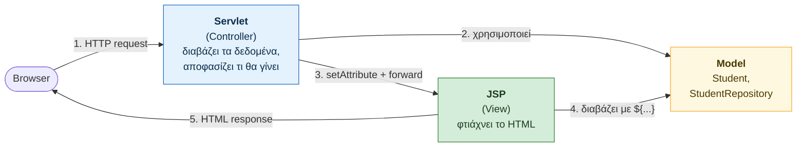
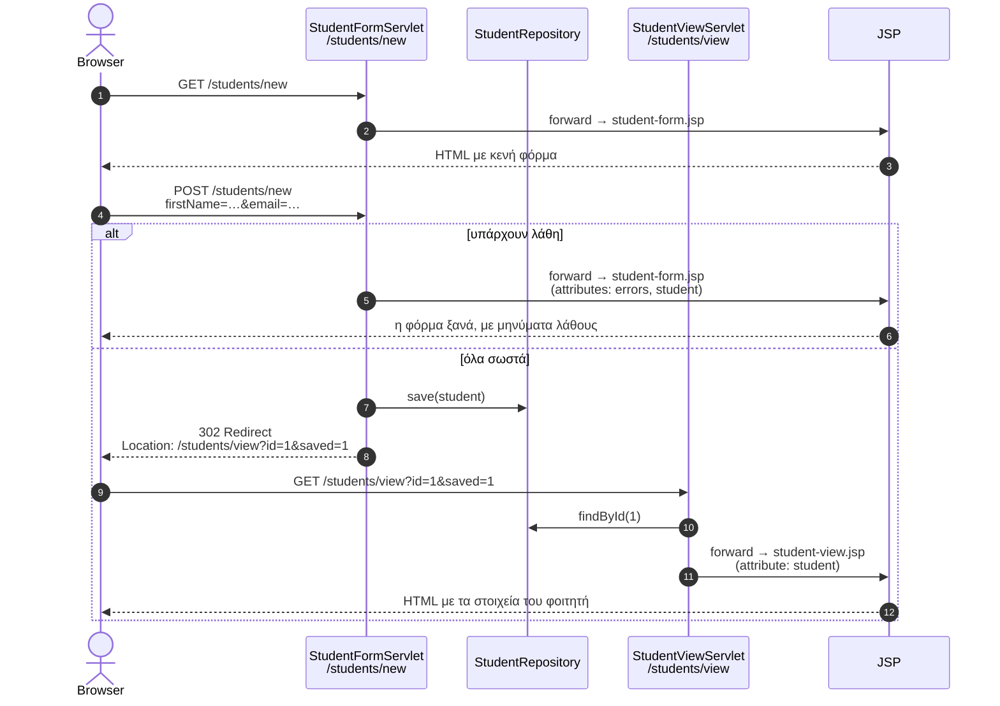

# Φόρμες με Servlets και JSP

Οδηγός βήμα‑βήμα: φτιάχνουμε μια φόρμα που δημιουργεί έναν **φοιτητή**, τον αποθηκεύει (προς το παρόν **στη μνήμη**)
και μετά τον εμφανίζει σε μια σελίδα. Στην πορεία βλέπουμε:

- τι είναι οι **JSP σελίδες** και πώς συνεργάζονται με τα **Servlets**,
- πώς εμφανίζουμε μια **HTML φόρμα** και πώς **διαβάζουμε τα δεδομένα** της στον server,
- πώς ελέγχουμε τα δεδομένα (**validation**) και ξαναδείχνουμε τη φόρμα με μηνύματα λάθους,
- πού μπαίνουν τα **στατικά αρχεία** (CSS, εικόνες) και πώς τα συνδέουμε στο HTML.

> **Προαπαιτούμενα:** Έχετε ολοκληρώσει το [README.md](README.md) (Μέρος Β), δηλαδή έχετε το project `webapp1`
> που τρέχει με `mvn jetty:run` ή σε Tomcat 10.1+/11.
## Περιεχόμενα

- [0. Τι θα φτιάξουμε](#0-τι-θα-φτιάξουμε)
- [1. Ρύθμιση του project: pom.xml και web.xml](#1-ρύθμιση-του-project-pomxml-και-webxml)
- [2. Εισαγωγή στις JSP](#2-εισαγωγή-στις-jsp)
- [3. Το model: η κλάση Student](#3-το-model-η-κλάση-student)
- [4. Αποθήκευση στη μνήμη](#4-αποθήκευση-στη-μνήμη)
- [5. Στατικά αρχεία και CSS](#5-στατικά-αρχεία-και-css)
- [6. Κοινό header και footer](#6-κοινό-header-και-footer)
- [7. Η αρχική σελίδα](#7-η-αρχική-σελίδα)
- [8. Πώς δουλεύει μια HTML φόρμα](#8-πώς-δουλεύει-μια-html-φόρμα)
- [9. Το Servlet της φόρμας](#9-το-servlet-της-φόρμας)
- [10. Η JSP της φόρμας](#10-η-jsp-της-φόρμας)
- [11. Η σελίδα του φοιτητή](#11-η-σελίδα-του-φοιτητή)
- [12. Η λίστα φοιτητών](#12-η-λίστα-φοιτητών)
- [13. Εκτέλεση και δοκιμές](#13-εκτέλεση-και-δοκιμές)
- [14. Σύνοψη: parameters, attributes, forward, redirect](#14-σύνοψη-parameters-attributes-forward-redirect)
- [Συχνά προβλήματα](#συχνά-προβλήματα)
- [Ασκήσεις](#ασκήσεις)

---

## 0. Τι θα φτιάξουμε

| URL                          | Μέθοδος | Ποιος το χειρίζεται     | Τι κάνει                                             |
|------------------------------|---------|-------------------------|------------------------------------------------------|
| `/webapp1/`                  | GET     | `index.jsp`             | αρχική σελίδα με links                               |
| `/webapp1/students/new`      | GET     | `StudentFormServlet`    | εμφανίζει την κενή φόρμα                             |
| `/webapp1/students/new`      | POST    | `StudentFormServlet`    | παίρνει τα δεδομένα, τα ελέγχει, αποθηκεύει τον φοιτητή |
| `/webapp1/students/view?id=1`| GET     | `StudentViewServlet`    | εμφανίζει έναν φοιτητή                               |
| `/webapp1/students`          | GET     | `StudentListServlet`    | λίστα με όλους τους φοιτητές                         |

Η τελική δομή του project (με `←` σημειώνονται τα νέα αρχεία και οι αλλαγές):

```
webapp1/
├── pom.xml                                   ← +JSTL
└── src/main/
    ├── java/gr/uniwa/ice/webapp1/
    │   ├── HelloServlet.java                 (από το README)
    │   ├── model/
    │   │   └── Student.java                  ← ΝΕΟ
    │   ├── repository/
    │   │   └── StudentRepository.java        ← ΝΕΟ
    │   └── web/
    │       ├── StudentFormServlet.java       ← ΝΕΟ
    │       ├── StudentViewServlet.java       ← ΝΕΟ
    │       └── StudentListServlet.java       ← ΝΕΟ
    └── webapp/
        ├── index.jsp                         ← αλλαγή
        ├── css/
        │   └── style.css                     ← ΝΕΟ
        └── WEB-INF/
            ├── web.xml                       ← +UTF-8
            └── jsp/
                ├── header.jspf               ← ΝΕΟ
                ├── footer.jspf               ← ΝΕΟ
                ├── student-form.jsp          ← ΝΕΟ
                ├── student-view.jsp          ← ΝΕΟ
                └── student-list.jsp          ← ΝΕΟ
```

---

## 1. Ρύθμιση του project: `pom.xml` και `web.xml`

Ξεκινάμε από το project `webapp1` του README και αλλάζουμε δύο αρχεία ρυθμίσεων. Σε σχέση με το README
**προστίθενται** μόνο:

- στο `pom.xml`: οι dependencies της **JSTL** (βιβλιοθήκη tags για τις JSP),
- στο `web.xml`: η κωδικοποίηση **UTF-8** για requests και responses.

Παρακάτω είναι τα **πλήρη** αρχεία, όπως πρέπει να είναι στο τέλος.

### 1.1 Το `pom.xml`

`webapp1/pom.xml`:

```xml
<project xmlns="http://maven.apache.org/POM/4.0.0"
         xmlns:xsi="http://www.w3.org/2001/XMLSchema-instance"
         xsi:schemaLocation="http://maven.apache.org/POM/4.0.0 https://maven.apache.org/xsd/maven-4.0.0.xsd">
  <modelVersion>4.0.0</modelVersion>

  <groupId>gr.uniwa.ice</groupId>
  <artifactId>webapp1</artifactId>
  <version>1.0-SNAPSHOT</version>
  <packaging>war</packaging>
  <name>webapp1 Maven Webapp</name>

  <properties>
    <!-- Έκδοση Java για την οποία γίνεται compile -->
    <maven.compiler.release>21</maven.compiler.release>
    <project.build.sourceEncoding>UTF-8</project.build.sourceEncoding>
  </properties>

  <dependencies>
    <!-- Servlet API: provided, γιατί το παρέχει ο server (Tomcat/Jetty) -->
    <dependency>
      <groupId>jakarta.servlet</groupId>
      <artifactId>jakarta.servlet-api</artifactId>
      <version>6.0.0</version>
      <scope>provided</scope>
    </dependency>

    <!-- JSTL: βιβλιοθήκη tags για τις JSP σελίδες (<c:if>, <c:forEach>, <c:out>, ...) -->
    <dependency>
      <groupId>jakarta.servlet.jsp.jstl</groupId>
      <artifactId>jakarta.servlet.jsp.jstl-api</artifactId>
      <version>3.0.2</version>
      <exclusions>
        <!-- το Expression Language (EL) το παρέχει ήδη ο server -->
        <exclusion>
          <groupId>jakarta.el</groupId>
          <artifactId>jakarta.el-api</artifactId>
        </exclusion>
      </exclusions>
    </dependency>
    <dependency>
      <groupId>org.glassfish.web</groupId>
      <artifactId>jakarta.servlet.jsp.jstl</artifactId>
      <version>3.0.1</version>
    </dependency>

    <!-- JUnit 5 για unit tests -->
    <dependency>
      <groupId>org.junit.jupiter</groupId>
      <artifactId>junit-jupiter</artifactId>
      <version>5.11.4</version>
      <scope>test</scope>
    </dependency>
  </dependencies>

  <build>
    <!-- Όνομα του παραγόμενου αρχείου: target/webapp1.war -->
    <finalName>webapp1</finalName>

    <plugins>
      <plugin>
        <groupId>org.apache.maven.plugins</groupId>
        <artifactId>maven-compiler-plugin</artifactId>
        <version>3.13.0</version>
      </plugin>
      <plugin>
        <groupId>org.apache.maven.plugins</groupId>
        <artifactId>maven-surefire-plugin</artifactId>
        <version>3.5.2</version>
      </plugin>
      <plugin>
        <groupId>org.apache.maven.plugins</groupId>
        <artifactId>maven-war-plugin</artifactId>
        <version>3.4.0</version>
      </plugin>

      <!-- Jetty: ενσωματωμένος web server για εκτέλεση με "mvn jetty:run" -->
      <plugin>
        <groupId>org.eclipse.jetty.ee10</groupId>
        <artifactId>jetty-ee10-maven-plugin</artifactId>
        <version>12.0.16</version>
        <configuration>
          <webApp>
            <contextPath>/webapp1</contextPath>
          </webApp>
        </configuration>
      </plugin>
    </plugins>
  </build>
</project>
```

Τι κάνει κάθε κομμάτι:

| Κομμάτι | Τι σημαίνει |
|---------|-------------|
| `groupId` / `artifactId` / `version` | οι «συντεταγμένες» του project (README, Μέρος Α §3) |
| `<packaging>war</packaging>` | το αποτέλεσμα του `mvn package` είναι **web εφαρμογή** (`.war`) και όχι `.jar` |
| `maven.compiler.release` | για ποια έκδοση Java γίνεται compile (21). Αν έχετε JDK 17, βάλτε `17` |
| `project.build.sourceEncoding` | τα αρχεία πηγαίου κώδικα είναι σε **UTF-8**, ώστε να δουλεύουν τα ελληνικά μέσα στα `.java` |
| `jakarta.servlet-api`, scope **`provided`** | οι κλάσεις `HttpServlet`, `HttpServletRequest` κ.λπ. Χρειάζονται για το compile, αλλά **δεν** μπαίνουν στο `.war`, γιατί τις έχει ήδη ο server |
| `jakarta.servlet.jsp.jstl-api` + `jakarta.servlet.jsp.jstl` | **νέο:** η JSTL (`<c:if>`, `<c:forEach>`, `<c:out>`, …). Το πρώτο είναι το **API** (interfaces) και το δεύτερο μια **υλοποίηση** (της Glassfish). Scope `compile` (το default), γιατί ο Tomcat **δεν** έχει JSTL, άρα πρέπει να μπουν στο `WEB-INF/lib/` του `.war` |
| `<exclusions>` → `jakarta.el-api` | **νέο:** το `jstl-api` φέρνει μαζί του (transitive) και το API του **Expression Language**. Αυτό όμως το έχει ήδη ο server, και ένα δεύτερο αντίγραφο στο `.war` μπορεί να προκαλέσει συγκρούσεις. Το εξαιρούμε |
| `junit-jupiter`, scope **`test`** | JUnit 5, μόνο για τα tests. Δεν μπαίνει στο `.war` |
| `<finalName>webapp1</finalName>` | το αρχείο θα λέγεται `target/webapp1.war`, άρα το URL θα είναι `/webapp1/` (README §9.5) |
| `maven-compiler/surefire/war-plugin` | τα plugins που κάνουν compile, τρέχουν τα tests και φτιάχνουν το `.war`. Δηλώνουμε **συγκεκριμένες εκδόσεις** ώστε το build να είναι ίδιο σε όλους τους υπολογιστές |
| `jetty-ee10-maven-plugin` | ενσωματωμένος server για `mvn jetty:run`. Το `<contextPath>` κάνει το URL ίδιο με του Tomcat (`/webapp1`) |

Ελέγξτε ότι όλα είναι σωστά:

```bash
mvn dependency:tree      # πρέπει να φαίνονται τα δύο jstl artifacts και ΟΧΙ το jakarta.el-api
mvn clean package        # BUILD SUCCESS
jar tf target/webapp1.war | grep WEB-INF/lib
```

```
WEB-INF/lib/jakarta.servlet.jsp.jstl-3.0.1.jar
WEB-INF/lib/jakarta.servlet.jsp.jstl-api-3.0.2.jar
```

> Μετά από αλλαγή στο `pom.xml`, το VS Code μπορεί να ρωτήσει αν θέλετε να ενημερωθεί το project. Απαντήστε **Yes / Always**.
> Αν δεν ρωτήσει: Command Palette (Ctrl+Shift+P) → *Java: Reload Projects*. Στο IntelliJ: κουμπί *Load Maven Changes*.

### 1.2 Το `web.xml`

`webapp1/src/main/webapp/WEB-INF/web.xml`:

```xml
<?xml version="1.0" encoding="UTF-8"?>
<web-app xmlns="https://jakarta.ee/xml/ns/jakartaee"
         xmlns:xsi="http://www.w3.org/2001/XMLSchema-instance"
         xsi:schemaLocation="https://jakarta.ee/xml/ns/jakartaee
                             https://jakarta.ee/xml/ns/jakartaee/web-app_6_0.xsd"
         version="6.0">
  <display-name>webapp1</display-name>

  <!-- Τα δεδομένα των φορμών (και οι απαντήσεις) είναι σε UTF-8, ώστε να δουλεύουν τα ελληνικά -->
  <request-character-encoding>UTF-8</request-character-encoding>
  <response-character-encoding>UTF-8</response-character-encoding>

  <welcome-file-list>
    <welcome-file>index.jsp</welcome-file>
  </welcome-file-list>
</web-app>
```

| Κομμάτι | Τι σημαίνει |
|---------|-------------|
| `xmlns="https://jakarta.ee/..."`, `version="6.0"` | το αρχείο ακολουθεί την προδιαγραφή **Servlet 6.0** (Jakarta EE 10). **Σημαντικό:** το archetype φτιάχνει `web.xml` 4.0 (Java EE, εποχή `javax.*`). Το αντικαθιστούμε με την έκδοση που ταιριάζει στον κώδικα και στους servers μας. Με πολύ παλιά αρχεία, όπως το 2.3 της έκδοσης 1.0 του archetype, ο server θεωρεί την εφαρμογή «παλιά» και **απενεργοποιεί το Expression Language**, οπότε στη σελίδα θα βλέπατε κυριολεκτικά `${student.firstName}` |
| `<display-name>` | ένα όνομα για την εφαρμογή (φαίνεται π.χ. στον Tomcat Manager) |
| `<request-character-encoding>` | **νέο:** τα δεδομένα που στέλνει ο browser (φόρμες) διαβάζονται ως **UTF-8** (εξήγηση παρακάτω) |
| `<response-character-encoding>` | **νέο:** οι απαντήσεις μας στέλνονται σε UTF-8 |
| `<welcome-file-list>` | ποιο αρχείο δείχνεται όταν ζητηθεί σκέτος φάκελος, π.χ. `/webapp1/` → `index.jsp` |

> **Γιατί χρειάζεται το UTF-8;** Η προδιαγραφή Servlet ορίζει ως default κωδικοποίηση το ISO‑8859‑1. Με αυτήν, το «Μαρία» που
> έστειλε η φόρμα διαβάζεται ως `ÎαÏία`. Οι σύγχρονοι servers (Tomcat 10.1/11, Jetty 12) έχουν ήδη UTF‑8 στις
> δικές τους ρυθμίσεις, οπότε εκεί θα δουλέψει και χωρίς αυτό. Το δηλώνουμε όμως **ρητά στην εφαρμογή**, ώστε να μην
> εξαρτάται από το πώς έχει ρυθμιστεί ο κάθε server. Η παλιά λύση ήταν να καλείται `req.setCharacterEncoding("UTF-8")`
> στην αρχή **κάθε** `doPost`.

**Τι δεν υπάρχει στο `web.xml`:** δηλώσεις servlets (`<servlet>`, `<servlet-mapping>`). Παλιότερα κάθε Servlet έπρεπε να
δηλωθεί εδώ, μαζί με το URL του. Σήμερα αρκεί το annotation **`@WebServlet("/students/new")`** πάνω στην κλάση, και ο server
βρίσκει μόνος του τα Servlets κατά την εκκίνηση. Το ίδιο ισχύει και για τα JSP: δεν δηλώνονται πουθενά.

---

## 2. Εισαγωγή στις JSP

### 2.1 Το πρόβλημα: HTML μέσα σε Java

Στο `HelloServlet` του README φτιάξαμε HTML με `out.println(...)`:

```java
out.println("<html><body>");
out.println("<h1>Γεια σου, " + escape(name) + "!</h1>");
out.println("</body></html>");
```

Για μία γραμμή είναι εντάξει. Για μια πραγματική σελίδα με φόρμα, πίνακες και CSS όμως γίνεται
δυσανάγνωστο: το HTML είναι κομμένο σε strings, δεν έχει χρωματισμό στον editor, και κάθε αλλαγή θέλει recompile.

### 2.2 Η λύση: JSP (Jakarta Server Pages)

Μια **JSP** είναι ένα αρχείο **HTML** μέσα στο οποίο βάζουμε λίγα **δυναμικά κομμάτια**:

```jsp
<h1>Γεια σου, ${name}!</h1>
```

Ο server (Tomcat/Jetty) **μετατρέπει αυτόματα κάθε JSP σε Servlet** και το κάνει compile. Αυτό γίνεται
την πρώτη φορά που ζητείται η σελίδα, και γι' αυτό η πρώτη φόρτωση αργεί λίγο. Δηλαδή μια JSP **είναι** ένα Servlet,
απλώς το γράφουμε «ανάποδα»: HTML με λίγη Java, αντί για Java με λίγο HTML.

> Στον Tomcat μπορείτε να δείτε τον κώδικα Java που παράγεται στο
> `$CATALINA_HOME/work/Catalina/localhost/webapp1/org/apache/jsp/...`.

### 2.3 Ποιος κάνει τι: Model–View–Controller (MVC)

Χωρίζουμε την εφαρμογή σε τρεις ρόλους:

| Ρόλος          | Στην εφαρμογή μας                   | Δουλειά                                                         |
|----------------|-------------------------------------|-----------------------------------------------------------------|
| **Model**      | `Student`, `StudentRepository`      | τα δεδομένα και η αποθήκευσή τους                               |
| **Controller** | τα **Servlets**                     | δέχονται το request, διαβάζουν παραμέτρους, κάνουν έλεγχο, αποφασίζουν ποια σελίδα θα δειχτεί |
| **View**       | οι **JSP**                          | μόνο εμφάνιση: παίρνουν έτοιμα δεδομένα και φτιάχνουν HTML      |



Ο κανόνας: **λογική στο Servlet, HTML στη JSP.** Η JSP δεν πρέπει να «αποφασίζει» τίποτα σημαντικό,
μόνο να εμφανίζει ό,τι της έδωσε το Servlet.

### 2.4 Από τι αποτελείται μια JSP

| Στοιχείο              | Σύνταξη                                         | Παράδειγμα / Χρήση                                       |
|-----------------------|-------------------------------------------------|----------------------------------------------------------|
| **Κείμενο / HTML**    | κανονικό HTML                                   | στέλνεται ως έχει στον browser                            |
| **Directive**         | `<%@ ... %>`                                    | ρυθμίσεις της σελίδας (βλ. παρακάτω)                     |
| **EL** (Expression Language) | `${ ... }`                               | `${student.firstName}`: εμφάνιση τιμών                   |
| **JSTL tags**         | `<c:... >`                                      | `<c:if>`, `<c:forEach>`: συνθήκες και επαναλήψεις        |
| **Scriptlet**         | `<% java κώδικας %>`, `<%= έκφραση %>`           | ⚠ παλιός τρόπος, **να αποφεύγεται**                       |
| **Σχόλιο JSP**        | `<%-- ... --%>`                                 | δεν φτάνει ποτέ στον browser (αντίθετα με το `<!-- -->`) |

**Directives** που θα χρησιμοποιήσουμε:

```jsp
<%-- Τι στέλνουμε (HTML σε UTF-8) και σε τι κωδικοποίηση είναι γραμμένο το αρχείο --%>
<%@ page contentType="text/html; charset=UTF-8" pageEncoding="UTF-8" %>

<%-- Φόρτωση της βιβλιοθήκης JSTL με πρόθεμα "c" --%>
<%@ taglib prefix="c" uri="jakarta.tags.core" %>

<%-- Εισαγωγή («copy-paste») ενός άλλου αρχείου σε αυτό το σημείο --%>
<%@ include file="/WEB-INF/jsp/header.jspf" %>
```

**Scriptlets:** Στις JSP μπορείτε να γράψετε και Java απευθείας, π.χ. `<% for (int i = 0; i < 3; i++) { %> ... <% } %>`.
Θα το δείτε σε πολλά παλιά tutorials. Αποφεύγεται γιατί ανακατεύει ξανά λογική και HTML. Εδώ θα χρησιμοποιήσουμε
**μόνο μία** έκφραση `<%= ... %>` στο `index.jsp`, για να δείτε πώς μοιάζει. Για όλα τα υπόλοιπα υπάρχουν EL και JSTL.

### 2.5 Expression Language (EL): `${...}`

Με το EL διαβάζουμε δεδομένα που μας έδωσε το Servlet:

```java
// στο Servlet
req.setAttribute("student", student);
```

```jsp
<%-- στη JSP --%>
${student.firstName}          <%-- καλεί student.getFirstName() --%>
${student.active}             <%-- καλεί student.isActive() --%>
${errors.email}               <%-- αν το errors είναι Map: errors.get("email") --%>
${param.saved}                <%-- request.getParameter("saved") --%>
${pageContext.request.contextPath}   <%-- "/webapp1" --%>
```

Χρήσιμοι τελεστές:

| EL                                      | Σημασία                                                         |
|-----------------------------------------|-----------------------------------------------------------------|
| `${empty errors}`                       | `true` αν είναι `null`, κενό String, κενή λίστα ή κενό Map      |
| `${not empty errors}`                   | το αντίθετο                                                     |
| `${a == b}`, `${a != b}`, `${a < b}`    | συγκρίσεις (υπάρχουν και ως `eq`, `ne`, `lt`, `gt`)             |
| `${x and y}`, `${x or y}`, `${not x}`   | λογικοί τελεστές                                                |
| `${student.active ? 'Ναι' : 'Όχι'}`     | τριαδικός τελεστής                                              |

Δύο σημαντικές ιδιότητες του EL:

1. **Δεν «σκάει» με `null`:** αν το `student` δεν υπάρχει, το `${student.firstName}` απλώς δεν τυπώνει τίποτα,
   αντί για `NullPointerException`. Αυτό μας βολεύει: η ίδια φόρμα δουλεύει και κενή και συμπληρωμένη.
2. **Πού ψάχνει:** το `${student}` ψάχνει attribute με όνομα `student` με τη σειρά: page → **request** → session → application.
   Εμείς θα χρησιμοποιούμε σχεδόν πάντα **request attributes** (`req.setAttribute(...)`).

> ⚠ **Ασφάλεια (XSS):** Το `${...}` τυπώνει την τιμή **όπως είναι**, χωρίς escaping. Αν ένας χρήστης γράψει
> ως όνομα `<script>...</script>`, αυτό θα εκτελεστεί στον browser όποιου δει τη σελίδα (*Cross‑Site Scripting*).
> **Ό,τι έχει γράψει ο χρήστης το τυπώνουμε πάντα με `<c:out value="${...}"/>`** (ή με `${fn:escapeXml(...)}`
> μέσα σε attributes HTML). Τα δικά μας δεδομένα (αριθμούς, `id`, δικά μας μηνύματα) μπορούμε να τα τυπώσουμε με σκέτο `${...}`.

### 2.6 JSTL: συνθήκες και επαναλήψεις χωρίς Java

Η **JSTL** (Jakarta Standard Tag Library) δίνει έτοιμα tags:

```jsp
<%@ taglib prefix="c"  uri="jakarta.tags.core" %>
<%@ taglib prefix="fn" uri="jakarta.tags.functions" %>

<c:if test="${not empty errors}"> ... </c:if>                 <%-- if --%>

<c:choose>                                                    <%-- if / else if / else --%>
  <c:when test="${empty students}"> ... </c:when>
  <c:otherwise> ... </c:otherwise>
</c:choose>

<c:forEach var="st" items="${students}"> ${st.id} </c:forEach>   <%-- for-each σε λίστα --%>
<c:forEach var="i" begin="1" end="10"> ${i} </c:forEach>         <%-- for i = 1..10 --%>

<c:set var="pageTitle" value="Νέος φοιτητής"/>                <%-- μεταβλητή --%>
<c:out value="${student.firstName}"/>                          <%-- ασφαλής εκτύπωση (escaping) --%>
${fn:escapeXml(student.firstName)}                             <%-- ασφαλής εκτύπωση ως συνάρτηση --%>
```

### 2.7 Γιατί οι JSP μπαίνουν στο `WEB-INF/`

Ό,τι βρίσκεται στο `src/main/webapp/` είναι **προσβάσιμο απευθείας** από τον browser, **εκτός** από τον φάκελο `WEB-INF/`.
Βάζουμε τις JSP στο `WEB-INF/jsp/` ώστε να **μην μπορεί κανείς να τις ανοίξει απευθείας**
(π.χ. `/webapp1/WEB-INF/jsp/student-view.jsp` → **404**). Θα εμφανίζονται μόνο όταν τις καλέσει ένα Servlet με
`forward`, αφού πρώτα ετοιμάσει τα δεδομένα. Εξαίρεση είναι το `index.jsp`, που θέλουμε να ανοίγει απευθείας.

---

## 3. Το model: η κλάση `Student`

`src/main/java/gr/uniwa/ice/webapp1/model/Student.java`:

```java
package gr.uniwa.ice.webapp1.model;

/**
 * Ένας φοιτητής. Είναι JavaBean: έχει κενό constructor και getters/setters,
 * ώστε οι JSP σελίδες να διαβάζουν τις ιδιότητες με EL, π.χ. ${student.firstName}.
 */
public class Student {

    private long id;
    private String firstName;
    private String lastName;
    private String email;
    private int semester;
    private boolean active;

    public Student() {
    }

    public long getId() { return id; }
    public void setId(long id) { this.id = id; }

    public String getFirstName() { return firstName; }
    public void setFirstName(String firstName) { this.firstName = firstName; }

    public String getLastName() { return lastName; }
    public void setLastName(String lastName) { this.lastName = lastName; }

    public String getEmail() { return email; }
    public void setEmail(String email) { this.email = email; }

    public int getSemester() { return semester; }
    public void setSemester(int semester) { this.semester = semester; }

    // Για boolean ιδιότητες ο getter λέγεται isXxx() αντί για getXxx()
    public boolean isActive() { return active; }
    public void setActive(boolean active) { this.active = active; }
}
```

Η κλάση είναι **JavaBean**, και αυτό είναι απαραίτητο για να δουλέψει το EL:

- έχει **public κενό constructor**,
- τα πεδία είναι `private` και για κάθε ιδιότητα `xxx` υπάρχει **`getXxx()`** (ή **`isXxx()`** για `boolean`) και `setXxx(...)`.

Το `${student.firstName}` δεν διαβάζει το πεδίο `firstName`. Καλεί τη μέθοδο **`getFirstName()`**. Αν λείπει ο getter,
η JSP βγάζει σφάλμα `PropertyNotFoundException`.

---

## 4. Αποθήκευση στη μνήμη

`src/main/java/gr/uniwa/ice/webapp1/repository/StudentRepository.java`:

```java
package gr.uniwa.ice.webapp1.repository;

import gr.uniwa.ice.webapp1.model.Student;

import java.util.Comparator;
import java.util.List;
import java.util.Map;
import java.util.Optional;
import java.util.concurrent.ConcurrentHashMap;
import java.util.concurrent.atomic.AtomicLong;

/**
 * Αποθήκευση φοιτητών ΣΤΗ ΜΝΗΜΗ. Τα δεδομένα χάνονται όταν σταματήσει ο server.
 * (Σε επόμενο εργαστήριο θα αντικατασταθεί από βάση δεδομένων.)
 */
public class StudentRepository {

    // Ένα και μοναδικό αντικείμενο για όλη την εφαρμογή (Singleton)
    private static final StudentRepository INSTANCE = new StudentRepository();

    public static StudentRepository getInstance() {
        return INSTANCE;
    }

    // Ο server εξυπηρετεί πολλά requests ταυτόχρονα (σε διαφορετικά threads),
    // γι' αυτό χρησιμοποιούμε thread-safe δομές.
    private final Map<Long, Student> students = new ConcurrentHashMap<>();
    private final AtomicLong nextId = new AtomicLong(1);

    private StudentRepository() {
    }

    public Student save(Student student) {
        student.setId(nextId.getAndIncrement());
        students.put(student.getId(), student);
        return student;
    }

    public Optional<Student> findById(long id) {
        return Optional.ofNullable(students.get(id));
    }

    public List<Student> findAll() {
        return students.values().stream()
                .sorted(Comparator.comparingLong(Student::getId))
                .toList();
    }
}
```

- **Singleton:** υπάρχει **ένα** `StudentRepository` για όλη την εφαρμογή (`getInstance()`), ώστε όλα τα Servlets να
  βλέπουν τους ίδιους φοιτητές. Ο constructor είναι `private` για να μη φτιάξει κανείς δεύτερο.
- **Thread-safety:** ο server εξυπηρετεί πολλά requests **ταυτόχρονα**, σε διαφορετικά threads. Αν δύο χρήστες
  αποθηκεύσουν την ίδια στιγμή, ένα απλό `HashMap` και ένα `long nextId++` μπορεί να «χαλάσουν». Τα `ConcurrentHashMap`
  και `AtomicLong` είναι φτιαγμένα για ταυτόχρονη χρήση.
- **Στη μνήμη:** τα δεδομένα **χάνονται** όταν σταματήσει ή γίνει redeploy η εφαρμογή. Σε επόμενο εργαστήριο θα τα
  αποθηκεύσουμε σε βάση δεδομένων, αλλάζοντας **μόνο** αυτή την κλάση.

---

## 5. Στατικά αρχεία και CSS

### 5.1 Πού μπαίνουν τα αρχεία: `webapp` vs `resources` vs `WEB-INF`

Αυτό μπερδεύει συχνά, γιατί υπάρχουν **τρία** διαφορετικά μέρη για «αρχεία που δεν είναι Java»:

| Φάκελος στο project            | Πού καταλήγει στο `.war`     | Προσβάσιμο από τον browser;  | Για τι το χρησιμοποιούμε                            |
|--------------------------------|------------------------------|------------------------------|-----------------------------------------------------|
| `src/main/webapp/`             | στη **ρίζα** του `.war`      | ✔ **Ναι**                    | **CSS, JavaScript, εικόνες**, `index.jsp`, σελίδες HTML |
| `src/main/webapp/WEB-INF/`     | `WEB-INF/`                   | ✘ Όχι                        | `web.xml`, JSP που καλούνται μόνο από Servlets      |
| `src/main/resources/`          | `WEB-INF/classes/` (classpath) | ✘ Όχι                      | αρχεία που διαβάζει ο **κώδικας Java**, π.χ. `.properties`, ρυθμίσεις |

Για τα **CSS** λοιπόν η σωστή θέση είναι το **`src/main/webapp/`** και όχι το `src/main/resources/`.
Το `src/main/resources` είναι για τον κώδικα Java (το διαβάζετε με `getClass().getResourceAsStream(...)`),
**όχι** για τον browser.

Η αντιστοίχιση **αρχείο → `.war` → URL** για το CSS μας:

```
src/main/webapp/css/style.css   ──mvn package──▶   webapp1.war!/css/style.css
                                                          │
                                                          ▼
                                    http://localhost:8080/webapp1/css/style.css
```

Τα στατικά αρχεία τα σερβίρει **ο ίδιος ο server** (το λεγόμενο *default servlet*), χωρίς να γράψουμε κώδικα.
Με τον ίδιο τρόπο δουλεύουν και οι εικόνες (`src/main/webapp/images/logo.png` → `/webapp1/images/logo.png`) και τα αρχεία JavaScript.

### 5.2 Το CSS

Δημιουργήστε το `src/main/webapp/css/style.css`:

```css
/* Απλό, «καθαρό» στυλ για όλη την εφαρμογή */

body {
  margin: 0;
  font-family: system-ui, -apple-system, "Segoe UI", Roboto, sans-serif;
  line-height: 1.5;
  color: #222;
  background: #f5f6f8;
}

a {
  color: #1f3a5f;
}

/* Οι φόρμες by default ΔΕΝ κληρονομούν τη γραμματοσειρά της σελίδας */
input, select, button {
  font: inherit;
}

/* Η μπάρα στην κορυφή */
.site-header {
  display: flex;
  justify-content: space-between;
  align-items: center;
  padding: 0.75rem 1.5rem;
  background: #1f3a5f;
}
.site-header a {
  color: #fff;
  text-decoration: none;
  margin-left: 1rem;
}
.site-header .brand {
  margin-left: 0;
  font-weight: bold;
}

/* Το κυρίως περιεχόμενο: λευκό «χαρτί» στο κέντρο */
main {
  max-width: 640px;
  margin: 2rem auto;
  padding: 1.5rem 2rem;
  background: #fff;
  border-radius: 8px;
  box-shadow: 0 1px 3px rgba(0, 0, 0, 0.1);
}

.site-footer {
  text-align: center;
  color: #888;
  font-size: 0.85rem;
  padding-bottom: 2rem;
}

/* Φόρμα */
.field {
  margin-bottom: 1rem;
}
.field label {
  display: block;
  font-weight: 600;
  margin-bottom: 0.25rem;
}
.field input[type="text"],
.field input[type="email"],
.field select {
  width: 100%;
  box-sizing: border-box;
  padding: 0.5rem;
  border: 1px solid #bbb;
  border-radius: 4px;
}
.field label.checkbox {
  font-weight: normal;
}
.error {
  color: #b00020;
  font-size: 0.9rem;
}

/* Κουμπιά */
button,
.button {
  display: inline-block;
  padding: 0.5rem 1.25rem;
  color: #fff;
  background: #1f3a5f;
  border: none;
  border-radius: 4px;
  text-decoration: none;
  cursor: pointer;
  margin-right: 0.75rem;
}
button:hover,
.button:hover {
  background: #2c5282;
}

/* Μηνύματα */
.alert {
  padding: 0.75rem 1rem;
  border-radius: 4px;
  margin-bottom: 1rem;
}
.alert-success { background: #e6f4ea; color: #1e4620; }
.alert-error   { background: #fdecea; color: #611a15; }

/* Λίστα «ετικέτα: τιμή» στη σελίδα του φοιτητή */
.details {
  display: grid;
  grid-template-columns: max-content 1fr;
  gap: 0.5rem 1.5rem;
}
.details dt { font-weight: 600; }
.details dd { margin: 0; }

/* Πίνακας */
table {
  width: 100%;
  border-collapse: collapse;
}
th, td {
  text-align: left;
  padding: 0.5rem;
  border-bottom: 1px solid #ddd;
}
```

### 5.3 Σύνδεση του CSS στο HTML

Στο `<head>` της σελίδας βάζουμε:

```jsp
<link rel="stylesheet" href="${pageContext.request.contextPath}/css/style.css">
```

Ο browser βλέπει τη γραμμή, κάνει **δεύτερο, ξεχωριστό HTTP request** για το CSS και το εφαρμόζει στη σελίδα.
Τα requests φαίνονται στα Developer Tools (F12 → καρτέλα *Network*).

**Γιατί `${pageContext.request.contextPath}`;** Το URL της εφαρμογής ξεκινά με το *context path* (`/webapp1`),
που εξαρτάται από το όνομα του `.war` (δείτε README, ενότητα 9.5). Ας δούμε τις επιλογές:

| `href=`                                            | Γίνεται                                    | Αποτέλεσμα |
|----------------------------------------------------|--------------------------------------------|------------|
| `/css/style.css`                                   | `http://localhost:8080/css/style.css`      | ✘ 404: λείπει το `/webapp1` |
| `css/style.css` (σχετικό)                          | εξαρτάται από τη σελίδα: από το `/webapp1/students/new` γίνεται `/webapp1/students/css/style.css` | ✘ 404 |
| `/webapp1/css/style.css`                           | σωστό…                                     | ⚠ χαλάει αν αλλάξει το όνομα του `.war` |
| `${pageContext.request.contextPath}/css/style.css` | `/webapp1/css/style.css`                   | ✔ πάντα σωστό |

Επειδή το γράφουμε συχνά, στο header το αποθηκεύουμε μία φορά σε μεταβλητή: `<c:set var="ctx" value="${pageContext.request.contextPath}"/>`.
Μετά γράφουμε απλώς `${ctx}/css/style.css`. Το ίδιο ισχύει για **όλα** τα links και τα `action` των φορμών.

> **Δεν βλέπετε τις αλλαγές στο CSS;** Ο browser κρατάει τα CSS στην cache. Κάντε **Ctrl+F5** (ή Ctrl+Shift+R).

---

## 6. Κοινό header και footer

Όλες οι σελίδες έχουν το ίδιο `<head>` (με το CSS), την ίδια μπάρα πλοήγησης και το ίδιο footer. Αντί να τα
αντιγράφουμε, τα βάζουμε σε δύο αρχεία **`.jspf`** (*JSP fragment*: κομμάτι σελίδας, όχι ολόκληρη σελίδα).

`src/main/webapp/WEB-INF/jsp/header.jspf`:

```jsp
<%@ page pageEncoding="UTF-8" %>
<%@ taglib prefix="c" uri="jakarta.tags.core" %>
<%-- ctx = το context path της εφαρμογής, π.χ. "/webapp1". Το χρησιμοποιούμε σε ΟΛΑ τα links, src και action. --%>
<c:set var="ctx" value="${pageContext.request.contextPath}"/>
<!DOCTYPE html>
<html lang="el">
<head>
  <meta charset="UTF-8">
  <meta name="viewport" content="width=device-width, initial-scale=1">
  <title><c:out value="${pageTitle}"/> · webapp1</title>
  <link rel="stylesheet" href="${ctx}/css/style.css">
</head>
<body>
<header class="site-header">
  <a class="brand" href="${ctx}/">webapp1</a>
  <nav>
    <a href="${ctx}/students/new">Νέος φοιτητής</a>
    <a href="${ctx}/students">Φοιτητές</a>
  </nav>
</header>
<main>
```

`src/main/webapp/WEB-INF/jsp/footer.jspf`:

```jsp
<%@ page pageEncoding="UTF-8" %>
</main>
<footer class="site-footer">webapp1 · Εργαστήριο Java Web</footer>
</body>
</html>
```

Κάθε σελίδα τα «κολλάει» με το directive `include`:

```jsp
<c:set var="pageTitle" value="Νέος φοιτητής"/>          <%-- ο τίτλος που θα δείξει το header --%>
<%@ include file="/WEB-INF/jsp/header.jspf" %>
   ... το περιεχόμενο της σελίδας ...
<%@ include file="/WEB-INF/jsp/footer.jspf" %>
```

Το `<%@ include %>` κάνει κυριολεκτικά **copy-paste** του αρχείου πριν τη μετατροπή σε Servlet. Γι' αυτό
οι μεταβλητές (`pageTitle`, `ctx`) είναι κοινές ανάμεσα στη σελίδα και στο header.

---

## 7. Η αρχική σελίδα

Αντικαταστήστε το `src/main/webapp/index.jsp` (το «Hello World!» του archetype):

```jsp
<%@ page contentType="text/html; charset=UTF-8" pageEncoding="UTF-8" %>
<%@ taglib prefix="c" uri="jakarta.tags.core" %>
<c:set var="pageTitle" value="Αρχική"/>
<%@ include file="/WEB-INF/jsp/header.jspf" %>

<h1>Καλώς ήρθατε</h1>
<p>Σήμερα είναι <strong><%= java.time.LocalDate.now() %></strong>.</p>
<p>
  <a class="button" href="${ctx}/students/new">Νέος φοιτητής</a>
  <a href="${ctx}/students">Δείτε όλους τους φοιτητές</a>
</p>

<%@ include file="/WEB-INF/jsp/footer.jspf" %>
```

Το `<%= java.time.LocalDate.now() %>` είναι **έκφραση scriptlet**: εκτελεί Java και τυπώνει το αποτέλεσμα. Το βάλαμε για να δείτε
πώς μοιάζει. Σε πραγματικό κώδικα, τέτοιες τιμές τις ετοιμάζει το Servlet και η JSP τις δείχνει με `${...}`.

---

## 8. Πώς δουλεύει μια HTML φόρμα

Πριν γράψουμε κώδικα, ας δούμε τι κάνει ο browser με μια φόρμα:

```html
<form action="/webapp1/students/new" method="post">
  <input type="text"     name="firstName">
  <input type="email"    name="email">
  <select                name="semester"> <option value="3">3ο</option> ... </select>
  <input type="checkbox" name="active" value="yes">
  <button type="submit">Αποθήκευση</button>
</form>
```

| Attribute        | Σημασία                                                                                  |
|------------------|------------------------------------------------------------------------------------------|
| `action`         | **πού** στέλνονται τα δεδομένα (URL του Servlet)                                           |
| `method`         | **πώς**: `get` ή `post`                                                                  |
| `name` (στα πεδία) | το **όνομα** με το οποίο θα διαβάσουμε την τιμή στον server: `req.getParameter("firstName")`. **Πεδίο χωρίς `name` δεν στέλνεται!** |
| `value`          | η τιμή που στέλνεται (για `<option>`, checkbox) ή η αρχική τιμή (για text)                |
| `id` / `<label for>` | μόνο για το HTML: συνδέει την ετικέτα με το πεδίο. Δεν στέλνεται στον server.       |

Όταν πατηθεί το *Αποθήκευση*, ο browser στέλνει ένα HTTP request σαν αυτό:

```
POST /webapp1/students/new HTTP/1.1
Host: localhost:8080
Content-Type: application/x-www-form-urlencoded

firstName=%CE%9C%CE%B1%CF%81%CE%AF%CE%B1&lastName=...&email=maria%40uniwa.gr&semester=3&active=yes
```

Τα δεδομένα είναι ζευγάρια **`name=value`** ενωμένα με `&`. Οι ειδικοί χαρακτήρες και τα ελληνικά είναι
URL-encoded (`%CE%9C` = «Μ» σε UTF-8). Ο server τα αποκωδικοποιεί για εμάς και το `req.getParameter("firstName")` επιστρέφει `"Μαρία"`.

### GET ή POST;

|                         | `GET`                                         | `POST`                                         |
|-------------------------|-----------------------------------------------|------------------------------------------------|
| Πού πάνε τα δεδομένα    | στο URL: `/hello?name=Μαρία`                   | στο σώμα (body) του request                    |
| Φαίνονται / bookmark    | ναι                                           | όχι                                            |
| Χρήση                   | **ανάγνωση**: αναζήτηση, προβολή σελίδας      | **αλλαγή δεδομένων**: δημιουργία, αποθήκευση   |
| Στο Servlet             | `doGet(...)`                                  | `doPost(...)`                                  |

Η φόρμα μας **δημιουργεί** φοιτητή, οπότε είναι `POST`. Το `req.getParameter(...)` δουλεύει ίδια και για τα δύο.

### Δύο παγίδες

1. **Checkbox:** στέλνεται **μόνο αν είναι τσεκαρισμένο** (`active=yes`). Αν δεν είναι, δεν στέλνεται καθόλου
   και το `getParameter("active")` επιστρέφει `null`.
2. **Τα `required`, `type="email"` κ.λπ. δεν αρκούν.** Ελέγχονται από τον browser και βοηθούν τον χρήστη, αλλά
   παρακάμπτονται εύκολα (Developer Tools, `curl`, άλλο πρόγραμμα). **Ο server πρέπει πάντα να ξαναελέγχει τα δεδομένα.**

---

## 9. Το Servlet της φόρμας

Ένα Servlet για ένα URL (`/students/new`) με **δύο** μεθόδους:

- `doGet` → **εμφανίζει** τη φόρμα,
- `doPost` → **επεξεργάζεται** την υποβολή.

`src/main/java/gr/uniwa/ice/webapp1/web/StudentFormServlet.java`:

```java
package gr.uniwa.ice.webapp1.web;

import gr.uniwa.ice.webapp1.model.Student;
import gr.uniwa.ice.webapp1.repository.StudentRepository;
import jakarta.servlet.ServletException;
import jakarta.servlet.annotation.WebServlet;
import jakarta.servlet.http.HttpServlet;
import jakarta.servlet.http.HttpServletRequest;
import jakarta.servlet.http.HttpServletResponse;

import java.io.IOException;
import java.util.LinkedHashMap;
import java.util.Map;

@WebServlet("/students/new")
public class StudentFormServlet extends HttpServlet {

    private static final String FORM_JSP = "/WEB-INF/jsp/student-form.jsp";

    private final StudentRepository repository = StudentRepository.getInstance();

    /** GET /students/new : εμφάνιση της (κενής) φόρμας. */
    @Override
    protected void doGet(HttpServletRequest req, HttpServletResponse resp)
            throws ServletException, IOException {
        req.getRequestDispatcher(FORM_JSP).forward(req, resp);
    }

    /** POST /students/new : υποβολή της φόρμας. */
    @Override
    protected void doPost(HttpServletRequest req, HttpServletResponse resp)
            throws ServletException, IOException {

        // 1. Διαβάζουμε τα πεδία της φόρμας. Το όνομα είναι το name="..." του <input>.
        String firstName = trim(req.getParameter("firstName"));
        String lastName  = trim(req.getParameter("lastName"));
        String email     = trim(req.getParameter("email"));
        String semester  = trim(req.getParameter("semester"));
        // Ένα checkbox στέλνεται ΜΟΝΟ όταν είναι τσεκαρισμένο. Αλλιώς getParameter() == null.
        boolean active   = req.getParameter("active") != null;

        // 2. Φτιάχνουμε το αντικείμενο
        Student student = new Student();
        student.setFirstName(firstName);
        student.setLastName(lastName);
        student.setEmail(email);
        student.setActive(active);

        // 3. Έλεγχος εγκυρότητας (validation) στον server
        Map<String, String> errors = new LinkedHashMap<>();
        if (firstName.isEmpty()) {
            errors.put("firstName", "Το όνομα είναι υποχρεωτικό.");
        }
        if (lastName.isEmpty()) {
            errors.put("lastName", "Το επώνυμο είναι υποχρεωτικό.");
        }
        if (!email.matches("[^@\\s]+@[^@\\s]+\\.[^@\\s]+")) {
            errors.put("email", "Δώστε ένα έγκυρο email.");
        }
        try {
            int s = Integer.parseInt(semester);
            if (s < 1 || s > 10) {
                errors.put("semester", "Το εξάμηνο πρέπει να είναι από 1 έως 10.");
            }
            student.setSemester(s);
        } catch (NumberFormatException e) {
            errors.put("semester", "Επιλέξτε εξάμηνο.");
        }

        // 4α. Υπάρχουν λάθη: ξαναδείχνουμε τη φόρμα με τα μηνύματα και ό,τι είχε γράψει ο χρήστης
        if (!errors.isEmpty()) {
            req.setAttribute("errors", errors);
            req.setAttribute("student", student);
            req.getRequestDispatcher(FORM_JSP).forward(req, resp);
            return;
        }

        // 4β. Όλα σωστά: αποθήκευση και redirect στη σελίδα του φοιτητή (Post/Redirect/Get)
        repository.save(student);
        resp.sendRedirect(req.getContextPath() + "/students/view?id=" + student.getId() + "&saved=1");
    }

    private static String trim(String value) {
        return value == null ? "" : value.trim();
    }
}
```

Τι κάνει το `doPost`, βήμα‑βήμα:

1. **Διαβάζει** κάθε πεδίο με `req.getParameter("όνομα")`. Επιστρέφει πάντα **`String`** (ή `null` αν δεν στάλθηκε),
   οπότε τους αριθμούς τους μετατρέπουμε εμείς (`Integer.parseInt`) και πιάνουμε το `NumberFormatException`.
2. **Φτιάχνει** ένα `Student` με τις τιμές.
3. **Ελέγχει** τις τιμές και μαζεύει τα λάθη σε ένα `Map<όνομα πεδίου, μήνυμα>`.
4. Αν υπάρχουν **λάθη**: βάζει τα `errors` και τον `student` ως **request attributes** και κάνει **`forward`** στην ίδια JSP.
   Έτσι η φόρμα ξαναεμφανίζεται με τα μηνύματα και με ό,τι είχε ήδη γράψει ο χρήστης.
5. Αν όλα είναι **σωστά**: αποθηκεύει και κάνει **`redirect`** στη σελίδα του φοιτητή.

### Forward ή redirect;

| | `req.getRequestDispatcher("/WEB-INF/jsp/x.jsp").forward(req, resp)` | `resp.sendRedirect(url)` |
|-|------|------|
| Τι γίνεται | ο server **εσωτερικά** δίνει το **ίδιο** request σε άλλη σελίδα | ο server απαντά «**πήγαινε αλλού**» (HTTP 302) και ο browser κάνει **νέο** GET request |
| Το URL στον browser | **δεν** αλλάζει | **αλλάζει** |
| Request attributes | **διατηρούνται** (έτσι η JSP βλέπει τα `errors`) | **χάνονται** (είναι νέο request) |
| Πότε | για να εμφανίσουμε μια JSP | μετά από **επιτυχημένο POST** |

### Γιατί redirect μετά την αποθήκευση; (Post/Redirect/Get)

Αν μετά την αποθήκευση κάναμε απλώς `forward` στη σελίδα του φοιτητή, ο browser θα έμενε στο URL του **POST**.
Αν ο χρήστης πατούσε **F5**, ο browser θα ξανάστελνε τη φόρμα (*«Confirm Form Resubmission»*) και θα
αποθηκευόταν **δεύτερος, ίδιος φοιτητής**. Με το redirect, η τελευταία σελίδα είναι ένα αθώο **GET**
(`/students/view?id=1`), οπότε το F5 απλώς την ξαναφορτώνει. Αυτό το μοτίβο λέγεται **Post/Redirect/Get (PRG)**.

Όλη η ροή:



> Στο redirect χρησιμοποιούμε `req.getContextPath()` (= `/webapp1`) για τον ίδιο λόγο που το χρησιμοποιούμε και στα links του HTML.

---

## 10. Η JSP της φόρμας

`src/main/webapp/WEB-INF/jsp/student-form.jsp`:

```jsp
<%@ page contentType="text/html; charset=UTF-8" pageEncoding="UTF-8" %>
<%@ taglib prefix="c" uri="jakarta.tags.core" %>
<%@ taglib prefix="fn" uri="jakarta.tags.functions" %>
<c:set var="pageTitle" value="Νέος φοιτητής"/>
<%@ include file="/WEB-INF/jsp/header.jspf" %>

<h1>Νέος φοιτητής</h1>

<c:if test="${not empty errors}">
  <div class="alert alert-error">Η φόρμα έχει λάθη. Διορθώστε τα πεδία με κόκκινο.</div>
</c:if>

<form action="${ctx}/students/new" method="post" class="form">

  <div class="field">
    <label for="firstName">Όνομα</label>
    <input type="text" id="firstName" name="firstName"
           value="${fn:escapeXml(student.firstName)}" required>
    <c:if test="${not empty errors.firstName}">
      <span class="error">${errors.firstName}</span>
    </c:if>
  </div>

  <div class="field">
    <label for="lastName">Επώνυμο</label>
    <input type="text" id="lastName" name="lastName"
           value="${fn:escapeXml(student.lastName)}" required>
    <c:if test="${not empty errors.lastName}">
      <span class="error">${errors.lastName}</span>
    </c:if>
  </div>

  <div class="field">
    <label for="email">Email</label>
    <input type="email" id="email" name="email"
           value="${fn:escapeXml(student.email)}" required>
    <c:if test="${not empty errors.email}">
      <span class="error">${errors.email}</span>
    </c:if>
  </div>

  <div class="field">
    <label for="semester">Εξάμηνο</label>
    <select id="semester" name="semester">
      <c:forEach var="s" begin="1" end="10">
        <option value="${s}" ${student.semester == s ? 'selected' : ''}>${s}ο</option>
      </c:forEach>
    </select>
    <c:if test="${not empty errors.semester}">
      <span class="error">${errors.semester}</span>
    </c:if>
  </div>

  <div class="field">
    <label class="checkbox">
      <input type="checkbox" name="active" value="yes" ${student.active ? 'checked' : ''}>
      Ενεργός φοιτητής
    </label>
  </div>

  <button type="submit">Αποθήκευση</button>
</form>

<%@ include file="/WEB-INF/jsp/footer.jspf" %>
```

Τι να προσέξετε:

- **Η ίδια JSP εξυπηρετεί και την κενή και τη συμπληρωμένη φόρμα.** Στο πρώτο GET δεν υπάρχει attribute `student`, οπότε
  το `${student.firstName}` είναι κενό. Μετά από λάθος, το Servlet έχει βάλει το `student` και τα πεδία ξαναγεμίζουν.
- Το `value="${fn:escapeXml(student.firstName)}"`: escaping **μέσα σε attribute**. Χωρίς αυτό, ένα όνομα όπως
  `"><script>...` θα «έσπαγε» το HTML.
- Το `${errors.firstName}` τυπώνει το μήνυμα λάθους για το πεδίο, αν υπάρχει. Εδώ δεν χρειάζεται escaping,
  γιατί τα μηνύματα τα γράψαμε εμείς στο Servlet.
- Τα `<option>` φτιάχνονται με `<c:forEach begin="1" end="10">`. Το `selected` μπαίνει σε αυτό που είχε επιλέξει ο χρήστης.
- Στο checkbox το `checked` μπαίνει αν ο φοιτητής ήταν ήδη `active`.
- Το `action="${ctx}/students/new"`: **πού** θα σταλούν τα δεδομένα.
  - Το **`${ctx}`** είναι μεταβλητή που ορίσαμε στο `header.jspf` (Βήμα 5) με
    `<c:set var="ctx" value="${pageContext.request.contextPath}"/>`. Περιέχει το **context path** της εφαρμογής,
    δηλαδή το πρώτο κομμάτι του URL, που προκύπτει από το όνομα του `.war`. Εδώ είναι **`/webapp1`**.
    Η σελίδα «βλέπει» τη μεταβλητή γιατί το header έχει γίνει include στην αρχή της.
  - Άρα ο browser παίρνει `<form action="/webapp1/students/new" ...>` (δείτε το με Ctrl+U) και στέλνει το POST στο
    `http://localhost:8080/webapp1/students/new`, εκεί όπου ακούει το `@WebServlet("/students/new")`.
  - Γιατί όχι σκέτο `action="/students/new"`; Γιατί θα πήγαινε στο `http://localhost:8080/students/new`, χωρίς το `/webapp1` → **404**.
    Αν πάλι γράφαμε `/webapp1/...` «καρφωτά», θα χαλούσε μόλις μετονομαζόταν το `.war`. Δείτε τον πίνακα στην ενότητα 5.3.
  - Η φόρμα στέλνει στο **ίδιο** URL από το οποίο φορτώθηκε (`/students/new`), αλλά με `POST`, οπότε αυτή τη φορά
    θα κληθεί η `doPost` του Servlet και όχι η `doGet`.

---

## 11. Η σελίδα του φοιτητή

Το Servlet παίρνει το `id` από το URL (`/students/view?id=1`), βρίσκει τον φοιτητή και τον δίνει στη JSP.

`src/main/java/gr/uniwa/ice/webapp1/web/StudentViewServlet.java`:

```java
package gr.uniwa.ice.webapp1.web;

import gr.uniwa.ice.webapp1.model.Student;
import gr.uniwa.ice.webapp1.repository.StudentRepository;
import jakarta.servlet.ServletException;
import jakarta.servlet.annotation.WebServlet;
import jakarta.servlet.http.HttpServlet;
import jakarta.servlet.http.HttpServletRequest;
import jakarta.servlet.http.HttpServletResponse;

import java.io.IOException;
import java.util.Optional;

/** GET /students/view?id=3 : εμφανίζει έναν φοιτητή. */
@WebServlet("/students/view")
public class StudentViewServlet extends HttpServlet {

    private final StudentRepository repository = StudentRepository.getInstance();

    @Override
    protected void doGet(HttpServletRequest req, HttpServletResponse resp)
            throws ServletException, IOException {
        Optional<Student> student;
        try {
            long id = Long.parseLong(req.getParameter("id"));
            student = repository.findById(id);
        } catch (NumberFormatException e) {
            student = Optional.empty();
        }

        if (student.isEmpty()) {
            resp.sendError(HttpServletResponse.SC_NOT_FOUND, "Ο φοιτητής δεν βρέθηκε");
            return;
        }

        req.setAttribute("student", student.get());
        req.getRequestDispatcher("/WEB-INF/jsp/student-view.jsp").forward(req, resp);
    }
}
```

Αν το `id` λείπει, δεν είναι αριθμός ή δεν υπάρχει φοιτητής με αυτό το `id`, απαντάμε **404** με `resp.sendError(...)`.

`src/main/webapp/WEB-INF/jsp/student-view.jsp`:

```jsp
<%@ page contentType="text/html; charset=UTF-8" pageEncoding="UTF-8" %>
<%@ taglib prefix="c" uri="jakarta.tags.core" %>
<c:set var="pageTitle" value="Στοιχεία φοιτητή"/>
<%@ include file="/WEB-INF/jsp/header.jspf" %>

<c:if test="${param.saved == '1'}">
  <div class="alert alert-success">Ο φοιτητής αποθηκεύτηκε.</div>
</c:if>

<h1><c:out value="${student.firstName} ${student.lastName}"/></h1>

<dl class="details">
  <dt>Α/Α</dt>      <dd>${student.id}</dd>
  <dt>Όνομα</dt>    <dd><c:out value="${student.firstName}"/></dd>
  <dt>Επώνυμο</dt>  <dd><c:out value="${student.lastName}"/></dd>
  <dt>Email</dt>    <dd><c:out value="${student.email}"/></dd>
  <dt>Εξάμηνο</dt>  <dd>${student.semester}ο</dd>
  <dt>Ενεργός</dt>  <dd>${student.active ? 'Ναι' : 'Όχι'}</dd>
</dl>

<p>
  <a class="button" href="${ctx}/students/new">Νέος φοιτητής</a>
  <a href="${ctx}/students">Όλοι οι φοιτητές</a>
</p>

<%@ include file="/WEB-INF/jsp/footer.jspf" %>
```

- Το `${param.saved}` διαβάζει την παράμετρο `saved` **από το URL**. Το `StudentFormServlet` την προσθέτει στο redirect
  (`...&saved=1`), ώστε το πράσινο μήνυμα «αποθηκεύτηκε» να εμφανίζεται μόνο αμέσως μετά την αποθήκευση.
- Ό,τι έγραψε ο χρήστης τυπώνεται με `<c:out>`. Το `id` και το `semester` είναι αριθμοί, οπότε αρκεί το `${...}`.

---

## 12. Η λίστα φοιτητών

`src/main/java/gr/uniwa/ice/webapp1/web/StudentListServlet.java`:

```java
package gr.uniwa.ice.webapp1.web;

import gr.uniwa.ice.webapp1.repository.StudentRepository;
import jakarta.servlet.ServletException;
import jakarta.servlet.annotation.WebServlet;
import jakarta.servlet.http.HttpServlet;
import jakarta.servlet.http.HttpServletRequest;
import jakarta.servlet.http.HttpServletResponse;

import java.io.IOException;

/** GET /students : λίστα με όλους τους φοιτητές. */
@WebServlet("/students")
public class StudentListServlet extends HttpServlet {

    private final StudentRepository repository = StudentRepository.getInstance();

    @Override
    protected void doGet(HttpServletRequest req, HttpServletResponse resp)
            throws ServletException, IOException {
        req.setAttribute("students", repository.findAll());
        req.getRequestDispatcher("/WEB-INF/jsp/student-list.jsp").forward(req, resp);
    }
}
```

`src/main/webapp/WEB-INF/jsp/student-list.jsp`:

```jsp
<%@ page contentType="text/html; charset=UTF-8" pageEncoding="UTF-8" %>
<%@ taglib prefix="c" uri="jakarta.tags.core" %>
<c:set var="pageTitle" value="Φοιτητές"/>
<%@ include file="/WEB-INF/jsp/header.jspf" %>

<h1>Φοιτητές</h1>

<c:choose>
  <c:when test="${empty students}">
    <p>Δεν υπάρχουν φοιτητές ακόμα. <a href="${ctx}/students/new">Προσθέστε έναν.</a></p>
  </c:when>
  <c:otherwise>
    <table>
      <thead>
        <tr><th>Α/Α</th><th>Ονοματεπώνυμο</th><th>Email</th><th>Εξάμηνο</th></tr>
      </thead>
      <tbody>
        <c:forEach var="st" items="${students}">
          <tr>
            <td>${st.id}</td>
            <td><a href="${ctx}/students/view?id=${st.id}"><c:out value="${st.firstName} ${st.lastName}"/></a></td>
            <td><c:out value="${st.email}"/></td>
            <td>${st.semester}ο</td>
          </tr>
        </c:forEach>
      </tbody>
    </table>
  </c:otherwise>
</c:choose>

<%@ include file="/WEB-INF/jsp/footer.jspf" %>
```

Το `<c:forEach var="st" items="${students}">` είναι το αντίστοιχο του `for (Student st : students)` της Java.

---

## 13. Εκτέλεση και δοκιμές

```bash
mvn clean package
mvn jetty:run
```

(ή αντιγράψτε το `target/webapp1.war` στο `webapps/` του Tomcat, όπως στο README, ενότητα 9.4).

Ανοίξτε <http://localhost:8080/webapp1/> και δοκιμάστε:

1. **Κανονική ροή:** *Νέος φοιτητής* → συμπληρώστε με ελληνικά → *Αποθήκευση*. Πρέπει να μεταφερθείτε στη σελίδα του
   φοιτητή με πράσινο μήνυμα. Παρατηρήστε ότι το URL άλλαξε σε `/students/view?id=1&saved=1` (redirect).
2. **Λίστα:** πατήστε *Φοιτητές* στο μενού.
3. **F5 μετά την αποθήκευση:** δεν δημιουργείται δεύτερος φοιτητής, χάρη στο PRG.
4. **Validation στον server:** ο browser δεν σας αφήνει να στείλετε κενά πεδία λόγω του `required`. Για να δείτε τον
   έλεγχο του server, πατήστε F12, σβήστε το `required` από ένα `<input>` στο *Elements*, και υποβάλετε κενό το πεδίο.
   Εναλλακτικά, από τερματικό:
   ```bash
   curl -X POST http://localhost:8080/webapp1/students/new -d firstName= -d lastName=X -d email=bad -d semester=2
   ```
5. **XSS:** δώστε ως όνομα `<b>Test</b>` ή `<script>alert(1)</script>`. Πρέπει να εμφανιστεί **ως κείμενο**, όχι ως έντονο
   και χωρίς παράθυρο alert. Μετά αλλάξτε προσωρινά ένα `<c:out value="${student.firstName}"/>` σε `${student.firstName}` και ξαναδοκιμάστε.
6. **Developer Tools → Network:** κάντε υποβολή και δείτε το `POST` (καρτέλα *Payload* για τα δεδομένα της φόρμας), την
   απάντηση `302`, το νέο `GET` και το ξεχωριστό request για το `style.css`.
7. **View Source** (Ctrl+U): δείτε ότι στον browser φτάνει **μόνο HTML**. Δεν φαίνεται ούτε JSP, ούτε EL, ούτε JSTL.
8. **Απευθείας JSP:** ανοίξτε `http://localhost:8080/webapp1/WEB-INF/jsp/student-form.jsp` → 404.
9. **Μνήμη:** σταματήστε και ξαναξεκινήστε τον server. Οι φοιτητές χάθηκαν.

---

## 14. Σύνοψη: parameters, attributes, forward, redirect

| Έννοια | Από πού έρχεται | Τύπος | Στη Java | Στη JSP |
|--------|-----------------|-------|----------|---------|
| **Request parameter** | από τον **browser** (φόρμα ή `?x=...` στο URL) | πάντα `String` | `req.getParameter("x")` | `${param.x}` |
| **Request attribute** | από **εμάς** (το Servlet), για να το δει η JSP | οποιοδήποτε αντικείμενο | `req.setAttribute("x", obj)` | `${x}` |

- **Parameters**: **είσοδος** από τον χρήστη. Δεν τις εμπιστευόμαστε, τις ελέγχουμε.
- **Attributes**: δεδομένα που περνάμε **από το Servlet στη JSP**. Ζουν όσο το request, οπότε επιβιώνουν σε `forward` αλλά όχι σε `redirect`.
- **Forward**: εσωτερική μεταβίβαση σε JSP, για εμφάνιση σελίδας.
- **Redirect**: νέο request από τον browser, μετά από επιτυχημένο POST (PRG).

---

## Συχνά προβλήματα

| Πρόβλημα | Αιτία / Λύση |
|----------|--------------|
| Τα ελληνικά από τη φόρμα γίνονται `ÎαÏία` | Ο server διαβάζει τα δεδομένα ως ISO‑8859‑1. Προσθέστε το `<request-character-encoding>UTF-8</...>` στο `web.xml` (ενότητα 1.2). |
| Τα ελληνικά της σελίδας εμφανίζονται ως `???` ή `Ã...` | Λείπει το `pageEncoding="UTF-8"` / `charset=UTF-8` από το `<%@ page %>`, ή το αρχείο δεν είναι αποθηκευμένο σε UTF-8. |
| `The absolute uri: [jakarta.tags.core] cannot be resolved` | Λείπουν οι dependencies της JSTL από το `pom.xml` (ενότητα 1.1), ή κάνατε deploy παλιό `.war`. Τρέξτε `mvn clean package`. |
| Στη σελίδα φαίνεται κυριολεκτικά `${student.firstName}` | Το `web.xml` είναι πολύ παλιά έκδοση (π.χ. 2.3, από την έκδοση 1.0 του archetype), που απενεργοποιεί το EL. Χρησιμοποιήστε το `web.xml` 6.0 της ενότητας 1.2. |
| `PropertyNotFoundException: ... does not have the property [firstName]` | Λείπει ο getter `getFirstName()` (ή είναι `private`, ή έχει λάθος όνομα) στο `Student`. |
| Η σελίδα δεν έχει στυλ / 404 στο `style.css` | Λάθος `href` (θυμηθείτε το `${ctx}`) ή το CSS δεν είναι στο `src/main/webapp/css/`. Ελέγξτε με F12 → Network. |
| Οι αλλαγές στο CSS δεν φαίνονται | Cache του browser: Ctrl+F5. |
| Πεδίο της φόρμας είναι πάντα `null` στο Servlet | Το `<input>` δεν έχει `name`, ή το `name` διαφέρει από αυτό στο `getParameter(...)` (κεφαλαία/πεζά μετράνε). |
| `HTTP 405 Method Not Allowed` | Η φόρμα κάνει `POST` αλλά το Servlet δεν έχει `doPost` (ή ανάποδα). |
| Η φόρμα στέλνει σε λάθος URL (404) | Το `action` δεν έχει το context path. Χρησιμοποιήστε `action="${ctx}/students/new"`. |
| Μετά από F5 δημιουργούνται διπλοί φοιτητές | Κάνετε `forward` αντί για `redirect` μετά την αποθήκευση. |

## Ασκήσεις

1. Προσθέστε στο `Student` πεδίο **αριθμός μητρώου** (`am`), υποχρεωτικό, με ακριβώς 5 ψηφία. Ενημερώστε φόρμα,
   validation, σελίδα φοιτητή και λίστα.
2. Ελέγξτε ότι **δεν** υπάρχουν δύο φοιτητές με το ίδιο email (μήνυμα λάθους στο πεδίο email).
3. Προσθέστε ένα πεδίο `<textarea name="notes">` για σχόλια. Τυπώστε το με ασφάλεια στη σελίδα του φοιτητή.
4. Αντικαταστήστε το checkbox με **radio buttons** για το πρόγραμμα σπουδών (π.χ. «Προπτυχιακό», «Μεταπτυχιακό»).
5. Προσθέστε **αναζήτηση** στη λίστα: φόρμα με `method="get"` και πεδίο `q` που φιλτράρει κατά επώνυμο
   (`/students?q=Παπα`). Γιατί εδώ ταιριάζει το GET;
6. Προσθέστε **επεξεργασία** (`/students/edit?id=1`) που ξαναχρησιμοποιεί την ίδια JSP φόρμας.
7. Προσθέστε **διαγραφή** με ένα κουμπί στη σελίδα του φοιτητή. Πρέπει να είναι link (GET) ή φόρμα (POST); Γιατί;
8. Αλλάξτε το CSS ώστε τα πεδία με λάθος να έχουν **κόκκινο περίγραμμα** (υπόδειξη: προσθέστε μια class στο `<div class="field">` όταν υπάρχει λάθος).
