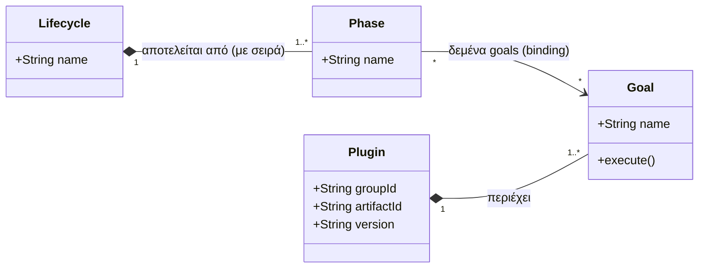
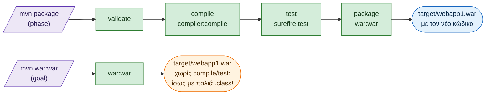

# Εισαγωγή στο Maven

Σύντομη εισαγωγή στο **Apache Maven**: τι είναι, πώς εγκαθίσταται, το `pom.xml`, το lifecycle, οι dependencies
και οι βασικές εντολές.

> Αυτός ο οδηγός είναι το πρώτο μέρος του [README.md](README.md). Αφού τον διαβάσετε, συνεχίστε εκεί με τη
> δημιουργία της web εφαρμογής.

## Περιεχόμενα

- [1. Τι είναι το Maven](#1-τι-είναι-το-maven)
- [2. Εγκατάσταση](#2-εγκατάσταση)
- [3. Το αρχείο pom.xml](#3-το-αρχείο-pomxml)
- [4. Η τυπική δομή φακέλων](#4-η-τυπική-δομή-φακέλων)
- [5. Lifecycle, phases, plugins και goals](#5-lifecycle-phases-plugins-και-goals)
- [6. Dependencies και scopes](#6-dependencies-και-scopes)
- [7. Repositories](#7-repositories)
- [8. Βασικές εντολές (cheat sheet)](#8-βασικές-εντολές-cheat-sheet)
- [9. Archetypes](#9-archetypes)

## 1. Τι είναι το Maven

Το **Maven** είναι εργαλείο *build automation* και *διαχείρισης εξαρτήσεων* για Java projects.
Αντί να κατεβάζουμε χειροκίνητα `.jar` αρχεία και να γράφουμε scripts για compile/test/πακετάρισμα,
περιγράφουμε το project σε ένα αρχείο (`pom.xml`) και το Maven:

- **κατεβάζει αυτόματα** τις βιβλιοθήκες (dependencies) που χρειαζόμαστε, μαζί με τις δικές τους εξαρτήσεις.
  Αυτές λέγονται **transitive dependencies**: αν εμείς χρειαζόμαστε τη βιβλιοθήκη Α και η Α χρειάζεται τη Β,
  το Maven φέρνει αυτόματα και τη Β,
- **κάνει compile** τον κώδικα,
- **τρέχει τα tests**,
- **πακετάρει** το αποτέλεσμα (`.jar`, `.war`, …),
- ακολουθεί **συμβάσεις** (*convention over configuration*): αν βάλουμε τα αρχεία στους «σωστούς» φακέλους, δεν χρειάζεται σχεδόν καμία ρύθμιση.

Έτσι, οποιοσδήποτε μπορεί να πάρει το project και να το κάνει build με την ίδια εντολή, σε οποιοδήποτε IDE ή λειτουργικό.

## 2. Εγκατάσταση

Χρειάζεστε:

1. **JDK** (προτείνεται 21 ή νεότερο). Έλεγχος:
   ```bash
   java -version
   javac -version
   ```
2. **Maven** (3.9.x). Κατεβάστε το από <https://maven.apache.org/download.cgi>, αποσυμπιέστε το
   και προσθέστε τον φάκελο `bin` στο `PATH`. Σε Linux μπορείτε και από τον package manager
   (π.χ. `sudo apt install maven`, `sudo pacman -S maven`), σε macOS `brew install maven`.

   Έλεγχος:
   ```bash
   mvn -v
   ```
   Η έξοδος δείχνει την έκδοση του Maven **και** ποιο JDK χρησιμοποιεί. Αν δείχνει λάθος JDK,
   ρυθμίστε τη μεταβλητή `JAVA_HOME` (βλ. παρακάτω).

### Μεταβλητές περιβάλλοντος: `PATH` και `JAVA_HOME`

- **`PATH`**: η λίστα φακέλων στους οποίους το τερματικό ψάχνει προγράμματα. Όταν γράφετε `mvn`, το τερματικό ψάχνει
  ένα αρχείο `mvn` σε αυτούς τους φακέλους. Αν πάρετε `mvn: command not found` (ή `'mvn' is not recognized` στα Windows),
  ο φάκελος `bin` του Maven δεν είναι στο `PATH`.
- **`JAVA_HOME`**: ο φάκελος όπου είναι εγκατεστημένο το JDK (ο **κύριος** φάκελος, **όχι** ο `bin`). Τον χρησιμοποιούν
  το Maven και ο Tomcat για να βρουν ποια Java θα τρέξουν.

**Linux / macOS:** προσθέστε στο τέλος του `~/.bashrc` (ή του `~/.zshrc`, αν το shell σας είναι zsh, όπως by default στο macOS):

```bash
export JAVA_HOME=/usr/lib/jvm/java-21-openjdk          # Linux: δείτε τι υπάρχει με  ls /usr/lib/jvm
# export JAVA_HOME=$(/usr/libexec/java_home -v 21)     # macOS: αυτή η γραμμή αντί για την από πάνω
export PATH="$JAVA_HOME/bin:$HOME/opt/apache-maven-3.9.11/bin:$PATH"   # προσαρμόστε τον φάκελο του Maven
```

Οι αλλαγές ισχύουν σε **νέα** τερματικά. Για το τρέχον τερματικό: `source ~/.bashrc` (ή `source ~/.zshrc`).

**Windows:** Έναρξη → αναζήτηση «*environment variables*» → **Edit environment variables for your account**:

1. **New…** → Variable name: `JAVA_HOME`, Variable value: ο φάκελος του JDK, π.χ. `C:\Program Files\Eclipse Adoptium\jdk-21.0.8.9-hotspot`.
2. Επιλέξτε τη μεταβλητή **Path** → **Edit…** → **New** και προσθέστε δύο γραμμές:
   `%JAVA_HOME%\bin` και τον φάκελο `bin` του Maven, π.χ. `C:\tools\apache-maven-3.9.11\bin`.
3. **OK** σε όλα τα παράθυρα και ανοίξτε **νέο** τερματικό.

**Έλεγχος** (σε νέο τερματικό):

```bash
echo $JAVA_HOME        # Linux/macOS      (PowerShell: echo $env:JAVA_HOME)
mvn -v                 # πρέπει να δείχνει το σωστό JDK στη γραμμή "Java version"
```

> **Σημείωση:** Τα IntelliJ IDEA, Eclipse, NetBeans και VS Code (με το *Extension Pack for Java*)
> αναγνωρίζουν απευθείας Maven projects: απλώς ανοίγετε τον φάκελο που περιέχει το `pom.xml`.

## 3. Το αρχείο `pom.xml`

Το **POM** (*Project Object Model*) είναι η «ταυτότητα» του project. Ένα ελάχιστο παράδειγμα:

```xml
<project xmlns="http://maven.apache.org/POM/4.0.0"
         xmlns:xsi="http://www.w3.org/2001/XMLSchema-instance"
         xsi:schemaLocation="http://maven.apache.org/POM/4.0.0 https://maven.apache.org/xsd/maven-4.0.0.xsd">
  <modelVersion>4.0.0</modelVersion>

  <!-- Συντεταγμένες (coordinates) του project -->
  <groupId>gr.uniwa.ice</groupId>
  <artifactId>hello</artifactId>
  <version>1.0-SNAPSHOT</version>
  <packaging>jar</packaging>

  <properties>
    <maven.compiler.release>21</maven.compiler.release>
    <project.build.sourceEncoding>UTF-8</project.build.sourceEncoding>
  </properties>

  <dependencies>
    <!-- βιβλιοθήκες που χρειάζεται το project -->
  </dependencies>

  <build>
    <plugins>
      <!-- plugins και ρυθμίσεις τους -->
    </plugins>
  </build>
</project>
```

### Coordinates (GAV)

Κάθε project/βιβλιοθήκη στον κόσμο του Maven αναγνωρίζεται μοναδικά από τρία στοιχεία:

| Στοιχείο      | Σημασία                                                          | Παράδειγμα          |
|---------------|------------------------------------------------------------------|---------------------|
| `groupId`     | Ο οργανισμός/ομάδα, συνήθως αντεστραμμένο domain                 | `gr.uniwa.ice`      |
| `artifactId`  | Το όνομα του project                                              | `webapp1`           |
| `version`     | Η έκδοση. Το `-SNAPSHOT` σημαίνει «έκδοση υπό ανάπτυξη»          | `1.0-SNAPSHOT`      |

Επιπλέον, το `packaging` ορίζει τι θα παραχθεί: `jar` (default), `war` (web εφαρμογή), `pom` (γονικό/multi‑module project).

## 4. Η τυπική δομή φακέλων

```
my-project/
├── pom.xml
├── src/
│   ├── main/
│   │   ├── java/          ← κώδικας Java (packages)
│   │   ├── resources/     ← αρχεία ρυθμίσεων, .properties κ.λπ. (μπαίνουν στο classpath)
│   │   └── webapp/        ← (μόνο για war) JSP, HTML, CSS, JS, WEB-INF/web.xml
│   └── test/
│       ├── java/          ← κώδικας tests
│       └── resources/     ← αρχεία για τα tests
└── target/                ← ΕΔΩ γράφει το Maven ό,τι παράγει (classes, .jar/.war, reports)
```

> Ο φάκελος `target/` δημιουργείται αυτόματα και **δεν** μπαίνει στο git (προσθέστε τον στο `.gitignore`).
> Το `mvn clean` τον διαγράφει.

> **Classpath** λέγεται το σύνολο των φακέλων και των `.jar` στους οποίους η Java ψάχνει κλάσεις και αρχεία (*resources*)
> όταν τρέχει ένα πρόγραμμα. Το Maven φτιάχνει το classpath αυτόματα: τα compiled αρχεία του `src/main/java`, τα αρχεία
> του `src/main/resources` και τα `.jar` των dependencies.

## 5. Lifecycle, phases, plugins και goals

Αυτές είναι οι τέσσερις πιο σημαντικές έννοιες του Maven.

### Με απλά λόγια

Αν ξέρετε Java, τα έχετε ήδη συναντήσει:

| Maven         | Σε Java θα ήταν…                                   | Καθημερινή αναλογία (κουζίνα)                         |
|---------------|----------------------------------------------------|-------------------------------------------------------|
| **Plugin**    | μια **κλάση**                                      | μια συσκευή: μίξερ, φούρνος                           |
| **Goal**      | μια **μέθοδος** της κλάσης (εκεί γίνεται η δουλειά) | μια λειτουργία της συσκευής: «χτύπημα», «ψήσιμο»      |
| **Phase**     | ένα **όνομα βήματος**, που μόνο του δεν κάνει τίποτα | ένα βήμα της συνταγής: «ανάμειξη», «ψήσιμο»          |
| **Lifecycle** | μια **λίστα από phases με σειρά**                  | ολόκληρη η συνταγή                                    |
| **Binding**   | ποιες μέθοδοι καλούνται σε κάθε βήμα               | «στο βήμα *ανάμειξη* χρησιμοποίησε το μίξερ»           |

Η πιο σημαντική ιδέα: **οι phases δεν κάνουν καμία δουλειά**. Είναι απλώς ονομασμένα σημεία
στη σειρά. Τη δουλειά την κάνουν τα **goals** που είναι «δεμένα» σε κάθε phase. Ποια goals είναι δεμένα
το αποφασίζει κυρίως το `<packaging>`. Γι' αυτό η phase `package` φτιάχνει `.jar` σε ένα project και `.war` σε άλλο.

Οι σχέσεις τους ως UML class diagram:



Διαβάζεται έτσι:

- Ένα **lifecycle** αποτελείται από μία ή περισσότερες **phases**, σε συγκεκριμένη σειρά.
- Ένα **plugin** περιέχει ένα ή περισσότερα **goals**. Κάθε goal ανήκει σε ακριβώς ένα plugin.
- Μια **phase** μπορεί να έχει κανένα, ένα ή πολλά δεμένα **goals** (π.χ. η `validate` δεν έχει κανένα).
  Ένα goal μπορεί να μην είναι δεμένο πουθενά (π.χ. το `dependency:tree`) και να το
  καλούμε μόνο απευθείας.

Και σε (ψευδο)κώδικα Java, αυτό που κάνει το Maven όταν γράφουμε `mvn package`:

```java
// Plugin = κλάση, Goal = μέθοδος
class CompilerPlugin { void compile() { /* ... */ }  void testCompile() { /* ... */ } }
class SurefirePlugin { void test()    { /* ... */ } }
class WarPlugin      { void war()     { /* ... */ } }

// Lifecycle = λίστα από phases με σειρά (οι phases είναι απλώς ονόματα)
List<String> defaultLifecycle =
    List.of("validate", "compile", "test", "package", "verify", "install", "deploy");

// Binding: ποια goals τρέχουν σε κάθε phase (για <packaging>war</packaging>)
Map<String, List<Runnable>> bindings = Map.of(
    "compile", List.of(compiler::compile),
    "test",    List.of(compiler::testCompile, surefire::test),
    "package", List.of(war::war));

// mvn package  →  περνάμε τις phases με τη σειρά, μέχρι και αυτήν που ζητήσαμε
for (String phase : defaultLifecycle) {
    bindings.getOrDefault(phase, List.of()).forEach(Runnable::run);
    if (phase.equals("package")) break;
}

// mvn war:war  →  καλούμε απευθείας μία μέθοδο, χωρίς lifecycle
war.war();
```

Στις επόμενες υποενότητες βλέπουμε κάθε έννοια αναλυτικά.

### Lifecycle και phases

Ένα **lifecycle** είναι μια σειρά από **phases** (φάσεις). Το Maven έχει τρία ενσωματωμένα lifecycles:

| Lifecycle  | Σκοπός                                  | Phases (με τη σειρά)                                   |
|------------|-----------------------------------------|--------------------------------------------------------|
| `clean`    | καθαρισμός (διαγραφή του `target/`)      | `pre-clean` → **`clean`** → `post-clean`               |
| `default`  | build: compile, test, πακετάρισμα, …     | `validate` → `compile` → … → `deploy` (βλ. παρακάτω)   |
| `site`     | παραγωγή ιστοσελίδας τεκμηρίωσης          | `pre-site` → **`site`** → `post-site` → `site-deploy`  |

**Τι είναι προκαθορισμένο και τι όχι:**

- **Προκαθορισμένα** (ίδια σε **κάθε** Maven project): τα τρία lifecycles, οι phases τους και η **σειρά** τους.
  Είναι ενσωματωμένα στο ίδιο το Maven. Δεν τα γράφουμε στο `pom.xml` και δεν αλλάζουμε τη σειρά τους.
- **Αλλάζει από project σε project:** **ποια goals** τρέχουν σε κάθε phase. Αυτό το καθορίζει κυρίως το `<packaging>`
  (π.χ. στη phase `package`: `jar:jar` για `jar`, `war:war` για `war`) και δευτερευόντως τα plugins που δηλώνουμε στο `pom.xml`.
  Οι phases δηλαδή είναι σαν τις **στάσεις μιας σταθερής διαδρομής**. Το project αποφασίζει τι θα γίνει σε κάθε στάση.
- Το όνομα **`default`** σημαίνει απλώς «**το κύριο lifecycle**, αυτό που κάνει το build» (στην τεκμηρίωση λέγεται και
  *build lifecycle*). **Δεν** σημαίνει «προεπιλογή που τρέχει αν δεν ζητήσουμε κάτι». Αν γράψετε σκέτο `mvn` χωρίς phase, δεν
  τρέχει τίποτα. Βγαίνει σφάλμα που, βολικά, απαριθμεί όλες τις προκαθορισμένες phases:
  ```
  [ERROR] No goals have been specified for this build. You must specify a valid lifecycle phase or a goal ...
  Available lifecycle phases are: pre-clean, clean, post-clean, validate, initialize, ..., deploy, pre-site, site, post-site, site-deploy.
  ```

> **Προσοχή στα ονόματα:** τα lifecycles `clean` και `site` έχουν μέσα τους μια **phase με το ίδιο όνομα**.
> Υπάρχει δηλαδή το *`clean` lifecycle* (όλη η σειρά `pre-clean` → `clean` → `post-clean`) και η
> *`clean` phase* (μόνο το μεσαίο βήμα, αυτό που διαγράφει το `target/`).
>
> Στην εντολή `mvn` γράφουμε **πάντα phases, ποτέ lifecycles**. Το `mvn clean` σημαίνει «εκτέλεσε
> το lifecycle στο οποίο ανήκει η phase `clean`, μέχρι και αυτήν»: εκτελούνται οι `pre-clean` και `clean`, αλλά όχι
> η `post-clean`. Το `default` lifecycle δεν έχει phase με το όνομά του, γι' αυτό δεν υπάρχει `mvn default`.
>
> Αν σας μπερδεύει μια λέξη, ρωτήστε το Maven: `mvn help:describe -Dcmd=clean` απαντά
> *"'clean' is a phase within the 'clean' lifecycle, which has the following phases: …"*.

Οι βασικές phases του `default` lifecycle, **με τη σειρά**:

| Phase       | Τι κάνει                                                              |
|-------------|-----------------------------------------------------------------------|
| `validate`  | ελέγχει ότι το project είναι σωστό και έχει όλες τις πληροφορίες       |
| `compile`   | κάνει compile τον κώδικα του `src/main/java` → `target/classes`        |
| `test`      | κάνει compile και τρέχει τα unit tests (`src/test/java`)               |
| `package`   | πακετάρει: `target/<όνομα>.jar` ή `.war`                               |
| `verify`    | τρέχει επιπλέον ελέγχους (π.χ. integration tests)                      |
| `install`   | αντιγράφει το πακέτο στο **τοπικό** repository (`~/.m2/repository`)   |
| `deploy`    | ανεβάζει το πακέτο σε **απομακρυσμένο** repository (για κοινή χρήση)   |

**Κανόνας-κλειδί:** όταν ζητάμε μια phase, εκτελούνται **και όλες οι προηγούμενες**.
Π.χ. το `mvn package` κάνει validate → compile → test → package.

Μπορούμε να δώσουμε πολλές phases μαζί: `mvn clean package` = «καθάρισε και μετά κάνε build».

Το παρακάτω σχήμα δείχνει τι εκτελεί η εντολή **`mvn clean package`** για ένα web project.
Τα μεγάλα πλαίσια είναι τα **lifecycles** και τα κουτιά μέσα τους είναι οι **phases**.
Με **πράσινο** οι phases που εκτελούνται και με **γκρι** όσες δεν εκτελούνται. Κάτω από το όνομα
κάθε phase φαίνονται τα goals (`plugin:goal`) που τρέχουν σε αυτήν (εξηγούνται στην επόμενη υποενότητα).
Το `clean` εμφανίζεται δύο φορές: ως πλαίσιο (lifecycle) και ως κουτί μέσα σε αυτό (phase).
Το `mvn clean package` ζητάει δύο **phases**: την `clean` (από το `clean` lifecycle) και την `package` (από το `default`).

```mermaid
flowchart LR
    subgraph CL["clean lifecycle"]
        direction LR
        c0["<b>pre-clean</b>"]
        c1["<b>clean</b><br/>clean:clean"]
        c2["<b>post-clean</b>"]
        c0 --> c1 --> c2
    end
    subgraph DL["default lifecycle"]
        direction LR
        p1["<b>validate</b>"]
        p2["<b>compile</b><br/>resources:resources<br/>compiler:compile"]
        p3["<b>test</b><br/>resources:testResources<br/>compiler:testCompile<br/>surefire:test"]
        p4["<b>package</b><br/>war:war"]
        p5["<b>verify</b>"]
        p6["<b>install</b><br/>install:install"]
        p7["<b>deploy</b><br/>deploy:deploy"]
        p1 --> p2 --> p3 --> p4 --> p5 --> p6 --> p7
    end
    CL ==> DL

    classDef run fill:#d4edda,stroke:#2e7d32,color:#1b3d1f
    classDef skip fill:#f1f1f1,stroke:#bbb,color:#999,stroke-dasharray:4 3
    class c0,c1,p1,p2,p3,p4 run
    class c2,p5,p6,p7 skip
```



> Στο σχήμα φαίνονται μόνο οι κύριες phases. Υπάρχουν και ενδιάμεσες (π.χ. `process-resources`,
> `test-compile`), που εδώ εμφανίζονται μέσα στην επόμενη κύρια phase. Την πλήρη λίστα τη δίνει η εντολή
> `mvn help:describe -Dcmd=deploy`.

> Τα διαγράμματα είναι σε [Mermaid](https://mermaid.js.org). Σχεδιάζονται αυτόματα στο GitHub/GitLab.
> Στο VS Code χρειάζεται το extension *Markdown Preview Mermaid Support*.

#### Δείτε το «build plan» του δικού σας project

Το σχήμα δείχνει τα **προκαθορισμένα** bindings για ένα `war` project. Για να δείτε **ακριβώς** τι θα εκτελεστεί στο
**δικό σας** project (με όποια plugins έχετε προσθέσει στο `pom.xml` και με τις ενδιάμεσες phases), υπάρχει το
plugin [buildplan-maven-plugin](https://github.com/jcgay/buildplan-maven-plugin). Τρέξτε το μέσα στον φάκελο ενός project
(δηλαδή εκεί όπου υπάρχει `pom.xml`). Αν δεν έχετε ακόμα project, δοκιμάστε το αφού φτιάξετε το `webapp1` στο [README.md](README.md):

```bash
mvn fr.jcgay.maven.plugins:buildplan-maven-plugin:list-phase -Dbuildplan.tasks=deploy
```

```
Build Plan for webapp1 Maven Webapp:
process-resources ---------------------------------------------------
    + maven-resources-plugin | default-resources     | resources
compile -------------------------------------------------------------
    + maven-compiler-plugin  | default-compile       | compile
process-test-resources ----------------------------------------------
    + maven-resources-plugin | default-testResources | testResources
test-compile --------------------------------------------------------
    + maven-compiler-plugin  | default-testCompile   | testCompile
test ----------------------------------------------------------------
    + maven-surefire-plugin  | default-test          | test
package -------------------------------------------------------------
    + maven-war-plugin       | default-war           | war
install -------------------------------------------------------------
    + maven-install-plugin   | default-install       | install
deploy --------------------------------------------------------------
    + maven-deploy-plugin    | default-deploy        | deploy
```

- Το `-Dbuildplan.tasks=` λέει **για ποιες phases** θέλουμε το πλάνο, π.χ. `-Dbuildplan.tasks=clean,package` για το
  `mvn clean package`. Αν το παραλείψετε, το plugin τυπώνει **κενό** πλάνο.
- Το plugin **δεν εκτελεί τίποτα**: δεν κάνει compile, ούτε tests, ούτε πακετάρισμα. Μόνο δείχνει τι **θα** γινόταν.
- Παραλλαγές: το goal `list` δίνει το ίδιο σε μορφή πίνακα (plugin | phase | goal) και το `list-plugin` το ομαδοποιεί ανά plugin.
- Το γράφουμε με το πλήρες όνομα (`groupId:artifactId:goal`), γιατί δεν είναι επίσημο plugin του Maven
  (δείτε «Η γενική μορφή της εντολής `mvn`» στην ενότητα 8 του Μέρους Α).

> ⚠ **Μη γράψετε `mvn deploy fr.jcgay...:list-phase`.** Το `deploy` εκεί είναι **phase**, οπότε το Maven θα
> **εκτελέσει πρώτα** όλο το lifecycle μέχρι το deploy: compile, tests, `.war`, install στο `~/.m2`, και στο τέλος θα αποτύχει
> στο deploy, γιατί δεν έχουμε ορίσει απομακρυσμένο repository. Οι phases για τις οποίες θέλουμε το πλάνο δίνονται
> **μόνο** με το `-Dbuildplan.tasks`.

### Plugins και goals

Στην πραγματικότητα το Maven μόνο του δεν «ξέρει» να κάνει compile. Όλη η δουλειά γίνεται από **plugins**.
Κάθε plugin έχει ένα ή περισσότερα **goals** (συγκεκριμένες εργασίες). Για παράδειγμα, το `maven-compiler-plugin`
έχει τα goals `compile` και `testCompile`. Το συμβολίζουμε με τη μορφή `plugin:goal`, π.χ. `compiler:compile`.

Κάθε phase είναι «δεμένη» (*bound*) με κάποια goals. Όταν εκτελείται η phase, εκτελούνται αυτά τα goals.
Ο πίνακας είναι **απλοποιημένος**, όπως και το διάγραμμα: δείχνει μόνο τις κύριες phases, και σε κάθε μία τα goals
που τρέχουν **μέχρι** αυτήν. Στην πραγματικότητα, π.χ. το `compiler:testCompile` είναι δεμένο στην ενδιάμεση phase
`test-compile` και στη `test` είναι δεμένο μόνο το `surefire:test`. Αυτό ακριβώς δείχνει η έξοδος του buildplan παραπάνω.

| Κύρια phase | Plugin:goal που εκτελούνται μέχρι αυτήν (για `jar`/`war`)                       |
|------------|---------------------------------------------------------------------------------|
| `clean`    | `clean:clean`                                                                   |
| `compile`  | `resources:resources` (αντιγραφή του `src/main/resources`), `compiler:compile`  |
| `test`     | `resources:testResources`, `compiler:testCompile`, `surefire:test`              |
| `package`  | `jar:jar` ή `war:war` (ανάλογα με το `<packaging>`)                             |
| `install`  | `install:install`                                                               |
| `deploy`   | `deploy:deploy`                                                                 |

Συνοπτικά: **lifecycle** → αποτελείται από **phases** → σε κάθε phase είναι δεμένα **goals** → κάθε goal ανήκει σε ένα **plugin**.

Αυτή η αλυσίδα φαίνεται στην έξοδο κάθε build. Π.χ. το `mvn clean package` τυπώνει:

```
[INFO] --- clean:3.2.0:clean (default-clean) @ webapp1 ---
[INFO] --- resources:3.3.1:resources (default-resources) @ webapp1 ---
[INFO] --- compiler:3.13.0:compile (default-compile) @ webapp1 ---
[INFO] --- resources:3.3.1:testResources (default-testResources) @ webapp1 ---
[INFO] --- compiler:3.13.0:testCompile (default-testCompile) @ webapp1 ---
[INFO] --- surefire:3.5.2:test (default-test) @ webapp1 ---
[INFO] --- war:3.4.0:war (default-war) @ webapp1 ---
```

(η μορφή είναι `plugin:έκδοση:goal`).

Ένα goal μπορεί να εκτελεστεί και **απευθείας**, με σύνταξη `plugin:goal`:

```bash
mvn dependency:tree       # goal "tree" του maven-dependency-plugin
mvn archetype:generate    # goal "generate" του maven-archetype-plugin
mvn jetty:run             # goal "run" του Jetty plugin
```

**Phase vs goal:** `mvn package` (phase, χωρίς `:`) τρέχει όλη την αλυσίδα του lifecycle.
`mvn war:war` (goal, με `:`) τρέχει **μόνο** αυτό το goal, χωρίς compile/test πριν:



## 6. Dependencies και scopes

Για να χρησιμοποιήσουμε μια βιβλιοθήκη, τη δηλώνουμε στο `<dependencies>` με τις συντεταγμένες της:

```xml
<dependency>
  <groupId>com.google.code.gson</groupId>
  <artifactId>gson</artifactId>
  <version>2.11.0</version>
</dependency>
```

Το Maven θα την κατεβάσει (μαζί με ό,τι χρειάζεται αυτή) την πρώτη φορά που θα τρέξει.
Τις συντεταγμένες οποιασδήποτε βιβλιοθήκης τις βρίσκετε στο <https://central.sonatype.com>
ή στο <https://mvnrepository.com>.

Το **scope** ορίζει *πότε* είναι διαθέσιμη η βιβλιοθήκη:

| Scope       | Compile | Test | Μπαίνει στο τελικό πακέτο; | Τυπική χρήση                                   |
|-------------|:-------:|:----:|:--------------------------:|------------------------------------------------|
| `compile`   | ✔       | ✔    | ✔                          | default — κανονικές βιβλιοθήκες                 |
| `provided`  | ✔       | ✔    | ✘                          | το παρέχει ο server, π.χ. **Servlet API**       |
| `runtime`   | ✘       | ✔    | ✔                          | π.χ. JDBC drivers                               |
| `test`      | ✘       | ✔    | ✘                          | JUnit, Mockito                                  |

> Για web εφαρμογές το **`provided`** είναι πολύ σημαντικό: το Servlet API το έχει ήδη ο Tomcat/Jetty,
> οπότε δεν πρέπει να μπει μέσα στο `.war`.

## 7. Repositories

- **Local repository** — `~/.m2/repository` (Windows: `C:\Users\<user>\.m2\repository`).
  Cache στον υπολογιστή σας με ό,τι έχει κατεβεί ή γίνει `install`. Αν «χαλάσει» κάτι, μπορείτε να διαγράψετε
  τον φάκελο της συγκεκριμένης βιβλιοθήκης και θα ξανακατέβει.
- **Remote repository** — κυρίως το **Maven Central** (<https://repo.maven.apache.org/maven2>), από όπου κατεβαίνουν όλα by default.

## 8. Βασικές εντολές (cheat sheet)

### Η γενική μορφή της εντολής `mvn`

```
mvn [options] <phase ή goal> [<phase ή goal> ...]
```

(το `mvn --help` το γράφει ως `usage: mvn [options] [<goal(s)>] [<phase(s)>]`)

Μετά το `mvn` γράφουμε **ένα ή περισσότερα** από τα εξής, χωρισμένα με κενό:

| Τι γράφουμε | Μορφή | Παράδειγμα | Τι εκτελείται |
|-------------|-------|------------|---------------|
| **phase**   | σκέτο όνομα, **χωρίς** `:` | `package` | όλες οι phases του lifecycle **μέχρι και αυτήν**, με όλα τα δεμένα goals τους |
| **goal** (σύντομη μορφή) | `prefix:goal` | `dependency:tree` | **μόνο** αυτό το goal |
| **goal** (πλήρης μορφή) | `groupId:artifactId[:version]:goal` | `org.apache.maven.plugins:maven-help-plugin:3.5.1:evaluate` | **μόνο** αυτό το goal, από τη συγκεκριμένη έκδοση του plugin |

- Το **`:`** είναι αυτό που ξεχωρίζει τα δύο: `package` είναι phase, `war:war` είναι goal.
- Το **prefix** είναι το σύντομο όνομα του plugin: `maven-dependency-plugin` → `dependency`, `maven-war-plugin` → `war`.
  Για τα επίσημα plugins του Maven δουλεύει πάντα. Για άλλα plugins (π.χ. Jetty → `jetty`) δουλεύει μόνο αν το plugin είναι
  δηλωμένο στο `pom.xml`. Γι' αυτό το `mvn jetty:run` δουλεύει μόνο μέσα στο project μας.
- Μπορούμε να **ανακατέψουμε** phases και goals. Εκτελούνται **με τη σειρά που τα γράψαμε**. Π.χ. το `mvn clean package dependency:tree`:
  ```
  [INFO] --- clean:3.2.0:clean ...                 ← phase clean
  [INFO] --- resources:3.3.1:resources ...         ┐
  [INFO] --- compiler:3.13.0:compile ...           │
  [INFO] --- resources:3.3.1:testResources ...     │ phase package
  [INFO] --- compiler:3.13.0:testCompile ...       │ (και όλες οι προηγούμενες)
  [INFO] --- surefire:3.5.2:test ...               │
  [INFO] --- war:3.4.0:war ...                     ┘
  [INFO] --- dependency:3.7.0:tree (default-cli)   ← goal (το "default-cli" = κλήθηκε από τη γραμμή εντολών)
  ```

**Options (flags):** ξεκινούν με `-` και αλλάζουν το *πώς* τρέχει το Maven. Οι πιο χρήσιμες:

| Option | Σημασία | Παράδειγμα |
|--------|---------|------------|
| `-D<όνομα>=<τιμή>` | ορίζει μια **ιδιότητα** (property). Έτσι δίνουμε ρυθμίσεις στα plugins | `mvn package -DskipTests` |
| `-q` | quiet: μόνο σφάλματα | `mvn -q package` |
| `-X` | debug: πάρα πολλά μηνύματα (troubleshooting) | `mvn -X package` |
| `-e` | δείχνει το πλήρες stack trace όταν κάτι αποτύχει | `mvn -e package` |
| `-o` | offline: χωρίς internet, μόνο από το `~/.m2` | `mvn -o package` |
| `-U` | ξαναελέγχει για νέες SNAPSHOT dependencies | `mvn -U package` |
| `-f <αρχείο>` | χρήση συγκεκριμένου `pom.xml` (π.χ. από άλλο φάκελο) | `mvn -f webapp1/pom.xml package` |
| `-B` | batch mode: μη διαδραστικό, χωρίς χρώματα (για scripts/CI) | `mvn -B package` |
| `-v` | έκδοση Maven και Java | `mvn -v` |

Ένα πλήρες παράδειγμα με όλα τα κομμάτια:

```
mvn  -q  -DskipTests  clean  package  dependency:tree
     └───options───┘  └─phases─────┘  └────goal─────┘
```

### Συνηθισμένες εντολές

| Εντολή                               | Τι κάνει                                                            |
|--------------------------------------|---------------------------------------------------------------------|
| `mvn -v`                             | έκδοση Maven και Java                                               |
| `mvn compile`                        | compile του κώδικα                                                  |
| `mvn test`                           | compile + εκτέλεση tests                                            |
| `mvn package`                        | compile + tests + δημιουργία `.jar`/`.war` στο `target/`            |
| `mvn clean`                          | διαγραφή του `target/`                                               |
| `mvn clean package`                  | «καθαρό» build από την αρχή (**η πιο συχνή εντολή**)                |
| `mvn clean install`                  | build + αντιγραφή στο `~/.m2` (για χρήση από άλλα δικά σας projects) |
| `mvn package -DskipTests`            | build χωρίς να τρέξουν τα tests                                      |
| `mvn test -Dtest=HelloServletTest`   | εκτέλεση μόνο ενός test class                                        |
| `mvn dependency:tree`                | δέντρο όλων των dependencies (και των transitive)                    |
| `mvn fr.jcgay.maven.plugins:buildplan-maven-plugin:list-phase -Dbuildplan.tasks=deploy` | ποια goals θα εκτελεστούν σε κάθε phase (χωρίς να εκτελεστεί τίποτα, βλ. ενότητα 5) |
| `mvn help:effective-pom`             | το «πλήρες» POM με όλα τα defaults που εφαρμόζονται                  |
| `mvn versions:display-dependency-updates` | ποιες dependencies έχουν νεότερη έκδοση                         |

## 9. Archetypes

Ένα **archetype** είναι ένα *πρότυπο (template) project*. Με το goal `archetype:generate` το Maven
δημιουργεί έτοιμη τη δομή φακέλων και το `pom.xml`. Μερικά γνωστά archetypes:

| archetypeArtifactId           | Τελευταία έκδοση | Τι δημιουργεί                         |
|-------------------------------|------------------|---------------------------------------|
| `maven-archetype-quickstart`  | 1.5              | απλή Java εφαρμογή (`jar`)            |
| `maven-archetype-webapp`      | 1.5              | Java web εφαρμογή (`war`)             |

Παράδειγμα για απλή (μη web) εφαρμογή:

```bash
mvn archetype:generate \
  -DgroupId=gr.uniwa.ice \
  -DartifactId=hello \
  -DarchetypeArtifactId=maven-archetype-quickstart \
  -DarchetypeVersion=1.5 \
  -DinteractiveMode=false
```

Αν παραλείψετε το `-DinteractiveMode=false`, το Maven θα σας ρωτήσει διαδραστικά τις τιμές.

> ⚠ **Δηλώνετε πάντα την έκδοση με `-DarchetypeVersion`.** Χωρίς αυτήν, το Maven παίρνει την έκδοση από τον
> εσωτερικό του κατάλογο. Για το `maven-archetype-webapp` αυτή είναι η **1.0**, ένα πολύ παλιό πρότυπο με JUnit 3.8 και
> `web.xml` του 2001. Τις διαθέσιμες εκδόσεις ενός archetype τις βλέπετε στο <https://central.sonatype.com>.

> **Άλλα archetypes:** Για εφαρμογές **Jakarta EE** που τρέχουν σε πλήρη *application server* (GlassFish, WildFly,
> Payara, TomEE, Open Liberty) υπάρχει το επίσημο **Eclipse Starter for Jakarta EE**
> (`org.eclipse.starter:jakarta-starter`, και σε web μορφή στο <https://start.jakarta.ee>). Φτιάχνει σύγχρονο project
> (Java 21, Jakarta EE 10/11), αλλά το παράδειγμά του είναι **REST service**, που **δεν** τρέχει σε σκέτο Tomcat/Jetty.
> Για Servlets/JSP σε Tomcat, που κάνουμε εδώ, χρησιμοποιούμε το `maven-archetype-webapp`.

---

**Επόμενο βήμα:** δημιουργία μιας Java web εφαρμογής με Maven, στο **[README.md](README.md)**.
