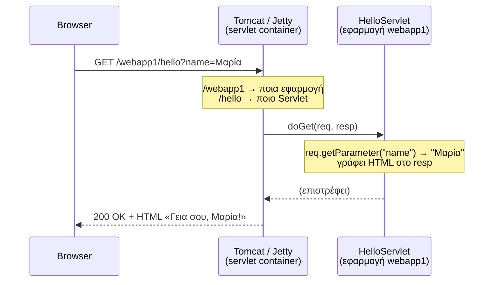

# Java Web Applications με Maven

Οδηγός για φοιτητές: βήμα‑βήμα, η δημιουργία, το build και η εκτέλεση μιας Java web εφαρμογής (Servlets/JSP) με **Apache Maven**.

Ο οδηγός χωρίζεται σε τέσσερα αρχεία:

1. **[Maven.md](Maven.md)**: εισαγωγή στο Maven (εγκατάσταση, `pom.xml`, lifecycle, dependencies, βασικές εντολές).
2. **README.md** (αυτό το αρχείο): δημιουργία της web εφαρμογής `webapp1`.
3. **[Servers.md](Servers.md)**: εκτέλεση της εφαρμογής σε Jetty και σε Apache Tomcat.
4. **[Forms.md](Forms.md)**: φόρμες με Servlets και JSP.

## Περιεχόμενα

- [Γρήγορη εκκίνηση με GitHub Codespaces](#γρήγορη-εκκίνηση-με-github-codespaces)
  - [Χρήστης για τον Tomcat Manager στο Codespaces](#χρήστης-για-τον-tomcat-manager-στο-codespaces)
- [Εισαγωγή στο Maven → Maven.md](Maven.md)
- [Δημιουργία Java Web Application](#δημιουργία-java-web-application)
  - [Πριν ξεκινήσουμε: πώς λειτουργεί μια web εφαρμογή](#πριν-ξεκινήσουμε-πώς-λειτουργεί-μια-web-εφαρμογή)
  - [Βήμα 1: Δημιουργία project από archetype](#βήμα-1-δημιουργία-project-από-archetype)
  - [Βήμα 2: Τι δημιουργήθηκε](#βήμα-2-τι-δημιουργήθηκε)
  - [Βήμα 3: Εκσυγχρονισμός του pom.xml](#βήμα-3-εκσυγχρονισμός-του-pomxml)
  - [Βήμα 4: Εκσυγχρονισμός του web.xml](#βήμα-4-εκσυγχρονισμός-του-webxml)
  - [Βήμα 5: Το πρώτο Servlet](#βήμα-5-το-πρώτο-servlet)
  - [Βήμα 6: Ένα unit test](#βήμα-6-ένα-unit-test)
  - [Βήμα 7: Build](#βήμα-7-build)
  - [Βήμα 8: Εκτέλεση](#βήμα-8-εκτέλεση)
- [Εκτέλεση σε Jetty και Tomcat → Servers.md](Servers.md)
- [Συχνά προβλήματα](#συχνά-προβλήματα)
- [Σύνοψη](#σύνοψη)
- [Ασκήσεις](#ασκήσεις)

---

# Γρήγορη εκκίνηση με GitHub Codespaces

Αν δεν θέλετε (ή δεν μπορείτε) να εγκαταστήσετε τίποτα στον υπολογιστή σας, το repository έχει έτοιμο
**dev container** (φάκελος [.devcontainer/](.devcontainer/)). Ανοίγει ένα πλήρες περιβάλλον ανάπτυξης μέσα στον browser,
με όλα τα εργαλεία ήδη εγκατεστημένα:

| Εργαλείο              | Έκδοση / Θέση                                     |
|-----------------------|---------------------------------------------------|
| JDK                   | 21                                                |
| Maven                 | 3.9.11 (`mvn`)                                    |
| Apache Tomcat         | 11 στο `$CATALINA_HOME` (= `/home/vscode/tomcat`) |
| VS Code extensions    | Java Extension Pack, XML, Community Server Connectors (Tomcat), Mermaid preview |

**Άνοιγμα:**

1. Στη σελίδα του repository στο GitHub: πράσινο κουμπί **Code → καρτέλα Codespaces → Create codespace on main**.
2. Την πρώτη φορά η δημιουργία παίρνει μερικά λεπτά (κατεβαίνει το image, ο Tomcat και οι Maven dependencies).
   Την πρόοδο τη βλέπετε στο τερματικό (*View creation log*).
3. Ανοίγει ένα VS Code στον browser, με τερματικό (**Ctrl+`**) όπου δουλεύουν κανονικά όλες οι εντολές του οδηγού.

**Εκτέλεση της εφαρμογής:**

```bash
cd webapp1
mvn jetty:run                     # ή:
mvn clean package && cp target/webapp1.war $CATALINA_HOME/webapps/ && $CATALINA_HOME/bin/catalina.sh run
```

Όταν ο server ξεκινήσει στη θύρα 8080, το Codespaces εμφανίζει ειδοποίηση **«Open in Browser»**. Η εφαρμογή ανοίγει
σε διεύθυνση της μορφής `https://<όνομα-codespace>-8080.app.github.dev/`. Προσθέστε στο τέλος το context path:
**`/webapp1/`**. Όλες τις προωθημένες θύρες τις βλέπετε στην καρτέλα **Ports** (δίπλα στο *Terminal*).

Όπου ο οδηγός γράφει `http://localhost:8080/...`, στο Codespaces χρησιμοποιήστε τη διεύθυνση από την καρτέλα *Ports*.

> ⚠ **Ο φάκελος `webapp1/` του repository είναι το τελικό αποτέλεσμα** και των δύο οδηγών (αυτού και του [Forms.md](Forms.md)).
> Γι' αυτό η εφαρμογή που θα δείτε έχει ήδη τη φόρμα φοιτητών και όχι το «Hello World!». Αν θέλετε να ακολουθήσετε τα βήματα
> **από την αρχή**, δουλέψτε σε δικό σας φάκελο, έξω από το repository, ώστε να μη συγκρουστεί με τον υπάρχοντα `webapp1/`:
> ```bash
> mkdir -p ~/work && cd ~/work      # και από εδώ συνεχίστε με το Βήμα 1
> ```

### Χρήστης για τον Tomcat Manager στο Codespaces

Ο Tomcat του codespace είναι εγκατεστημένος στο `/home/vscode/tomcat` (= `$CATALINA_HOME`), **έξω** από τον φάκελο του project,
οπότε δεν φαίνεται στο Explorer. Για να ορίσετε χρήστη για το Manager UI (εξηγείται αναλυτικά στο [Servers.md, ενότητα 3.7](Servers.md#37-deploy-από-τον-browser-tomcat-manager)):

1. Σταματήστε τον Tomcat αν τρέχει (Ctrl+C στο τερματικό του `catalina.sh run`).
2. Ανοίξτε το αρχείο στον editor του VS Code από το τερματικό:
   ```bash
   code $CATALINA_HOME/conf/tomcat-users.xml
   ```
3. Πριν από το `</tomcat-users>` (στο **τέλος** του αρχείου, **έξω** από τα σχόλια `<!-- -->`) προσθέστε:
   ```xml
   <role rolename="manager-gui"/>
   <user username="admin" password="Ενας-Δικος-Σας-Κωδικος" roles="manager-gui"/>
   ```
   και αποθηκεύστε (Ctrl+S).
4. Ελέγξτε ότι το XML είναι σωστό και ότι ο χρήστης δεν είναι μέσα σε σχόλιο:
   ```bash
   tail -5 $CATALINA_HOME/conf/tomcat-users.xml
   ```
5. Ξεκινήστε τον Tomcat: `$CATALINA_HOME/bin/catalina.sh run`.
6. Από την καρτέλα **Ports** ανοίξτε τη διεύθυνση της θύρας 8080 και προσθέστε στο τέλος **`/manager/html`**.
   Δώστε το username/password που ορίσατε.

> **Καλό να ξέρετε**
> - Οι θύρες ενός codespace είναι by default **private**: τις ανοίγετε μόνο εσείς, συνδεδεμένοι στο GitHub.
>   **Μην** κάνετε τη θύρα 8080 *Public* όσο ο Manager έχει απλό κωδικό.
> - Οι αλλαγές στο `tomcat-users.xml` **διατηρούνται** όταν το codespace σταματά και ξαναξεκινά. **Χάνονται** μόνο αν
>   κάνετε *Rebuild Container* ή φτιάξετε νέο codespace, γιατί τότε ο Tomcat εγκαθίσταται από την αρχή.
> - Αν μετά τη σύνδεση εμφανιστεί **403 Access Denied**, ελέγξτε πρώτα ότι ο ρόλος είναι γραμμένος σωστά (`manager-gui`).
>   Αν είναι σωστός, το πρόβλημα είναι ο περιορισμός του Manager σε συνδέσεις από `localhost`
>   (`$CATALINA_HOME/webapps/manager/META-INF/context.xml`, `RemoteCIDRValve`). Σε αυτή την περίπτωση χρησιμοποιήστε για deploy
>   την αντιγραφή του `.war` στο `webapps/` ([Servers.md, ενότητα 3.4](Servers.md#34-deploy-της-εφαρμογής)), που δεν χρειάζεται τον Manager.

> **Σημειώσεις**
> - Το Codespaces έχει περιορισμένες δωρεάν ώρες χρήσης το μήνα. Οι φοιτητές παίρνουν περισσότερες μέσω του
>   [GitHub Education](https://education.github.com). Σταματήστε το codespace όταν δεν το χρησιμοποιείτε
>   (σταματάει και μόνο του μετά από λίγη ώρα αδράνειας).
> - Το ίδιο περιβάλλον ανοίγει και **τοπικά**, αν έχετε Docker: VS Code + extension **Dev Containers** →
>   *Reopen in Container*.

---

# Δημιουργία Java Web Application

> **Προαπαιτούμενα:** Τα βασικά του Maven (εγκατάσταση, `pom.xml`, phases, dependencies), από το [Maven.md](Maven.md).

Στόχος: μια web εφαρμογή με ένα JSP και ένα Servlet, που τρέχει σε Jetty (από το Maven) και σε Apache Tomcat.

> Οι οδηγίες χρησιμοποιούν **Jakarta Servlet 6.0** (packages `jakarta.servlet.*`), δηλαδή
> Tomcat 10.1+/11 ή Jetty 12. Παλιότερα tutorials χρησιμοποιούν `javax.servlet.*` — αυτά
> **δεν** δουλεύουν σε Tomcat 10+.

## Πριν ξεκινήσουμε: πώς λειτουργεί μια web εφαρμογή

Όταν ανοίγετε μια σελίδα, ο **browser** στέλνει ένα **HTTP request** σε έναν **server**, και ο server απαντά με ένα
**HTTP response**: έναν κωδικό κατάστασης (π.χ. `200 OK`) και ένα περιεχόμενο, συνήθως HTML.

Σε μια Java web εφαρμογή, τα requests τα δέχεται ένας **servlet container**, όπως ο **Tomcat** ή ο **Jetty**. Είναι ένα πρόγραμμα
Java που ακούει σε μια θύρα (εδώ 8080) και μοιράζει κάθε request στον σωστό κώδικα:

- **Servlet:** μια κλάση Java που κληρονομεί την `HttpServlet` και απαντά σε ένα συγκεκριμένο URL. Ο container καλεί τη
  μέθοδο **`doGet`** για requests τύπου GET (π.χ. όταν ανοίγουμε ένα link) και τη **`doPost`** για POST (π.χ. υποβολή φόρμας).
  Η μέθοδος παίρνει δύο αντικείμενα:
  - **`HttpServletRequest req`**: ό,τι έστειλε ο browser. Π.χ. το `req.getParameter("name")` επιστρέφει την τιμή της παραμέτρου `name`.
  - **`HttpServletResponse resp`**: εκεί γράφουμε την απάντηση, π.χ. με `resp.getWriter().println(...)`.
- **JSP:** μια σελίδα HTML με λίγα δυναμικά κομμάτια, που ο container τη μετατρέπει αυτόματα σε Servlet.
  Θα τις δούμε αναλυτικά στο [Forms.md](Forms.md).

**Η ανατομία ενός URL.** Ας δούμε τι σημαίνει κάθε κομμάτι του URL που θα χρησιμοποιήσουμε:

```
http://localhost:8080/webapp1/hello?name=Μαρία
└──┬──┘└───┬───┘└─┬─┘└──┬───┘└─┬──┘└────┬────┘
   │       │      │     │      │        └────── query string: παράμετροι, ζευγάρια όνομα=τιμή (χωρισμένα με &)
   │       │      │     │      └─────────────── servlet path: ποιο Servlet (το ορίζει το @WebServlet("/hello"))
   │       │      │     └────────────────────── context path: ποια εφαρμογή (ένας server μπορεί να έχει πολλές)
   │       │      └──────────────────────────── θύρα (port) στην οποία ακούει ο server
   │       └─────────────────────────────────── host: localhost = ο δικός σας υπολογιστής
   └─────────────────────────────────────────── πρωτόκολλο
```



**Κωδικοί κατάστασης HTTP** που θα συναντήσετε (τους βλέπετε στα Developer Tools του browser, F12 → *Network*):

| Κωδικός | Σημασία | Πότε θα τον δείτε εδώ |
|---------|---------|-----------------------|
| **200** OK | όλα καλά | η σελίδα φόρτωσε κανονικά |
| **302** Found | «πήγαινε αλλού» (redirect) | μετά την αποθήκευση μιας φόρμας ([Forms.md](Forms.md)) |
| **400** Bad Request | το request είναι λανθασμένο | π.χ. μη κωδικοποιημένοι χαρακτήρες στο URL |
| **401** Unauthorized | χρειάζεται username/password | Tomcat Manager χωρίς σύνδεση |
| **403** Forbidden | συνδεθήκατε, αλλά δεν έχετε δικαίωμα | Tomcat Manager με χρήστη χωρίς τον σωστό ρόλο |
| **404** Not Found | δεν υπάρχει τίποτα σε αυτό το URL | λάθος URL ή context path, ή η εφαρμογή δεν έγινε deploy |
| **405** Method Not Allowed | το URL υπάρχει, αλλά όχι για αυτή τη μέθοδο | POST σε Servlet που έχει μόνο `doGet` |
| **500** Internal Server Error | ο **δικός μας κώδικας** πέταξε exception | δείτε το stack trace στο τερματικό ή στα logs |

## Βήμα 1: Δημιουργία project από archetype

**Πού τρέχετε την εντολή:** σε έναν φάκελο εργασίας που **δεν** είναι ήδη Maven project, δηλαδή δεν περιέχει `pom.xml`.
Το Maven θα δημιουργήσει **μέσα του** έναν νέο φάκελο `webapp1/`. Για παράδειγμα:

```bash
mkdir -p ~/java-web && cd ~/java-web          # Windows (PowerShell): mkdir $HOME\java-web; cd $HOME\java-web
```

> Αν ο φάκελος `webapp1` υπάρχει ήδη (π.χ. τρέχετε την εντολή μέσα στο repository του μαθήματος, που έχει ήδη έτοιμο `webapp1/`),
> το Maven σταματά με `A Maven project already exists in the directory .../webapp1`. Πηγαίνετε σε άλλο φάκελο ή δώστε άλλο `artifactId`.

Σε Linux/macOS:

```bash
mvn archetype:generate \
  -DgroupId=gr.uniwa.ice \
  -DartifactId=webapp1 \
  -DarchetypeArtifactId=maven-archetype-webapp \
  -DarchetypeVersion=1.5 \
  -DinteractiveMode=false
```

Σε Windows (PowerShell), είτε όλα σε μία γραμμή είτε με backtick `` ` `` για αλλαγή γραμμής
(και με εισαγωγικά γύρω από κάθε `-D…`):

```powershell
mvn archetype:generate "-DgroupId=gr.uniwa.ice" "-DartifactId=webapp1" "-DarchetypeArtifactId=maven-archetype-webapp" "-DarchetypeVersion=1.5" "-DinteractiveMode=false"
```

Τι σημαίνει κάθε παράμετρος:

| Παράμετρος                                   | Σημασία                                                  |
|----------------------------------------------|----------------------------------------------------------|
| `archetype:generate`                         | goal `generate` του plugin `archetype`                    |
| `-DgroupId=gr.uniwa.ice`                     | το groupId του νέου project                               |
| `-DartifactId=webapp1`                       | το όνομα του project — και του φακέλου που θα δημιουργηθεί |
| `-DarchetypeArtifactId=maven-archetype-webapp` | ποιο πρότυπο να χρησιμοποιηθεί                           |
| `-DarchetypeVersion=1.5`                     | ποια **έκδοση** του προτύπου. **Μην την παραλείψετε**: χωρίς αυτήν το Maven παίρνει την πολύ παλιά 1.0 (βλ. [Maven.md, ενότητα 9 «Archetypes»](Maven.md#9-archetypes)) |
| `-DinteractiveMode=false`                    | να μη ρωτήσει τίποτα, να χρησιμοποιήσει defaults          |

Η πρώτη εκτέλεση αργεί λίγο γιατί κατεβαίνουν plugins στο `~/.m2`. Στο τέλος πρέπει να δείτε `BUILD SUCCESS`.

Μπείτε στον νέο φάκελο και δείτε τι περιέχει. **Όλες οι επόμενες εντολές `mvn` τρέχουν από εδώ**, δηλαδή από τον φάκελο που έχει το `pom.xml`:

```bash
cd webapp1
ls -A            # Windows (PowerShell): dir -Force
```

```
.mvn  pom.xml  src
```

## Βήμα 2: Τι δημιουργήθηκε

```
webapp1/
├── .mvn/
│   ├── jvm.config
│   └── maven.config
├── pom.xml
└── src/
    └── main/
        └── webapp/
            ├── index.jsp
            └── WEB-INF/
                └── web.xml
```

Παρατηρήσεις:

- Το `packaging` στο `pom.xml` είναι `war`.
- **Δεν** υπάρχει φάκελος `src/main/java`. Θα τον φτιάξουμε εμείς.
- Ο φάκελος `.mvn/` έχει δύο **κενά** αρχεία. Εκεί μπορεί κανείς να γράψει ρυθμίσεις που ισχύουν για το συγκεκριμένο project:
  options του Maven στο `maven.config` (π.χ. `-B`) και options της JVM που τρέχει το Maven στο `jvm.config` (π.χ. `-Xmx1g`).
  Τα αφήνουμε όπως είναι.
- Το `pom.xml` έχει ήδη **κλειδωμένες εκδόσεις** για όλα τα plugins (στο `<pluginManagement>`). Αυτό είναι καλή πρακτική.
- Το πρότυπο όμως είναι φτιαγμένο για **παλιότερη Java**. Αυτά πρέπει να αλλάξουν:

  | Τι έφτιαξε το archetype                                    | Τι θέλουμε                                    |
  |------------------------------------------------------------|-----------------------------------------------|
  | Java **8** (`maven.compiler.source/target`)                | Java **21** (`maven.compiler.release`)        |
  | **JUnit 4**                                                | **JUnit 5** (Jupiter)                         |
  | **κανένα** Servlet API                                     | `jakarta.servlet-api` 6.0 (`provided`)        |
  | `web.xml` **4.0**, namespace **Java EE** (`xmlns.jcp.org`, εποχή `javax.*`) | `web.xml` **6.0**, namespace **Jakarta EE** |
  | χωρίς server για εκτέλεση                                  | Jetty plugin για `mvn jetty:run`              |

  Στα επόμενα δύο βήματα τα εκσυγχρονίζουμε.

## Βήμα 3: Εκσυγχρονισμός του `pom.xml`

Αντικαταστήστε **όλο** το περιεχόμενο του `pom.xml` με το παρακάτω:

```xml
<project xmlns="http://maven.apache.org/POM/4.0.0"
         xmlns:xsi="http://www.w3.org/2001/XMLSchema-instance"
         xsi:schemaLocation="http://maven.apache.org/POM/4.0.0 https://maven.apache.org/xsd/maven-4.0.0.xsd">
  <modelVersion>4.0.0</modelVersion>

  <groupId>gr.uniwa.ice</groupId>
  <artifactId>webapp1</artifactId>
  <version>1.0-SNAPSHOT</version>
  <packaging>war</packaging>
  <name>webapp1 Maven Webapp</name>

  <properties>
    <!-- Έκδοση Java για την οποία γίνεται compile -->
    <maven.compiler.release>21</maven.compiler.release>
    <project.build.sourceEncoding>UTF-8</project.build.sourceEncoding>
  </properties>

  <dependencies>
    <!-- Servlet API: provided, γιατί το παρέχει ο server (Tomcat/Jetty) -->
    <dependency>
      <groupId>jakarta.servlet</groupId>
      <artifactId>jakarta.servlet-api</artifactId>
      <version>6.0.0</version>
      <scope>provided</scope>
    </dependency>

    <!-- JUnit 5 για unit tests -->
    <dependency>
      <groupId>org.junit.jupiter</groupId>
      <artifactId>junit-jupiter</artifactId>
      <version>5.11.4</version>
      <scope>test</scope>
    </dependency>
  </dependencies>

  <build>
    <!-- Όνομα του παραγόμενου αρχείου: target/webapp1.war -->
    <finalName>webapp1</finalName>

    <plugins>
      <plugin>
        <groupId>org.apache.maven.plugins</groupId>
        <artifactId>maven-compiler-plugin</artifactId>
        <version>3.13.0</version>
      </plugin>
      <plugin>
        <groupId>org.apache.maven.plugins</groupId>
        <artifactId>maven-surefire-plugin</artifactId>
        <version>3.5.2</version>
      </plugin>
      <plugin>
        <groupId>org.apache.maven.plugins</groupId>
        <artifactId>maven-war-plugin</artifactId>
        <version>3.4.0</version>
      </plugin>

      <!-- Jetty: ενσωματωμένος web server για εκτέλεση με "mvn jetty:run" -->
      <plugin>
        <groupId>org.eclipse.jetty.ee10</groupId>
        <artifactId>jetty-ee10-maven-plugin</artifactId>
        <version>12.0.16</version>
        <configuration>
          <webApp>
            <contextPath>/webapp1</contextPath>
          </webApp>
        </configuration>
      </plugin>
    </plugins>
  </build>
</project>
```

> Αν έχετε JDK 17, αλλάξτε το `maven.compiler.release` σε `17`.

> **Και το `<pluginManagement>` του archetype;** Στο Βήμα 2 είπαμε ότι το κλείδωμα εκδόσεων είναι καλή πρακτική.
> Εδώ, για να μείνει το `pom.xml` μικρό και ευανάγνωστο, κλειδώνουμε μόνο τα plugins που μας ενδιαφέρουν άμεσα
> (compiler, surefire, war, Jetty). Για τα υπόλοιπα (clean, resources, install, deploy) χρησιμοποιείται η έκδοση που
> ορίζει η έκδοση του Maven που έχετε. Σε ένα πραγματικό project θα τα κλειδώνατε όλα.

### Τι σημαίνει το `<scope>`

Κάθε `<dependency>` μπορεί να έχει ένα **`<scope>`**. Το scope λέει στο Maven **σε ποιες φάσεις χρειάζεται η βιβλιοθήκη**
και, κυρίως για εμάς, **αν θα μπει μέσα στο `.war`**. Μια βιβλιοθήκη μπορεί να χρειάζεται σε τρία διαφορετικά σημεία:

1. για το **compile** του κώδικά μας (`src/main/java`),
2. για τα **tests** (`src/test/java`),
3. όταν **τρέχει** η εφαρμογή στον server. Για να είναι διαθέσιμη τότε, πρέπει να υπάρχει στο `WEB-INF/lib/` του `.war`,
   **εκτός** αν την έχει ήδη ο server.

Στο `pom.xml` μας υπάρχουν δύο scopes:

| Dependency | Scope | Compile `src/main` | Tests | Μέσα στο `.war`; | Γιατί |
|------------|-------|:------------------:|:-----:|:----------------:|-------|
| `jakarta.servlet-api` | **`provided`** | ✔ | ✔ | ✘ | Χωρίς αυτήν δεν γίνεται compile το `HelloServlet` (`import jakarta.servlet...`). Όταν όμως τρέχει η εφαρμογή, το Servlet API το **παρέχει** (*provides*) ο server: ο Tomcat έχει δικό του αντίγραφο στο `$CATALINA_HOME/lib/servlet-api.jar`. Αν βάζαμε και δεύτερο αντίγραφο στο `.war`, θα συγκρουόταν με αυτό του server |
| `junit-jupiter` | **`test`** | ✘ | ✔ | ✘ | Το JUnit χρειάζεται **μόνο** για τα tests. Δεν έχει καμία δουλειά στον server |

Και αν **δεν** γράψουμε `<scope>`; Τότε ισχύει το default, **`compile`**: η βιβλιοθήκη είναι διαθέσιμη παντού **και** μπαίνει
στο `WEB-INF/lib/` του `.war`. Αυτό θέλουμε για κανονικές βιβλιοθήκες που ο server δεν έχει, π.χ. τη JSTL του
[Forms.md](Forms.md) ή μια βιβλιοθήκη για JSON (Gson). Όλα τα scopes συγκεντρωμένα είναι στον πίνακα της
[ενότητας 6 του Maven.md](Maven.md#6-dependencies-και-scopes).

Το scope φαίνεται και στην πράξη:

- Το `mvn dependency:list` δείχνει το scope στο τέλος κάθε γραμμής. Παρατηρήστε ότι και οι βιβλιοθήκες που φέρνει
  μαζί του το JUnit (transitive) «κληρονομούν» το scope `test`:
  ```
  jakarta.servlet:jakarta.servlet-api:jar:6.0.0:provided
  org.junit.jupiter:junit-jupiter:jar:5.11.4:test
  org.junit.jupiter:junit-jupiter-api:jar:5.11.4:test
  org.opentest4j:opentest4j:jar:1.3.0:test
  ...
  ```
- Μετά το build (Βήμα 7), το `.war` **δεν** περιέχει ούτε το Servlet API ούτε το JUnit.
- Αν κάνετε `import org.junit...` σε μια κλάση του `src/main/java`, το compile αποτυγχάνει
  (`package org.junit.jupiter.api does not exist`): εκεί το JUnit δεν «φαίνεται», λόγω του scope `test`.

## Βήμα 4: Εκσυγχρονισμός του `web.xml`

Αντικαταστήστε το `src/main/webapp/WEB-INF/web.xml` με:

```xml
<?xml version="1.0" encoding="UTF-8"?>
<web-app xmlns="https://jakarta.ee/xml/ns/jakartaee"
         xmlns:xsi="http://www.w3.org/2001/XMLSchema-instance"
         xsi:schemaLocation="https://jakarta.ee/xml/ns/jakartaee
                             https://jakarta.ee/xml/ns/jakartaee/web-app_6_0.xsd"
         version="6.0">
  <display-name>webapp1</display-name>
  <welcome-file-list>
    <welcome-file>index.jsp</welcome-file>
  </welcome-file-list>
</web-app>
```

> **Γιατί;** Το `web.xml` του archetype είναι έκδοση 4.0 (Java EE 8, εποχή `javax.*`). Ο κώδικάς μας και οι servers
> που χρησιμοποιούμε (Tomcat 10.1+/11, Jetty 12) είναι **Jakarta EE** (`jakarta.*`), οπότε δηλώνουμε την αντίστοιχη έκδοση,
> 6.0, με το νέο namespace `https://jakarta.ee/xml/ns/jakartaee`. Ακόμα παλιότερα αρχεία `web.xml` (π.χ. το 2.3 της
> έκδοσης 1.0 του archetype) είναι χειρότερα: ο server **απενεργοποιεί** σύγχρονες δυνατότητες, όπως τα annotations
> `@WebServlet` (υποστηρίζονται από την έκδοση 3.0 και μετά) και το Expression Language (`${...}`) στα JSP.

Τι κάνει κάθε στοιχείο:

- `<display-name>`: ένα όνομα για την εφαρμογή (φαίνεται π.χ. στον Tomcat Manager).
- `<welcome-file-list>`: ποιο αρχείο εμφανίζεται όταν ζητηθεί σκέτος φάκελος. Γι' αυτό το `http://localhost:8080/webapp1/`
  (χωρίς όνομα αρχείου) δείχνει το `index.jsp`.
- **Δεν** δηλώνουμε εδώ τα Servlets. Παλιότερα κάθε Servlet έπρεπε να δηλωθεί στο `web.xml` με `<servlet>` και
  `<servlet-mapping>`. Σήμερα αρκεί το annotation `@WebServlet` πάνω στην κλάση (Βήμα 5).

## Βήμα 5: Το πρώτο Servlet

Δημιουργήστε τον φάκελο για τον κώδικα Java (το package `gr.uniwa.ice.webapp1` αντιστοιχεί σε φακέλους):

```bash
mkdir -p src/main/java/gr/uniwa/ice/webapp1
mkdir -p src/test/java/gr/uniwa/ice/webapp1
```

Στα Windows (PowerShell), το `mkdir` φτιάχνει και τους ενδιάμεσους φακέλους μόνο του:

```powershell
mkdir src\main\java\gr\uniwa\ice\webapp1
mkdir src\test\java\gr\uniwa\ice\webapp1
```

> **Package = φάκελος.** Η πρώτη γραμμή κάθε αρχείου (`package gr.uniwa.ice.webapp1;`) πρέπει να αντιστοιχεί **ακριβώς** στον φάκελο
> όπου βρίσκεται το αρχείο (`gr/uniwa/ice/webapp1/`). Αν διαφέρουν, η κλάση καταλήγει σε άλλο package από αυτό που νομίζετε,
> και οι άλλες κλάσεις που τη χρησιμοποιούν βγάζουν μπερδεμένα σφάλματα (π.χ. `duplicate class` ή `cannot access`).
> Το VS Code και τα άλλα IDE το επισημαίνουν αμέσως με κόκκινο.

Αρχείο `src/main/java/gr/uniwa/ice/webapp1/HelloServlet.java`:

```java
package gr.uniwa.ice.webapp1;

import jakarta.servlet.annotation.WebServlet;
import jakarta.servlet.http.HttpServlet;
import jakarta.servlet.http.HttpServletRequest;
import jakarta.servlet.http.HttpServletResponse;

import java.io.IOException;
import java.io.PrintWriter;

@WebServlet("/hello")   // το servlet απαντά στο URL  /webapp1/hello
public class HelloServlet extends HttpServlet {

    @Override
    protected void doGet(HttpServletRequest req, HttpServletResponse resp)
            throws IOException {
        String name = req.getParameter("name");   // ?name=...
        if (name == null || name.isBlank()) {
            name = "κόσμε";
        }
        resp.setContentType("text/html; charset=UTF-8");
        try (PrintWriter out = resp.getWriter()) {
            out.println("<!DOCTYPE html>");
            out.println("<html><body>");
            out.println("<h1>Γεια σου, " + escape(name) + "!</h1>");
            out.println("</body></html>");
        }
    }

    /** Απλό HTML escaping ώστε να μην μπορεί ο χρήστης να «περάσει» HTML/JavaScript (XSS). */
    static String escape(String s) {
        return s.replace("&", "&amp;").replace("<", "&lt;").replace(">", "&gt;");
    }
}
```

Τι κάνει ο κώδικας:

- **`@WebServlet("/hello")`**: annotation που λέει στον server «αυτή η κλάση απαντά στο URL `/hello`» μέσα στο context path της
  εφαρμογής, δηλαδή στο `/webapp1/hello`. Ο server βρίσκει τις κλάσεις με `@WebServlet` αυτόματα κατά την εκκίνηση.
- **`extends HttpServlet`**: κληρονομούμε από την κλάση του Servlet API, που ξέρει να διαβάζει HTTP requests.
- **`doGet(req, resp)`**: καλείται για κάθε **GET** request στο `/hello`. Κάνουμε `@Override` μόνο στις μεθόδους που μας χρειάζονται.
  Αν έρθει POST και δεν έχουμε `doPost`, ο server απαντά αυτόματα **405**.
- **`req.getParameter("name")`**: η τιμή της παραμέτρου `name` από το query string (`?name=Μαρία`). Επιστρέφει πάντα `String`,
  ή `null` αν η παράμετρος δεν στάλθηκε. Γι' αυτό ελέγχουμε για `null`.
- **`resp.setContentType("text/html; charset=UTF-8")`**: λέμε στον browser ότι στέλνουμε HTML σε UTF-8, ώστε να εμφανίσει σωστά τα ελληνικά.
  Πρέπει να γίνει **πριν** από το `getWriter()`.
- **`resp.getWriter()`**: ένας `PrintWriter`. Ό,τι γράφουμε εκεί φτάνει στον browser.
- **`escape(...)`**: αντικαθιστά τα `<`, `>`, `&`, ώστε αν κάποιος δώσει ως όνομα `<script>...</script>`, να εμφανιστεί ως κείμενο και
  να μην εκτελεστεί (*Cross-Site Scripting*, XSS).

## Βήμα 6: Ένα unit test

Αρχείο `src/test/java/gr/uniwa/ice/webapp1/HelloServletTest.java`:

```java
package gr.uniwa.ice.webapp1;

import org.junit.jupiter.api.Test;
import static org.junit.jupiter.api.Assertions.assertEquals;

class HelloServletTest {

    @Test
    void escapesHtml() {
        assertEquals("&lt;b&gt;", HelloServlet.escape("<b>"));
    }
}
```

Η τελική δομή του project:

```
webapp1/
├── .mvn/                      (από το archetype, τα αφήνουμε)
├── pom.xml
└── src/
    ├── main/
    │   ├── java/gr/uniwa/ice/webapp1/HelloServlet.java
    │   └── webapp/
    │       ├── index.jsp
    │       └── WEB-INF/web.xml
    └── test/
        └── java/gr/uniwa/ice/webapp1/HelloServletTest.java
```

## Βήμα 7: Build

```bash
mvn clean package
```

Θα δείτε να τρέχει το test (`Tests run: 1, Failures: 0`) και στο τέλος `BUILD SUCCESS`.
Το αποτέλεσμα είναι το αρχείο **`target/webapp1.war`**. Μπορείτε να δείτε τι περιέχει:

```bash
jar tf target/webapp1.war
```

```
index.jsp
WEB-INF/web.xml
WEB-INF/classes/gr/uniwa/ice/webapp1/HelloServlet.class
META-INF/...
```

Παρατηρήστε ότι το Servlet API **δεν** υπάρχει μέσα στο `.war` (λόγω `provided`),
ούτε το JUnit (λόγω `test`). Αν προσθέσετε dependencies με scope `compile`, θα εμφανιστούν στο `WEB-INF/lib/`.

**Τι είναι το `.war`:** (*Web ARchive*) ένα αρχείο **zip** με συγκεκριμένη δομή, που καταλαβαίνει κάθε servlet container:

| Μέσα στο `.war` | Από πού προέρχεται | Τι είναι |
|-----------------|--------------------|----------|
| `index.jsp`, `css/`, … (ρίζα) | `src/main/webapp/` | σελίδες και στατικά αρχεία, **προσβάσιμα** από τον browser |
| `WEB-INF/` | `src/main/webapp/WEB-INF/` | **μη προσβάσιμος** φάκελος από τον browser: ό,τι είναι εδώ το βλέπει μόνο ο server |
| `WEB-INF/web.xml` | `src/main/webapp/WEB-INF/web.xml` | οι ρυθμίσεις της εφαρμογής |
| `WEB-INF/classes/` | compile του `src/main/java/` (+ `src/main/resources/`) | οι κλάσεις μας |
| `WEB-INF/lib/` | dependencies με scope `compile`/`runtime` | τα `.jar` των βιβλιοθηκών |
| `META-INF/` | Maven | πληροφορίες για το πακέτο (π.χ. αντίγραφο του `pom.xml`) |

Επειδή είναι zip, μπορείτε να το ανοίξετε και με οποιοδήποτε πρόγραμμα αποσυμπίεσης. Η εντολή `jar` υπάρχει σε κάθε JDK
(Linux, macOS και Windows).

## Βήμα 8: Εκτέλεση

Για να τρέξει, η εφαρμογή χρειάζεται έναν **servlet container**. Ο πιο γρήγορος τρόπος, χωρίς να εγκαταστήσετε server:

```bash
mvn jetty:run
```

Όταν δείτε `Started Server`, ανοίξτε στον browser:

- <http://localhost:8080/webapp1/> → η σελίδα `index.jsp` («Hello World!»)
- <http://localhost:8080/webapp1/hello> → το servlet («Γεια σου, κόσμε!»)
- <http://localhost:8080/webapp1/hello?name=Μαρία> → «Γεια σου, Μαρία!»

Τερματισμός με **Ctrl+C**.

> **Ελληνικά σε JSP:** το `index.jsp` του archetype δεν δηλώνει κωδικοποίηση, οπότε ο server διαβάζει το αρχείο ως ISO‑8859‑1.
> Αν γράψετε μέσα του ελληνικά, θα εμφανιστούν «σκουπίδια», π.χ. `ÎαλημέÏα` αντί για «Καλημέρα».
> Προσθέστε ως **πρώτη γραμμή** του αρχείου:
> ```jsp
> <%@ page contentType="text/html; charset=UTF-8" pageEncoding="UTF-8" %>
> ```

Όλες οι λεπτομέρειες για το πού τρέχει η εφαρμογή είναι στο **[Servers.md](Servers.md)**:

- **Jetty** (`mvn jetty:run`): αλλαγές ενώ τρέχει, αυτόματο reload, [αλλαγή θύρας](Servers.md#11-αλλαγή-θύρας-port).
- **[Jetty ή Tomcat;](Servers.md#2-jetty-ή-tomcat)**: τι κοινό έχουν, σε τι διαφέρουν, ποιον να χρησιμοποιήσετε.
- **[Apache Tomcat](Servers.md#3-εκτέλεση-σε-apache-tomcat)**: εγκατάσταση, deploy του `.war`, context path,
  Tomcat Manager, logs, Tomcat μέσα από το IDE.

---

## Συχνά προβλήματα

| Πρόβλημα | Αιτία / Λύση |
|----------|--------------|
| `mvn: command not found` | Το Maven δεν είναι στο `PATH` ([Maven.md, ενότητα 2](Maven.md#2-εγκατάσταση)). |
| `The goal you specified requires a project to execute but there is no POM in this directory` | Τρέξατε `mvn package` (ή άλλη phase) έξω από τον φάκελο του project. Κάντε `cd` στον φάκελο που έχει το `pom.xml`. |
| `No plugin found for prefix 'jetty' in the current project ...` | Το `mvn jetty:run` τρέχει μόνο μέσα στον φάκελο του project, γιατί το Jetty plugin είναι δηλωμένο στο **δικό του** `pom.xml`. Κάντε `cd webapp1`. Αν είστε ήδη εκεί, ελέγξτε ότι το plugin υπάρχει στο `pom.xml` (Βήμα 3). |
| `release version 21 not supported` | Το Maven τρέχει με παλιότερο JDK. Δείτε το `mvn -v` και ρυθμίστε το `JAVA_HOME`, ή μειώστε το `maven.compiler.release`. |
| `package jakarta.servlet does not exist` | Λείπει η dependency `jakarta.servlet-api` από το `pom.xml`. |
| 404 στο `/hello` | Ελέγξτε το URL (περιλαμβάνει το context path `/webapp1`), το `@WebServlet("/hello")`, και ότι το `web.xml` **δεν** είναι έκδοση 2.x (τα annotations δουλεύουν από την 3.0 και μετά, εδώ χρησιμοποιούμε 6.0, Βήμα 4). |
| Η εφαρμογή γίνεται deploy σε Tomcat 9 αλλά τα servlets δεν φορτώνουν (404) | Ο Tomcat 9 χρησιμοποιεί `javax.*`. Χρησιμοποιήστε Tomcat 10.1+. |
| Ελληνικά εμφανίζονται ως `???` ή ως `Îαλη...` | Σε Servlet: βάλτε `charset=UTF-8` στο `setContentType`. Σε JSP: βάλτε `<%@ page contentType="text/html; charset=UTF-8" pageEncoding="UTF-8" %>` στην πρώτη γραμμή (Βήμα 8). Ελέγξτε και ότι το αρχείο είναι αποθηκευμένο σε UTF-8 (κάτω δεξιά στο VS Code). |
| `Address already in use` / port 8080 | Τρέχει ήδη κάποιος server (π.χ. Tomcat ή άλλο `jetty:run`). Σταματήστε τον ή αλλάξτε θύρα: για Jetty δείτε [Servers.md, 1.1](Servers.md#11-αλλαγή-θύρας-port), για Tomcat [Servers.md, 3.9](Servers.md#39-αλλαγή-θύρας). |
| Tomcat: `Neither the JAVA_HOME nor the JRE_HOME environment variable is defined` | Ορίστε το `JAVA_HOME` ([Maven.md, ενότητα 2](Maven.md#2-εγκατάσταση)). |
| Tomcat: `Permission denied` στο `startup.sh` | `chmod +x $CATALINA_HOME/bin/*.sh` |
| Tomcat: το `.war` αντιγράφηκε αλλά η εφαρμογή δεν ανοίγει | Δείτε τα `logs/catalina.<ημερομηνία>.log` και `logs/localhost.<ημερομηνία>.log`. Συχνή αιτία: λάθος έκδοση Java ή `javax` αντί για `jakarta`. |
| Tomcat Manager: ζητάει συνεχώς κωδικό ή 403 Access Denied | Δείτε τον πίνακα «Προβλήματα σύνδεσης» στο [Servers.md, ενότητα 3.7](Servers.md#37-deploy-από-τον-browser-tomcat-manager). |
| `400 Bad Request – Invalid character found in the request target` (με `curl`) | Μη κωδικοποιημένοι χαρακτήρες (π.χ. ελληνικά) στο URL. Ο browser τους κωδικοποιεί αυτόματα. Με curl: `curl -G --data-urlencode "name=Μαρία" http://localhost:8080/webapp1/hello` |
| HTTP **500** στον browser | Ο κώδικάς μας πέταξε exception. Το πλήρες stack trace είναι στο τερματικό του `jetty:run` / `catalina.sh run` (ή στα logs του Tomcat). Διαβάστε τη **γραμμή `Caused by:`** και τη γραμμή του **δικού σας** αρχείου (π.χ. `HelloServlet.java:21`). |
| Περίεργα σφάλματα μετά από αλλαγές | Δοκιμάστε `mvn clean package`. Αν επιμένει, `mvn -U clean package`. |

## Σύνοψη

**Τι μάθαμε:**

- Το **Maven** περιγράφει το project στο `pom.xml` (συντεταγμένες, dependencies με scopes, plugins), κατεβάζει τις
  βιβλιοθήκες και κάνει το build. Οι εντολές του είναι **phases** του lifecycle (`compile`, `test`, `package`, …), όπου κάθε
  phase τρέχει και όλες τις προηγούμενες, ή απευθείας **goals** plugins (`jetty:run`, `dependency:tree`).
- Μια **Java web εφαρμογή** πακετάρεται σε **`.war`** και τρέχει σε **servlet container** (Tomcat, Jetty). Ένα **Servlet**
  απαντά σε ένα URL (`@WebServlet`) με τις μεθόδους `doGet`/`doPost`.

**Ο κύκλος εργασίας**, σε μία ματιά:

```bash
cd webapp1                                                # πάντα στον φάκελο του pom.xml
mvn clean package                                         # compile + tests + target/webapp1.war
mvn jetty:run                                             # ανάπτυξη: http://localhost:8080/webapp1/
cp target/webapp1.war $CATALINA_HOME/webapps/             # deploy σε Tomcat (που τρέχει με catalina.sh run)
mvn dependency:tree                                       # ποιες βιβλιοθήκες χρησιμοποιούνται
```

**Επόμενο βήμα:** συνεχίστε με το **[Forms.md](Forms.md)**, όπου η εφαρμογή αποκτά **JSP σελίδες**, **CSS** και μια **HTML φόρμα**
που αποθηκεύει δεδομένα (`doPost`, validation, redirect).

## Ασκήσεις

1. Τρέξτε `mvn dependency:tree` και εξηγήστε ποιες βιβλιοθήκες φέρνει το `junit-jupiter`.
2. Αλλάξτε το `index.jsp` ώστε να περιέχει μια HTML φόρμα με πεδίο `name` που κάνει `GET` στο `hello`.
   (Θυμηθείτε το `<%@ page ... charset=UTF-8 %>` αν γράψετε ελληνικά, Βήμα 8. Οι φόρμες εξηγούνται αναλυτικά στο [Forms.md](Forms.md).)
3. Προσθέστε ένα δεύτερο servlet `/time` που επιστρέφει την τρέχουσα ώρα (`java.time.LocalDateTime`).
4. Υλοποιήστε `doPost` στο `HelloServlet` και αλλάξτε τη φόρμα σε `method="post"`. Ποια διαφορά βλέπετε στο URL;
   (Η διαφορά GET/POST εξηγείται στο [Forms.md](Forms.md), ενότητα 8.)
5. Προσθέστε τη βιβλιοθήκη Gson (scope `compile`) και ένα servlet `/api/hello` που επιστρέφει JSON.
   Μετά το `mvn package`, ελέγξτε ότι το jar της Gson βρίσκεται στο `WEB-INF/lib/` του `.war`.
6. Κάντε deploy το `.war` σε Tomcat ([Servers.md](Servers.md#3-εκτέλεση-σε-apache-tomcat)) και επαληθεύστε ότι δουλεύει όπως και με το Jetty.
7. Βάλτε ένα `System.out.println` στο `doGet`. Βρείτε πού εμφανίζεται, όταν ο Tomcat ξεκινά με `catalina.sh run` και όταν ξεκινά με `startup.sh`.
8. Κάντε deploy την εφαρμογή ώστε να ανοίγει στο `http://localhost:8080/` (χωρίς `/webapp1`).
