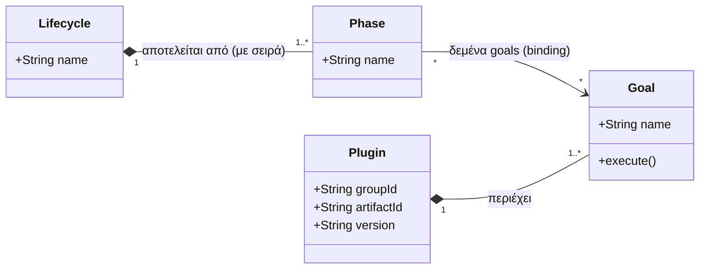
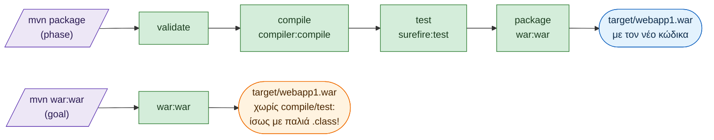

# Java Web Applications με Maven

Οδηγός για φοιτητές: πρώτα μια σύντομη εισαγωγή στο **Apache Maven** και μετά, βήμα‑βήμα,
η δημιουργία, το build και η εκτέλεση μιας Java web εφαρμογής (Servlets/JSP).

> Συνέχεια: [Forms.md](Forms.md): φόρμες με Servlets και JSP.

## Περιεχόμενα

- [Γρήγορη εκκίνηση με GitHub Codespaces](#γρήγορη-εκκίνηση-με-github-codespaces)
  - [Χρήστης για τον Tomcat Manager στο Codespaces](#χρήστης-για-τον-tomcat-manager-στο-codespaces)
- [Μέρος Α: Εισαγωγή στο Maven](#μέρος-α-εισαγωγή-στο-maven)
  - [1. Τι είναι το Maven](#1-τι-είναι-το-maven)
  - [2. Εγκατάσταση](#2-εγκατάσταση)
  - [3. Το αρχείο pom.xml](#3-το-αρχείο-pomxml)
  - [4. Η τυπική δομή φακέλων](#4-η-τυπική-δομή-φακέλων)
  - [5. Lifecycle, phases, plugins και goals](#5-lifecycle-phases-plugins-και-goals)
  - [6. Dependencies και scopes](#6-dependencies-και-scopes)
  - [7. Repositories](#7-repositories)
  - [8. Βασικές εντολές (cheat sheet)](#8-βασικές-εντολές-cheat-sheet)
  - [9. Archetypes](#9-archetypes)
- [Μέρος Β: Δημιουργία Java Web Application](#μέρος-β-δημιουργία-java-web-application)
  - [Βήμα 1: Δημιουργία project από archetype](#βήμα-1-δημιουργία-project-από-archetype)
  - [Βήμα 2: Τι δημιουργήθηκε](#βήμα-2-τι-δημιουργήθηκε)
  - [Βήμα 3: Εκσυγχρονισμός του pom.xml](#βήμα-3-εκσυγχρονισμός-του-pomxml)
  - [Βήμα 4: Εκσυγχρονισμός του web.xml](#βήμα-4-εκσυγχρονισμός-του-webxml)
  - [Βήμα 5: Το πρώτο Servlet](#βήμα-5-το-πρώτο-servlet)
  - [Βήμα 6: Ένα unit test](#βήμα-6-ένα-unit-test)
  - [Βήμα 7: Build](#βήμα-7-build)
  - [Βήμα 8: Εκτέλεση με Jetty](#βήμα-8-εκτέλεση-με-jetty)
  - [Jetty ή Tomcat;](#jetty-ή-tomcat)
  - [Βήμα 9: Εκτέλεση σε Apache Tomcat](#βήμα-9-εκτέλεση-σε-apache-tomcat)
- [Συχνά προβλήματα](#συχνά-προβλήματα)
- [Ασκήσεις](#ασκήσεις)

---

# Γρήγορη εκκίνηση με GitHub Codespaces

Αν δεν θέλετε (ή δεν μπορείτε) να εγκαταστήσετε τίποτα στον υπολογιστή σας, το repository έχει έτοιμο
**dev container** (φάκελος [.devcontainer/](.devcontainer/)). Ανοίγει ένα πλήρες περιβάλλον ανάπτυξης μέσα στον browser,
με όλα τα εργαλεία ήδη εγκατεστημένα:

| Εργαλείο              | Έκδοση / Θέση                                     |
|-----------------------|---------------------------------------------------|
| JDK                   | 21                                                |
| Maven                 | 3.9.11 (`mvn`)                                    |
| Apache Tomcat         | 11 στο `$CATALINA_HOME` (= `/home/vscode/tomcat`) |
| VS Code extensions    | Java Extension Pack, XML, Community Server Connectors (Tomcat), Mermaid preview |

**Άνοιγμα:**

1. Στη σελίδα του repository στο GitHub: πράσινο κουμπί **Code → καρτέλα Codespaces → Create codespace on main**.
2. Την πρώτη φορά η δημιουργία παίρνει μερικά λεπτά (κατεβαίνει το image, ο Tomcat και οι Maven dependencies).
   Την πρόοδο τη βλέπετε στο τερματικό (*View creation log*).
3. Ανοίγει ένα VS Code στον browser, με τερματικό (**Ctrl+`**) όπου δουλεύουν κανονικά όλες οι εντολές του οδηγού.

**Εκτέλεση της εφαρμογής:**

```bash
cd webapp1
mvn jetty:run                     # ή:
mvn clean package && cp target/webapp1.war $CATALINA_HOME/webapps/ && $CATALINA_HOME/bin/catalina.sh run
```

Όταν ο server ξεκινήσει στη θύρα 8080, το Codespaces εμφανίζει ειδοποίηση **«Open in Browser»**. Η εφαρμογή ανοίγει
σε διεύθυνση της μορφής `https://<όνομα-codespace>-8080.app.github.dev/`. Προσθέστε στο τέλος το context path:
**`/webapp1/`**. Όλες τις προωθημένες θύρες τις βλέπετε στην καρτέλα **Ports** (δίπλα στο *Terminal*).

Όπου ο οδηγός γράφει `http://localhost:8080/...`, στο Codespaces χρησιμοποιήστε τη διεύθυνση από την καρτέλα *Ports*.

### Χρήστης για τον Tomcat Manager στο Codespaces

Ο Tomcat του codespace είναι εγκατεστημένος στο `/home/vscode/tomcat` (= `$CATALINA_HOME`), **έξω** από τον φάκελο του project,
οπότε δεν φαίνεται στο Explorer. Για να ορίσετε χρήστη για το Manager UI (εξηγείται αναλυτικά στην [ενότητα 9.7](#97-deploy-από-τον-browser-tomcat-manager)):

1. Σταματήστε τον Tomcat αν τρέχει (Ctrl+C στο τερματικό του `catalina.sh run`).
2. Ανοίξτε το αρχείο στον editor του VS Code από το τερματικό:
   ```bash
   code $CATALINA_HOME/conf/tomcat-users.xml
   ```
3. Πριν από το `</tomcat-users>` (στο **τέλος** του αρχείου, **έξω** από τα σχόλια `<!-- -->`) προσθέστε:
   ```xml
   <role rolename="manager-gui"/>
   <user username="admin" password="Ενας-Δικος-Σας-Κωδικος" roles="manager-gui"/>
   ```
   και αποθηκεύστε (Ctrl+S).
4. Ελέγξτε ότι το XML είναι σωστό και ότι ο χρήστης δεν είναι μέσα σε σχόλιο:
   ```bash
   tail -5 $CATALINA_HOME/conf/tomcat-users.xml
   ```
5. Ξεκινήστε τον Tomcat: `$CATALINA_HOME/bin/catalina.sh run`.
6. Από την καρτέλα **Ports** ανοίξτε τη διεύθυνση της θύρας 8080 και προσθέστε στο τέλος **`/manager/html`**.
   Δώστε το username/password που ορίσατε.

> **Καλό να ξέρετε**
> - Οι θύρες ενός codespace είναι by default **private**: τις ανοίγετε μόνο εσείς, συνδεδεμένοι στο GitHub.
>   **Μην** κάνετε τη θύρα 8080 *Public* όσο ο Manager έχει απλό κωδικό.
> - Οι αλλαγές στο `tomcat-users.xml` **διατηρούνται** όταν το codespace σταματά και ξαναξεκινά. **Χάνονται** μόνο αν
>   κάνετε *Rebuild Container* ή φτιάξετε νέο codespace, γιατί τότε ο Tomcat εγκαθίσταται από την αρχή.
> - Αν μετά τη σύνδεση εμφανιστεί **403 Access Denied**, ελέγξτε πρώτα ότι ο ρόλος είναι γραμμένος σωστά (`manager-gui`).
>   Αν είναι σωστός, το πρόβλημα είναι ο περιορισμός του Manager σε συνδέσεις από `localhost`
>   (`$CATALINA_HOME/webapps/manager/META-INF/context.xml`, `RemoteCIDRValve`). Σε αυτή την περίπτωση χρησιμοποιήστε για deploy
>   την αντιγραφή του `.war` στο `webapps/` (ενότητα 9.4), που δεν χρειάζεται τον Manager.

> **Σημειώσεις**
> - Το Codespaces έχει περιορισμένες δωρεάν ώρες χρήσης το μήνα. Οι φοιτητές παίρνουν περισσότερες μέσω του
>   [GitHub Education](https://education.github.com). Σταματήστε το codespace όταν δεν το χρησιμοποιείτε
>   (σταματάει και μόνο του μετά από λίγη ώρα αδράνειας).
> - Το ίδιο περιβάλλον ανοίγει και **τοπικά**, αν έχετε Docker: VS Code + extension **Dev Containers** →
>   *Reopen in Container*.

---

# Μέρος Α: Εισαγωγή στο Maven

## 1. Τι είναι το Maven

Το **Maven** είναι εργαλείο *build automation* και *διαχείρισης εξαρτήσεων* για Java projects.
Αντί να κατεβάζουμε χειροκίνητα `.jar` αρχεία και να γράφουμε scripts για compile/test/πακετάρισμα,
περιγράφουμε το project σε ένα αρχείο (`pom.xml`) και το Maven:

- **κατεβάζει αυτόματα** τις βιβλιοθήκες (dependencies) που χρειαζόμαστε, μαζί με τις δικές τους εξαρτήσεις (transitive dependencies),
- **κάνει compile** τον κώδικα,
- **τρέχει τα tests**,
- **πακετάρει** το αποτέλεσμα (`.jar`, `.war`, …),
- ακολουθεί **συμβάσεις** (*convention over configuration*): αν βάλουμε τα αρχεία στους «σωστούς» φακέλους, δεν χρειάζεται σχεδόν καμία ρύθμιση.

Έτσι, οποιοσδήποτε μπορεί να πάρει το project και να το κάνει build με την ίδια εντολή, σε οποιοδήποτε IDE ή λειτουργικό.

## 2. Εγκατάσταση

Χρειάζεστε:

1. **JDK** (προτείνεται 21 ή νεότερο). Έλεγχος:
   ```bash
   java -version
   javac -version
   ```
2. **Maven** (3.9.x). Κατεβάστε το από <https://maven.apache.org/download.cgi>, αποσυμπιέστε το
   και προσθέστε τον φάκελο `bin` στο `PATH`. Σε Linux μπορείτε και από τον package manager
   (π.χ. `sudo apt install maven`, `sudo pacman -S maven`), σε macOS `brew install maven`.

   Έλεγχος:
   ```bash
   mvn -v
   ```
   Η έξοδος δείχνει την έκδοση του Maven **και** ποιο JDK χρησιμοποιεί. Αν δείχνει λάθος JDK,
   ρυθμίστε τη μεταβλητή `JAVA_HOME`.

> **Σημείωση:** Τα IntelliJ IDEA, Eclipse, NetBeans και VS Code (με το *Extension Pack for Java*)
> αναγνωρίζουν απευθείας Maven projects: απλώς ανοίγετε τον φάκελο που περιέχει το `pom.xml`.

## 3. Το αρχείο `pom.xml`

Το **POM** (*Project Object Model*) είναι η «ταυτότητα» του project. Ένα ελάχιστο παράδειγμα:

```xml
<project xmlns="http://maven.apache.org/POM/4.0.0"
         xmlns:xsi="http://www.w3.org/2001/XMLSchema-instance"
         xsi:schemaLocation="http://maven.apache.org/POM/4.0.0 https://maven.apache.org/xsd/maven-4.0.0.xsd">
  <modelVersion>4.0.0</modelVersion>

  <!-- Συντεταγμένες (coordinates) του project -->
  <groupId>gr.uniwa.ice</groupId>
  <artifactId>hello</artifactId>
  <version>1.0-SNAPSHOT</version>
  <packaging>jar</packaging>

  <properties>
    <maven.compiler.release>21</maven.compiler.release>
    <project.build.sourceEncoding>UTF-8</project.build.sourceEncoding>
  </properties>

  <dependencies>
    <!-- βιβλιοθήκες που χρειάζεται το project -->
  </dependencies>

  <build>
    <plugins>
      <!-- plugins και ρυθμίσεις τους -->
    </plugins>
  </build>
</project>
```

### Coordinates (GAV)

Κάθε project/βιβλιοθήκη στον κόσμο του Maven αναγνωρίζεται μοναδικά από τρία στοιχεία:

| Στοιχείο      | Σημασία                                                          | Παράδειγμα          |
|---------------|------------------------------------------------------------------|---------------------|
| `groupId`     | Ο οργανισμός/ομάδα, συνήθως αντεστραμμένο domain                 | `gr.uniwa.ice`      |
| `artifactId`  | Το όνομα του project                                              | `webapp1`           |
| `version`     | Η έκδοση. Το `-SNAPSHOT` σημαίνει «έκδοση υπό ανάπτυξη»          | `1.0-SNAPSHOT`      |

Επιπλέον, το `packaging` ορίζει τι θα παραχθεί: `jar` (default), `war` (web εφαρμογή), `pom` (γονικό/multi‑module project).

## 4. Η τυπική δομή φακέλων

```
my-project/
├── pom.xml
├── src/
│   ├── main/
│   │   ├── java/          ← κώδικας Java (packages)
│   │   ├── resources/     ← αρχεία ρυθμίσεων, .properties κ.λπ. (μπαίνουν στο classpath)
│   │   └── webapp/        ← (μόνο για war) JSP, HTML, CSS, JS, WEB-INF/web.xml
│   └── test/
│       ├── java/          ← κώδικας tests
│       └── resources/     ← αρχεία για τα tests
└── target/                ← ΕΔΩ γράφει το Maven ό,τι παράγει (classes, .jar/.war, reports)
```

> Ο φάκελος `target/` δημιουργείται αυτόματα και **δεν** μπαίνει στο git (προσθέστε τον στο `.gitignore`).
> Το `mvn clean` τον διαγράφει.

## 5. Lifecycle, phases, plugins και goals

Αυτές είναι οι τέσσερις πιο σημαντικές έννοιες του Maven.

### Με απλά λόγια

Αν ξέρετε Java, τα έχετε ήδη συναντήσει:

| Maven         | Σε Java θα ήταν…                                   | Καθημερινή αναλογία (κουζίνα)                         |
|---------------|----------------------------------------------------|-------------------------------------------------------|
| **Plugin**    | μια **κλάση**                                      | μια συσκευή: μίξερ, φούρνος                           |
| **Goal**      | μια **μέθοδος** της κλάσης (εκεί γίνεται η δουλειά) | μια λειτουργία της συσκευής: «χτύπημα», «ψήσιμο»      |
| **Phase**     | ένα **όνομα βήματος**, που μόνο του δεν κάνει τίποτα | ένα βήμα της συνταγής: «ανάμειξη», «ψήσιμο»          |
| **Lifecycle** | μια **λίστα από phases με σειρά**                  | ολόκληρη η συνταγή                                    |
| **Binding**   | ποιες μέθοδοι καλούνται σε κάθε βήμα               | «στο βήμα *ανάμειξη* χρησιμοποίησε το μίξερ»           |

Η πιο σημαντική ιδέα: **οι phases δεν κάνουν καμία δουλειά**. Είναι απλώς ονομασμένα σημεία
στη σειρά. Τη δουλειά την κάνουν τα **goals** που είναι «δεμένα» σε κάθε phase. Ποια goals είναι δεμένα
το αποφασίζει κυρίως το `<packaging>`. Γι' αυτό η phase `package` φτιάχνει `.jar` σε ένα project και `.war` σε άλλο.

Οι σχέσεις τους ως UML class diagram:



Διαβάζεται έτσι:

- Ένα **lifecycle** αποτελείται από μία ή περισσότερες **phases**, σε συγκεκριμένη σειρά.
- Ένα **plugin** περιέχει ένα ή περισσότερα **goals**. Κάθε goal ανήκει σε ακριβώς ένα plugin.
- Μια **phase** μπορεί να έχει κανένα, ένα ή πολλά δεμένα **goals** (η `validate` δεν έχει κανένα,
  η `test` έχει τρία). Ένα goal μπορεί να μην είναι δεμένο πουθενά (π.χ. το `dependency:tree`) και να το
  καλούμε μόνο απευθείας.

Και σε (ψευδο)κώδικα Java, αυτό που κάνει το Maven όταν γράφουμε `mvn package`:

```java
// Plugin = κλάση, Goal = μέθοδος
class CompilerPlugin { void compile() { /* ... */ }  void testCompile() { /* ... */ } }
class SurefirePlugin { void test()    { /* ... */ } }
class WarPlugin      { void war()     { /* ... */ } }

// Lifecycle = λίστα από phases με σειρά (οι phases είναι απλώς ονόματα)
List<String> defaultLifecycle =
    List.of("validate", "compile", "test", "package", "verify", "install", "deploy");

// Binding: ποια goals τρέχουν σε κάθε phase (για <packaging>war</packaging>)
Map<String, List<Runnable>> bindings = Map.of(
    "compile", List.of(compiler::compile),
    "test",    List.of(compiler::testCompile, surefire::test),
    "package", List.of(war::war));

// mvn package  →  περνάμε τις phases με τη σειρά, μέχρι και αυτήν που ζητήσαμε
for (String phase : defaultLifecycle) {
    bindings.getOrDefault(phase, List.of()).forEach(Runnable::run);
    if (phase.equals("package")) break;
}

// mvn war:war  →  καλούμε απευθείας μία μέθοδο, χωρίς lifecycle
war.war();
```

Στις επόμενες υποενότητες βλέπουμε κάθε έννοια αναλυτικά.

### Lifecycle και phases

Ένα **lifecycle** είναι μια σειρά από **phases** (φάσεις). Το Maven έχει τρία ενσωματωμένα lifecycles:

| Lifecycle  | Σκοπός                                  | Phases (με τη σειρά)                                   |
|------------|-----------------------------------------|--------------------------------------------------------|
| `clean`    | καθαρισμός (διαγραφή του `target/`)      | `pre-clean` → **`clean`** → `post-clean`               |
| `default`  | build: compile, test, πακετάρισμα, …     | `validate` → `compile` → … → `deploy` (βλ. παρακάτω)   |
| `site`     | παραγωγή ιστοσελίδας τεκμηρίωσης          | `pre-site` → **`site`** → `post-site` → `site-deploy`  |

**Τι είναι προκαθορισμένο και τι όχι:**

- **Προκαθορισμένα** (ίδια σε **κάθε** Maven project): τα τρία lifecycles, οι phases τους και η **σειρά** τους.
  Είναι ενσωματωμένα στο ίδιο το Maven. Δεν τα γράφουμε στο `pom.xml` και δεν αλλάζουμε τη σειρά τους.
- **Αλλάζει από project σε project:** **ποια goals** τρέχουν σε κάθε phase. Αυτό το καθορίζει κυρίως το `<packaging>`
  (π.χ. στη phase `package`: `jar:jar` για `jar`, `war:war` για `war`) και δευτερευόντως τα plugins που δηλώνουμε στο `pom.xml`.
  Οι phases δηλαδή είναι σαν τις **στάσεις μιας σταθερής διαδρομής**. Το project αποφασίζει τι θα γίνει σε κάθε στάση.
- Το όνομα **`default`** σημαίνει απλώς «**το κύριο lifecycle**, αυτό που κάνει το build» (στην τεκμηρίωση λέγεται και
  *build lifecycle*). **Δεν** σημαίνει «προεπιλογή που τρέχει αν δεν ζητήσουμε κάτι». Αν γράψετε σκέτο `mvn` χωρίς phase, δεν
  τρέχει τίποτα. Βγαίνει σφάλμα που, βολικά, απαριθμεί όλες τις προκαθορισμένες phases:
  ```
  [ERROR] No goals have been specified for this build. You must specify a valid lifecycle phase or a goal ...
  Available lifecycle phases are: pre-clean, clean, post-clean, validate, initialize, ..., deploy, pre-site, site, post-site, site-deploy.
  ```

> **Προσοχή στα ονόματα:** τα lifecycles `clean` και `site` έχουν μέσα τους μια **phase με το ίδιο όνομα**.
> Υπάρχει δηλαδή το *`clean` lifecycle* (όλη η σειρά `pre-clean` → `clean` → `post-clean`) και η
> *`clean` phase* (μόνο το μεσαίο βήμα, αυτό που διαγράφει το `target/`).
>
> Στην εντολή `mvn` γράφουμε **πάντα phases, ποτέ lifecycles**. Το `mvn clean` σημαίνει «εκτέλεσε
> το lifecycle στο οποίο ανήκει η phase `clean`, μέχρι και αυτήν»: εκτελούνται οι `pre-clean` και `clean`, αλλά όχι
> η `post-clean`. Το `default` lifecycle δεν έχει phase με το όνομά του, γι' αυτό δεν υπάρχει `mvn default`.
>
> Αν σας μπερδεύει μια λέξη, ρωτήστε το Maven: `mvn help:describe -Dcmd=clean` απαντά
> *"'clean' is a phase within the 'clean' lifecycle, which has the following phases: …"*.

Οι βασικές phases του `default` lifecycle, **με τη σειρά**:

| Phase       | Τι κάνει                                                              |
|-------------|-----------------------------------------------------------------------|
| `validate`  | ελέγχει ότι το project είναι σωστό και έχει όλες τις πληροφορίες       |
| `compile`   | κάνει compile τον κώδικα του `src/main/java` → `target/classes`        |
| `test`      | κάνει compile και τρέχει τα unit tests (`src/test/java`)               |
| `package`   | πακετάρει: `target/<όνομα>.jar` ή `.war`                               |
| `verify`    | τρέχει επιπλέον ελέγχους (π.χ. integration tests)                      |
| `install`   | αντιγράφει το πακέτο στο **τοπικό** repository (`~/.m2/repository`)   |
| `deploy`    | ανεβάζει το πακέτο σε **απομακρυσμένο** repository (για κοινή χρήση)   |

**Κανόνας-κλειδί:** όταν ζητάμε μια phase, εκτελούνται **και όλες οι προηγούμενες**.
Π.χ. το `mvn package` κάνει validate → compile → test → package.

Μπορούμε να δώσουμε πολλές phases μαζί: `mvn clean package` = «καθάρισε και μετά κάνε build».

Το παρακάτω σχήμα δείχνει τι εκτελεί η εντολή **`mvn clean package`** για ένα web project.
Τα μεγάλα πλαίσια είναι τα **lifecycles** και τα κουτιά μέσα τους είναι οι **phases**.
Με **πράσινο** οι phases που εκτελούνται και με **γκρι** όσες δεν εκτελούνται. Κάτω από το όνομα
κάθε phase φαίνονται τα goals (`plugin:goal`) που τρέχουν σε αυτήν (εξηγούνται στην επόμενη υποενότητα).
Το `clean` εμφανίζεται δύο φορές: ως πλαίσιο (lifecycle) και ως κουτί μέσα σε αυτό (phase).
Το `mvn clean package` ζητάει δύο **phases**: την `clean` (από το `clean` lifecycle) και την `package` (από το `default`).

```mermaid
flowchart LR
    subgraph CL["clean lifecycle"]
        direction LR
        c0["<b>pre-clean</b>"]
        c1["<b>clean</b><br/>clean:clean"]
        c2["<b>post-clean</b>"]
        c0 --> c1 --> c2
    end
    subgraph DL["default lifecycle"]
        direction LR
        p1["<b>validate</b>"]
        p2["<b>compile</b><br/>resources:resources<br/>compiler:compile"]
        p3["<b>test</b><br/>resources:testResources<br/>compiler:testCompile<br/>surefire:test"]
        p4["<b>package</b><br/>war:war"]
        p5["<b>verify</b>"]
        p6["<b>install</b><br/>install:install"]
        p7["<b>deploy</b><br/>deploy:deploy"]
        p1 --> p2 --> p3 --> p4 --> p5 --> p6 --> p7
    end
    CL ==> DL

    classDef run fill:#d4edda,stroke:#2e7d32,color:#1b3d1f
    classDef skip fill:#f1f1f1,stroke:#bbb,color:#999,stroke-dasharray:4 3
    class c0,c1,p1,p2,p3,p4 run
    class c2,p5,p6,p7 skip
```



> Στο σχήμα φαίνονται μόνο οι κύριες phases. Υπάρχουν και ενδιάμεσες (π.χ. `process-resources`,
> `test-compile`), που εδώ εμφανίζονται μέσα στην επόμενη κύρια phase. Την πλήρη λίστα τη δίνει η εντολή
> `mvn help:describe -Dcmd=deploy`.

> Τα διαγράμματα είναι σε [Mermaid](https://mermaid.js.org). Σχεδιάζονται αυτόματα στο GitHub/GitLab.
> Στο VS Code χρειάζεται το extension *Markdown Preview Mermaid Support*.

#### Δείτε το «build plan» του δικού σας project

Το σχήμα δείχνει τα **προκαθορισμένα** bindings για ένα `war` project. Για να δείτε **ακριβώς** τι θα εκτελεστεί στο
**δικό σας** project (με όποια plugins έχετε προσθέσει στο `pom.xml` και με τις ενδιάμεσες phases), υπάρχει το
plugin [buildplan-maven-plugin](https://github.com/jcgay/buildplan-maven-plugin). Τρέξτε το μέσα στον φάκελο του project:

```bash
mvn fr.jcgay.maven.plugins:buildplan-maven-plugin:list-phase -Dbuildplan.tasks=deploy
```

```
Build Plan for webapp1 Maven Webapp:
process-resources ---------------------------------------------------
    + maven-resources-plugin | default-resources     | resources
compile -------------------------------------------------------------
    + maven-compiler-plugin  | default-compile       | compile
process-test-resources ----------------------------------------------
    + maven-resources-plugin | default-testResources | testResources
test-compile --------------------------------------------------------
    + maven-compiler-plugin  | default-testCompile   | testCompile
test ----------------------------------------------------------------
    + maven-surefire-plugin  | default-test          | test
package -------------------------------------------------------------
    + maven-war-plugin       | default-war           | war
install -------------------------------------------------------------
    + maven-install-plugin   | default-install       | install
deploy --------------------------------------------------------------
    + maven-deploy-plugin    | default-deploy        | deploy
```

- Το `-Dbuildplan.tasks=` λέει **για ποιες phases** θέλουμε το πλάνο, π.χ. `-Dbuildplan.tasks=clean,package` για το
  `mvn clean package`. Αν το παραλείψετε, το plugin τυπώνει **κενό** πλάνο.
- Το plugin **δεν εκτελεί τίποτα**: δεν κάνει compile, ούτε tests, ούτε πακετάρισμα. Μόνο δείχνει τι **θα** γινόταν.
- Παραλλαγές: το goal `list` δίνει το ίδιο σε μορφή πίνακα (plugin | phase | goal) και το `list-plugin` το ομαδοποιεί ανά plugin.
- Το γράφουμε με το πλήρες όνομα (`groupId:artifactId:goal`), γιατί δεν είναι επίσημο plugin του Maven
  (δείτε «Η γενική μορφή της εντολής `mvn`» στην ενότητα 8).

> ⚠ **Μη γράψετε `mvn deploy fr.jcgay...:list-phase`.** Το `deploy` εκεί είναι **phase**, οπότε το Maven θα
> **εκτελέσει πρώτα** όλο το lifecycle μέχρι το deploy: compile, tests, `.war`, install στο `~/.m2`, και στο τέλος θα αποτύχει
> στο deploy, γιατί δεν έχουμε ορίσει απομακρυσμένο repository. Οι phases για τις οποίες θέλουμε το πλάνο δίνονται
> **μόνο** με το `-Dbuildplan.tasks`.

### Plugins και goals

Στην πραγματικότητα το Maven μόνο του δεν «ξέρει» να κάνει compile. Όλη η δουλειά γίνεται από **plugins**.
Κάθε plugin έχει ένα ή περισσότερα **goals** (συγκεκριμένες εργασίες). Για παράδειγμα, το `maven-compiler-plugin`
έχει τα goals `compile` και `testCompile`. Το συμβολίζουμε με τη μορφή `plugin:goal`, π.χ. `compiler:compile`.

Κάθε phase είναι «δεμένη» (*bound*) με κάποια goals. Όταν εκτελείται η phase, εκτελούνται αυτά τα goals:

| Phase      | Plugin:goal που εκτελείται (για `jar`/`war`)                                    |
|------------|---------------------------------------------------------------------------------|
| `clean`    | `clean:clean`                                                                   |
| `compile`  | `resources:resources` (αντιγραφή του `src/main/resources`), `compiler:compile`  |
| `test`     | `resources:testResources`, `compiler:testCompile`, `surefire:test`              |
| `package`  | `jar:jar` ή `war:war` (ανάλογα με το `<packaging>`)                             |
| `install`  | `install:install`                                                               |
| `deploy`   | `deploy:deploy`                                                                 |

Συνοπτικά: **lifecycle** → αποτελείται από **phases** → σε κάθε phase είναι δεμένα **goals** → κάθε goal ανήκει σε ένα **plugin**.

Αυτή η αλυσίδα φαίνεται στην έξοδο κάθε build. Π.χ. το `mvn clean package` τυπώνει:

```
[INFO] --- clean:3.2.0:clean (default-clean) @ webapp1 ---
[INFO] --- resources:3.3.1:resources (default-resources) @ webapp1 ---
[INFO] --- compiler:3.13.0:compile (default-compile) @ webapp1 ---
[INFO] --- resources:3.3.1:testResources (default-testResources) @ webapp1 ---
[INFO] --- compiler:3.13.0:testCompile (default-testCompile) @ webapp1 ---
[INFO] --- surefire:3.5.2:test (default-test) @ webapp1 ---
[INFO] --- war:3.4.0:war (default-war) @ webapp1 ---
```

(η μορφή είναι `plugin:έκδοση:goal`).

Ένα goal μπορεί να εκτελεστεί και **απευθείας**, με σύνταξη `plugin:goal`:

```bash
mvn dependency:tree       # goal "tree" του maven-dependency-plugin
mvn archetype:generate    # goal "generate" του maven-archetype-plugin
mvn jetty:run             # goal "run" του Jetty plugin
```

**Phase vs goal:** `mvn package` (phase, χωρίς `:`) τρέχει όλη την αλυσίδα του lifecycle.
`mvn war:war` (goal, με `:`) τρέχει **μόνο** αυτό το goal, χωρίς compile/test πριν:



## 6. Dependencies και scopes

Για να χρησιμοποιήσουμε μια βιβλιοθήκη, τη δηλώνουμε στο `<dependencies>` με τις συντεταγμένες της:

```xml
<dependency>
  <groupId>com.google.code.gson</groupId>
  <artifactId>gson</artifactId>
  <version>2.11.0</version>
</dependency>
```

Το Maven θα την κατεβάσει (μαζί με ό,τι χρειάζεται αυτή) την πρώτη φορά που θα τρέξει.
Τις συντεταγμένες οποιασδήποτε βιβλιοθήκης τις βρίσκετε στο <https://central.sonatype.com>
ή στο <https://mvnrepository.com>.

Το **scope** ορίζει *πότε* είναι διαθέσιμη η βιβλιοθήκη:

| Scope       | Compile | Test | Μπαίνει στο τελικό πακέτο; | Τυπική χρήση                                   |
|-------------|:-------:|:----:|:--------------------------:|------------------------------------------------|
| `compile`   | ✔       | ✔    | ✔                          | default — κανονικές βιβλιοθήκες                 |
| `provided`  | ✔       | ✔    | ✘                          | το παρέχει ο server, π.χ. **Servlet API**       |
| `runtime`   | ✘       | ✔    | ✔                          | π.χ. JDBC drivers                               |
| `test`      | ✘       | ✔    | ✘                          | JUnit, Mockito                                  |

> Για web εφαρμογές το **`provided`** είναι πολύ σημαντικό: το Servlet API το έχει ήδη ο Tomcat/Jetty,
> οπότε δεν πρέπει να μπει μέσα στο `.war`.

## 7. Repositories

- **Local repository** — `~/.m2/repository` (Windows: `C:\Users\<user>\.m2\repository`).
  Cache στον υπολογιστή σας με ό,τι έχει κατεβεί ή γίνει `install`. Αν «χαλάσει» κάτι, μπορείτε να διαγράψετε
  τον φάκελο της συγκεκριμένης βιβλιοθήκης και θα ξανακατέβει.
- **Remote repository** — κυρίως το **Maven Central** (<https://repo.maven.apache.org/maven2>), από όπου κατεβαίνουν όλα by default.

## 8. Βασικές εντολές (cheat sheet)

### Η γενική μορφή της εντολής `mvn`

```
mvn [options] <phase ή goal> [<phase ή goal> ...]
```

(το `mvn --help` το γράφει ως `usage: mvn [options] [<goal(s)>] [<phase(s)>]`)

Μετά το `mvn` γράφουμε **ένα ή περισσότερα** από τα εξής, χωρισμένα με κενό:

| Τι γράφουμε | Μορφή | Παράδειγμα | Τι εκτελείται |
|-------------|-------|------------|---------------|
| **phase**   | σκέτο όνομα, **χωρίς** `:` | `package` | όλες οι phases του lifecycle **μέχρι και αυτήν**, με όλα τα δεμένα goals τους |
| **goal** (σύντομη μορφή) | `prefix:goal` | `dependency:tree` | **μόνο** αυτό το goal |
| **goal** (πλήρης μορφή) | `groupId:artifactId[:version]:goal` | `org.apache.maven.plugins:maven-help-plugin:3.5.1:evaluate` | **μόνο** αυτό το goal, από τη συγκεκριμένη έκδοση του plugin |

- Το **`:`** είναι αυτό που ξεχωρίζει τα δύο: `package` είναι phase, `war:war` είναι goal.
- Το **prefix** είναι το σύντομο όνομα του plugin: `maven-dependency-plugin` → `dependency`, `maven-war-plugin` → `war`.
  Για τα επίσημα plugins του Maven δουλεύει πάντα. Για άλλα plugins (π.χ. Jetty → `jetty`) δουλεύει μόνο αν το plugin είναι
  δηλωμένο στο `pom.xml`. Γι' αυτό το `mvn jetty:run` δουλεύει μόνο μέσα στο project μας.
- Μπορούμε να **ανακατέψουμε** phases και goals. Εκτελούνται **με τη σειρά που τα γράψαμε**. Π.χ. το `mvn clean package dependency:tree`:
  ```
  [INFO] --- clean:3.2.0:clean ...                 ← phase clean
  [INFO] --- resources:3.3.1:resources ...         ┐
  [INFO] --- compiler:3.13.0:compile ...           │
  [INFO] --- resources:3.3.1:testResources ...     │ phase package
  [INFO] --- compiler:3.13.0:testCompile ...       │ (και όλες οι προηγούμενες)
  [INFO] --- surefire:3.5.2:test ...               │
  [INFO] --- war:3.4.0:war ...                     ┘
  [INFO] --- dependency:3.7.0:tree (default-cli)   ← goal (το "default-cli" = κλήθηκε από τη γραμμή εντολών)
  ```

**Options (flags):** ξεκινούν με `-` και αλλάζουν το *πώς* τρέχει το Maven. Οι πιο χρήσιμες:

| Option | Σημασία | Παράδειγμα |
|--------|---------|------------|
| `-D<όνομα>=<τιμή>` | ορίζει μια **ιδιότητα** (property). Έτσι δίνουμε ρυθμίσεις στα plugins | `mvn package -DskipTests` |
| `-q` | quiet: μόνο σφάλματα | `mvn -q package` |
| `-X` | debug: πάρα πολλά μηνύματα (troubleshooting) | `mvn -X package` |
| `-e` | δείχνει το πλήρες stack trace όταν κάτι αποτύχει | `mvn -e package` |
| `-o` | offline: χωρίς internet, μόνο από το `~/.m2` | `mvn -o package` |
| `-U` | ξαναελέγχει για νέες SNAPSHOT dependencies | `mvn -U package` |
| `-f <αρχείο>` | χρήση συγκεκριμένου `pom.xml` (π.χ. από άλλο φάκελο) | `mvn -f webapp1/pom.xml package` |
| `-B` | batch mode: μη διαδραστικό, χωρίς χρώματα (για scripts/CI) | `mvn -B package` |
| `-v` | έκδοση Maven και Java | `mvn -v` |

Ένα πλήρες παράδειγμα με όλα τα κομμάτια:

```
mvn  -q  -DskipTests  clean  package  dependency:tree
     └───options───┘  └─phases─────┘  └────goal─────┘
```

### Συνηθισμένες εντολές

| Εντολή                               | Τι κάνει                                                            |
|--------------------------------------|---------------------------------------------------------------------|
| `mvn -v`                             | έκδοση Maven και Java                                               |
| `mvn compile`                        | compile του κώδικα                                                  |
| `mvn test`                           | compile + εκτέλεση tests                                            |
| `mvn package`                        | compile + tests + δημιουργία `.jar`/`.war` στο `target/`            |
| `mvn clean`                          | διαγραφή του `target/`                                               |
| `mvn clean package`                  | «καθαρό» build από την αρχή (**η πιο συχνή εντολή**)                |
| `mvn clean install`                  | build + αντιγραφή στο `~/.m2` (για χρήση από άλλα δικά σας projects) |
| `mvn package -DskipTests`            | build χωρίς να τρέξουν τα tests                                      |
| `mvn test -Dtest=HelloServletTest`   | εκτέλεση μόνο ενός test class                                        |
| `mvn dependency:tree`                | δέντρο όλων των dependencies (και των transitive)                    |
| `mvn fr.jcgay.maven.plugins:buildplan-maven-plugin:list-phase -Dbuildplan.tasks=deploy` | ποια goals θα εκτελεστούν σε κάθε phase (χωρίς να εκτελεστεί τίποτα, βλ. ενότητα 5) |
| `mvn help:effective-pom`             | το «πλήρες» POM με όλα τα defaults που εφαρμόζονται                  |
| `mvn versions:display-dependency-updates` | ποιες dependencies έχουν νεότερη έκδοση                         |

## 9. Archetypes

Ένα **archetype** είναι ένα *πρότυπο (template) project*. Με το goal `archetype:generate` το Maven
δημιουργεί έτοιμη τη δομή φακέλων και το `pom.xml`. Μερικά γνωστά archetypes:

| archetypeArtifactId           | Τελευταία έκδοση | Τι δημιουργεί                         |
|-------------------------------|------------------|---------------------------------------|
| `maven-archetype-quickstart`  | 1.5              | απλή Java εφαρμογή (`jar`)            |
| `maven-archetype-webapp`      | 1.5              | Java web εφαρμογή (`war`)             |

Παράδειγμα για απλή (μη web) εφαρμογή:

```bash
mvn archetype:generate \
  -DgroupId=gr.uniwa.ice \
  -DartifactId=hello \
  -DarchetypeArtifactId=maven-archetype-quickstart \
  -DarchetypeVersion=1.5 \
  -DinteractiveMode=false
```

Αν παραλείψετε το `-DinteractiveMode=false`, το Maven θα σας ρωτήσει διαδραστικά τις τιμές.

> ⚠ **Δηλώνετε πάντα την έκδοση με `-DarchetypeVersion`.** Χωρίς αυτήν, το Maven παίρνει την έκδοση από τον
> εσωτερικό του κατάλογο. Για το `maven-archetype-webapp` αυτή είναι η **1.0**, ένα πολύ παλιό πρότυπο με JUnit 3.8 και
> `web.xml` του 2001. Τις διαθέσιμες εκδόσεις ενός archetype τις βλέπετε στο <https://central.sonatype.com>.

> **Άλλα archetypes:** Για εφαρμογές **Jakarta EE** που τρέχουν σε πλήρη *application server* (GlassFish, WildFly,
> Payara, TomEE, Open Liberty) υπάρχει το επίσημο **Eclipse Starter for Jakarta EE**
> (`org.eclipse.starter:jakarta-starter`, και σε web μορφή στο <https://start.jakarta.ee>). Φτιάχνει σύγχρονο project
> (Java 21, Jakarta EE 10/11), αλλά το παράδειγμά του είναι **REST service**, που **δεν** τρέχει σε σκέτο Tomcat/Jetty.
> Για Servlets/JSP σε Tomcat, που κάνουμε εδώ, χρησιμοποιούμε το `maven-archetype-webapp`.

---

# Μέρος Β: Δημιουργία Java Web Application

Στόχος: μια web εφαρμογή με ένα JSP και ένα Servlet, που τρέχει σε Jetty (από το Maven) και σε Apache Tomcat.

> Οι οδηγίες χρησιμοποιούν **Jakarta Servlet 6.0** (packages `jakarta.servlet.*`), δηλαδή
> Tomcat 10.1+/11 ή Jetty 12. Παλιότερα tutorials χρησιμοποιούν `javax.servlet.*` — αυτά
> **δεν** δουλεύουν σε Tomcat 10+.

## Βήμα 1: Δημιουργία project από archetype

Σε Linux/macOS:

```bash
mvn archetype:generate \
  -DgroupId=gr.uniwa.ice \
  -DartifactId=webapp1 \
  -DarchetypeArtifactId=maven-archetype-webapp \
  -DarchetypeVersion=1.5 \
  -DinteractiveMode=false
```

Σε Windows (PowerShell), είτε όλα σε μία γραμμή είτε με backtick `` ` `` για αλλαγή γραμμής
(και με εισαγωγικά γύρω από κάθε `-D…`):

```powershell
mvn archetype:generate "-DgroupId=gr.uniwa.ice" "-DartifactId=webapp1" "-DarchetypeArtifactId=maven-archetype-webapp" "-DarchetypeVersion=1.5" "-DinteractiveMode=false"
```

Τι σημαίνει κάθε παράμετρος:

| Παράμετρος                                   | Σημασία                                                  |
|----------------------------------------------|----------------------------------------------------------|
| `archetype:generate`                         | goal `generate` του plugin `archetype`                    |
| `-DgroupId=gr.uniwa.ice`                     | το groupId του νέου project                               |
| `-DartifactId=webapp1`                       | το όνομα του project — και του φακέλου που θα δημιουργηθεί |
| `-DarchetypeArtifactId=maven-archetype-webapp` | ποιο πρότυπο να χρησιμοποιηθεί                           |
| `-DarchetypeVersion=1.5`                     | ποια **έκδοση** του προτύπου. **Μην την παραλείψετε**: χωρίς αυτήν το Maven παίρνει την πολύ παλιά 1.0 (βλ. ενότητα 9) |
| `-DinteractiveMode=false`                    | να μη ρωτήσει τίποτα, να χρησιμοποιήσει defaults          |

Η πρώτη εκτέλεση αργεί λίγο γιατί κατεβαίνουν plugins στο `~/.m2`. Στο τέλος πρέπει να δείτε `BUILD SUCCESS`.

```bash
cd webapp1
```

## Βήμα 2: Τι δημιουργήθηκε

```
webapp1/
├── .mvn/
│   ├── jvm.config
│   └── maven.config
├── pom.xml
└── src/
    └── main/
        └── webapp/
            ├── index.jsp
            └── WEB-INF/
                └── web.xml
```

Παρατηρήσεις:

- Το `packaging` στο `pom.xml` είναι `war`.
- **Δεν** υπάρχει φάκελος `src/main/java`. Θα τον φτιάξουμε εμείς.
- Ο φάκελος `.mvn/` έχει δύο **κενά** αρχεία. Εκεί μπορεί κανείς να γράψει ρυθμίσεις που ισχύουν για το συγκεκριμένο project:
  options του Maven στο `maven.config` (π.χ. `-B`) και options της JVM που τρέχει το Maven στο `jvm.config` (π.χ. `-Xmx1g`).
  Τα αφήνουμε όπως είναι.
- Το `pom.xml` έχει ήδη **κλειδωμένες εκδόσεις** για όλα τα plugins (στο `<pluginManagement>`). Αυτό είναι καλή πρακτική.
- Το πρότυπο όμως είναι φτιαγμένο για **παλιότερη Java**. Αυτά πρέπει να αλλάξουν:

  | Τι έφτιαξε το archetype                                    | Τι θέλουμε                                    |
  |------------------------------------------------------------|-----------------------------------------------|
  | Java **8** (`maven.compiler.source/target`)                | Java **21** (`maven.compiler.release`)        |
  | **JUnit 4**                                                | **JUnit 5** (Jupiter)                         |
  | **κανένα** Servlet API                                     | `jakarta.servlet-api` 6.0 (`provided`)        |
  | `web.xml` **4.0**, namespace **Java EE** (`xmlns.jcp.org`, εποχή `javax.*`) | `web.xml` **6.0**, namespace **Jakarta EE** |
  | χωρίς server για εκτέλεση                                  | Jetty plugin για `mvn jetty:run`              |

  Στα επόμενα δύο βήματα τα εκσυγχρονίζουμε.

## Βήμα 3: Εκσυγχρονισμός του `pom.xml`

Αντικαταστήστε **όλο** το περιεχόμενο του `pom.xml` με το παρακάτω:

```xml
<project xmlns="http://maven.apache.org/POM/4.0.0"
         xmlns:xsi="http://www.w3.org/2001/XMLSchema-instance"
         xsi:schemaLocation="http://maven.apache.org/POM/4.0.0 https://maven.apache.org/xsd/maven-4.0.0.xsd">
  <modelVersion>4.0.0</modelVersion>

  <groupId>gr.uniwa.ice</groupId>
  <artifactId>webapp1</artifactId>
  <version>1.0-SNAPSHOT</version>
  <packaging>war</packaging>
  <name>webapp1 Maven Webapp</name>

  <properties>
    <!-- Έκδοση Java για την οποία γίνεται compile -->
    <maven.compiler.release>21</maven.compiler.release>
    <project.build.sourceEncoding>UTF-8</project.build.sourceEncoding>
  </properties>

  <dependencies>
    <!-- Servlet API: provided, γιατί το παρέχει ο server (Tomcat/Jetty) -->
    <dependency>
      <groupId>jakarta.servlet</groupId>
      <artifactId>jakarta.servlet-api</artifactId>
      <version>6.0.0</version>
      <scope>provided</scope>
    </dependency>

    <!-- JUnit 5 για unit tests -->
    <dependency>
      <groupId>org.junit.jupiter</groupId>
      <artifactId>junit-jupiter</artifactId>
      <version>5.11.4</version>
      <scope>test</scope>
    </dependency>
  </dependencies>

  <build>
    <!-- Όνομα του παραγόμενου αρχείου: target/webapp1.war -->
    <finalName>webapp1</finalName>

    <plugins>
      <plugin>
        <groupId>org.apache.maven.plugins</groupId>
        <artifactId>maven-compiler-plugin</artifactId>
        <version>3.13.0</version>
      </plugin>
      <plugin>
        <groupId>org.apache.maven.plugins</groupId>
        <artifactId>maven-surefire-plugin</artifactId>
        <version>3.5.2</version>
      </plugin>
      <plugin>
        <groupId>org.apache.maven.plugins</groupId>
        <artifactId>maven-war-plugin</artifactId>
        <version>3.4.0</version>
      </plugin>

      <!-- Jetty: ενσωματωμένος web server για εκτέλεση με "mvn jetty:run" -->
      <plugin>
        <groupId>org.eclipse.jetty.ee10</groupId>
        <artifactId>jetty-ee10-maven-plugin</artifactId>
        <version>12.0.16</version>
        <configuration>
          <webApp>
            <contextPath>/webapp1</contextPath>
          </webApp>
        </configuration>
      </plugin>
    </plugins>
  </build>
</project>
```

> Αν έχετε JDK 17, αλλάξτε το `maven.compiler.release` σε `17`.

### Τι σημαίνει το `<scope>`

Κάθε `<dependency>` μπορεί να έχει ένα **`<scope>`**. Το scope λέει στο Maven **σε ποιες φάσεις χρειάζεται η βιβλιοθήκη**
και, κυρίως για εμάς, **αν θα μπει μέσα στο `.war`**. Μια βιβλιοθήκη μπορεί να χρειάζεται σε τρία διαφορετικά σημεία:

1. για το **compile** του κώδικά μας (`src/main/java`),
2. για τα **tests** (`src/test/java`),
3. όταν **τρέχει** η εφαρμογή στον server. Για να είναι διαθέσιμη τότε, πρέπει να υπάρχει στο `WEB-INF/lib/` του `.war`,
   **εκτός** αν την έχει ήδη ο server.

Στο `pom.xml` μας υπάρχουν δύο scopes:

| Dependency | Scope | Compile `src/main` | Tests | Μέσα στο `.war`; | Γιατί |
|------------|-------|:------------------:|:-----:|:----------------:|-------|
| `jakarta.servlet-api` | **`provided`** | ✔ | ✔ | ✘ | Χωρίς αυτήν δεν γίνεται compile το `HelloServlet` (`import jakarta.servlet...`). Όταν όμως τρέχει η εφαρμογή, το Servlet API το **παρέχει** (*provides*) ο server: ο Tomcat έχει δικό του αντίγραφο στο `$CATALINA_HOME/lib/servlet-api.jar`. Αν βάζαμε και δεύτερο αντίγραφο στο `.war`, θα συγκρουόταν με αυτό του server |
| `junit-jupiter` | **`test`** | ✘ | ✔ | ✘ | Το JUnit χρειάζεται **μόνο** για τα tests. Δεν έχει καμία δουλειά στον server |

Και αν **δεν** γράψουμε `<scope>`; Τότε ισχύει το default, **`compile`**: η βιβλιοθήκη είναι διαθέσιμη παντού **και** μπαίνει
στο `WEB-INF/lib/` του `.war`. Αυτό θέλουμε για κανονικές βιβλιοθήκες που ο server δεν έχει, π.χ. τη JSTL του
[Forms.md](Forms.md) ή μια βιβλιοθήκη για JSON (Gson). Όλα τα scopes συγκεντρωμένα είναι στον πίνακα της
[ενότητας 6](#6-dependencies-και-scopes).

Το scope φαίνεται και στην πράξη:

- Το `mvn dependency:list` δείχνει το scope στο τέλος κάθε γραμμής. Παρατηρήστε ότι και οι βιβλιοθήκες που φέρνει
  μαζί του το JUnit (transitive) «κληρονομούν» το scope `test`:
  ```
  jakarta.servlet:jakarta.servlet-api:jar:6.0.0:provided
  org.junit.jupiter:junit-jupiter:jar:5.11.4:test
  org.junit.jupiter:junit-jupiter-api:jar:5.11.4:test
  org.opentest4j:opentest4j:jar:1.3.0:test
  ...
  ```
- Μετά το build (Βήμα 7), το `.war` **δεν** περιέχει ούτε το Servlet API ούτε το JUnit.
- Αν κάνετε `import org.junit...` σε μια κλάση του `src/main/java`, το compile αποτυγχάνει
  (`package org.junit.jupiter.api does not exist`): εκεί το JUnit δεν «φαίνεται», λόγω του scope `test`.

## Βήμα 4: Εκσυγχρονισμός του `web.xml`

Αντικαταστήστε το `src/main/webapp/WEB-INF/web.xml` με:

```xml
<?xml version="1.0" encoding="UTF-8"?>
<web-app xmlns="https://jakarta.ee/xml/ns/jakartaee"
         xmlns:xsi="http://www.w3.org/2001/XMLSchema-instance"
         xsi:schemaLocation="https://jakarta.ee/xml/ns/jakartaee
                             https://jakarta.ee/xml/ns/jakartaee/web-app_6_0.xsd"
         version="6.0">
  <display-name>webapp1</display-name>
  <welcome-file-list>
    <welcome-file>index.jsp</welcome-file>
  </welcome-file-list>
</web-app>
```

> **Γιατί;** Το `web.xml` του archetype είναι έκδοση 4.0 (Java EE 8, εποχή `javax.*`). Ο κώδικάς μας και οι servers
> που χρησιμοποιούμε (Tomcat 10.1+/11, Jetty 12) είναι **Jakarta EE** (`jakarta.*`), οπότε δηλώνουμε την αντίστοιχη έκδοση,
> 6.0, με το νέο namespace `https://jakarta.ee/xml/ns/jakartaee`. Ακόμα παλιότερα αρχεία `web.xml` (π.χ. το 2.3 της
> έκδοσης 1.0 του archetype) είναι χειρότερα: ο server **απενεργοποιεί** σύγχρονες δυνατότητες, όπως τα annotations
> `@WebServlet` και το Expression Language (`${...}`) στα JSP.

## Βήμα 5: Το πρώτο Servlet

Δημιουργήστε τον φάκελο για τον κώδικα Java (το package `gr.uniwa.ice.webapp1` αντιστοιχεί σε φακέλους):

```bash
mkdir -p src/main/java/gr/uniwa/ice/webapp1
mkdir -p src/test/java/gr/uniwa/ice/webapp1
```

Αρχείο `src/main/java/gr/uniwa/ice/webapp1/HelloServlet.java`:

```java
package gr.uniwa.ice.webapp1;

import jakarta.servlet.annotation.WebServlet;
import jakarta.servlet.http.HttpServlet;
import jakarta.servlet.http.HttpServletRequest;
import jakarta.servlet.http.HttpServletResponse;

import java.io.IOException;
import java.io.PrintWriter;

@WebServlet("/hello")   // το servlet απαντά στο URL  /webapp1/hello
public class HelloServlet extends HttpServlet {

    @Override
    protected void doGet(HttpServletRequest req, HttpServletResponse resp)
            throws IOException {
        String name = req.getParameter("name");   // ?name=...
        if (name == null || name.isBlank()) {
            name = "κόσμε";
        }
        resp.setContentType("text/html; charset=UTF-8");
        try (PrintWriter out = resp.getWriter()) {
            out.println("<!DOCTYPE html>");
            out.println("<html><body>");
            out.println("<h1>Γεια σου, " + escape(name) + "!</h1>");
            out.println("</body></html>");
        }
    }

    /** Απλό HTML escaping ώστε να μην μπορεί ο χρήστης να «περάσει» HTML/JavaScript (XSS). */
    static String escape(String s) {
        return s.replace("&", "&amp;").replace("<", "&lt;").replace(">", "&gt;");
    }
}
```

## Βήμα 6: Ένα unit test

Αρχείο `src/test/java/gr/uniwa/ice/webapp1/HelloServletTest.java`:

```java
package gr.uniwa.ice.webapp1;

import org.junit.jupiter.api.Test;
import static org.junit.jupiter.api.Assertions.assertEquals;

class HelloServletTest {

    @Test
    void escapesHtml() {
        assertEquals("&lt;b&gt;", HelloServlet.escape("<b>"));
    }
}
```

Η τελική δομή του project:

```
webapp1/
├── pom.xml
└── src/
    ├── main/
    │   ├── java/gr/uniwa/ice/webapp1/HelloServlet.java
    │   └── webapp/
    │       ├── index.jsp
    │       └── WEB-INF/web.xml
    └── test/
        └── java/gr/uniwa/ice/webapp1/HelloServletTest.java
```

## Βήμα 7: Build

```bash
mvn clean package
```

Θα δείτε να τρέχει το test (`Tests run: 1, Failures: 0`) και στο τέλος `BUILD SUCCESS`.
Το αποτέλεσμα είναι το αρχείο **`target/webapp1.war`**. Μπορείτε να δείτε τι περιέχει:

```bash
jar tf target/webapp1.war
```

```
index.jsp
WEB-INF/web.xml
WEB-INF/classes/gr/uniwa/ice/webapp1/HelloServlet.class
META-INF/...
```

Παρατηρήστε ότι το Servlet API **δεν** υπάρχει μέσα στο `.war` (λόγω `provided`),
ούτε το JUnit (λόγω `test`). Αν προσθέσετε dependencies με scope `compile`, θα εμφανιστούν στο `WEB-INF/lib/`.

## Βήμα 8: Εκτέλεση με Jetty

Ο πιο γρήγορος τρόπος για ανάπτυξη — δεν χρειάζεται να εγκαταστήσετε server:

```bash
mvn jetty:run
```

Όταν δείτε `Started Server`, ανοίξτε στον browser:

- <http://localhost:8080/webapp1/> → η σελίδα `index.jsp` («Hello World!»)
- <http://localhost:8080/webapp1/hello> → το servlet («Γεια σου, κόσμε!»)
- <http://localhost:8080/webapp1/hello?name=Μαρία> → «Γεια σου, Μαρία!»

Τερματισμός με **Ctrl+C**.

> Αν η θύρα 8080 είναι πιασμένη: `mvn jetty:run -Djetty.http.port=9090`

## Jetty ή Tomcat;

### Τι κοινό έχουν

Ο **Eclipse Jetty** και ο **Apache Tomcat** είναι και οι δύο **servlet containers**: web servers που
υλοποιούν τις προδιαγραφές Jakarta **Servlet**, **JSP**, **Expression Language** και **WebSocket**. Και οι δύο είναι
open source και δωρεάν. Ο Jetty αναπτύσσεται από το Eclipse Foundation και ο Tomcat από το Apache Software Foundation.

Επειδή υλοποιούν **τις ίδιες προδιαγραφές**, **το ίδιο `.war` τρέχει και στους δύο χωρίς καμία αλλαγή**.
Ο κώδικάς μας χρησιμοποιεί μόνο `jakarta.servlet.*` και δεν «ξέρει» σε ποιον server τρέχει.
Ακόμα και τα JSP μεταγλωττίζονται με τον ίδιο μηχανισμό: ο Jetty χρησιμοποιεί τον **Jasper**, τον JSP compiler του Tomcat.

> Κανένας από τους δύο **δεν** είναι πλήρης *Jakarta EE application server* (όπως WildFly, GlassFish, Payara, Open Liberty).
> Δεν περιλαμβάνουν, π.χ., JPA ή CDI. Αν τα χρειαστούμε, τα προσθέτουμε ως dependencies στο `pom.xml`.

### Σε τι διαφέρουν (όπως τους χρησιμοποιούμε εδώ)

|                              | **Jetty** μέσω `mvn jetty:run`                                        | **Tomcat** (εγκατεστημένος)                                    |
|------------------------------|------------------------------------------------------------------------|----------------------------------------------------------------|
| Εγκατάσταση                  | καμία: το Maven κατεβάζει το plugin                                    | download και αποσυμπίεση, ρύθμιση `JAVA_HOME`                  |
| Εκκίνηση                     | `mvn jetty:run` μέσα στον φάκελο του project                            | `catalina.sh run` / `startup.sh`                               |
| Από πού τρέχει η εφαρμογή    | **απευθείας** από τα `src/main/webapp/` και `target/classes/`. **Δεν χρειάζεται `.war`** | από το **`.war`** στο `webapps/`              |
| Αλλαγή σε JSP / CSS / HTML   | φαίνεται με απλό refresh (σε λίγα δευτερόλεπτα)                       | νέο `mvn package` και αντιγραφή του `.war`                     |
| Αλλαγή σε κώδικα Java        | Ctrl+C και ξανά `mvn jetty:run` (ή αυτόματα, βλ. παρακάτω)             | νέο `mvn package` και αντιγραφή του `.war` (αυτόματο redeploy) |
| Πόσες εφαρμογές              | μία: το project που τρέχουμε                                          | **πολλές** ταυτόχρονα, μία ανά `.war`                          |
| Ρυθμίσεις                    | στο `pom.xml` (`<configuration>` του plugin)                           | αρχεία στο `conf/` (`server.xml`, `tomcat-users.xml`, …)       |
| Διαχείριση από browser       | όχι                                                                    | ναι, Tomcat Manager (9.7)                                      |
| Logs                         | στο τερματικό                                                          | στο τερματικό (`catalina.sh run`) ή στον φάκελο `logs/`        |

### Ποιον να χρησιμοποιήσω;

- **Κατά την ανάπτυξη:** `mvn jetty:run`. Ξεκινά με μία εντολή, δεν θέλει εγκατάσταση, και οι αλλαγές σε JSP/CSS φαίνονται αμέσως.
- **Για να δείτε πώς γίνεται πραγματικό deploy:** Tomcat. Είναι ο πιο διαδεδομένος standalone servlet container,
  και η διαδικασία `.war` → server είναι αυτή που θα συναντήσετε σε πραγματικούς servers.
- Και στην αγορά χρησιμοποιούνται και οι δύο. Συχνά μάλιστα **ενσωματωμένοι** μέσα σε μια εφαρμογή αντί για ξεχωριστό
  πρόγραμμα. Για παράδειγμα, το Spring Boot έχει by default ενσωματωμένο Tomcat και προαιρετικά Jetty.

> **Tip: αυτόματο reload στο Jetty.** Προσθέστε `<scan>1</scan>` στο `<configuration>` του Jetty plugin:
> ```xml
> <configuration>
>   <scan>1</scan>
>   <webApp>
>     <contextPath>/webapp1</contextPath>
>   </webApp>
> </configuration>
> ```
> Αφήστε το `mvn jetty:run` να τρέχει και, μετά από κάθε αλλαγή σε Java, τρέξτε σε **δεύτερο τερματικό** `mvn compile`.
> Το Jetty βλέπει τα νέα `.class` και ξαναφορτώνει μόνο του την εφαρμογή μέσα σε λίγα δευτερόλεπτα.
> Προσοχή: με το reload χάνονται τα δεδομένα που κρατάει η εφαρμογή στη μνήμη.

## Βήμα 9: Εκτέλεση σε Apache Tomcat

Ας δούμε τώρα πώς γίνεται deploy σε έναν **ξεχωριστό** servlet container, τον **Apache Tomcat**. Ο Tomcat είναι ένα αυτόνομο
πρόγραμμα: το εγκαθιστούμε μία φορά και μπορεί να «φιλοξενεί» πολλές web εφαρμογές ταυτόχρονα.

### 9.1 Ποια έκδοση Tomcat

| Tomcat   | Servlet API        | Packages     | Ελάχιστη Java |
|----------|--------------------|--------------|---------------|
| 9.0      | 4.0                | `javax.*`    | 8             |
| 10.1     | 6.0                | `jakarta.*`  | 11            |
| **11.0** | 6.1                | `jakarta.*`  | 17            |

Ο κώδικάς μας χρησιμοποιεί `jakarta.servlet` (Servlet 6.0), οπότε χρειάζεστε **Tomcat 10.1 ή 11**
(προτείνεται ο 11). Ο Tomcat **9 δεν θα δουλέψει**.

### 9.2 Εγκατάσταση

1. Από το <https://tomcat.apache.org/download-11.cgi>, ενότητα **Binary Distributions → Core**, κατεβάστε:
   - Linux/macOS: το **`tar.gz`**
   - Windows: το **`zip`** (64-bit Windows zip). Ο Windows Service Installer **δεν** συνιστάται για ανάπτυξη.
2. Αποσυμπιέστε το σε έναν φάκελο **χωρίς κενά και ελληνικά** στη διαδρομή, π.χ.:
   ```bash
   mkdir -p ~/opt && cd ~/opt
   tar xzf ~/Downloads/apache-tomcat-11.0.*.tar.gz
   ```
   Στα Windows αποσυμπιέστε το zip π.χ. στο `C:\tools\`.
3. Ο φάκελος που προκύπτει (π.χ. `~/opt/apache-tomcat-11.0.27`) λέγεται **`CATALINA_HOME`**:
   ```
   apache-tomcat-11.0.x/
   ├── bin/       ← scripts εκκίνησης/τερματισμού (startup, shutdown, catalina)
   ├── conf/      ← ρυθμίσεις (server.xml, tomcat-users.xml, …)
   ├── lib/       ← βιβλιοθήκες του Tomcat (εδώ βρίσκεται και το Servlet API)
   ├── logs/      ← αρχεία καταγραφής
   ├── webapps/   ← ΕΔΩ μπαίνουν οι εφαρμογές (.war)
   ├── work/      ← προσωρινά αρχεία (π.χ. τα JSP μεταγλωττισμένα σε Java)
   └── temp/
   ```
4. Ο Tomcat χρειάζεται να βρει τη Java: πρέπει να είναι ορισμένο το **`JAVA_HOME`** (ή το `JRE_HOME`).
   Για ευκολία ορίστε και το `CATALINA_HOME`:

   Linux/macOS (π.χ. στο `~/.bashrc` ή `~/.zshrc`):
   ```bash
   export JAVA_HOME=/usr/lib/jvm/java-21-openjdk     # προσαρμόστε στο σύστημά σας
   export CATALINA_HOME=~/opt/apache-tomcat-11.0.27
   ```
   Windows (PowerShell, μόνιμα για τον χρήστη):
   ```powershell
   setx JAVA_HOME "C:\Program Files\Eclipse Adoptium\jdk-21"
   setx CATALINA_HOME "C:\tools\apache-tomcat-11.0.27"
   ```
   (ανοίξτε νέο τερματικό μετά το `setx`).

   > Αν έχετε αποσυμπιέσει **zip** σε Linux/macOS, δώστε δικαίωμα εκτέλεσης στα scripts:
   > `chmod +x $CATALINA_HOME/bin/*.sh`

### 9.3 Εκκίνηση και τερματισμός

Υπάρχουν δύο τρόποι εκκίνησης:

| Εντολή (Linux/macOS)             | Εντολή (Windows)                 | Τι κάνει                                                                     |
|----------------------------------|----------------------------------|------------------------------------------------------------------------------|
| `$CATALINA_HOME/bin/catalina.sh run` | `%CATALINA_HOME%\bin\catalina.bat run` | Τρέχει **στο προσκήνιο**: τα logs φαίνονται στο τερματικό, σταματάει με **Ctrl+C**. **Προτείνεται για ανάπτυξη.** |
| `$CATALINA_HOME/bin/startup.sh`  | `%CATALINA_HOME%\bin\startup.bat`  | Τρέχει **στο παρασκήνιο**. Τα logs πάνε στο `logs/catalina.out`.              |
| `$CATALINA_HOME/bin/shutdown.sh` | `%CATALINA_HOME%\bin\shutdown.bat` | Σταματάει τον Tomcat που ξεκίνησε με `startup`.                              |

Μετά την εκκίνηση, ανοίξτε <http://localhost:8080>. Πρέπει να δείτε τη σελίδα καλωσορίσματος του Tomcat.

### 9.4 Deploy της εφαρμογής

Ο Tomcat έχει **auto-deploy**: παρακολουθεί τον φάκελο `webapps/` και, όταν βρει ένα νέο `.war`,
το αποσυμπιέζει και ξεκινάει την εφαρμογή **χωρίς επανεκκίνηση**.

```bash
cd webapp1                                   # ο φάκελος του project
mvn clean package
cp target/webapp1.war $CATALINA_HOME/webapps/
```

Windows (PowerShell):
```powershell
mvn clean package
Copy-Item target\webapp1.war $env:CATALINA_HOME\webapps\
```

Στο log θα εμφανιστεί κάτι σαν:

```
INFO [...] HostConfig.deployWAR Deploying web application archive [.../webapps/webapp1.war]
INFO [...] HostConfig.deployWAR Deployment of web application archive [.../webapps/webapp1.war] has finished in [416] ms
```

Ανοίξτε:

- <http://localhost:8080/webapp1/> → `index.jsp`
- <http://localhost:8080/webapp1/hello?name=Μαρία> → το servlet

### 9.5 Context path

Το πρώτο κομμάτι του URL (το **context path**) προκύπτει από το **όνομα του αρχείου `.war`**:

| Αρχείο στο `webapps/` | URL                                  |
|-----------------------|--------------------------------------|
| `webapp1.war`         | `http://localhost:8080/webapp1/`     |
| `shop.war`            | `http://localhost:8080/shop/`        |
| `ROOT.war`            | `http://localhost:8080/` (ρίζα)      |

Γι' αυτό στο `pom.xml` ορίσαμε `<finalName>webapp1</finalName>`: χωρίς αυτό το αρχείο θα λεγόταν
`webapp1-1.0-SNAPSHOT.war` και το URL θα ήταν `/webapp1-1.0-SNAPSHOT/`.

> Για να τρέχει η εφαρμογή στη ρίζα, αντιγράψτε τη ως `ROOT.war`. Πρώτα όμως διαγράψτε
> τον υπάρχοντα φάκελο `webapps/ROOT` (τη σελίδα καλωσορίσματος του Tomcat).

### 9.6 Ο κύκλος ανάπτυξης: αλλαγή → redeploy

Κάθε φορά που αλλάζετε κώδικα:

```bash
mvn clean package && cp target/webapp1.war $CATALINA_HOME/webapps/
```

Ο Tomcat καταλαβαίνει ότι το `.war` άλλαξε και κάνει **αυτόματα redeploy** μέσα σε λίγα δευτερόλεπτα.
Τον Tomcat **δεν** χρειάζεται να τον επανεκκινήσετε.

**Undeploy** (αφαίρεση της εφαρμογής): διαγράψτε το `webapps/webapp1.war`. Ο Tomcat θα σβήσει μόνος του και τον φάκελο `webapps/webapp1/`.

> Αν κάτι «κολλήσει», σταματήστε τον Tomcat, διαγράψτε τα `webapps/webapp1.war`, `webapps/webapp1/`
> και `work/Catalina/localhost/webapp1/`, και ξεκινήστε τον ξανά.

### 9.7 Deploy από τον browser: Tomcat Manager

Ο Tomcat έχει δύο web εφαρμογές διαχείρισης (UI):

| UI                | URL                                     | Τι κάνει                                                                 | Απαιτούμενος ρόλος |
|-------------------|-----------------------------------------|--------------------------------------------------------------------------|--------------------|
| **Manager App**   | <http://localhost:8080/manager/html>    | λίστα εφαρμογών, start/stop/reload/undeploy, **ανέβασμα `.war`**         | `manager-gui`      |
| **Host Manager**  | <http://localhost:8080/host-manager/html> | διαχείριση virtual hosts (δεν θα τη χρειαστούμε)                       | `admin-gui`        |
| **Server Status** | <http://localhost:8080/manager/status>  | μνήμη, threads, ενεργά requests                                           | `manager-gui` (ή `manager-status`) |

Τα ίδια links υπάρχουν και ως κουμπιά στη σελίδα καλωσορίσματος (<http://localhost:8080>).

Για λόγους ασφαλείας **δεν υπάρχει κανένας χρήστης by default**. Αν πατήσετε *Manager App* χωρίς να
έχετε ορίσει χρήστη, ο browser θα ζητήσει username/password και ό,τι κι αν δώσετε θα αποτύχει.

#### Βήμα 1: Ορισμός χρήστη στο `conf/tomcat-users.xml`

1. **Σταματήστε** τον Tomcat (Ctrl+C ή `shutdown.sh`/`shutdown.bat`).
2. Ανοίξτε με έναν text editor το αρχείο `$CATALINA_HOME/conf/tomcat-users.xml`
   (Windows: `%CATALINA_HOME%\conf\tomcat-users.xml`). Από τερματικό, π.χ. `code $CATALINA_HOME/conf/tomcat-users.xml`
   (VS Code) ή `nano $CATALINA_HOME/conf/tomcat-users.xml`.
   Στο **Codespaces** δείτε και την ενότητα [Χρήστης για τον Tomcat Manager στο Codespaces](#χρήστης-για-τον-tomcat-manager-στο-codespaces).
3. Το αρχείο περιέχει ήδη παραδείγματα χρηστών, αλλά είναι **μέσα σε σχόλια** `<!-- ... -->`, άρα δεν ισχύουν.
   Προσθέστε τις δικές σας γραμμές **ακριβώς πριν** το κλείσιμο `</tomcat-users>`, έξω από οποιοδήποτε σχόλιο:

   ```xml
   <tomcat-users xmlns="http://tomcat.apache.org/xml"
                 xmlns:xsi="http://www.w3.org/2001/XMLSchema-instance"
                 xsi:schemaLocation="http://tomcat.apache.org/xml tomcat-users.xsd"
                 version="1.0">

     <!-- ... τα σχόλια/παραδείγματα που ήδη υπάρχουν, τα αφήνουμε ως έχουν ... -->

     <role rolename="manager-gui"/>
     <role rolename="admin-gui"/>
     <user username="admin" password="Ενας-Δικος-Σας-Κωδικος" roles="manager-gui,admin-gui"/>

   </tomcat-users>
   ```

   - `username` / `password`: ό,τι θέλετε. Αυτά θα δίνετε στον browser.
   - `roles`: τι επιτρέπεται στον χρήστη, χωρισμένοι με κόμμα **χωρίς κενά**. Το `manager-gui` αρκεί
     για το Manager App. Το `admin-gui` χρειάζεται μόνο για το Host Manager.
   - Αν ο κωδικός περιέχει χαρακτήρες του XML (`&`, `<`, `"`), γράψτε τους ως `&amp;`, `&lt;`, `&quot;`.
     Πιο απλά: αποφύγετε τους.
4. Αποθηκεύστε και **ξεκινήστε ξανά** τον Tomcat. Το αρχείο διαβάζεται κατά την εκκίνηση.
   Αν το XML έχει λάθος, ο Tomcat γράφει σφάλμα στο log (`logs/catalina.<ημερομηνία>.log`) και η σύνδεση δεν θα δουλεύει.

#### Βήμα 2: Σύνδεση

1. Ανοίξτε <http://localhost:8080/manager/html>.
2. Ο browser εμφανίζει παράθυρο σύνδεσης (*HTTP Basic Authentication*). Δώστε το `username` και το `password` του Βήματος 1.
3. Θα δείτε τον πίνακα *Applications* με όλες τις εφαρμογές (`/`, `/docs`, `/manager`, `/webapp1`, …)
   και κουμπιά **Start / Stop / Reload / Undeploy** για την καθεμία.

#### Βήμα 3: Deploy ενός `.war` από το UI

1. Στην ενότητα **Deploy → WAR file to deploy**, πατήστε *Choose File / Browse* και επιλέξτε το `target/webapp1.war`.
2. Πατήστε **Deploy**.
3. Η εφαρμογή εμφανίζεται στη λίστα *Applications*. Πατήστε το path της (`/webapp1`) για να την ανοίξετε.

Μετά από αλλαγές στον κώδικα: `mvn clean package`, μετά **Undeploy** της παλιάς έκδοσης και **Deploy** της νέας.
Εναλλακτικά, αντιγράψτε το νέο `.war` στο `webapps/` όπως στο 9.6.

#### Προβλήματα σύνδεσης

| Τι βλέπετε | Αιτία / Λύση |
|------------|--------------|
| Ο browser ξαναζητάει συνεχώς κωδικό (401) | Λάθος username/password, ή ο χρήστης είναι μέσα σε `<!-- -->`, ή δεν κάνατε επανεκκίνηση τον Tomcat. |
| Σελίδα **403 Access Denied** μετά τη σύνδεση | Ο χρήστης υπάρχει αλλά **δεν έχει τον ρόλο** `manager-gui` (π.χ. ορθογραφικό λάθος στο `roles`). |
| 403 όταν ανοίγετε τον Manager από **άλλον υπολογιστή** | Από προεπιλογή ο Manager δέχεται συνδέσεις **μόνο από localhost**. Είναι ρύθμιση ασφαλείας στο `webapps/manager/META-INF/context.xml` (`RemoteCIDRValve`) και για τις ασκήσεις **δεν** χρειάζεται να αλλάξει. |
| Θέλετε να συνδεθείτε ως άλλος χρήστης | Ο browser θυμάται τα στοιχεία της Basic Authentication. Κλείστε όλα τα παράθυρα του browser ή χρησιμοποιήστε ιδιωτικό παράθυρο (incognito). |

> ⚠ **Ασφάλεια:** Ο κωδικός αποθηκεύεται **σε απλό κείμενο** στο `tomcat-users.xml`. Για τον
> υπολογιστή σας και τις ασκήσεις αυτό είναι αποδεκτό. Μην χρησιμοποιήσετε όμως κωδικό που χρησιμοποιείτε
> και αλλού. Σε πραγματικό server, ο Manager είτε απενεργοποιείται είτε προστατεύεται πολύ πιο αυστηρά.
> Μην αφαιρέσετε ποτέ τον περιορισμό του localhost σε μηχάνημα προσβάσιμο από το internet.

#### Deploy από τη γραμμή εντολών (`manager-script`)

Υπάρχει και ο ρόλος `manager-script`. Με αυτόν μπορείτε να κάνετε deploy και από τη γραμμή εντολών,
μέσω του *text interface* του Manager. Ο ρόλος αυτός μπαίνει **σε διαφορετικό χρήστη** από τον `manager-gui`
(η τεκμηρίωση του Tomcat το συνιστά για λόγους ασφαλείας):

```xml
<role rolename="manager-script"/>
<user username="deployer" password="ΚΩΔΙΚΟΣ" roles="manager-script"/>
```

```bash
curl -u deployer:ΚΩΔΙΚΟΣ -T target/webapp1.war \
  "http://localhost:8080/manager/text/deploy?path=/webapp1&update=true"
```

### 9.8 Logs

Όλα τα logs βρίσκονται στο `$CATALINA_HOME/logs/`:

| Αρχείο                                | Περιεχόμενο                                                        |
|---------------------------------------|--------------------------------------------------------------------|
| `catalina.out`                        | ό,τι γράφεται στην κονσόλα (μόνο με `startup.sh`), μαζί με `System.out.println` |
| `catalina.<ημερομηνία>.log`           | μηνύματα του ίδιου του Tomcat (εκκίνηση, deploy)                    |
| `localhost.<ημερομηνία>.log`          | σφάλματα/exceptions των εφαρμογών                                   |
| `localhost_access_log.<ημερομηνία>.txt` | κάθε HTTP request που δέχτηκε ο server                           |

Παρακολούθηση σε πραγματικό χρόνο (Linux/macOS):

```bash
tail -f $CATALINA_HOME/logs/catalina.out
```

### 9.9 Αλλαγή θύρας

Αν η θύρα 8080 είναι πιασμένη (π.χ. από ένα `mvn jetty:run` που τρέχει ακόμα), αλλάξτε τη θύρα
στο `conf/server.xml`:

```xml
<Connector port="8080" protocol="HTTP/1.1"
           connectionTimeout="20000"
           redirectPort="8443" />
```

π.χ. σε `port="8081"`, και κάντε επανεκκίνηση τον Tomcat.

### 9.10 Tomcat μέσα από το IDE

Όλα τα IDE μπορούν να ξεκινούν τον Tomcat και να κάνουν deploy με ένα κλικ. Σε όλα δηλώνετε
τον φάκελο `CATALINA_HOME`:

- **IntelliJ IDEA Ultimate**: *Run → Edit Configurations → + → Tomcat Server → Local* και στην καρτέλα
  *Deployment* επιλέξτε `webapp1:war exploded`. Στο IntelliJ Community υπάρχει το plugin *Smart Tomcat*.
- **Eclipse (for Enterprise Java and Web Developers)**: καρτέλα *Servers → new server → Apache → Tomcat v11.0*,
  και μετά δεξί κλικ στο project → *Run As → Run on Server*.
- **NetBeans**: *Tools → Servers → Add Server → Apache Tomcat or TomEE*.
- **VS Code**: extension *Community Server Connectors*.

Χρησιμοποιείτε IDE; Μάθετε πρώτα τη χειροκίνητη διαδικασία (`mvn package` → `cp` στο `webapps/`).
Είναι αυτό που κάνει το IDE στο παρασκήνιο, και αυτό που θα κάνετε σε έναν πραγματικό server.

---

## Συχνά προβλήματα

| Πρόβλημα | Αιτία / Λύση |
|----------|--------------|
| `mvn: command not found` | Το Maven δεν είναι στο `PATH`. |
| `release version 21 not supported` | Το Maven τρέχει με παλιότερο JDK. Δείτε το `mvn -v` και ρυθμίστε το `JAVA_HOME`, ή μειώστε το `maven.compiler.release`. |
| `package jakarta.servlet does not exist` | Λείπει η dependency `jakarta.servlet-api` από το `pom.xml`. |
| 404 στο `/hello` | Ελέγξτε το URL (περιλαμβάνει το context path `/webapp1`), το `@WebServlet` και ότι το `web.xml` είναι έκδοση 6.0 (Βήμα 4) και όχι κάποια παλιότερη. |
| Η εφαρμογή γίνεται deploy σε Tomcat 9 αλλά τα servlets δεν φορτώνουν (404) | Ο Tomcat 9 χρησιμοποιεί `javax.*`. Χρησιμοποιήστε Tomcat 10.1+. |
| Ελληνικά εμφανίζονται ως `???` | Βάλτε `charset=UTF-8` στο `setContentType` και `<%@ page contentType="text/html; charset=UTF-8" %>` στα JSP. |
| `Address already in use` / port 8080 | Τρέχει ήδη κάποιος server (π.χ. Tomcat ή άλλο `jetty:run`). Σταματήστε τον ή αλλάξτε θύρα. |
| Tomcat: `Neither the JAVA_HOME nor the JRE_HOME environment variable is defined` | Ορίστε το `JAVA_HOME` (βλ. 9.2). |
| Tomcat: `Permission denied` στο `startup.sh` | `chmod +x $CATALINA_HOME/bin/*.sh` |
| Tomcat: το `.war` αντιγράφηκε αλλά η εφαρμογή δεν ανοίγει | Δείτε τα `logs/catalina.<ημερομηνία>.log` και `logs/localhost.<ημερομηνία>.log`. Συχνή αιτία: λάθος έκδοση Java ή `javax` αντί για `jakarta`. |
| Tomcat Manager: ζητάει συνεχώς κωδικό ή 403 Access Denied | Δείτε τον πίνακα «Προβλήματα σύνδεσης» στο 9.7. |
| `400 Bad Request – Invalid character found in the request target` (με `curl`) | Μη κωδικοποιημένοι χαρακτήρες (π.χ. ελληνικά) στο URL. Ο browser τους κωδικοποιεί αυτόματα. Με curl: `curl -G --data-urlencode "name=Μαρία" http://localhost:8080/webapp1/hello` |
| Περίεργα σφάλματα μετά από αλλαγές | Δοκιμάστε `mvn clean package`. Αν επιμένει, `mvn -U clean package`. |

## Ασκήσεις

1. Τρέξτε `mvn dependency:tree` και εξηγήστε ποιες βιβλιοθήκες φέρνει το `junit-jupiter`.
2. Αλλάξτε το `index.jsp` ώστε να περιέχει μια HTML φόρμα με πεδίο `name` που κάνει `GET` στο `hello`.
3. Προσθέστε ένα δεύτερο servlet `/time` που επιστρέφει την τρέχουσα ώρα (`java.time.LocalDateTime`).
4. Υλοποιήστε `doPost` στο `HelloServlet` και αλλάξτε τη φόρμα σε `method="post"`.
5. Προσθέστε τη βιβλιοθήκη Gson (scope `compile`) και ένα servlet `/api/hello` που επιστρέφει JSON.
   Μετά το `mvn package`, ελέγξτε ότι το jar της Gson βρίσκεται στο `WEB-INF/lib/` του `.war`.
6. Κάντε deploy το `.war` σε Tomcat και επαληθεύστε ότι δουλεύει όπως και με το Jetty.
7. Βάλτε ένα `System.out.println` στο `doGet`. Βρείτε πού εμφανίζεται, όταν ο Tomcat ξεκινά με `catalina.sh run` και όταν ξεκινά με `startup.sh`.
8. Κάντε deploy την εφαρμογή ώστε να ανοίγει στο `http://localhost:8080/` (χωρίς `/webapp1`).
