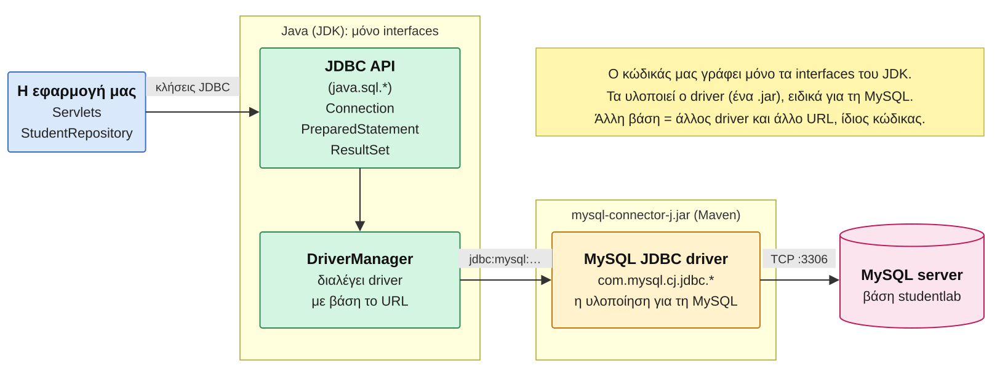
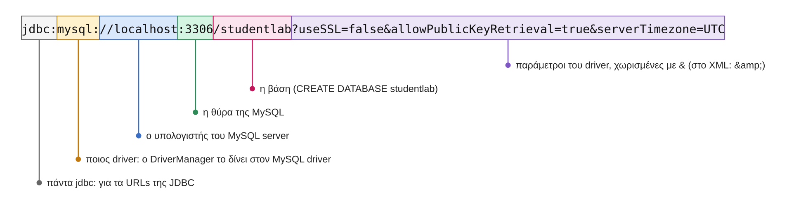
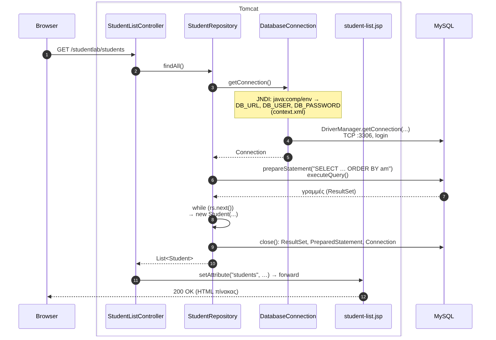

# Lab: Οι φοιτητές σε βάση δεδομένων MySQL με JDBC

Οδηγός εργαστηρίου, βήμα‑βήμα. Συνεχίζουμε την εφαρμογή **studentlab** του [lab-form.md](lab-form.md). Μέχρι τώρα οι
φοιτητές ζούσαν σε μια `List` στη μνήμη και χάνονταν σε κάθε επανεκκίνηση του Tomcat. Εδώ τους αποθηκεύουμε σε μια
βάση δεδομένων **MySQL**, με τη **JDBC** (Java Database Connectivity).

Στο τέλος του lab:

- οι φοιτητές αποθηκεύονται σε έναν πίνακα `students` της MySQL και **δεν χάνονται** όταν σταματά ο Tomcat,
- τα στοιχεία σύνδεσης (URL, χρήστης, κωδικός) **δεν** είναι γραμμένα στον κώδικα Java, αλλά στο `context.xml`,
- αλλάζει **μόνο** το `StudentRepository`. Οι controllers, οι JSP και η `Student` μένουν όπως ήταν.

> **Από πού ξεκινάμε:** από το project όπως είναι στο **τέλος του βήματος 15** του [lab-form.md](lab-form.md)
> (καταχώρηση, λίστα, προβολή, επεξεργασία και διαγραφή φοιτητή, με τον ΑΜ ως κλειδί). Τα βήματα 16 και 17
> (βαθμοί, μαθήματα) **δεν** χρειάζονται.

> **Ξεκινάτε από εδώ;** Κατεβάστε το έτοιμο project, όπως είναι στο τέλος του βήματος 15:
> **[studentlab-step15.zip](studentlab-step15.zip)**.
>
> 1. Αποσυμπιέστε το zip σε έναν φάκελο της επιλογής σας.
> 2. Στο NetBeans: **File → Open Project…** → επιλέξτε τον φάκελο `studentlab` → **Open Project**. Είναι Maven
>    project, οπότε ανοίγει κατευθείαν, χωρίς import.
> 3. Δεξί κλικ στο project → **Run**. Την πρώτη φορά το NetBeans ρωτά σε ποιον server θα γίνει το deploy: διαλέξτε
>    τον Tomcat του [βήματος 1 του lab-form](lab-form.md#1-προετοιμασία-tomcat-στο-netbeans).
> 4. Ελέγξτε ότι δουλεύει: καταχωρήστε έναν φοιτητή με ΑΜ, ανοίξτε τη σελίδα του από τη λίστα, κάντε επεξεργασία
>    και διαγραφή. Οι φοιτητές είναι ακόμα **στη μνήμη**: αυτό αλλάζουμε σε αυτό το lab.
>
> Χρειάζεται JDK 21 ή νεότερο. Το [studentlab.zip](studentlab.zip) του lab-form **δεν** κάνει εδώ: είναι το τέλος του
> βήματος 14, χωρίς ΑΜ και χωρίς προβολή, επεξεργασία και διαγραφή.

## Περιεχόμενα

- [0. Τι θα φτιάξουμε](#0-τι-θα-φτιάξουμε)
- [1. Τι είναι η JDBC](#1-τι-είναι-η-jdbc)
- [2. Εγκατάσταση της MySQL](#2-εγκατάσταση-της-mysql)
- [3. Δημιουργία βάσης και χρήστη](#3-δημιουργία-βάσης-και-χρήστη)
- [4. Ο πίνακας students](#4-ο-πίνακας-students)
- [5. Η βάση μέσα από το NetBeans (προαιρετικό)](#5-η-βάση-μέσα-από-το-netbeans-προαιρετικό)
- [6. Ο JDBC driver στο pom.xml](#6-ο-jdbc-driver-στο-pomxml)
- [7. Τα στοιχεία σύνδεσης στο context.xml](#7-τα-στοιχεία-σύνδεσης-στο-contextxml)
- [8. Η κλάση DatabaseConnection](#8-η-κλάση-databaseconnection)
- [9. Έλεγχος σύνδεσης: ο DbTestController](#9-έλεγχος-σύνδεσης-ο-dbtestcontroller)
- [10. Το StudentRepository με JDBC](#10-το-studentrepository-με-jdbc)
- [11. Εκτέλεση και δοκιμή](#11-εκτέλεση-και-δοκιμή)
- [12. Πώς δουλεύουν όλα μαζί](#12-πώς-δουλεύουν-όλα-μαζί)
- [13. Επέκταση: connection pool με DataSource](#13-επέκταση-connection-pool-με-datasource)
- [Συχνά προβλήματα](#συχνά-προβλήματα)
- [Ασκήσεις](#ασκήσεις)

---

## 0. Τι θα φτιάξουμε

Τα URLs της εφαρμογής είναι **ακριβώς** τα ίδια με του βήματος 15. Προστίθεται μόνο μια σελίδα ελέγχου:

| URL                    | Μέθοδος | Controller          | Τι κάνει                                                |
|------------------------|---------|---------------------|---------------------------------------------------------|
| `/studentlab/testdb`   | GET     | `DbTestController`  | ελέγχει αν η εφαρμογή συνδέεται με τη MySQL (προσωρινό) |

Νέα και αλλαγμένα αρχεία:

```
studentlab/
├── pom.xml                                     + dependency: MySQL JDBC driver
└── src/main/
    ├── java/gr/uniwa/ice/studentlab/
    │   ├── model/
    │   │   └── Student.java                    ίδιο
    │   ├── repository/
    │   │   ├── DatabaseConnection.java         ΝΕΟ   ανοίγει συνδέσεις με τη MySQL
    │   │   └── StudentRepository.java          ΑΛΛΑΖΕΙ: SQL αντί για List στη μνήμη
    │   └── controller/
    │       ├── DbTestController.java           ΝΕΟ   /testdb
    │       └── ... (όλοι οι υπόλοιποι)         ίδιοι
    └── webapp/
        ├── META-INF/
        │   └── context.xml                     + στοιχεία σύνδεσης (DB_URL, DB_USER, DB_PASSWORD)
        └── WEB-INF/views/
            └── ... (όλες οι JSP)               ίδιες
```

Θυμηθείτε τι λέγαμε στην [ενότητα 6 του lab-form](lab-form.md#6-packages-και-οργάνωση-του-κώδικα): *«Όταν η λίστα στη
μνήμη γίνει βάση δεδομένων, θα αλλάξει μόνο το `repository`.»* Αυτό ακριβώς κάνουμε τώρα.

> Στο υλικό για τη JDBC θα συναντήσετε συχνά τον όρο **DAO** (Data Access Object), π.χ. `UserDAO`. Είναι ακριβώς
> ό,τι εμείς λέμε **repository**: η κλάση που κρατά **όλη** την SQL και κρύβει από τους controllers πώς
> αποθηκεύονται τα δεδομένα. Ο controller δεν ξέρει πώς γράφεται ένα `SELECT`· απλώς ζητά «φέρε μου τους φοιτητές».

---

## 1. Τι είναι η JDBC

Η Java μιλάει τη «γλώσσα» των **αντικειμένων** (`Student`, `List<Student>`). Η MySQL μιλάει **SQL**, και
επικοινωνεί μέσα από το δίκτυο με ένα δικό της πρωτόκολλο. Η **JDBC** είναι ο «διερμηνέας» ανάμεσά τους.



### 1.1 Interfaces και υλοποιήσεις

Το πιο σημαντικό πράγμα: η Java δίνει μόνο **interfaces**, δηλαδή κανόνες, όχι τον κώδικα που κάνει τη δουλειά.

- **Java (`java.sql.*`)**: λέει «χρειάζομαι έναν τρόπο να συνδεθώ (`Connection`), να στείλω μια εντολή
  (`PreparedStatement`) και να πάρω αποτελέσματα (`ResultSet`)».
- **MySQL driver (`com.mysql.cj.jdbc.*`)**: ένα `.jar` που κατεβάζει το Maven. Περιέχει τις κλάσεις που
  **υλοποιούν** αυτά τα interfaces ειδικά για τη MySQL.

Ο κώδικάς μας γράφει μόνο `Connection`, `PreparedStatement`, `ResultSet`. Δεν αναφέρει πουθενά κλάσεις της MySQL
(εκτός από το όνομα του driver, μία φορά). Αν αύριο αλλάξουμε βάση, αλλάζει ο driver και το URL, όχι η λογική.

### 1.2 Οι βασικοί «παίκτες»

| Κλάση / interface   | Ρόλος | Αναλογία |
|---------------------|-------|----------|
| **`Driver`**        | Ξέρει το πρωτόκολλο της MySQL: μετατρέπει τις εντολές μας σε πακέτα (bytes) που ταξιδεύουν στο δίκτυο, στη θύρα 3306. Για τη MySQL είναι η κλάση `com.mysql.cj.jdbc.Driver`. | ο διερμηνέας |
| **`DriverManager`** | Κλάση της Java που κρατά όλους τους drivers που έχουν φορτωθεί. Όταν καλούμε `DriverManager.getConnection(url, ...)`, κοιτάζει το URL: αν ξεκινά με `jdbc:mysql:`, το δίνει στον MySQL driver. | ο τροχονόμος |
| **`Connection`**    | Μια ανοιχτή **συνεδρία** με τη βάση. Από πίσω υπάρχει μια σύνδεση TCP και έχει γίνει έλεγχος username/password. Η δημιουργία της είναι **ακριβή** (χρόνος, πόροι), και πρέπει πάντα να **κλείνει**. | το τηλεφώνημα |
| **`PreparedStatement`** | Μια εντολή SQL με «κενά» (`?`). Στέλνουμε πρώτα την εντολή και μετά, ξεχωριστά, τις τιμές. Είναι ασφαλής απέναντι στο **SQL injection** (ενότητα 10.3). | ο ταχυδρόμος |
| **`ResultSet`**     | Τα αποτελέσματα ενός `SELECT`. Είναι ένας **δείκτης (cursor)** σε γραμμές: με `rs.next()` πάμε στην επόμενη γραμμή, με `rs.getString("name")` διαβάζουμε μια στήλη. | το κουτί με τα αποτελέσματα |

Υπάρχει και το απλό **`Statement`**, που στέλνει την SQL όπως είναι, σε ένα `String`. **Δεν** το χρησιμοποιούμε
για εντολές με τιμές από τον χρήστη (θα δούμε γιατί στην 10.3).

### 1.3 Τι γίνεται σε ένα request, βήμα‑βήμα

1. **Φόρτωση driver:** `Class.forName("com.mysql.cj.jdbc.Driver")` φορτώνει την κλάση του driver, και αυτή
   δηλώνει στον `DriverManager`: «αν σου ζητήσουν URL που ξεκινά με `jdbc:mysql:`, στείλ' τους σε μένα».
2. **Σύνδεση:** `DriverManager.getConnection(url, user, password)`. Ο driver ανοίγει σύνδεση TCP με τη MySQL και
   ελέγχεται ο κωδικός.
3. Επιστρέφεται ένα αντικείμενο της MySQL που **υλοποιεί** το `Connection`.
4. **Αποστολή:** `ps.executeQuery()`. Ο driver στέλνει την εντολή στη MySQL.
5. **Εκτέλεση:** η MySQL εκτελεί την εντολή και βρίσκει τα δεδομένα.
6. **Επιστροφή:** η MySQL στέλνει πίσω τις γραμμές.
7. **Μετατροπή:** ο driver τις δίνει στη Java ως `ResultSet`, και εμείς φτιάχνουμε από αυτές αντικείμενα `Student`.
8. **Κλείσιμο:** κλείνουμε `ResultSet`, `PreparedStatement` και `Connection` (αυτόματα, με try‑with‑resources).

---

## 2. Εγκατάσταση της MySQL

Χρειαζόμαστε έναν **MySQL server** που να τρέχει. Διαλέξτε **έναν** από τους παρακάτω τρόπους.

### 2.1 Windows, χωρίς δικαιώματα διαχειριστή (ZIP)

Ο τρόπος αυτός δουλεύει και στους υπολογιστές του εργαστηρίου, γιατί δεν θέλει εγκατάσταση.

1. Από το <https://dev.mysql.com/downloads/mysql/> επιλέξτε **MySQL Community Server 8.4 LTS**, λειτουργικό
   **Microsoft Windows**, και κατεβάστε το **Windows (x86, 64-bit), ZIP Archive** (όχι το MSI installer).
   Στη σελίδα που ζητά login, πατήστε **«No thanks, just start my download»**.
2. Αποσυμπιέστε το σε έναν φάκελο, π.χ. `C:\mysql` (ή σε ένα USB stick). Μέσα υπάρχει ο φάκελος `bin`.
3. Ανοίξτε ένα **Command Prompt** στον φάκελο `bin` και τρέξτε **μία φορά**:

   ```bat
   mysqld --initialize-insecure --console
   ```

   Φτιάχνει τον φάκελο `data` με τις βάσεις του server. Το `--initialize-insecure` σημαίνει ότι ο διαχειριστής
   `root` **δεν έχει κωδικό** (αποδεκτό μόνο για τοπική χρήση στο εργαστήριο).
4. Ξεκινήστε τον server:

   ```bat
   mysqld --console
   ```

   Όταν δείτε `ready for connections ... port: 3306`, ο server τρέχει. **Αφήστε αυτό το παράθυρο ανοιχτό**: αν το
   κλείσετε, σταματά και ο server. Την επόμενη φορά τρέχετε μόνο αυτή την εντολή (όχι ξανά το `--initialize`).
5. Ανοίξτε ένα **δεύτερο** Command Prompt στον ίδιο φάκελο `bin` και συνδεθείτε ως `root`:

   ```bat
   mysql -u root
   ```

   Βλέπετε την προτροπή `mysql>`. Εδώ θα γράψουμε τις εντολές SQL της [ενότητας 3](#3-δημιουργία-βάσης-και-χρήστη).

### 2.2 Linux

Σε Debian/Ubuntu:

```bash
sudo apt install mysql-server
sudo systemctl start mysql
sudo mysql            # σύνδεση ως root (με τον κωδικό του sudo)
```

Χωρίς δικαιώματα διαχειριστή, όπως στα Windows: από την ίδια σελίδα κατεβάστε το **Linux - Generic** archive
(`mysql-8.4.x-linux-glibc2.17-x86_64.tar.xz`), αποσυμπιέστε το και, στον φάκελο `bin`, τρέξτε
`./mysqld --initialize-insecure --console` (μία φορά) και μετά `./mysqld --console`.

> **`Can't connect to local MySQL server through socket '/run/mysqld/mysqld.sock'`:** στο Linux, το `mysql` χωρίς
> `-h` δεν συνδέεται μέσω δικτύου αλλά μέσω ενός αρχείου socket. Ο server του archive φτιάχνει το socket στο
> `/tmp/mysql.sock`, ενώ το `mysql` της διανομής το ψάχνει αλλού. Συνδεθείτε μέσω TCP με
> **`mysql -u root -h 127.0.0.1`** (ή με `--socket=/tmp/mysql.sock`, ή με το `./mysql` του φακέλου `bin` του archive).
> Η εφαρμογή δεν επηρεάζεται: η JDBC συνδέεται πάντα μέσω TCP, στο `localhost:3306`.

### 2.3 Docker

Αν έχετε Docker:

```bash
docker run --name studentlab-mysql -e MYSQL_ROOT_PASSWORD=root -p 3306:3306 -d mysql:8.4
docker exec -it studentlab-mysql mysql -u root -p     # κωδικός: root
```

### 2.4 Σταμάτημα και επανεκκίνηση του server

Ο server σταματά **κανονικά** (αφού γράψει στον δίσκο ό,τι έχει στη μνήμη) με την εντολή SQL `SHUTDOWN`, από μια
σύνδεση ως `root`:

```bash
mysql -u root -h 127.0.0.1 -e "SHUTDOWN;"
```

ή, ισοδύναμα, με το `mysqladmin` (βρίσκεται κι αυτό στον φάκελο `bin`):

```bash
mysqladmin -u root -h 127.0.0.1 shutdown
```

Στα Windows, από τον φάκελο `bin`: `mysqladmin -u root shutdown`.

Το παράθυρο του `mysqld --console` επιστρέφει στην προτροπή. Για να ξεκινήσει ξανά ο server, τρέχετε πάλι
**μόνο** το `mysqld --console` (όχι το `--initialize-insecure`: αυτό γίνεται μία φορά). Οι βάσεις και τα δεδομένα
μένουν στον φάκελο `data`.

| Εγκατάσταση          | Σταμάτημα                                  | Εκκίνηση                          |
|----------------------|--------------------------------------------|-----------------------------------|
| ZIP / archive        | `mysqladmin -u root -h 127.0.0.1 shutdown` | `mysqld --console` στο `bin`      |
| Linux (apt)          | `sudo systemctl stop mysql`                | `sudo systemctl start mysql`      |
| Docker               | `docker stop studentlab-mysql`             | `docker start studentlab-mysql`   |

> **Ctrl+C** στο παράθυρο του server συχνά **δεν** τον σταματά στο Linux, γιατί ο `mysqld` κατά κανόνα αγνοεί αυτό το
> σήμα (SIGINT). Εναλλακτικά, ένα `kill <PID>` (SIGTERM) τον κλείνει κι αυτό κανονικά. **Ποτέ** `kill -9`: κόβει
> τον server απότομα, χωρίς να προλάβει να γράψει στον δίσκο.

> **MySQL στο cloud:** υπάρχουν δωρεάν MySQL βάσεις, π.χ. στο <https://console.clever-cloud.com/> ή στο
> <https://tidbcloud.com/> (το TiDB είναι συμβατό με τη MySQL). Εκεί η βάση και ο χρήστης φτιάχνονται από τη σελίδα
> τους, και σας δίνουν host, θύρα, όνομα βάσης, χρήστη και κωδικό. Τα βάζετε στο `context.xml` της
> [ενότητας 7](#7-τα-στοιχεία-σύνδεσης-στο-contextxml) στη θέση των `localhost`, `studentlab` κ.λπ. Οι βάσεις στο
> cloud συνήθως **απαιτούν SSL**, οπότε στο URL γράφετε `sslMode=REQUIRED` αντί για `useSSL=false`.

---

## 3. Δημιουργία βάσης και χρήστη

Ένας MySQL server έχει πολλές **βάσεις** (databases), και κάθε βάση έχει πίνακες. Φτιάχνουμε μια βάση μόνο για την
εφαρμογή μας, και έναν **χρήστη** με δικαιώματα μόνο σε αυτή. Η εφαρμογή **δεν** συνδέεται ποτέ ως `root`: αν
κάποιος βρει τον κωδικό της, πρέπει να μπορεί να πειράξει μόνο τη δική της βάση.

Στην προτροπή `mysql>` (ως `root`) τρέξτε:

```sql
-- 1. Η βάση. utf8mb4 = πλήρης υποστήριξη Unicode (ελληνικά, emoji)
CREATE DATABASE IF NOT EXISTS studentlab
  CHARACTER SET utf8mb4
  COLLATE utf8mb4_unicode_ci;

-- 2. Ο χρήστης της εφαρμογής. 'localhost' = συνδέεται μόνο από τον ίδιο υπολογιστή.
CREATE USER 'studentlab'@'localhost' IDENTIFIED BY 'studentlab123';

-- 3. Όλα τα δικαιώματα, αλλά μόνο στη βάση studentlab
GRANT ALL PRIVILEGES ON studentlab.* TO 'studentlab'@'localhost';

-- 4. Ενημέρωση των δικαιωμάτων
FLUSH PRIVILEGES;
```

- **`CHARACTER SET utf8mb4`**: η κωδικοποίηση των κειμένων. Χωρίς αυτήν, τα ελληνικά ονόματα μπορεί να
  αποθηκευτούν ως `???`. (Το παλιό `utf8` της MySQL **δεν** είναι πλήρες UTF‑8· χρησιμοποιούμε πάντα `utf8mb4`.)
- **`'studentlab'@'localhost'`**: στη MySQL ένας χρήστης ορίζεται από το **όνομα** και τον **υπολογιστή** από τον
  οποίο συνδέεται. Με `'%'` αντί για `'localhost'` θα μπορούσε να συνδεθεί από οπουδήποτε.

> **Docker:** ο Tomcat συνδέεται στο container μέσα από τη θύρα 3306, οπότε η MySQL δεν βλέπει τη σύνδεση ως
> `localhost`. Εκεί φτιάξτε τον χρήστη ως `'studentlab'@'%'` (και στο `GRANT`).

Ελέγξτε ότι ο νέος χρήστης συνδέεται. Βγείτε με `exit` και:

```bat
mysql -u studentlab -p studentlab
```

Το πρώτο `studentlab` είναι ο χρήστης, το δεύτερο η βάση. Δίνετε τον κωδικό `studentlab123`.

---

## 4. Ο πίνακας students

Συνδεδεμένοι ως `studentlab` στη βάση `studentlab`, φτιάξτε τον πίνακα:

```sql
CREATE TABLE students (
    am      INT          PRIMARY KEY,
    name    VARCHAR(100) NOT NULL,
    surname VARCHAR(100) NOT NULL,
    email   VARCHAR(255) NOT NULL
);

-- Δύο φοιτητές για αρχή, ώστε η λίστα να μην είναι άδεια
INSERT INTO students (am, name, surname, email) VALUES
    (21390001, 'Γιώργος', 'Παπαδόπουλος', 'gpap@uniwa.gr'),
    (21390002, 'Μαρία',   'Νικολάου',     'mnik@uniwa.gr');

SELECT * FROM students;
```

Ο πίνακας αντιστοιχεί **ένα προς ένα** στην κλάση `Student` του βήματος 15. Κάθε **γραμμή** του πίνακα είναι ένα
αντικείμενο `Student`, και κάθε **στήλη** ένα πεδίο του:

| Στήλη (MySQL)        | Πεδίο (Java)      | Διαβάζουμε με        | Γράφουμε με          |
|----------------------|-------------------|----------------------|----------------------|
| `am INT`             | `int am`          | `rs.getInt("am")`    | `ps.setInt(...)`     |
| `name VARCHAR(100)`  | `String name`     | `rs.getString("name")` | `ps.setString(...)` |
| `surname VARCHAR(100)` | `String surname` | `rs.getString("surname")` | `ps.setString(...)` |
| `email VARCHAR(255)` | `String email`    | `rs.getString("email")` | `ps.setString(...)` |

- **`am INT PRIMARY KEY`**: ο ΑΜ είναι το **primary key**, το κλειδί που συζητήσαμε στην
  [ενότητα 15.1 του lab-form](lab-form.md#151-ο-αμ-ως-μοναδικό-κλειδί). Τώρα η **ίδια η βάση** εγγυάται ότι δεν
  υπάρχουν δύο φοιτητές με τον ίδιο ΑΜ: ένα δεύτερο `INSERT` με ίδιο ΑΜ απορρίπτεται με λάθος
  `Duplicate entry ... for key 'PRIMARY'`.
- **`NOT NULL`**: η στήλη δεν μπορεί να μείνει χωρίς τιμή. Είναι ένας δεύτερος έλεγχος, πίσω από τη `validate()`.
- **`VARCHAR(100)`**: κείμενο **έως** 100 χαρακτήρες.

> **Γιατί όχι `AUTO_INCREMENT`;** Σε πολλά παραδείγματα το κλειδί είναι ένα `id INT PRIMARY KEY AUTO_INCREMENT`: έναν
> αριθμό που δίνει μόνη της η MySQL σε κάθε νέα γραμμή (τεχνητό κλειδί). Εδώ το κλειδί είναι ο ΑΜ, που τον γράφει ο
> χρήστης στη φόρμα (φυσικό κλειδί), οπότε δεν χρειάζεται. Αν θέλαμε και τα δύο, θα γράφαμε
> `id INT PRIMARY KEY AUTO_INCREMENT` και `am INT NOT NULL UNIQUE`.

---

## 5. Η βάση μέσα από το NetBeans (προαιρετικό)

Το NetBeans μπορεί να συνδεθεί κι αυτό με τη MySQL, για να βλέπετε τους πίνακες και να τρέχετε SQL χωρίς το `mysql`
της γραμμής εντολών. Η σύνδεση αυτή είναι **μόνο για εσάς**· η εφαρμογή συνδέεται με τον δικό της τρόπο (ενότητες 6–8).

Χρειάζεται το `.jar` του MySQL driver. Δύο τρόποι να το βρείτε:

- αν έχετε ήδη κάνει το [βήμα 6](#6-ο-jdbc-driver-στο-pomxml) και build, το έχει κατεβάσει το Maven στο
  `~/.m2/repository/com/mysql/mysql-connector-j/8.4.0/mysql-connector-j-8.4.0.jar`
  (στα Windows: `C:\Users\<όνομα>\.m2\...`),
- αλλιώς, από το <https://dev.mysql.com/downloads/connector/j/>: επιλέξτε **Platform Independent**, κατεβάστε το
  ZIP, αποσυμπιέστε το και κρατήστε το **`.jar`** που έχει μέσα (όχι το ZIP).

Στο NetBeans:

1. Καρτέλα **Services** → δεξί κλικ στο **Databases** → **New Connection…**
2. **Driver:** `MySQL (Connector/J driver)`. Αν στο **Driver File(s)** φαίνεται ότι λείπει το αρχείο, πατήστε
   **Add…** και διαλέξτε το `.jar` → **Next**.
3. Συμπληρώστε:

   | Πεδίο       | Τιμή             |
   |-------------|------------------|
   | Host        | `localhost`      |
   | Port        | `3306`           |
   | Database    | `studentlab`     |
   | User Name   | `studentlab`     |
   | Password    | `studentlab123`  |

   Πατήστε **Test Connection**. Πρέπει να δείτε **Connection Succeeded** → **Next** → **Finish**.
   Αν βγει λάθος για «Public Key Retrieval», προσθέστε στο **JDBC URL** στο τέλος `?allowPublicKeyRetrieval=true&useSSL=false`.
4. Η σύνδεση εμφανίζεται κάτω από το **Databases**. Ανοίξτε την → `studentlab` → **Tables** → δεξί κλικ στο
   `students` → **View Data…**: βλέπετε τις γραμμές του πίνακα.
5. Για να τρέξετε δική σας SQL: δεξί κλικ στη σύνδεση → **Execute Command…**, γράψτε την εντολή και πατήστε
   **Run SQL** (**Ctrl+Shift+E**). Με αυτόν τον τρόπο μπορείτε να τρέξετε και το SQL της ενότητας 4.

---

## 6. Ο JDBC driver στο pom.xml

Η εφαρμογή χρειάζεται τον MySQL driver. Ανοίξτε το **Project Files → pom.xml** και, μέσα στο `<dependencies>`,
**κάτω** από τις dependencies της JSTL, προσθέστε:

**Αρχείο:** `pom.xml`

```xml
    <!-- MySQL JDBC driver: υλοποιεί τα interfaces του java.sql για τη MySQL -->
    <dependency>
      <groupId>com.mysql</groupId>
      <artifactId>mysql-connector-j</artifactId>
      <version>8.4.0</version>
    </dependency>
```

Αποθηκεύστε και κάντε δεξί κλικ στο project → **Clean and Build**. Στο **Dependencies** εμφανίζεται πλέον το
`mysql-connector-j-8.4.0.jar`.

- Η dependency **δεν** έχει `<scope>provided</scope>`: ο Tomcat **δεν** έχει τον MySQL driver, οπότε πρέπει να μπει
  μέσα στο `.war` (στο `WEB-INF/lib`), όπως η JSTL.
- Το `java.sql.*` (`Connection`, `PreparedStatement`, ...) **δεν** χρειάζεται dependency: είναι μέρος του JDK.

---

## 7. Τα στοιχεία σύνδεσης στο context.xml

Για να συνδεθεί η εφαρμογή χρειάζεται τρία πράγματα: το **URL** της βάσης, τον **χρήστη** και τον **κωδικό**. Θα
μπορούσαμε να τα γράψουμε μέσα σε μια κλάση Java. Δεν το κάνουμε, για τρεις λόγους:

1. **Ασφάλεια:** ο κωδικός δεν πρέπει να βρίσκεται στον κώδικα, που τον διαβάζουν (και τον ανεβάζουν στο git)
   πολλοί.
2. **Ευκολία αλλαγής:** αν αλλάξει ο κωδικός ή ο server της βάσης, αλλάζουμε ένα αρχείο XML, χωρίς compile.
3. **Διαφορετικά περιβάλλοντα:** στον υπολογιστή σας η βάση είναι στο `localhost`, σε έναν server κάπου αλλού. Ο
   κώδικας μένει ίδιος· αλλάζουν μόνο οι ρυθμίσεις.

Τις ρυθμίσεις τις γράφουμε στο **`context.xml`**, και η Java τις διαβάζει με το **JNDI**.

### 7.1 Το αρχείο

Ανοίξτε το **Web Pages → META-INF → context.xml** (το έφτιαξε το NetBeans· δείτε το
[βήμα 4 του lab-form](lab-form.md#4-καθάρισμα-αρχείων-που-δεν-χρειαζόμαστε)). Αν δεν υπάρχει: δεξί κλικ στο
**Web Pages** → **New → Folder…** → `META-INF`, και μέσα του **New → Other… → XML → XML Document** → `context`.

Βάλτε μέσα στο `<Context>` τα τρία `<Environment>`. Αν το NetBeans είχε ήδη γράψει κάποιο attribute στο `<Context>`
(π.χ. `path="/studentlab"`), κρατήστε το:

**Αρχείο:** `src/main/webapp/META-INF/context.xml`

```xml
<?xml version="1.0" encoding="UTF-8"?>
<Context path="/studentlab">

    <!-- Πού είναι η βάση. Το & γράφεται &amp; μέσα σε XML. -->
    <Environment name="DB_URL"
                 value="jdbc:mysql://localhost:3306/studentlab?useSSL=false&amp;allowPublicKeyRetrieval=true&amp;serverTimezone=UTC"
                 type="java.lang.String" override="false"/>

    <!-- Με ποιον χρήστη συνδέεται η εφαρμογή (ενότητα 3) -->
    <Environment name="DB_USER" value="studentlab"
                 type="java.lang.String" override="false"/>
    <Environment name="DB_PASSWORD" value="studentlab123"
                 type="java.lang.String" override="false"/>

</Context>
```

**Το URL, κομμάτι‑κομμάτι:**



| Παράμετρος                     | Τι κάνει |
|--------------------------------|----------|
| `useSSL=false`                 | σύνδεση χωρίς κρυπτογράφηση. Αποδεκτό μόνο για `localhost`. |
| `allowPublicKeyRetrieval=true` | η MySQL 8 κρυπτογραφεί τον κωδικό με το δημόσιο κλειδί του server. Χωρίς SSL, ο driver πρέπει να του επιτραπεί να το ζητήσει, αλλιώς παίρνουμε `Public Key Retrieval is not allowed`. |
| `serverTimezone=UTC`           | η ζώνη ώρας του server, για τις ημερομηνίες. Αποφεύγει λάθη σε παλιότερες εγκαταστάσεις. |

> **Προσοχή στο XML:** το `&` έχει ειδική σημασία στο XML, οπότε γράφεται **`&amp;`**. Αν γράψετε σκέτο `&`, ο Tomcat
> δεν μπορεί να διαβάσει το `context.xml` και η εφαρμογή δεν ξεκινά.

> **Κωδικοί και git:** το `context.xml` με πραγματικό κωδικό **δεν** ανεβαίνει σε δημόσιο repository. Στο εργαστήριο
> ο κωδικός `studentlab123` είναι μόνο για τοπική χρήση· σε πραγματική εφαρμογή ο κωδικός ορίζεται στον server (π.χ.
> στο `conf/` του Tomcat ή σε μεταβλητές περιβάλλοντος), όχι μέσα στο project.

### 7.2 Τι είναι το Context

Σκεφτείτε τον Tomcat σαν μια **πολυκατοικία**:

- Το **Context** είναι το **διαμέρισμα** της δικής σας εφαρμογής μέσα στην πολυκατοικία. Κάθε web εφαρμογή που
  τρέχει στον ίδιο Tomcat (εδώ η `/studentlab`, αλλά και όποια άλλη έχετε κάνει deploy) έχει το δικό της Context.
- Αυτό εξασφαλίζει **απομόνωση**: κάθε εφαρμογή έχει τις δικές της κλάσεις, τις δικές της βιβλιοθήκες (`WEB-INF/lib`)
  και τις δικές της ρυθμίσεις. Αν μια εφαρμογή «κρασάρει» ή αλλάξει μια ρύθμιση, οι άλλες δεν επηρεάζονται.
- Στον κώδικα, το Context της εφαρμογής αντιπροσωπεύεται από το αντικείμενο **`ServletContext`**
  (`getServletContext()` μέσα σε ένα Servlet). Υπάρχει **ένα** για όλη την εφαρμογή, και είναι το «περιβάλλον» μέσα
  στο οποίο ζουν όλα τα Servlets και οι JSP της. Το όνομά του το έχουμε ήδη χρησιμοποιήσει: είναι το
  `request.getContextPath()` (= `/studentlab`) που βάζουμε μπροστά στα redirects και στα links.

**Γιατί φτιάχνουμε το `context.xml`;** Αν το Context είναι το διαμέρισμα, το **`context.xml`** είναι το **συμβόλαιο
μίσθωσης**: γράφει τους ειδικούς όρους και τις «παροχές» που χρειάζεται η εφαρμογή για να λειτουργήσει. Εδώ οι
παροχές είναι τα στοιχεία σύνδεσης με τη βάση, ως **μεταβλητές περιβάλλοντος** (`<Environment>`). Τα κερδίζουμε
όσα είπαμε στην αρχή της ενότητας: ο κωδικός δεν είναι στον κώδικα, αλλάζει χωρίς compile, και η Java τον βρίσκει
μέσω **JNDI** (7.3).

**Γιατί στο `META-INF`;** Ο φάκελος `META-INF` (meta information) είναι ο τυποποιημένος φάκελος της Java για
πληροφορίες σχετικά με το «πακετάρισμα» της εφαρμογής. Βάζοντας το αρχείο στο `src/main/webapp/META-INF/` (στο
`.war` καταλήγει στο `META-INF/context.xml`):

1. **Φορητότητα:** το αρχείο «ταξιδεύει» μαζί με την εφαρμογή. Όταν δώσετε το `.war` σε κάποιον άλλον ή το
   ανεβάσετε σε έναν server, οι ρυθμίσεις πάνε μαζί του.
2. **Αυτόματη αναγνώριση:** ο Tomcat είναι προγραμματισμένος να κοιτάει **ακριβώς** σε αυτό το σημείο όταν ξεκινά
   την εφαρμογή. Αν βρει το αρχείο, φορτώνει αυτόματα τις ρυθμίσεις του.

Συνοπτικά, το `context.xml` στο `META-INF` είναι ο τρόπος να πούμε στον Tomcat: *«Όταν τρέξεις αυτή την εφαρμογή,
φόρτωσε αυτές τις ρυθμίσεις σύνδεσης, ώστε ο κώδικας Java να μπορεί να τις βρει όταν τις χρειαστεί.»*

> **Πού αλλού διαβάζει ο Tomcat ρυθμίσεις Context;** Εκτός από το `META-INF/context.xml` της εφαρμογής, υπάρχουν:
>
> - το **`conf/context.xml`** του Tomcat: ρυθμίσεις για **όλες** τις εφαρμογές του,
> - ένα αρχείο **`conf/Catalina/localhost/studentlab.xml`**: ρυθμίσεις μόνο για την εφαρμογή `studentlab`. Αν υπάρχει,
>   ο Tomcat χρησιμοποιεί **αυτό** και **αγνοεί** το `META-INF/context.xml` της εφαρμογής.
>
> Το δεύτερο το φτιάχνει το **NetBeans**: όταν πατάτε **Run**, αντιγράφει εκεί το περιεχόμενο του
> `META-INF/context.xml` σας και προσθέτει ένα `docBase` που δείχνει στον φάκελο `target/` του project. Γι' αυτό, μετά
> από αλλαγή στο `context.xml`, χρειάζεται νέο **Run** (ή **Clean and Build** και Run): αλλιώς ο Tomcat διαβάζει ακόμα
> το παλιό αντίγραφο. Σε πραγματικό server, οι κωδικοί συχνά μπαίνουν σε αυτά τα αρχεία του `conf/` και όχι στο `.war`,
> ώστε να μη βρίσκονται μέσα στο project.

### 7.3 Τι είναι το JNDI

Το **JNDI** (Java Naming and Directory Interface) είναι ένας **τηλεφωνικός κατάλογος** για τις Java εφαρμογές: ο
κώδικας ζητά κάτι με ένα **όνομα** και ο server του δίνει την **τιμή**, χωρίς ο κώδικας να ξέρει από πού ήρθε.

1. **Καταχώρηση (Tomcat):** διαβάζοντας το `context.xml`, ο Tomcat γράφει στον κατάλογο της εφαρμογής ότι το όνομα
   `DB_URL` αντιστοιχεί σε `jdbc:mysql://localhost:3306/...`.
2. **Αναζήτηση (Java):** ο κώδικας
   - ανοίγει τον κατάλογο: `new InitialContext()`,
   - πηγαίνει στον «φάκελο» της εφαρμογής: `lookup("java:comp/env")`,
   - ζητά την τιμή: `lookup("DB_URL")`.

Το **`java:comp/env`** διαβάζεται έτσι:

| Κομμάτι | Σημαίνει |
|---------|----------|
| `java:` | το «πρωτόκολλο», όπως το `http:`: ψάχνουμε κάτι στον κατάλογο της Java |
| `comp`  | *component*: η **τρέχουσα** εφαρμογή (η `/studentlab`) |
| `env`   | *environment*: ο υποφάκελος με τις ρυθμίσεις της, εκεί που μπαίνουν τα `<Environment>` |

Δηλαδή το `java:comp/env` είναι ο **ιδιωτικός χώρος** ρυθμίσεων της εφαρμογής, κάτι σαν τον φάκελο «Τα έγγραφά μου».

- **`type="java.lang.String"`**: τι τύπου είναι η τιμή. Ο κώδικας τη διαβάζει ως `String`.
- **`override="false"`**: η τιμή του `context.xml` δεν μπορεί να αντικατασταθεί από το `web.xml` της εφαρμογής.

---

## 8. Η κλάση DatabaseConnection

Μια μικρή κλάση με **μία** δουλειά: να ανοίγει συνδέσεις με τη βάση. Διαβάζει τα στοιχεία από το JNDI και καλεί τον
`DriverManager`. Τη βάζουμε στο package **`repository`**, γιατί τη χρησιμοποιούν μόνο τα repositories.

Δεξί κλικ στο package `gr.uniwa.ice.studentlab.repository` → **New → Java Class…** → `DatabaseConnection`:

**Αρχείο:** `src/main/java/gr/uniwa/ice/studentlab/repository/DatabaseConnection.java`

```java
package gr.uniwa.ice.studentlab.repository;

import java.sql.Connection;
import java.sql.DriverManager;
import java.sql.SQLException;
import javax.naming.Context;
import javax.naming.InitialContext;
import javax.naming.NamingException;

public class DatabaseConnection {

    // Ανοίγει μια νέα σύνδεση με τη βάση. Όποιος την καλεί, πρέπει να την κλείσει.
    public static Connection getConnection() throws SQLException {
        // 1. Φόρτωση του MySQL driver
        try {
            Class.forName("com.mysql.cj.jdbc.Driver");
        } catch (ClassNotFoundException e) {
            throw new SQLException("Δεν βρέθηκε ο MySQL driver. Λείπει από το pom.xml;", e);
        }

        // 2. Τα στοιχεία σύνδεσης, από το context.xml (μέσω JNDI)
        String url = getContextVariable("DB_URL");
        String user = getContextVariable("DB_USER");
        String password = getContextVariable("DB_PASSWORD");

        // 3. Σύνδεση
        return DriverManager.getConnection(url, user, password);
    }

    // Διαβάζει μια τιμή <Environment name="..."> του context.xml
    private static String getContextVariable(String name) throws SQLException {
        try {
            Context initialContext = new InitialContext();                       // ο κατάλογος
            Context env = (Context) initialContext.lookup("java:comp/env");      // ο φάκελος της εφαρμογής
            return (String) env.lookup(name);                                    // η τιμή
        } catch (NamingException e) {
            throw new SQLException("Δεν βρέθηκε η ρύθμιση " + name + " στο context.xml", e);
        }
    }
}
```

**Τι προσέχουμε:**

- **`import javax.naming.Context`**: προσοχή στο `import`. Το NetBeans μπορεί να προτείνει και άλλες κλάσεις με
  όνομα `Context`. Θέλουμε αυτή του **`javax.naming`** (το JNDI είναι μέρος του JDK και κρατά ακόμα το παλιό
  `javax`, σε αντίθεση με τα Servlets που έγιναν `jakarta`).
- **`Class.forName(...)`**: φορτώνει την κλάση του driver, που «γράφεται» στον `DriverManager`. Στις απλές
  εφαρμογές Java δεν χρειάζεται πια (οι νεότεροι drivers γράφονται μόνοι τους), όμως στον **Tomcat**, όταν ο
  driver είναι μέσα στο `.war` της εφαρμογής, ο `DriverManager` δεν τον βρίσκει μόνος του. Γι' αυτό τον φορτώνουμε
  ρητά.
- Η μέθοδος δηλώνει **`throws SQLException`**, και μόνο αυτό. Τα δύο άλλα λάθη που μπορεί να συμβούν
  (`ClassNotFoundException`, `NamingException`) τα «τυλίγουμε» σε `SQLException` με ένα κατανοητό μήνυμα. Έτσι όποιος
  καλεί τη `getConnection()` χειρίζεται έναν μόνο τύπο λάθους.
- Κάθε κλήση ανοίγει **νέα** σύνδεση. Όποιος την καλεί είναι υπεύθυνος να την **κλείσει** (με try‑with‑resources,
  ενότητα 10.2).

> **Connection pool:** το άνοιγμα μιας σύνδεσης είναι ακριβό (TCP, έλεγχος κωδικού). Εδώ ανοίγουμε μία σε κάθε
> κλήση του repository, που για ένα εργαστήριο είναι μια χαρά. Οι πραγματικές εφαρμογές χρησιμοποιούν ένα
> **connection pool**: ένα «απόθεμα» από ανοιχτές συνδέσεις που ξαναχρησιμοποιούνται. Ο Tomcat έχει έτοιμο pool:
> δηλώνεται στο ίδιο `context.xml` με ένα `<Resource type="javax.sql.DataSource" .../>`, και ο κώδικας κάνει
> `lookup` ένα `DataSource` αντί για τρία `String`. Αυτός είναι ο **ενδεδειγμένος** τρόπος σε Tomcat, και τον φτιάχνουμε
> στην [ενότητα 13](#13-επέκταση-connection-pool-με-datasource), αφού δουλέψει πρώτα η απλή εκδοχή.

---

## 9. Έλεγχος σύνδεσης: ο DbTestController

Πριν αλλάξουμε το repository, ελέγχουμε ότι η εφαρμογή **συνδέεται**. Αν κάτι δεν πάει καλά, είναι πολύ πιο
εύκολο να το βρούμε εδώ, σε μια σελίδα που κάνει μόνο αυτό.

Στο package `gr.uniwa.ice.studentlab.controller`, νέα κλάση `DbTestController`:

**Αρχείο:** `src/main/java/gr/uniwa/ice/studentlab/controller/DbTestController.java`

```java
package gr.uniwa.ice.studentlab.controller;

import gr.uniwa.ice.studentlab.repository.DatabaseConnection;
import jakarta.servlet.ServletException;
import jakarta.servlet.annotation.WebServlet;
import jakarta.servlet.http.HttpServlet;
import jakarta.servlet.http.HttpServletRequest;
import jakarta.servlet.http.HttpServletResponse;
import java.io.IOException;
import java.io.PrintWriter;
import java.sql.Connection;
import java.sql.DatabaseMetaData;

// ΠΡΟΣΩΡΙΝΟ: μόνο για να ελέγξουμε τη σύνδεση. Σβήστε το όταν τελειώσετε.
@WebServlet("/testdb")
public class DbTestController extends HttpServlet {

    @Override
    protected void doGet(HttpServletRequest request, HttpServletResponse response)
            throws ServletException, IOException {

        response.setContentType("text/html; charset=UTF-8");
        PrintWriter out = response.getWriter();
        out.println("<h1>Έλεγχος σύνδεσης με τη βάση</h1>");

        try (Connection conn = DatabaseConnection.getConnection()) {
            DatabaseMetaData meta = conn.getMetaData();
            out.println("<p style='color:green'>Επιτυχία!</p>");
            out.println("<p>Βάση: " + meta.getDatabaseProductName() + " " + meta.getDatabaseProductVersion() + "</p>");
            out.println("<p>Driver: " + meta.getDriverName() + " " + meta.getDriverVersion() + "</p>");
        } catch (Exception e) {
            out.println("<p style='color:red'>Αποτυχία: " + e.getMessage() + "</p>");
            out.println("<pre>");
            e.printStackTrace(out);
            out.println("</pre>");
        }
    }
}
```

Πατήστε **Run** και ανοίξτε <http://localhost:8080/studentlab/testdb>. Πρέπει να δείτε:

```
Επιτυχία!
Βάση: MySQL 8.4.x
Driver: MySQL Connector/J mysql-connector-j-8.4.0 ...
```

- **`try (Connection conn = ...)`**: η σύνδεση μπαίνει μέσα στις παρενθέσεις του `try`, οπότε κλείνει **αυτόματα**
  στο τέλος, ακόμα κι αν γίνει λάθος (try‑with‑resources, 10.2).
- **`conn.getMetaData()`**: ρωτάμε τη βάση «ποια είσαι;». Αν απαντήσει `MySQL`, μιλάμε πραγματικά με τον server και
  όχι απλώς με τον driver.
- Εδώ, κατ' εξαίρεση, ο controller γράφει HTML μόνος του (`PrintWriter`), χωρίς JSP. Είναι μια σελίδα για εμάς, όχι
  για τους χρήστες.

Αν δείτε **Αποτυχία**, διαβάστε το μήνυμα και ψάξτε το στα [Συχνά προβλήματα](#συχνά-προβλήματα). **Μην**
προχωρήσετε πριν δείτε «Επιτυχία!».

> Μια σελίδα που δείχνει stack traces και εκδόσεις λογισμικού δίνει πληροφορίες σε όποιον θέλει να επιτεθεί στην
> εφαρμογή. **Σβήστε** τον `DbTestController` όταν βεβαιωθείτε ότι η σύνδεση δουλεύει.

---

## 10. Το StudentRepository με JDBC

Τώρα το κύριο βήμα. Το `StudentRepository` του βήματος 15 έχει πέντε μεθόδους: `save`, `findAll`, `findByAm`,
`update`, `deleteByAm`. Κρατάμε **ακριβώς** τις ίδιες μεθόδους, με τα ίδια ονόματα, παραμέτρους και τύπους
επιστροφής. Αλλάζει μόνο το **σώμα** τους: αντί να ψάχνουν σε μια `List`, στέλνουν SQL στη MySQL.

### 10.1 Ο κώδικας

Αντικαταστήστε **όλο** το `StudentRepository` με:

**Αρχείο:** `src/main/java/gr/uniwa/ice/studentlab/repository/StudentRepository.java`

```java
package gr.uniwa.ice.studentlab.repository;

import gr.uniwa.ice.studentlab.model.Student;
import java.sql.Connection;
import java.sql.PreparedStatement;
import java.sql.ResultSet;
import java.sql.SQLException;
import java.util.ArrayList;
import java.util.List;

public class StudentRepository {

    // INSERT: νέα γραμμή στον πίνακα
    public static void save(Student student) {
        String sql = "INSERT INTO students (am, name, surname, email) VALUES (?, ?, ?, ?)";

        try (Connection conn = DatabaseConnection.getConnection();
             PreparedStatement ps = conn.prepareStatement(sql)) {

            ps.setInt(1, student.getAm());
            ps.setString(2, student.getName());
            ps.setString(3, student.getSurname());
            ps.setString(4, student.getEmail());
            ps.executeUpdate();

        } catch (SQLException e) {
            throw new RuntimeException("Αποτυχία αποθήκευσης φοιτητή", e);
        }
    }

    // SELECT όλων των γραμμών → List<Student>
    public static List<Student> findAll() {
        String sql = "SELECT am, name, surname, email FROM students ORDER BY am";
        List<Student> students = new ArrayList<>();

        try (Connection conn = DatabaseConnection.getConnection();
             PreparedStatement ps = conn.prepareStatement(sql);
             ResultSet rs = ps.executeQuery()) {

            while (rs.next()) {                 // μία επανάληψη για κάθε γραμμή
                students.add(toStudent(rs));
            }

        } catch (SQLException e) {
            throw new RuntimeException("Αποτυχία ανάγνωσης φοιτητών", e);
        }
        return students;
    }

    // SELECT μίας γραμμής με βάση το κλειδί. Επιστρέφει null αν δεν υπάρχει.
    public static Student findByAm(int am) {
        String sql = "SELECT am, name, surname, email FROM students WHERE am = ?";

        try (Connection conn = DatabaseConnection.getConnection();
             PreparedStatement ps = conn.prepareStatement(sql)) {

            ps.setInt(1, am);
            try (ResultSet rs = ps.executeQuery()) {
                if (rs.next()) {
                    return toStudent(rs);
                }
                return null;
            }

        } catch (SQLException e) {
            throw new RuntimeException("Αποτυχία ανάγνωσης φοιτητή " + am, e);
        }
    }

    // UPDATE της γραμμής με τον ίδιο ΑΜ. Επιστρέφει false αν δεν βρέθηκε.
    public static boolean update(Student student) {
        String sql = "UPDATE students SET name = ?, surname = ?, email = ? WHERE am = ?";

        try (Connection conn = DatabaseConnection.getConnection();
             PreparedStatement ps = conn.prepareStatement(sql)) {

            ps.setString(1, student.getName());
            ps.setString(2, student.getSurname());
            ps.setString(3, student.getEmail());
            ps.setInt(4, student.getAm());
            return ps.executeUpdate() > 0;

        } catch (SQLException e) {
            throw new RuntimeException("Αποτυχία αλλαγής φοιτητή " + student.getAm(), e);
        }
    }

    // DELETE της γραμμής με αυτόν τον ΑΜ. Επιστρέφει false αν δεν βρέθηκε.
    public static boolean deleteByAm(int am) {
        String sql = "DELETE FROM students WHERE am = ?";

        try (Connection conn = DatabaseConnection.getConnection();
             PreparedStatement ps = conn.prepareStatement(sql)) {

            ps.setInt(1, am);
            return ps.executeUpdate() > 0;

        } catch (SQLException e) {
            throw new RuntimeException("Αποτυχία διαγραφής φοιτητή " + am, e);
        }
    }

    // Μία γραμμή του ResultSet → ένα αντικείμενο Student
    private static Student toStudent(ResultSet rs) throws SQLException {
        return new Student(
                rs.getString("name"),
                rs.getString("surname"),
                rs.getString("email"),
                rs.getInt("am"));
    }
}
```

Κάθε μέθοδος ακολουθεί το **ίδιο σχήμα**:

1. γράφουμε την εντολή SQL σε ένα `String`, με **`?`** στις θέσεις των τιμών,
2. ανοίγουμε σύνδεση και `PreparedStatement` μέσα σε **try‑with‑resources**,
3. δίνουμε τιμές στα `?` με `setInt` / `setString`,
4. εκτελούμε: **`executeQuery()`** για `SELECT` (επιστρέφει `ResultSet`), **`executeUpdate()`** για
   `INSERT` / `UPDATE` / `DELETE` (επιστρέφει πόσες γραμμές άλλαξαν),
5. αν είναι `SELECT`, μετατρέπουμε τις γραμμές σε αντικείμενα `Student`,
6. αν γίνει `SQLException`, το τυλίγουμε σε `RuntimeException`.

Τα επόμενα υποβήματα εξηγούν το καθένα.

### 10.2 Try‑with‑resources: κάθε σύνδεση κλείνει

```java
try (Connection conn = DatabaseConnection.getConnection();
     PreparedStatement ps = conn.prepareStatement(sql);
     ResultSet rs = ps.executeQuery()) {
    ...
}
```

- Ό,τι δηλώνεται μέσα στις **παρενθέσεις** του `try` κλείνει **αυτόματα** (καλείται η `close()`) στο τέλος του
  block, είτε τελειώσει κανονικά, είτε με `return`, είτε με exception.
- Κλείνουν με την **αντίστροφη** σειρά: πρώτα το `rs`, μετά το `ps`, τέλος το `conn`.
- **Γιατί είναι τόσο σημαντικό:** η MySQL δέχεται περιορισμένο αριθμό συνδέσεων (εξ ορισμού 151). Αν ξεχνάμε να
  κλείνουμε συνδέσεις, μετά από μερικές εκατοντάδες requests η βάση αρνείται νέες (`Too many connections`) και η
  εφαρμογή σταματά να δουλεύει.

Στη `findByAm` το `ResultSet` έχει δικό του, εσωτερικό `try (...)`. Ο λόγος: πρώτα πρέπει να γίνει το
`ps.setInt(1, am)` και **μετά** το `executeQuery()`, οπότε το `ResultSet` δεν μπορεί να μπει στις ίδιες παρενθέσεις
με το `ps`.

### 10.3 PreparedStatement και SQL injection

Γιατί γράφουμε `WHERE am = ?` και `ps.setInt(1, am)`, και όχι απλώς να «κολλήσουμε» την τιμή στο `String`;

Ας πούμε ότι κάνουμε την [άσκηση 3 του lab-form](lab-form.md#ασκήσεις) (αναζήτηση με επώνυμο) με κόλλημα
κειμένου και το απλό `Statement`:

```java
// ΛΑΘΟΣ: ΠΟΤΕ ΕΤΣΙ
String sql = "SELECT * FROM students WHERE surname = '" + surname + "'";
ResultSet rs = conn.createStatement().executeQuery(sql);
```

Αν ο χρήστης γράψει στο πεδίο αναζήτησης `Νικολάου`, η εντολή είναι αυτή που περιμένουμε:

```sql
SELECT * FROM students WHERE surname = 'Νικολάου'
```

Αν όμως γράψει **`' OR '1'='1`**, η εντολή γίνεται:

```sql
SELECT * FROM students WHERE surname = '' OR '1'='1'
```

Η συνθήκη είναι πάντα αληθής και επιστρέφονται **όλοι** οι φοιτητές. Με παρόμοιο τρόπο, σε μια φόρμα login, κάποιος
μπαίνει χωρίς κωδικό, ή σε μια εντολή `DELETE` σβήνει όλο τον πίνακα. Η επίθεση λέγεται **SQL injection**: το κείμενο
του χρήστη γίνεται **μέρος της εντολής SQL**, αντί να είναι απλώς μια τιμή.

Με **`PreparedStatement`**:

```java
String sql = "SELECT am, name, surname, email FROM students WHERE surname = ?";
PreparedStatement ps = conn.prepareStatement(sql);
ps.setString(1, surname);
```

- Η εντολή στέλνεται στη βάση **πρώτα**, με το `?` ως κενή θέση, και η βάση την «προετοιμάζει».
- Η τιμή στέλνεται **μετά, χωριστά**. Ό,τι κι αν περιέχει (εισαγωγικά, `OR`, `;`), η βάση τη χειρίζεται **μόνο ως
  τιμή** και ψάχνει έναν φοιτητή με επώνυμο κυριολεκτικά `' OR '1'='1`. Δεν θα βρει κανέναν.

> **Κανόνας:** κάθε τιμή που προέρχεται από τον χρήστη μπαίνει σε εντολή SQL **μόνο** με `?` και `setXxx(...)`.
> Είναι ο ίδιος κανόνας με το `<c:out>` στις JSP: τα δεδομένα του χρήστη δεν γίνονται ποτέ κώδικας (εκεί HTML, εδώ SQL).

Λεπτομέρειες για τα `?`:

- Μετράνε από το **1** (όχι από το 0), με τη σειρά που εμφανίζονται στην εντολή. Στο `UPDATE` το `am` είναι το
  τέταρτο `?`, γιατί είναι στο `WHERE`, στο τέλος.
- Η μέθοδος ταιριάζει με τον τύπο της στήλης: `setInt` για `INT`, `setString` για `VARCHAR` (δείτε τον πίνακα της
  [ενότητας 4](#4-ο-πίνακας-students)).
- Τα `?` μπαίνουν **μόνο** στη θέση τιμών, όχι ονομάτων πινάκων ή στηλών (`SELECT * FROM ?` δεν δουλεύει).

### 10.4 ResultSet: από γραμμές σε αντικείμενα

```java
while (rs.next()) {
    students.add(toStudent(rs));
}
```

- Ένα `ResultSet` είναι ένας **δείκτης** που στην αρχή βρίσκεται **πριν** από την πρώτη γραμμή. Η **`rs.next()`**
  τον πηγαίνει στην επόμενη γραμμή και επιστρέφει `true`· όταν δεν υπάρχουν άλλες, επιστρέφει `false` και το
  `while` τελειώνει.
- Ο driver δεν φέρνει απαραίτητα όλες τις γραμμές μαζί στη μνήμη. Μπορεί να τις φέρνει σταδιακά από τη βάση,
  ώστε ένα `SELECT` με ένα εκατομμύριο γραμμές να μη γεμίσει τη μνήμη της Java.
- Στη **`findByAm`** περιμένουμε **το πολύ μία** γραμμή (ο ΑΜ είναι primary key), οπότε αρκεί ένα `if (rs.next())`
  αντί για `while`. Αν δεν υπάρχει γραμμή, επιστρέφουμε `null`, όπως έκανε και η παλιά `findByAm`.
- Η **`toStudent`** διαβάζει τις στήλες **της τρέχουσας γραμμής** με το όνομά τους (`rs.getString("name")`,
  `rs.getInt("am")`) και φτιάχνει μια `Student` με τον constructor της. Τη χρησιμοποιούν και η `findAll` και η
  `findByAm`, γι' αυτό είναι ξεχωριστή μέθοδος.

Αυτή η μετατροπή **γραμμή πίνακα → αντικείμενο Java** είναι ο λόγος που υπάρχει η `Student` (ένα «POJO», Plain Old
Java Object). Χωρίς αυτήν, θα μεταφέραμε από το repository στον controller και στη JSP τέσσερις ξεχωριστές τιμές για
κάθε φοιτητή. Με αυτήν, τις «πακετάρουμε» σε ένα αντικείμενο.

> **`ORDER BY am`:** η παλιά λίστα στη μνήμη κρατούσε τους φοιτητές με τη σειρά που καταχωρήθηκαν. Ένας πίνακας
> **δεν** έχει εγγυημένη σειρά: χωρίς `ORDER BY` η MySQL μπορεί να τους επιστρέφει με όποια σειρά τη βολεύει.

### 10.5 executeUpdate: πόσες γραμμές άλλαξαν

```java
return ps.executeUpdate() > 0;
```

Για `INSERT`, `UPDATE` και `DELETE`, η `executeUpdate()` επιστρέφει **πόσες γραμμές** επηρεάστηκαν. Στο `UPDATE` και
στο `DELETE` με `WHERE am = ?` αυτό είναι `1` αν ο φοιτητής υπάρχει και `0` αν όχι. Έτσι οι `update` και `deleteByAm`
κρατούν το ίδιο νόημα με πριν: **`false` αν δεν βρέθηκε ο φοιτητής**, και ο `StudentDeleteController` συνεχίζει να
απαντά με 404.

### 10.6 Τι γίνεται με τα λάθη

Οι μέθοδοι της JDBC πετούν **`SQLException`** όταν κάτι πάει στραβά: η βάση δεν τρέχει, λάθος κωδικός, λάθος στη
SQL, διπλό primary key κ.λπ. Το `SQLException` είναι **checked** exception: η Java μάς υποχρεώνει ή να το πιάσουμε ή
να το δηλώσουμε με `throws`.

Αν το δηλώναμε (`public static void save(...) throws SQLException`), θα έπρεπε να το πιάνουν ή να το δηλώνουν
**όλοι** οι controllers, και οι `doGet` / `doPost` επιτρέπεται να πετούν μόνο `ServletException` και `IOException`.
Οι controllers θα άλλαζαν, ενώ θέλουμε να μείνουν ίδιοι. Γι' αυτό:

```java
} catch (SQLException e) {
    throw new RuntimeException("Αποτυχία αποθήκευσης φοιτητή", e);
}
```

- Το **`RuntimeException`** είναι **unchecked**: δεν χρειάζεται `throws`, οπότε οι controllers δεν αλλάζουν.
- Το αρχικό `e` περνά ως **αιτία** (cause), οπότε στο log του Tomcat φαίνεται και το πραγματικό λάθος της MySQL.
- Αν φτάσει ως τον Tomcat, ο χρήστης βλέπει μια σελίδα **500 Internal Server Error**, και το πλήρες λάθος γράφεται
  στο **Output** του NetBeans.

> **Γιατί όχι `return false`;** Σε πολλά παραδείγματα θα δείτε `catch (Exception e) { return false; }` ή
> `catch (Exception e) { System.err.println(e); }` και επιστροφή μιας άδειας λίστας. Έτσι το λάθος **κρύβεται**: αν
> η βάση έχει πέσει, η λίστα φοιτητών δείχνει «Δεν υπάρχουν φοιτητές ακόμα», σαν να μην υπάρχει κανένα πρόβλημα, και
> ψάχνουμε για ώρες τι φταίει. Ένα λάθος που δεν ξέρουμε πώς να χειριστούμε το **αφήνουμε να φανεί**.

### 10.7 Χωρίς `synchronized`

Στο παλιό repository όλες οι μέθοδοι ήταν **`synchronized`**, γιατί πολλά requests μπορεί να πείραζαν ταυτόχρονα την
**ίδια** `ArrayList`, που δεν είναι φτιαγμένη για αυτό. Τώρα:

- κάθε κλήση ανοίγει **δική της** σύνδεση, οπότε τα requests δεν μοιράζονται κανένα αντικείμενο Java,
- την ταυτόχρονη πρόσβαση στα **δεδομένα** τη χειρίζεται η ίδια η **βάση**, που είναι φτιαγμένη ακριβώς για αυτό.

Ένα `synchronized` εδώ θα έκανε τα requests να περιμένουν το ένα το άλλο χωρίς λόγο.

### 10.8 Τι δεν άλλαξε

Ανοίξτε τους controllers και τις JSP: **καμία** αλλαγή. Ο `StudentListController` καλεί ακόμα
`StudentRepository.findAll()` και παίρνει μια `List<Student>`· δεν ξέρει (ούτε τον νοιάζει) ότι πλέον η λίστα
έρχεται από τη MySQL. Το ίδιο και η `Student`: ο constructor της χρησιμοποιείται πλέον και από την `toStudent`.

Αυτό είναι το κέρδος από τον διαχωρισμό σε **model / repository / controller / view**:

| Αν αλλάξει...                              | αλλάζει μόνο...                     |
|--------------------------------------------|-------------------------------------|
| η αποθήκευση (μνήμη → MySQL)               | το `repository`                     |
| ο server της βάσης ή ο κωδικός             | το `context.xml`                    |
| η βάση (MySQL → άλλη)                      | ο driver στο `pom.xml`, το URL και, αν χρειαστεί, η SQL στο `repository` |
| η εμφάνιση μιας σελίδας                    | η JSP                               |

---

## 11. Εκτέλεση και δοκιμή

Βεβαιωθείτε ότι **τρέχει ο MySQL server** (το παράθυρο του `mysqld --console` είναι ανοιχτό). Δεξί κλικ στο project
→ **Clean and Build** και μετά **Run**.

1. Ανοίξτε <http://localhost:8080/studentlab/students>. Βλέπετε τους **δύο φοιτητές** που βάλαμε με `INSERT` στην
   ενότητα 4. Η εφαρμογή διαβάζει πλέον από τη βάση.
2. Καταχωρήστε έναν νέο φοιτητή, με ελληνικά, π.χ. ΑΜ `21390003`. Εμφανίζεται στη λίστα.
3. Ελέγξτε τον **και στη βάση**: στο `mysql>` (ή στο **View Data** του NetBeans) τρέξτε
   `SELECT * FROM students;`. Η νέα γραμμή είναι εκεί, με σωστά ελληνικά.
4. **Η μεγάλη διαφορά:** σταματήστε τον Tomcat (**Services → Servers** → δεξί κλικ στον Tomcat → **Stop**) και
   πατήστε ξανά **Run**. Οι φοιτητές **είναι ακόμα εκεί**. Στο lab-form χάνονταν σε κάθε επανεκκίνηση.
5. Καταχωρήστε φοιτητή με ΑΜ `21390001`: εμφανίζεται «Υπάρχει ήδη φοιτητής με αυτόν τον ΑΜ.» (ο έλεγχος του
   controller, με την `findByAm`, που τώρα κάνει `SELECT`).
6. Ανοίξτε τον φοιτητή `21390002`, πατήστε **Επεξεργασία**, αλλάξτε το email και αποθηκεύστε. Στη βάση:
   `SELECT * FROM students WHERE am = 21390002;` δείχνει το νέο email.
7. Διαγράψτε τον φοιτητή `21390003`. Στη βάση η γραμμή δεν υπάρχει πια, και το
   <http://localhost:8080/studentlab/students/21390003> δίνει **404**.
8. Αλλάξτε έναν φοιτητή **απευθείας στη βάση**:

   ```sql
   UPDATE students SET name = 'Γιάννης' WHERE am = 21390001;
   ```

   Κάντε refresh τη λίστα στον browser: δείχνει το νέο όνομα, χωρίς καμία αλλαγή στην εφαρμογή.
9. Σταματήστε τον MySQL server (κλείστε το παράθυρο του `mysqld --console`) και ανοίξτε τη λίστα: σελίδα **500**.
   Στο **Output** του NetBeans βλέπετε `Αποτυχία ανάγνωσης φοιτητών` και, πιο κάτω (`Caused by`), το πραγματικό
   λάθος: `Communications link failure`. Ξεκινήστε ξανά τον server και κάντε refresh: η εφαρμογή δουλεύει πάλι.
10. Όταν όλα δουλεύουν, **σβήστε** τον `DbTestController` (ενότητα 9).

---

## 12. Πώς δουλεύουν όλα μαζί

Τι γίνεται όταν ο χρήστης ανοίγει τη λίστα φοιτητών:



Και με την αναλογία του **εστιατορίου**, το MVC της εφαρμογής:

| Ρόλος στο εστιατόριο            | Στην εφαρμογή                                   | Τι κάνει |
|---------------------------------|-------------------------------------------------|----------|
| ο πελάτης                       | ο browser                                       | ζητά μια σελίδα |
| ο σερβιτόρος                    | **Controller**: τα Servlets                     | παίρνει την παραγγελία, δεν μαγειρεύει· συντονίζει |
| ο μάγειρας                      | **Model**: `StudentRepository`, `DatabaseConnection` | ξέρει πού είναι τα υλικά και πώς να τα ετοιμάσει (SQL, JDBC) |
| η αποθήκη                       | η βάση MySQL                                    | κρατά τα δεδομένα |
| τα υλικά σε ένα πιάτο           | **Model**: η `Student`                          | τα δεδομένα, «πακεταρισμένα» για να μεταφερθούν |
| το σερβίρισμα                   | **View**: οι JSP                                | πώς φαίνονται τα δεδομένα στον πελάτη |

Ο σερβιτόρος δεν μπαίνει στην αποθήκη, και ο μάγειρας δεν μιλά με τον πελάτη. Γι' αυτό, όταν αλλάξαμε αποθήκη (από
λίστα στη μνήμη σε MySQL), άλλαξε μόνο η δουλειά του μάγειρα.

---

## 13. Επέκταση: connection pool με DataSource

Η εφαρμογή δουλεύει, αλλά ο τρόπος που **ανοίγει** συνδέσεις (ενότητα 8) είναι κατάλληλος για εργαστήριο και όχι
για πραγματική εφαρμογή. Εδώ τον αλλάζουμε στον **ενδεδειγμένο** τρόπο για Tomcat: ένα **connection pool** που το
διαχειρίζεται ο ίδιος ο Tomcat και που η εφαρμογή το βρίσκει μέσω JNDI ως **`DataSource`**.

### 13.1 Τι δεν πάει καλά με τον DriverManager

1. **Κάθε κλήση ανοίγει νέα σύνδεση.** Σύνδεση TCP, login στη MySQL, μία εντολή SQL, κλείσιμο. Μια καταχώρηση
   φοιτητή ανοίγει **δύο** συνδέσεις (`findByAm` και `save`). Το άνοιγμα συχνά κοστίζει περισσότερο από την ίδια την
   εντολή SQL.
2. **Δεν υπάρχει όριο.** Αν έρθουν 500 requests μαζί, ανοίγουν 500 συνδέσεις, και η MySQL (που δέχεται εξ ορισμού
   151) αρνείται τις υπόλοιπες με `Too many connections`.
3. **Κάθε `getConnection()` ξανακάνει όλη τη δουλειά:** `Class.forName` και τρία JNDI lookups.
4. **Ο driver φορτώνεται από την εφαρμογή.** Γράφεται στον `DriverManager`, που ανήκει σε όλη τη JVM και όχι στην
   εφαρμογή. Όταν η εφαρμογή σταματά (Stop, νέο deploy), ο Tomcat βγάζει στο log προειδοποιήσεις όπως
   `registered the JDBC driver [com.mysql.cj.jdbc.Driver] but failed to unregister it` και
   `appears to have started a thread named [mysql-cj-abandoned-connection-cleanup]`: η παλιά εφαρμογή δεν μπορεί να
   φύγει εντελώς από τη μνήμη (memory leak).

### 13.2 Τι είναι το connection pool

Ένα **pool** είναι ένα «απόθεμα» από **ανοιχτές** συνδέσεις, όπως τα ποδήλατα ενός σταθμού κοινόχρηστων ποδηλάτων:

- όταν η εφαρμογή θέλει σύνδεση, **δανείζεται** μια ανοιχτή από το pool, χωρίς νέο TCP και login,
- όταν τελειώσει, το **`close()` δεν κλείνει** τη σύνδεση· την **επιστρέφει** στο pool για το επόμενο request,
- το pool ανοίγει συνδέσεις μόνο όταν χρειάζεται, και **ποτέ περισσότερες** από ένα όριο. Αν όλες είναι δανεισμένες,
  το επόμενο request **περιμένει** να επιστραφεί κάποια, αντί να φορτώσει τη βάση.

Το pool το βλέπουμε μέσα από το interface **`javax.sql.DataSource`**, που έχει μία βασική μέθοδο:
`getConnection()`. Επειδή επιστρέφει κι αυτή ένα `Connection`, ο κώδικας του repository **δεν αλλάζει καθόλου**.
Αλλάζουν τρία πράγματα: το `context.xml`, η `DatabaseConnection` και η θέση του driver.

### 13.3 Ο driver πηγαίνει στον Tomcat

Το pool το φτιάχνει ο **Tomcat**, πριν ξεκινήσει η εφαρμογή, οπότε ο Tomcat πρέπει να «βλέπει» τον driver. Η
τεκμηρίωση του Tomcat ζητά το `.jar` του driver στον φάκελο **`lib/`** του Tomcat, όχι μέσα στο `.war`.

1. **Σταματήστε** τον Tomcat (**Services → Servers** → δεξί κλικ → **Stop**).
2. Αντιγράψτε το `mysql-connector-j-8.4.0.jar` στον φάκελο `lib` του Tomcat, π.χ. στο
   `~/opt/apache-tomcat-11.0.x/lib/`. Το `.jar` το έχει ήδη κατεβάσει το Maven στο
   `~/.m2/repository/com/mysql/mysql-connector-j/8.4.0/` (δείτε την [ενότητα 5](#5-η-βάση-μέσα-από-το-netbeans-προαιρετικό)).
3. Στο `pom.xml`, κάντε τη dependency του driver **`provided`**: τη χρειαζόμαστε πλέον μόνο για το compile, γιατί στο
   runtime τη δίνει ο Tomcat (όπως το `jakarta.servlet-api`):

   **Αρχείο:** `pom.xml`

   ```xml
       <!-- MySQL JDBC driver: provided, γιατί είναι πλέον στο lib/ του Tomcat -->
       <dependency>
         <groupId>com.mysql</groupId>
         <artifactId>mysql-connector-j</artifactId>
         <version>8.4.0</version>
         <scope>provided</scope>
       </dependency>
   ```

Ο φάκελος `lib/` διαβάζεται μόνο όταν **ξεκινά** ο Tomcat. Αν αντιγράψετε το `.jar` ενώ τρέχει, κάντε τον restart.

> Ο driver δεν πρέπει να είναι **και** στο `lib/` του Tomcat **και** στο `.war`: δύο αντίγραφα της ίδιας κλάσης σε
> διαφορετικούς classloaders δίνουν δυσνόητα λάθη. Γι' αυτό το `provided`.

### 13.4 Το pool στο context.xml

Αντικαταστήστε τα τρία `<Environment>` με ένα **`<Resource>`**:

**Αρχείο:** `src/main/webapp/META-INF/context.xml`

```xml
<?xml version="1.0" encoding="UTF-8"?>
<Context path="/studentlab">

    <!-- Ένα pool συνδέσεων, που το φτιάχνει ο Tomcat και το βρίσκουμε στο JNDI ως jdbc/studentlab -->
    <Resource name="jdbc/studentlab" auth="Container" type="javax.sql.DataSource"
              driverClassName="com.mysql.cj.jdbc.Driver"
              url="jdbc:mysql://localhost:3306/studentlab?useSSL=false&amp;allowPublicKeyRetrieval=true&amp;serverTimezone=UTC"
              username="studentlab" password="studentlab123"
              maxTotal="10" maxIdle="5" maxWaitMillis="10000"/>

</Context>
```

| Attribute                  | Τι σημαίνει |
|----------------------------|-------------|
| `name="jdbc/studentlab"`   | το όνομα στο JNDI. Κατά σύμβαση, τα `DataSource` μπαίνουν κάτω από το `jdbc/`. |
| `auth="Container"`         | τη σύνδεση στη βάση (με `username` / `password`) την κάνει ο Tomcat, όχι ο κώδικας. |
| `type="javax.sql.DataSource"` | τι αντικείμενο θα πάρει η εφαρμογή με το `lookup`. |
| `driverClassName`          | η κλάση του driver, η ίδια που γράφαμε στο `Class.forName`. Τη φορτώνει πλέον ο Tomcat. |
| `url`, `username`, `password` | ό,τι είχαμε στα τρία `<Environment>`. **Προσοχή:** εδώ λέγεται `username`, όχι `user`. |
| `maxTotal="10"`            | το πολύ 10 ανοιχτές συνδέσεις, όσα requests κι αν έρθουν. |
| `maxIdle="5"`              | το πολύ 5 συνδέσεις μένουν ανοιχτές χωρίς δουλειά· όσες περισσεύουν κλείνουν. |
| `maxWaitMillis="10000"`    | αν και οι 10 είναι δανεισμένες, ένα request περιμένει έως 10 δευτερόλεπτα· μετά παίρνει `SQLException`. |

Οι τιμές `10` / `5` είναι για εργαστήριο. Σε πραγματική εφαρμογή ρυθμίζονται ανάλογα με τον φόρτο και με το πόσες
συνδέσεις δέχεται η βάση.

### 13.5 Η DatabaseConnection με DataSource

Αντικαταστήστε **όλη** την `DatabaseConnection`:

**Αρχείο:** `src/main/java/gr/uniwa/ice/studentlab/repository/DatabaseConnection.java`

```java
package gr.uniwa.ice.studentlab.repository;

import java.sql.Connection;
import java.sql.SQLException;
import javax.naming.InitialContext;
import javax.naming.NamingException;
import javax.sql.DataSource;

public class DatabaseConnection {

    // Το pool του Tomcat. Το βρίσκουμε μία φορά (την πρώτη) και το κρατάμε.
    private static DataSource dataSource;

    // «Δανείζεται» μια σύνδεση από το pool. Το close() την επιστρέφει στο pool.
    public static Connection getConnection() throws SQLException {
        return getDataSource().getConnection();
    }

    private static synchronized DataSource getDataSource() throws SQLException {
        if (dataSource == null) {
            try {
                dataSource = (DataSource) new InitialContext().lookup("java:comp/env/jdbc/studentlab");
            } catch (NamingException e) {
                throw new SQLException("Δεν βρέθηκε το DataSource jdbc/studentlab στο context.xml", e);
            }
        }
        return dataSource;
    }
}
```

**Τι άλλαξε:**

- **Ούτε `Class.forName` ούτε `DriverManager`.** Τον driver τον φορτώνει ο Tomcat, και τη σύνδεση την ανοίγει το pool.
- **Ένα lookup αντί για τρία, και μόνο την πρώτη φορά.** Το `"java:comp/env/jdbc/studentlab"` είναι ο ίδιος δρόμος με
  πριν (`lookup("java:comp/env")` και μετά `lookup("jdbc/studentlab")`), γραμμένος σε μία κλήση. Το `DataSource`
  κρατιέται σε ένα `static` πεδίο, οπότε οι επόμενες κλήσεις το βρίσκουν έτοιμο.
- **`synchronized`** στη `getDataSource()`: τα πρώτα requests μπορεί να έρθουν ταυτόχρονα, και το `if
  (dataSource == null)` πρέπει να το ελέγχει ένα νήμα τη φορά. Εδώ το `synchronized` είναι φθηνό: προστατεύει μόνο
  ένα lookup, όχι τη δουλειά με τη βάση.
- Η **υπογραφή** της `getConnection()` **έμεινε ίδια** (`public static Connection getConnection() throws
  SQLException`). Γι' αυτό το `StudentRepository` και ο `DbTestController` δεν αλλάζουν ούτε γραμμή, και το
  try‑with‑resources τους τώρα **επιστρέφει** τις συνδέσεις στο pool αντί να τις κλείνει.

Το ίδιο σχήμα ξαναβλέπουμε: άλλαξε ο τρόπος που ανοίγουν οι συνδέσεις, και άλλαξε **μόνο** η κλάση που είναι
υπεύθυνη για αυτό.

> **Αν ξεχάσετε ένα `close()`**, με τον `DriverManager` η σύνδεση έμενε ανοιχτή μέχρι να την κλείσει η MySQL. Με το
> pool είναι χειρότερα: η σύνδεση **δεν επιστρέφεται ποτέ**. Μετά από 10 τέτοια requests το pool είναι άδειο, και κάθε
> επόμενο request περιμένει 10 δευτερόλεπτα και αποτυγχάνει. Γι' αυτό το try‑with‑resources (10.2) είναι υποχρεωτικό.

### 13.6 Δοκιμή

1. Βεβαιωθείτε ότι το `.jar` είναι στο `lib/` του Tomcat, και κάντε **Clean and Build** και **Run** (ο Tomcat πρέπει
   να ξεκινήσει από την αρχή, βλ. 13.3).
2. Ανοίξτε <http://localhost:8080/studentlab/testdb>: «Επιτυχία!», όπως πριν. Αν δεν τον έχετε σβήσει, προσθέστε
   προσωρινά στον `DbTestController` τη γραμμή

   ```java
   out.println("<p>Κλάση σύνδεσης: " + conn.getClass().getName() + "</p>");
   ```

   Πριν από το pool έδειχνε μια κλάση της MySQL (`com.mysql.cj.jdbc.ConnectionImpl`). Τώρα δείχνει μια κλάση του pool
   του Tomcat (`org.apache.tomcat.dbcp...`): ένα «περιτύλιγμα» γύρω από τη σύνδεση της MySQL, του οποίου το `close()`
   την επιστρέφει στο pool.
3. Κάντε όλες τις δοκιμές της [ενότητας 11](#11-εκτέλεση-και-δοκιμή) (καταχώρηση, προβολή, επεξεργασία, διαγραφή).
   Δουλεύουν όπως πριν.
4. **Δείτε το pool από την πλευρά της MySQL.** Ανοίξτε τη λίστα φοιτητών 20 φορές (refresh) και τρέξτε ως `root`:

   ```sql
   SELECT ID, USER, HOST, COMMAND, TIME
   FROM information_schema.PROCESSLIST
   WHERE USER = 'studentlab';
   ```

   Βλέπετε μία ή δύο συνδέσεις σε κατάσταση `Sleep`: οι **ίδιες** συνδέσεις εξυπηρέτησαν και τα 20 requests, και
   μένουν ανοιχτές για τα επόμενα. Με τον `DriverManager`, μετά τα requests δεν έμενε καμία σύνδεση της εφαρμογής
   (ό,τι βλέπετε τότε στη λίστα είναι π.χ. η σύνδεση του NetBeans της ενότητας 5).
5. Σταματήστε τον Tomcat και δείτε το **Output**: οι προειδοποιήσεις για τον JDBC driver και το νήμα
   `mysql-cj-abandoned-connection-cleanup` (13.1) δεν εμφανίζονται πια.

> **Και χωρίς Tomcat;** Σε εφαρμογές που δεν τρέχουν σε Tomcat (ή όταν θέλουμε το pool μέσα στην εφαρμογή), η πιο
> διαδεδομένη βιβλιοθήκη pool είναι το **HikariCP**. Είναι κι αυτό ένα `DataSource`, οπότε ο υπόλοιπος κώδικας μένει
> ίδιος. Το Spring Boot, για παράδειγμα, το χρησιμοποιεί εξ ορισμού.

---

## Συχνά προβλήματα

Τα περισσότερα φαίνονται στη σελίδα `/testdb` ή στο **Output** του NetBeans (καρτέλα του Tomcat), στη γραμμή
`Caused by: ...`.

| Πρόβλημα | Αιτία / Λύση |
|----------|--------------|
| `Δεν βρέθηκε ο MySQL driver` / `ClassNotFoundException: com.mysql.cj.jdbc.Driver` | Λείπει η dependency από το `pom.xml` (βήμα 6), ή δεν έγινε **Clean and Build** μετά την προσθήκη της. |
| `No suitable driver found for jdbc:mysql://...` | Το URL δεν ξεκινά ακριβώς με `jdbc:mysql://`, ή λείπει το `Class.forName(...)` από την `DatabaseConnection`. |
| `Δεν βρέθηκε η ρύθμιση DB_URL στο context.xml` / `Name [DB_URL] is not bound in this Context` | Το `context.xml` δεν είναι στο `src/main/webapp/META-INF/`, ή το `name="..."` δεν ταιριάζει ακριβώς. Μετά από αλλαγή στο `context.xml` κάντε **Clean and Build** και **Run** (ή restart τον Tomcat): ο Tomcat το διαβάζει μόνο όταν ξεκινά η εφαρμογή. |
| Η εφαρμογή δεν ξεκινά, λάθος για το `context.xml` (`The reference to entity "allowPublicKeyRetrieval" must end with ';'`) | Γράψατε σκέτο `&` στο URL. Μέσα σε XML γράφεται `&amp;`. |
| `Communications link failure` | Ο MySQL server δεν τρέχει, ή ακούει σε άλλη θύρα / άλλο host από αυτά του `DB_URL`. Ελέγξτε το παράθυρο του `mysqld --console`. |
| `Access denied for user 'studentlab'@'localhost'` | Λάθος χρήστης ή κωδικός στο `context.xml`, ή ο χρήστης δεν φτιάχτηκε (βήμα 3). Δοκιμάστε `mysql -u studentlab -p studentlab` από τη γραμμή εντολών. |
| `Unknown database 'studentlab'` | Δεν τρέξατε το `CREATE DATABASE` (βήμα 3), ή το όνομα στο URL διαφέρει. |
| `Table 'studentlab.students' doesn't exist` | Δεν τρέξατε το `CREATE TABLE` (βήμα 4), ή το τρέξατε σε άλλη βάση. Στο `mysql>` γράψτε `USE studentlab;` πριν από το `CREATE TABLE`. |
| `Public Key Retrieval is not allowed` | Λείπει το `allowPublicKeyRetrieval=true` από το URL. |
| `Unknown column 'xxx' in 'field list'` | Λάθος όνομα στήλης στην εντολή SQL ή στο `rs.getString("...")`. Τα ονόματα πρέπει να ταιριάζουν με το `CREATE TABLE`. |
| `Duplicate entry '21390001' for key 'PRIMARY'` (σελίδα 500) | Έγινε `INSERT` με ΑΜ που υπάρχει ήδη. Η `findByAm` του controller το προλαβαίνει συνήθως· δείτε την [άσκηση 3](#ασκήσεις). |
| `Too many connections` | Κάπου ανοίγει `Connection` χωρίς να κλείνει. Κάθε `getConnection()` πρέπει να είναι μέσα σε `try (...)` (10.2). |
| Τα ελληνικά αποθηκεύονται ως `???` ή βγαίνει `Incorrect string value` | Η βάση ή ο πίνακας δεν είναι `utf8mb4`. Ξαναφτιάξτε τη βάση με το `CHARACTER SET utf8mb4` του βήματος 3. |
| `incompatible types: javax.naming.Context ...` ή άγνωστες μέθοδοι στο `Context` | Λάθος `import`. Πρέπει να είναι `import javax.naming.Context;`. |
| Στο Output, κατά το Stop/Redeploy: `...appears to have started a thread named [mysql-cj-abandoned-connection-cleanup]...` | Προειδοποίηση του Tomcat: ο driver φορτώθηκε από την εφαρμογή (μαζί με ένα `registered the JDBC driver ... but failed to unregister it`). Δεν επηρεάζει τη λειτουργία της εφαρμογής στο εργαστήριο· με το pool του [βήματος 13](#13-επέκταση-connection-pool-με-datasource) δεν εμφανίζεται. |
| (Βήμα 13) `ClassNotFoundException: com.mysql.cj.jdbc.Driver` στη δημιουργία του pool, ή `Cannot load JDBC driver class` | Το `.jar` του driver δεν είναι στο `lib/` του Tomcat, ή μπήκε εκεί ενώ ο Tomcat έτρεχε. Σταματήστε τον Tomcat, ελέγξτε τον φάκελο και ξεκινήστε τον ξανά. |
| (Βήμα 13) `Cannot create JDBC driver of class '' for connect URL 'null'` | Το pool δημιουργήθηκε χωρίς τα attributes του: λάθος στο `<Resource>` (π.χ. `driverClassName` ή `url` γραμμένα αλλιώς). |
| (Βήμα 13) `Cannot create PoolableConnectionFactory (Access denied for user '...'@'localhost')`, με το όνομα του **δικού σας λογαριασμού** στον υπολογιστή αντί για `studentlab` | Στο `<Resource>` γράψατε `user="..."` αντί για `username="..."`. Ο Tomcat αγνοεί το `user`, και ο driver στέλνει το όνομα του χρήστη του λειτουργικού. |
| (Βήμα 13) `Δεν βρέθηκε το DataSource jdbc/studentlab` | Το `name` του `<Resource>` δεν είναι ακριβώς `jdbc/studentlab`, ή ο Tomcat δεν ξαναδιάβασε το `context.xml` (Clean and Build + Run). |
| (Βήμα 13) Τα requests «κολλάνε» για 10 δευτερόλεπτα και μετά: `Cannot get a connection, pool error Timeout waiting for idle object` | Το pool άδειασε: κάπου μια σύνδεση δεν κλείνει, οπότε δεν επιστρέφεται ποτέ. Ελέγξτε ότι **κάθε** `getConnection()` είναι μέσα σε `try (...)`. |

---

## Ασκήσεις

1. **Πλήθος φοιτητών με SQL.** Προσθέστε στο `StudentRepository` μια μέθοδο `count()` που εκτελεί
   `SELECT COUNT(*) FROM students` και επιστρέφει `int` (υπόδειξη: `rs.getInt(1)`, η πρώτη στήλη). Εμφανίστε το
   πλήθος πάνω από τον πίνακα της λίστας. Γιατί είναι καλύτερο από το `${students.size()}` όταν οι φοιτητές είναι
   πολλές χιλιάδες;
2. **Αναζήτηση με επώνυμο.** Λύστε την [άσκηση 3 του lab-form](lab-form.md#ασκήσεις) (`/students/search?surname=...`)
   με μια μέθοδο `findBySurname(String surname)` στο repository. Χρησιμοποιήστε `PreparedStatement`. Κάντε την
   αναζήτηση να βρίσκει και **μέρος** του επωνύμου με `WHERE surname LIKE ?` και `ps.setString(1, "%" + surname + "%")`.
   Δοκιμάστε στο πεδίο αναζήτησης το `' OR '1'='1` και επιβεβαιώστε ότι δεν επιστρέφονται όλοι οι φοιτητές.
3. **Διπλός ΑΜ από τη βάση.** Ο έλεγχος του 15.2 (`findByAm` και μετά `save`) έχει ένα μικρό «παράθυρο»: αν δύο
   χρήστες καταχωρήσουν τον ίδιο ΑΜ σχεδόν ταυτόχρονα, περνούν και οι δύο τον έλεγχο, και το δεύτερο `INSERT`
   αποτυγχάνει με `Duplicate entry` (σελίδα 500). Το primary key της βάσης είναι ο **τελικός** έλεγχος. Κάντε τη
   `save` να πιάνει το `java.sql.SQLIntegrityConstraintViolationException` (υποκλάση του `SQLException`) και να
   επιστρέφει `false`, και τον controller να δείχνει τότε το μήνυμα «Υπάρχει ήδη φοιτητής με αυτόν τον ΑΜ.».
4. **Μοναδικό email.** Λύστε την [άσκηση 2 του lab-form](lab-form.md#ασκήσεις) (δύο φοιτητές δεν έχουν το ίδιο
   email) με δύο τρόπους: (α) με μια `existsByEmail` στο repository, (β) στη βάση, με
   `ALTER TABLE students ADD CONSTRAINT uq_students_email UNIQUE (email);`. Τι γίνεται αν κάνετε μόνο το (β);
5. **(Μετά το βήμα 13) Ένα pool που αδειάζει.** Στο `context.xml` βάλτε `maxTotal="2"` και `maxWaitMillis="3000"`.
   Στη `findAll` του `StudentRepository`, βγάλτε **προσωρινά** τη σύνδεση από το try‑with‑resources, ώστε να μην
   κλείνει ποτέ:

   ```java
   Connection conn = DatabaseConnection.getConnection();   // ΛΑΘΟΣ: δεν επιστρέφεται στο pool
   try (PreparedStatement ps = conn.prepareStatement(sql);
        ResultSet rs = ps.executeQuery()) {
   ```

   Ανοίξτε τη λίστα φοιτητών τρεις φορές. Τι γίνεται στην τρίτη, και γιατί αργεί 3 δευτερόλεπτα; Τι λέει το
   `Caused by` στο Output; Τι δείχνει το `PROCESSLIST` της 13.6; Επαναφέρετε τον κώδικα και τις τιμές όταν τελειώσετε.
6. **Ημερομηνία καταχώρησης.** Προσθέστε στον πίνακα μια στήλη
   `created_at TIMESTAMP DEFAULT CURRENT_TIMESTAMP` (με `ALTER TABLE`). Το `INSERT` **δεν** αλλάζει, γιατί την τιμή
   τη βάζει η ίδια η βάση. Προσθέστε στη `Student` ένα πεδίο `java.time.LocalDateTime createdAt` και έναν **δεύτερο**
   constructor με πέντε ορίσματα (ώστε οι controllers, που καλούν τον constructor με τέσσερα, να μην αλλάξουν), διαβάστε το στην
   `toStudent` με `rs.getObject("created_at", LocalDateTime.class)` και εμφανίστε το στη σελίδα του φοιτητή.
