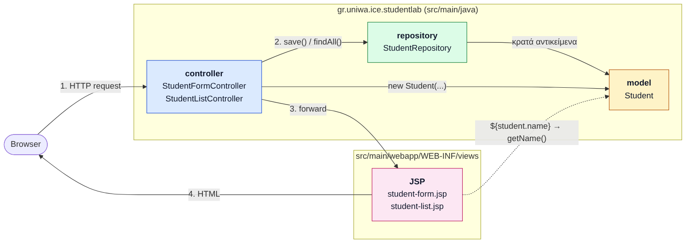
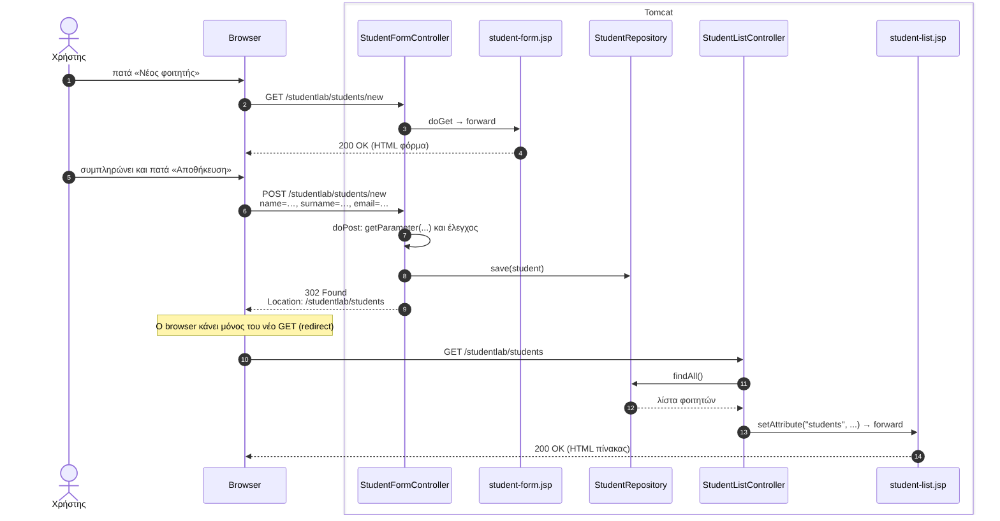

# Lab: Φόρμα φοιτητών με Servlets και JSP στο NetBeans

Οδηγός εργαστηρίου, βήμα‑βήμα. Φτιάχνουμε στο **NetBeans** μια μικρή web εφαρμογή που:

- καταχωρεί φοιτητές (όνομα, επώνυμο, email) με μια **HTML φόρμα**,
- τους κρατάει σε μια απλή **λίστα στη μνήμη** (repository),
- τους εμφανίζει σε μια **σελίδα με πίνακα**.

Όλα τα requests περνούν από **controllers** (Servlets). Οι JSP σελίδες είναι απλές, χωρίς CSS, και μόνο
εμφανίζουν δεδομένα. Ο κώδικας είναι σε έτοιμα blocks για copy‑paste.

> Περισσότερες εξηγήσεις για όσα κάνουμε εδώ θα βρείτε στο [README.md](README.md) (Maven, Servlets), στο
> [Servers.md](Servers.md) (Tomcat) και στο [Forms.md](Forms.md) (φόρμες, JSP, forward/redirect).

## Περιεχόμενα

- [0. Τι θα φτιάξουμε](#0-τι-θα-φτιάξουμε)
- [1. Προετοιμασία: Tomcat στο NetBeans](#1-προετοιμασία-tomcat-στο-netbeans)
- [2. Δημιουργία Maven project: Web Application](#2-δημιουργία-maven-project-web-application)
- [3. Το pom.xml](#3-το-pomxml)
- [4. Καθάρισμα αρχείων που δεν χρειαζόμαστε](#4-καθάρισμα-αρχείων-που-δεν-χρειαζόμαστε)
- [5. Το web.xml](#5-το-webxml)
- [7. Η οντότητα Student](#7-η-οντότητα-student)
- [8. Το StudentRepository](#8-το-studentrepository)
- [9. Η φόρμα καταχώρησης: controller και JSP](#9-η-φόρμα-καταχώρησης-controller-και-jsp)
- [10. Η λίστα φοιτητών: controller και JSP](#10-η-λίστα-φοιτητών-controller-και-jsp)
- [11. Η αρχική σελίδα](#11-η-αρχική-σελίδα)
- [12. Εκτέλεση και δοκιμή](#12-εκτέλεση-και-δοκιμή)
- [13. Πώς δουλεύουν όλα μαζί](#13-πώς-δουλεύουν-όλα-μαζί)
- [14. Επέκταση: validation στην κλάση Student](#14-επέκταση-validation-στην-κλάση-student)
- [15. Επέκταση: επεξεργασία και διαγραφή φοιτητή](#15-επέκταση-επεξεργασία-και-διαγραφή-φοιτητή)
- [16. Επέκταση: σχέση 1 προς πολλά (Student → Grade)](#16-επέκταση-σχέση-1-προς-πολλά-student--grade)
- [Συχνά προβλήματα](#συχνά-προβλήματα)
- [Ασκήσεις](#ασκήσεις)

---

## 0. Τι θα φτιάξουμε

| URL                        | Μέθοδος | Controller                 | Τι κάνει                                         |
|----------------------------|---------|----------------------------|--------------------------------------------------|
| `/studentlab/`             | GET     | (στατική σελίδα)           | αρχική σελίδα με δύο links                       |
| `/studentlab/students/new` | GET     | `StudentFormController`    | εμφανίζει την κενή φόρμα                         |
| `/studentlab/students/new` | POST    | `StudentFormController`    | διαβάζει τη φόρμα και αποθηκεύει τον φοιτητή     |
| `/studentlab/students`     | GET     | `StudentListController`    | εμφανίζει όλους τους φοιτητές                    |

Η δομή του project στο τέλος:

```
studentlab/
├── pom.xml
└── src/main/
    ├── java/gr/uniwa/ice/studentlab/
    │   ├── model/
    │   │   └── Student.java                    η οντότητα (name, surname, email)
    │   ├── repository/
    │   │   └── StudentRepository.java          η λίστα με τους φοιτητές
    │   └── controller/
    │       ├── StudentFormController.java      /students/new  (GET: φόρμα, POST: αποθήκευση)
    │       └── StudentListController.java      /students      (GET: λίστα)
    └── webapp/
        ├── index.html                          αρχική σελίδα
        └── WEB-INF/
            ├── web.xml
            └── views/
                ├── student-form.jsp            η φόρμα
                └── student-list.jsp            ο πίνακας με τους φοιτητές
```

Οι JSP σελίδες μπαίνουν μέσα στο **`WEB-INF/`**. Ό,τι βρίσκεται εκεί **δεν** ανοίγει απευθείας από τον browser, μόνο
μέσω ενός controller. Έτσι κάθε request περνάει υποχρεωτικά από τον controller.

> Αυτή η οργάνωση λέγεται **MVC** (Model–View–Controller):
> **Model** είναι η `Student` (τα δεδομένα), **View** οι JSP (η εμφάνιση) και **Controller** τα Servlets
> (δέχονται το request, αποφασίζουν τι θα γίνει, και διαλέγουν ποια σελίδα θα εμφανιστεί).

---

## 1. Προετοιμασία: Tomcat στο NetBeans

Χρειάζεστε **JDK 21** (ή νεότερο) και **Apache Tomcat 10.1** ή **11**. Ο Tomcat κατεβαίνει ως zip από το
<https://tomcat.apache.org>. Αποσυμπιέστε τον σε έναν φάκελο, π.χ. `~/opt/apache-tomcat-11.0.x`.

> **Προσοχή:** ο Tomcat **9** δεν κάνει. Χρησιμοποιεί τα παλιά packages `javax.servlet.*`, ενώ εμείς γράφουμε
> `jakarta.servlet.*`.

Δηλώστε τον Tomcat στο NetBeans (μία φορά μόνο):

1. **Tools → Servers → Add Server…**
2. Επιλέξτε **Apache Tomcat or TomEE** → **Next**.
3. **Server Location:** ο φάκελος όπου αποσυμπιέσατε τον Tomcat.
4. **Username / Password:** γράψτε π.χ. `admin` / `admin` και αφήστε τσεκαρισμένο το
   *Create user if it does not exist*. Το NetBeans θα τον προσθέσει στο `conf/tomcat-users.xml` του Tomcat.
5. **Finish**.

Ο Tomcat εμφανίζεται πλέον στην καρτέλα **Services → Servers**.

---

## 2. Δημιουργία Maven project: Web Application

1. **File → New Project…**
2. **Categories:** `Java with Maven` · **Projects:** `Web Application` → **Next**.
3. Συμπληρώστε:

   | Πεδίο            | Τιμή                            |
   |------------------|---------------------------------|
   | Project Name     | `studentlab`                    |
   | Project Location | ένας φάκελος της επιλογής σας   |
   | Group Id         | `gr.uniwa.ice`                  |
   | Version          | `1.0-SNAPSHOT` (όπως είναι)     |
   | Package          | `gr.uniwa.ice.studentlab`       |

   → **Next**.
4. **Server:** ο Tomcat του βήματος 1 · **Jakarta EE Version:** `Jakarta EE 10 Web` (ή όποια έκδοση 10 προτείνει) → **Finish**.

Το NetBeans φτιάχνει το project. Στο παράθυρο **Projects** το βλέπετε έτσι:

```
studentlab
├── Web Pages              ← ο φάκελος src/main/webapp
├── Source Packages        ← ο φάκελος src/main/java
├── Dependencies
└── Project Files
    └── pom.xml
```

> Το **Group Id** μαζί με το **Project Name** (που γίνεται το **Artifact Id**) είναι οι «συντεταγμένες» του project στο
> Maven. Δείτε το [Maven.md](Maven.md#coordinates-gav).

---

## 3. Το pom.xml

Ανοίξτε το **Project Files → pom.xml**, σβήστε **όλο** το περιεχόμενο και επικολλήστε:

**Αρχείο:** `pom.xml`

```xml
<?xml version="1.0" encoding="UTF-8"?>
<project xmlns="http://maven.apache.org/POM/4.0.0"
         xmlns:xsi="http://www.w3.org/2001/XMLSchema-instance"
         xsi:schemaLocation="http://maven.apache.org/POM/4.0.0 https://maven.apache.org/xsd/maven-4.0.0.xsd">
  <modelVersion>4.0.0</modelVersion>

  <groupId>gr.uniwa.ice</groupId>
  <artifactId>studentlab</artifactId>
  <version>1.0-SNAPSHOT</version>
  <packaging>war</packaging>

  <properties>
    <maven.compiler.release>21</maven.compiler.release>
    <project.build.sourceEncoding>UTF-8</project.build.sourceEncoding>
  </properties>

  <dependencies>
    <!-- Servlet API: provided, γιατί το παρέχει ο Tomcat -->
    <dependency>
      <groupId>jakarta.servlet</groupId>
      <artifactId>jakarta.servlet-api</artifactId>
      <version>6.0.0</version>
      <scope>provided</scope>
    </dependency>

    <!-- JSTL: tags για τις JSP σελίδες (<c:forEach>, <c:out>, <c:if>) -->
    <dependency>
      <groupId>jakarta.servlet.jsp.jstl</groupId>
      <artifactId>jakarta.servlet.jsp.jstl-api</artifactId>
      <version>3.0.2</version>
      <exclusions>
        <exclusion>
          <groupId>jakarta.el</groupId>
          <artifactId>jakarta.el-api</artifactId>
        </exclusion>
      </exclusions>
    </dependency>
    <dependency>
      <groupId>org.glassfish.web</groupId>
      <artifactId>jakarta.servlet.jsp.jstl</artifactId>
      <version>3.0.1</version>
    </dependency>
  </dependencies>

  <build>
    <finalName>studentlab</finalName>
    <plugins>
      <plugin>
        <groupId>org.apache.maven.plugins</groupId>
        <artifactId>maven-compiler-plugin</artifactId>
        <version>3.13.0</version>
      </plugin>
      <plugin>
        <groupId>org.apache.maven.plugins</groupId>
        <artifactId>maven-war-plugin</artifactId>
        <version>3.4.0</version>
      </plugin>
    </plugins>
  </build>
</project>
```

Αποθηκεύστε (**Ctrl+S**). Κάντε δεξί κλικ στο project → **Build** (ή **Clean and Build**) και περιμένετε το `BUILD SUCCESS`.
Την πρώτη φορά το Maven κατεβάζει τις βιβλιοθήκες, οπότε θέλει λίγο χρόνο.

**Τι δηλώνουμε εδώ:**

- **`jakarta.servlet-api`** με scope **`provided`**: τα Servlets. Τα χρειαζόμαστε για το compile, αλλά δεν μπαίνουν στο `.war`,
  γιατί τα έχει ήδη ο Tomcat.
- **JSTL** (δύο dependencies, το API και η υλοποίηση): τα tags `<c:forEach>`, `<c:out>`, `<c:if>` που θα χρησιμοποιήσουμε
  στις JSP. Ο Tomcat **δεν** τα έχει, οπότε μπαίνουν στο `.war`.
- **`finalName`**: το αρχείο θα λέγεται `studentlab.war`, άρα η εφαρμογή θα ανοίγει στο `/studentlab`.

---

## 4. Καθάρισμα αρχείων που δεν χρειαζόμαστε

Ανάλογα με την έκδοση, το NetBeans φτιάχνει μερικά αρχεία παραδείγματος. Σβήστε (δεξί κλικ → **Delete**) όσα από αυτά υπάρχουν:

- στο **Source Packages**: το package **`gr.uniwa.ice.studentlab.resources`** (κλάσεις `JakartaRestConfiguration`,
  `JakartaEE10Resource`). Είναι παράδειγμα REST service και, με το νέο `pom.xml`, δεν κάνει πια compile.
- στο **Web Pages → WEB-INF**: το **`beans.xml`**.

**Μην** σβήσετε το `Web Pages → META-INF/context.xml`, αν υπάρχει. Εκεί το NetBeans γράφει το context path (`/studentlab`).

Το `index.html` το κρατάμε. Θα αλλάξουμε το περιεχόμενό του στο βήμα 11.

---

## 5. Το web.xml

Αν **δεν** υπάρχει ήδη `Web Pages → WEB-INF → web.xml`, φτιάξτε το:
δεξί κλικ στο project → **New → Other… → Web → Standard Deployment Descriptor (web.xml)** → **Next** → **Finish**.

Σβήστε το περιεχόμενό του και επικολλήστε:

**Αρχείο:** `src/main/webapp/WEB-INF/web.xml`

```xml
<?xml version="1.0" encoding="UTF-8"?>
<web-app xmlns="https://jakarta.ee/xml/ns/jakartaee"
         xmlns:xsi="http://www.w3.org/2001/XMLSchema-instance"
         xsi:schemaLocation="https://jakarta.ee/xml/ns/jakartaee
                             https://jakarta.ee/xml/ns/jakartaee/web-app_6_0.xsd"
         version="6.0">

  <!-- Τα δεδομένα των φορμών και οι σελίδες σε UTF-8, για να δουλεύουν τα ελληνικά -->
  <request-character-encoding>UTF-8</request-character-encoding>
  <response-character-encoding>UTF-8</response-character-encoding>

  <welcome-file-list>
    <welcome-file>index.html</welcome-file>
  </welcome-file-list>
</web-app>
```

Δεν δηλώνουμε εδώ τα Servlets. Κάθε Servlet δηλώνει το URL του με το annotation **`@WebServlet`**.

---

## 6. Packages και οργάνωση του κώδικα

Πριν γράψουμε κώδικα Java, ας δούμε **πού** θα μπει ο καθένας. Δεν βάζουμε όλες τις κλάσεις σε ένα σημείο, αλλά τις
χωρίζουμε σε **packages** ανάλογα με τη **δουλειά** που κάνουν.

**Τι είναι ένα package;** Ένας φάκελος για κλάσεις Java, που ταυτόχρονα δίνει στις κλάσεις ένα «επώνυμο». Η κλάση
`Student` στο package `gr.uniwa.ice.studentlab.model` έχει πλήρες όνομα `gr.uniwa.ice.studentlab.model.Student`, και
δεν μπερδεύεται με μια άλλη `Student` από κάποια βιβλιοθήκη.

- Το όνομα ξεκινά με ένα **domain ανάποδα** (`uniwa.gr` → `gr.uniwa`) και συνεχίζει με το τμήμα και το project
  (`ice.studentlab`). Έτσι τα ονόματα είναι μοναδικά σε όλο τον κόσμο. Γράφεται πάντα με **μικρά γράμματα**.
- Κάθε τελεία του ονόματος είναι ένας **υποφάκελος**. Το package πρέπει να ταιριάζει με τη θέση του αρχείου και να
  δηλώνεται στην πρώτη γραμμή της κλάσης:

  ```
  src/main/java/gr/uniwa/ice/studentlab/model/Student.java
                └──────────┬──────────┘ └─┬─┘
                           │              └── package gr.uniwa.ice.studentlab.model;
                           └── το βασικό package του project
  ```

- Για να χρησιμοποιήσει μια κλάση μια άλλη από **άλλο** package, χρειάζεται **`import`** (π.χ. ο controller γράφει
  `import gr.uniwa.ice.studentlab.model.Student;`), και η κλάση πρέπει να είναι **`public`**.

**Πώς οργανώνουμε τον κώδικα:** κάθε package έχει **έναν ρόλο**:

| Package / φάκελος | Τι περιέχει | Ποιον «ξέρει» |
|-------------------|-------------|---------------|
| `...studentlab.model` | τις **οντότητες**: κλάσεις με δεδομένα (`Student`) | κανέναν |
| `...studentlab.repository` | την **αποθήκευση** των οντοτήτων (`StudentRepository`) | το `model` |
| `...studentlab.controller` | τα **Servlets**: δέχονται τα requests και αποφασίζουν τι θα γίνει | το `model` και το `repository` |
| `src/main/webapp/WEB-INF/views` | τις **JSP**: φτιάχνουν το HTML (δεν είναι Java, άρα δεν είναι package) | διαβάζουν το `model` |

Στο διάγραμμα, τα βέλη δείχνουν ποιος χρησιμοποιεί ποιον, και οι αριθμοί τη σειρά σε ένα request:



Ο βασικός κανόνας: **οι εξαρτήσεις πάνε προς μία κατεύθυνση**, από τον controller προς το model. Το `model` δεν
κάνει `import` τίποτα από τα άλλα packages, και το `repository` δεν ξέρει τίποτα για Servlets ή HTTP. Έτσι:

- κάθε κλάση έχει **μία δουλειά** και ξέρουμε αμέσως πού να ψάξουμε (λάθος στην εμφάνιση → JSP, λάθος στην
  αποθήκευση → repository),
- μπορούμε να αλλάξουμε ένα κομμάτι χωρίς να πειράξουμε τα άλλα. Όταν η λίστα στη μνήμη γίνει βάση δεδομένων, θα
  αλλάξει μόνο το `repository`.

**Στο NetBeans:** δεξί κλικ στο **Source Packages** (ή σε ένα υπάρχον package) → **New → Java Package…** → γράφουμε
το **πλήρες** όνομα, π.χ. `gr.uniwa.ice.studentlab.model` → **Finish**. Το NetBeans φτιάχνει μόνο του όλους τους
υποφακέλους. Στο παράθυρο **Projects** τα packages φαίνονται ως μία γραμμή με τελείες· στο **Files** φαίνονται οι
πραγματικοί φάκελοι. Αν μετακινήσετε μια κλάση σε άλλο package, κάντε το με **Refactor → Move**, ώστε να αλλάξουν
αυτόματα η γραμμή `package` και τα `import`.

Στις επόμενες ενότητες φτιάχνουμε τα packages με τη σειρά: πρώτα το `model`, μετά το `repository` και τέλος τον
`controller`, δηλαδή από αυτό που δεν εξαρτάται από κανέναν προς αυτό που τα χρησιμοποιεί όλα.

> Σε μεγάλες εφαρμογές, οι κλάσεις συχνά ομαδοποιούνται **ανά λειτουργία** (π.χ. `student/`, `grade/`, καθένα με
> τον δικό του controller, model και repository) αντί για ανά ρόλο. Για ένα μικρό project όπως αυτό, η οργάνωση
> ανά ρόλο είναι η πιο καθαρή.

---

## 7. Η οντότητα Student

Δεξί κλικ στο **Source Packages → `gr.uniwa.ice.studentlab`** → **New → Java Package…** → όνομα
`gr.uniwa.ice.studentlab.model` → **Finish**.
Μετά, δεξί κλικ στο νέο package → **New → Java Class…** → όνομα `Student` → **Finish**.
Σβήστε ό,τι έφτιαξε το NetBeans και επικολλήστε:

**Αρχείο:** `src/main/java/gr/uniwa/ice/studentlab/model/Student.java`

```java
package gr.uniwa.ice.studentlab.model;

public class Student {

    private String name;
    private String surname;
    private String email;

    public Student(String name, String surname, String email) {
        this.name = name;
        this.surname = surname;
        this.email = email;
    }

    public String getName() {
        return name;
    }

    public String getSurname() {
        return surname;
    }

    public String getEmail() {
        return email;
    }
}
```

Μια απλή κλάση με τρία πεδία, έναν constructor και **getters**. Οι getters είναι απαραίτητοι: όταν σε μια JSP γράφουμε
`${student.name}`, στην πραγματικότητα καλείται η `student.getName()`.

---

## 8. Το StudentRepository

Το **repository** είναι η κλάση που «αποθηκεύει» τα δεδομένα. Εδώ τα κρατάμε απλώς σε μια `List` στη μνήμη. Αργότερα, στη
θέση της θα μπει μια βάση δεδομένων, χωρίς να αλλάξουν οι controllers.

Φτιάξτε το package `gr.uniwa.ice.studentlab.repository` και μέσα του την κλάση `StudentRepository`:

**Αρχείο:** `src/main/java/gr/uniwa/ice/studentlab/repository/StudentRepository.java`

```java
package gr.uniwa.ice.studentlab.repository;

import gr.uniwa.ice.studentlab.model.Student;
import java.util.ArrayList;
import java.util.List;

public class StudentRepository {

    // Μία λίστα για όλη την εφαρμογή (static). Χάνεται όταν σταματήσει ο Tomcat.
    private static final List<Student> students = new ArrayList<>();

    // synchronized: πολλά requests μπορεί να έρθουν ταυτόχρονα,
    // οπότε μόνο ένα τη φορά επιτρέπεται να πειράζει τη λίστα.
    public static synchronized void save(Student student) {
        students.add(student);
    }

    public static synchronized List<Student> findAll() {
        return new ArrayList<>(students);   // αντίγραφο, για να μην αλλάζει η λίστα απ' έξω
    }
}
```

> Επειδή η λίστα είναι **στη μνήμη**, οι φοιτητές χάνονται σε κάθε επανεκκίνηση του Tomcat ή νέο deploy.
> Αυτό είναι αναμενόμενο σε αυτό το lab.

---

## 9. Η φόρμα καταχώρησης: controller και JSP

### 9.1 Ο controller

Φτιάξτε το package `gr.uniwa.ice.studentlab.controller` και μέσα του μια **Java Class** (όχι *Servlet*: ο οδηγός
*New → Servlet* του NetBeans βάζει πολύ έτοιμο κώδικα που δεν χρειαζόμαστε) με όνομα `StudentFormController`:

**Αρχείο:** `src/main/java/gr/uniwa/ice/studentlab/controller/StudentFormController.java`

```java
package gr.uniwa.ice.studentlab.controller;

import gr.uniwa.ice.studentlab.model.Student;
import gr.uniwa.ice.studentlab.repository.StudentRepository;
import jakarta.servlet.ServletException;
import jakarta.servlet.annotation.WebServlet;
import jakarta.servlet.http.HttpServlet;
import jakarta.servlet.http.HttpServletRequest;
import jakarta.servlet.http.HttpServletResponse;
import java.io.IOException;

@WebServlet("/students/new")
public class StudentFormController extends HttpServlet {

    // GET /students/new → εμφάνιση της κενής φόρμας
    @Override
    protected void doGet(HttpServletRequest request, HttpServletResponse response)
            throws ServletException, IOException {
        request.getRequestDispatcher("/WEB-INF/views/student-form.jsp").forward(request, response);
    }

    // POST /students/new → ο χρήστης πάτησε «Αποθήκευση»
    @Override
    protected void doPost(HttpServletRequest request, HttpServletResponse response)
            throws ServletException, IOException {

        // 1. Διαβάζουμε τα πεδία της φόρμας (τα ονόματα είναι τα name="..." των <input>)
        String name = request.getParameter("name");
        String surname = request.getParameter("surname");
        String email = request.getParameter("email");

        // 2. Απλός έλεγχος: όλα τα πεδία υποχρεωτικά
        if (isBlank(name) || isBlank(surname) || isBlank(email)) {
            request.setAttribute("error", "Συμπληρώστε όλα τα πεδία.");
            request.getRequestDispatcher("/WEB-INF/views/student-form.jsp").forward(request, response);
            return;
        }

        // 3. Αποθήκευση
        StudentRepository.save(new Student(name.trim(), surname.trim(), email.trim()));

        // 4. Redirect στη λίστα (ο browser κάνει νέο GET στο /students)
        response.sendRedirect(request.getContextPath() + "/students");
    }

    private boolean isBlank(String value) {
        return value == null || value.isBlank();
    }
}
```

Ο ίδιος controller χειρίζεται **δύο** requests στο ίδιο URL:

- **`doGet`**: απλώς κάνει **forward** στη JSP της φόρμας. Το forward γίνεται μέσα στον server: ο browser δεν το καταλαβαίνει
  και το URL μένει `/students/new`.
- **`doPost`**: διαβάζει τα πεδία με **`getParameter`**, τα ελέγχει, αποθηκεύει τον φοιτητή και κάνει **redirect** στη λίστα.
  Αν λείπει κάποιο πεδίο, βάζει ένα μήνυμα λάθους ως **attribute** στο request και ξαναδείχνει τη φόρμα.

#### Η doPost βήμα προς βήμα

Όταν ο χρήστης πατήσει «Αποθήκευση», ο browser στέλνει ένα request σαν αυτό:

```http
POST /studentlab/students/new HTTP/1.1
Content-Type: application/x-www-form-urlencoded

name=%CE%93%CE%B9%CF%8E%CF%81%CE%B3%CE%BF%CF%82&surname=Papadopoulos&email=g%40uniwa.gr
```

Τα δεδομένα της φόρμας είναι στο **σώμα (body)** του request, ως ζευγάρια `όνομα=τιμή` χωρισμένα με `&`. Τα ελληνικά
και τα ειδικά σύμβολα (π.χ. το `@` → `%40`) είναι κωδικοποιημένα. Ο Tomcat βλέπει ότι το URL ταιριάζει με το
`@WebServlet("/students/new")` και ότι η μέθοδος είναι POST, οπότε καλεί τη **`doPost`** του controller.

**Βήμα 1: ανάγνωση των πεδίων**

```java
String name = request.getParameter("name");
```

- Η `getParameter("name")` ψάχνει στο body το ζευγάρι με όνομα `name` και επιστρέφει την τιμή του, ήδη
  αποκωδικοποιημένη (π.χ. `"Γιώργος"`). Το `"name"` πρέπει να είναι **ακριβώς** ίδιο με το `name="name"` του
  `<input>` στη JSP. Αν γράψουμε λάθος όνομα (π.χ. `"Name"`), δεν θα βγει σφάλμα: απλώς θα πάρουμε `null`.
- Η τιμή είναι **πάντα `String`**, ακόμη κι αν ο χρήστης έγραψε αριθμό. Αν χρειαζόμαστε `int`, το μετατρέπουμε εμείς
  (π.χ. `Integer.parseInt(...)`).
- Τρεις περιπτώσεις για το τι επιστρέφει:

  | Τι έστειλε ο browser            | Τι επιστρέφει η `getParameter` |
  |---------------------------------|--------------------------------|
  | `name=Γιώργος`                  | `"Γιώργος"`                    |
  | `name=` (το πεδίο ήταν κενό)    | `""` (κενό string)             |
  | δεν υπάρχει καθόλου `name`      | `null`                         |

  Η τρίτη περίπτωση δεν συμβαίνει από τη δική μας φόρμα, αλλά μπορεί να συμβεί αν κάποιος στείλει POST με άλλο
  εργαλείο (π.χ. `curl`). Ο server **δεν πρέπει ποτέ να εμπιστεύεται** ότι τα δεδομένα ήρθαν από τη φόρμα μας.

**Βήμα 2: έλεγχος (validation)**

```java
if (isBlank(name) || isBlank(surname) || isBlank(email)) {
    request.setAttribute("error", "Συμπληρώστε όλα τα πεδία.");
    request.getRequestDispatcher("/WEB-INF/views/student-form.jsp").forward(request, response);
    return;
}
```

- Η βοηθητική `isBlank` επιστρέφει `true` αν η τιμή είναι `null` **ή** αποτελείται μόνο από κενά
  (η `String.isBlank()` θεωρεί κενό και το `"   "`). Ο έλεγχος `value == null` γράφεται **πρώτος**: αν η τιμή είναι
  `null`, το `||` σταματά εκεί και δεν καλείται ποτέ το `value.isBlank()`, που θα έριχνε `NullPointerException`.
- Αν κάποιο πεδίο λείπει:
  1. **`setAttribute("error", ...)`**: αφήνουμε ένα μήνυμα στο request. Η JSP θα το διαβάσει ως `${error}`.
  2. **`forward`** στη JSP της φόρμας: ο χρήστης βλέπει ξανά τη φόρμα, με το μήνυμα. Εδώ κάνουμε forward και όχι
     redirect, γιατί με redirect το attribute θα χανόταν (νέο request). Επίσης τα parameters του αρχικού POST
     είναι ακόμη διαθέσιμα, γι' αυτό η JSP μπορεί να ξαναγεμίσει τα πεδία με `${param.name}`.
  3. **`return`**: τερματίζει τη `doPost`. Χωρίς αυτό, η εκτέλεση θα συνέχιζε στο βήμα 3 και θα αποθήκευε έναν
     φοιτητή με κενά πεδία, και μετά θα προσπαθούσε να κάνει και redirect σε response που έχει ήδη σταλεί
     (`IllegalStateException`).
- Ο έλεγχος γίνεται **στον server**, παρόλο που θα μπορούσαμε να βάλουμε `required` στα `<input>`. Ο έλεγχος στον
  browser είναι μόνο διευκόλυνση για τον χρήστη: παρακάμπτεται εύκολα, οπότε ο έλεγχος στον server είναι
  υποχρεωτικός.

**Βήμα 3: αποθήκευση**

```java
StudentRepository.save(new Student(name.trim(), surname.trim(), email.trim()));
```

- Εδώ ξέρουμε ήδη ότι κανένα πεδίο δεν είναι `null` ή κενό, οπότε το `trim()` είναι ασφαλές. Το `trim()` κόβει τα
  κενά στην αρχή και στο τέλος, ώστε το `"  Γιώργος "` να αποθηκευτεί ως `"Γιώργος"`.
- Φτιάχνουμε ένα αντικείμενο `Student` και το δίνουμε στο repository. Ο controller **δεν ξέρει** πώς γίνεται η
  αποθήκευση (λίστα στη μνήμη, βάση δεδομένων κ.λπ.). Αυτό είναι δουλειά του repository.

**Βήμα 4: redirect**

```java
response.sendRedirect(request.getContextPath() + "/students");
```

- Η `getContextPath()` επιστρέφει το `/studentlab`, άρα το redirect πηγαίνει στο `/studentlab/students`. Αν γράφαμε
  σκέτο `"/students"`, ο browser θα πήγαινε στο `http://localhost:8080/students`, εκτός της εφαρμογής μας (404).
- Η `sendRedirect` **δεν** εμφανίζει σελίδα. Στέλνει στον browser μια σύντομη απάντηση:

  ```http
  HTTP/1.1 302 Found
  Location: /studentlab/students
  ```

  Ο browser τη διαβάζει και κάνει μόνος του **νέο GET** στο `/studentlab/students`, που το χειρίζεται ο
  `StudentListController`. Γιατί το κάνουμε έτσι (Post/Redirect/Get), εξηγείται στην [ενότητα 13](#13-πώς-δουλεύουν-όλα-μαζί).

**Σύνοψη:** η `doPost` καταλήγει πάντα σε **ένα** από δύο αποτελέσματα:

| Περίπτωση               | Τι κάνει ο controller                | Τι βλέπει ο χρήστης                          |
|-------------------------|--------------------------------------|----------------------------------------------|
| Λείπει κάποιο πεδίο     | `setAttribute` + `forward` + `return`| τη φόρμα ξανά, με μήνυμα και τα πεδία γεμάτα |
| Όλα τα πεδία συμπληρωμένα | `save` + `sendRedirect`            | τη λίστα φοιτητών, με τον νέο φοιτητή        |

### 9.2 Η JSP της φόρμας

Στο **Web Pages → WEB-INF**: δεξί κλικ → **New → Folder…** → όνομα `views` → **Finish**.
Μετά, δεξί κλικ στο `views` → **New → JSP…** → όνομα `student-form` (το `.jsp` το βάζει μόνο του) → **Finish**.
Σβήστε το περιεχόμενο και επικολλήστε:

**Αρχείο:** `src/main/webapp/WEB-INF/views/student-form.jsp`

```jsp
<%@ page contentType="text/html; charset=UTF-8" pageEncoding="UTF-8" %>
<%@ taglib prefix="c" uri="jakarta.tags.core" %>
<!DOCTYPE html>
<html>
<head>
    <meta charset="UTF-8">
    <title>Νέος φοιτητής</title>
</head>
<body>
    <h1>Νέος φοιτητής</h1>

    <c:if test="${not empty error}">
        <p><strong><c:out value="${error}"/></strong></p>
    </c:if>

    <form method="post" action="${pageContext.request.contextPath}/students/new">
        <p>
            <label for="name">Όνομα:</label>
            <input type="text" id="name" name="name" value="<c:out value='${param.name}'/>">
        </p>
        <p>
            <label for="surname">Επώνυμο:</label>
            <input type="text" id="surname" name="surname" value="<c:out value='${param.surname}'/>">
        </p>
        <p>
            <label for="email">Email:</label>
            <input type="email" id="email" name="email" value="<c:out value='${param.email}'/>">
        </p>
        <p>
            <button type="submit">Αποθήκευση</button>
        </p>
    </form>

    <p><a href="${pageContext.request.contextPath}/students">Λίστα φοιτητών</a></p>
</body>
</html>
```

**Τι προσέχουμε:**

- **`method="post"`** και **`action=".../students/new"`**: με το πάτημα του κουμπιού, ο browser στέλνει POST στον
  `StudentFormController`, που θα το χειριστεί η `doPost`.
- Το **`name="..."`** κάθε `<input>` είναι το όνομα που διαβάζει ο controller με `request.getParameter("...")`.
- **`${pageContext.request.contextPath}`** είναι το `/studentlab`. Έτσι τα links δουλεύουν όποιο κι αν είναι το όνομα της εφαρμογής.
- **`${error}`**: το attribute που έβαλε ο controller. Υπάρχει μόνο όταν ο έλεγχος αποτύχει.
- **`${param.name}`**: η τιμή που είχε στείλει ο χρήστης. Αν η φόρμα ξαναεμφανιστεί με λάθος, τα πεδία
  κρατούν ό,τι είχε γράψει.
- **`<c:out>`**: εμφανίζει κείμενο με ασφάλεια (μετατρέπει π.χ. το `<` σε `&lt;`), ώστε ο χρήστης να μην μπορεί να «περάσει»
  δικό του HTML ή JavaScript στη σελίδα.

---

## 10. Η λίστα φοιτητών: controller και JSP

### 10.1 Ο controller

Στο package `gr.uniwa.ice.studentlab.controller`, νέα **Java Class** με όνομα `StudentListController`:

**Αρχείο:** `src/main/java/gr/uniwa/ice/studentlab/controller/StudentListController.java`

```java
package gr.uniwa.ice.studentlab.controller;

import gr.uniwa.ice.studentlab.model.Student;
import gr.uniwa.ice.studentlab.repository.StudentRepository;
import jakarta.servlet.ServletException;
import jakarta.servlet.annotation.WebServlet;
import jakarta.servlet.http.HttpServlet;
import jakarta.servlet.http.HttpServletRequest;
import jakarta.servlet.http.HttpServletResponse;
import java.io.IOException;
import java.util.List;

@WebServlet("/students")
public class StudentListController extends HttpServlet {

    // GET /students → εμφάνιση όλων των φοιτητών
    @Override
    protected void doGet(HttpServletRequest request, HttpServletResponse response)
            throws ServletException, IOException {

        // 1. Παίρνουμε τα δεδομένα από το repository
        List<Student> students = StudentRepository.findAll();

        // 2. Τα «δίνουμε» στη JSP ως attribute του request
        request.setAttribute("students", students);

        // 3. Forward στη JSP, που θα φτιάξει το HTML
        request.getRequestDispatcher("/WEB-INF/views/student-list.jsp").forward(request, response);
    }
}
```

Αυτό είναι το τυπικό σχήμα ενός controller: **παίρνει δεδομένα → τα βάζει στο request → κάνει forward σε μια JSP**.

### 10.2 Η JSP της λίστας

Δεξί κλικ στο `WEB-INF/views` → **New → JSP…** → όνομα `student-list`:

**Αρχείο:** `src/main/webapp/WEB-INF/views/student-list.jsp`

```jsp
<%@ page contentType="text/html; charset=UTF-8" pageEncoding="UTF-8" %>
<%@ taglib prefix="c" uri="jakarta.tags.core" %>
<!DOCTYPE html>
<html>
<head>
    <meta charset="UTF-8">
    <title>Φοιτητές</title>
</head>
<body>
    <h1>Φοιτητές</h1>

    <c:choose>
        <c:when test="${empty students}">
            <p>Δεν υπάρχουν φοιτητές ακόμα.</p>
        </c:when>
        <c:otherwise>
            <table border="1">
                <tr>
                    <th>Όνομα</th>
                    <th>Επώνυμο</th>
                    <th>Email</th>
                </tr>
                <c:forEach var="student" items="${students}">
                    <tr>
                        <td><c:out value="${student.name}"/></td>
                        <td><c:out value="${student.surname}"/></td>
                        <td><c:out value="${student.email}"/></td>
                    </tr>
                </c:forEach>
            </table>
        </c:otherwise>
    </c:choose>

    <p><a href="${pageContext.request.contextPath}/students/new">Νέος φοιτητής</a></p>
</body>
</html>
```

- **`${students}`** είναι το attribute που έβαλε ο `StudentListController`.
- **`<c:forEach>`** γράφει μία γραμμή του πίνακα για κάθε φοιτητή της λίστας. Μέσα στον βρόχο, το `student` είναι ο τρέχων φοιτητής.
- **`${student.name}`** καλεί την `getName()` της `Student`.
- **`<c:choose>` / `<c:when>` / `<c:otherwise>`**: όπως ένα `if … else`. Αν η λίστα είναι άδεια, δείχνει μήνυμα αντί για πίνακα.

---

## 11. Η αρχική σελίδα

Ανοίξτε το **Web Pages → index.html** (αν δεν υπάρχει: δεξί κλικ στο **Web Pages** → **New → HTML…** → `index`),
σβήστε το περιεχόμενο και επικολλήστε:

**Αρχείο:** `src/main/webapp/index.html`

```html
<!DOCTYPE html>
<html>
<head>
    <meta charset="UTF-8">
    <title>Student Lab</title>
</head>
<body>
    <h1>Student Lab</h1>
    <ul>
        <li><a href="students/new">Νέος φοιτητής</a></li>
        <li><a href="students">Λίστα φοιτητών</a></li>
    </ul>
</body>
</html>
```

Είναι στατική σελίδα, χωρίς δεδομένα, οπότε δεν χρειάζεται controller. Τα links είναι **σχετικά** (χωρίς `/` μπροστά), άρα
από το `/studentlab/` οδηγούν στο `/studentlab/students/new` και στο `/studentlab/students`.

---

## 12. Εκτέλεση και δοκιμή

1. Δεξί κλικ στο project → **Run** (ή **F6**).
   Το NetBeans κάνει build, ξεκινά τον Tomcat (αν δεν τρέχει), κάνει deploy την εφαρμογή και ανοίγει τον browser στο
   <http://localhost:8080/studentlab/>.
2. Πατήστε **Νέος φοιτητής**, συμπληρώστε τα πεδία και πατήστε **Αποθήκευση**. Βλέπετε τη λίστα με τον φοιτητή.
3. Προσθέστε άλλον έναν, με ελληνικά. Πρέπει να εμφανίζονται σωστά.
4. Αφήστε ένα πεδίο κενό και πατήστε **Αποθήκευση**. Βλέπετε το μήνυμα «Συμπληρώστε όλα τα πεδία.», ενώ τα υπόλοιπα
   πεδία κρατούν ό,τι γράψατε.
5. Δοκιμάστε να ανοίξετε απευθείας <http://localhost:8080/studentlab/WEB-INF/views/student-list.jsp>.
   Παίρνετε **404**: οι JSP μέσα στο `WEB-INF` είναι προσβάσιμες μόνο μέσω controller.

Τα μηνύματα του Tomcat (και τυχόν σφάλματα) εμφανίζονται στο παράθυρο **Output**, στην καρτέλα του Tomcat.

> **Αλλαγές ενώ τρέχει:** μετά από αλλαγή σε κώδικα Java ή JSP, πατήστε ξανά **Run**. Το NetBeans κάνει νέο deploy
> (και, επειδή η λίστα είναι στη μνήμη, οι φοιτητές που είχατε βάλει χάνονται).

---

## 13. Πώς δουλεύουν όλα μαζί

Τι γίνεται όταν ο χρήστης καταχωρεί έναν φοιτητή:



> Η πηγή του διαγράμματος (Mermaid) είναι στο [images/lab-form-flow.mmd](images/lab-form-flow.mmd).
> Για να ξαναφτιάξετε την εικόνα: `mmdc -i images/lab-form-flow.mmd -o images/lab-form-flow.png -s 2 -b white`.

**Γιατί redirect μετά το POST;** Αν ο controller έκανε απευθείας forward στη λίστα, ο browser θα έμενε στο URL του POST. Ένα
**Refresh (F5)** τότε θα ξανάστελνε τη φόρμα και θα αποθήκευε τον ίδιο φοιτητή δεύτερη φορά. Με το redirect, ο browser
καταλήγει σε ένα απλό GET στο `/students`, που μπορεί να γίνει refresh όσες φορές θέλουμε.
Το σχήμα αυτό λέγεται **Post/Redirect/Get**.

**Forward ή redirect;**

|                    | `forward`                                  | `sendRedirect`                                   |
|--------------------|--------------------------------------------|--------------------------------------------------|
| Πού γίνεται        | μέσα στον server                           | ο browser κάνει **νέο** request                  |
| URL στον browser   | δεν αλλάζει                                | αλλάζει                                          |
| Attributes         | περνάνε στη JSP                            | **χάνονται** (νέο request)                       |
| Πότε το χρησιμοποιούμε | για να εμφανίσουμε μια JSP             | μετά από ένα POST που άλλαξε δεδομένα            |

**Parameter ή attribute;**

- **Parameter** (`getParameter`): ό,τι στέλνει ο **browser** (πεδία φόρμας, `?x=...` στο URL). Πάντα `String`.
- **Attribute** (`setAttribute` / `${...}`): ό,τι βάζει ο **controller** στο request για να το διαβάσει η JSP. Οποιοδήποτε αντικείμενο.

Για περισσότερα, δείτε το [Forms.md](Forms.md#14-σύνοψη-parameters-attributes-forward-redirect).

---

## 14. Επέκταση: validation στην κλάση Student

Μέχρι τώρα ο έλεγχος στον controller ήταν ένας: «όλα τα πεδία υποχρεωτικά», με ένα γενικό μήνυμα. Εδώ τον κάνουμε
λίγο πιο πραγματικό:

- οι **κανόνες** μπαίνουν στην ίδια την `Student` (μέθοδος `validate()`). Έτσι βρίσκονται μαζί με τα δεδομένα
  που ελέγχουν, και όποιος controller φτιάχνει `Student` μπορεί να τους ξαναχρησιμοποιήσει,
- κάθε πεδίο έχει **δικό του μήνυμα λάθους**, που εμφανίζεται δίπλα του στη φόρμα.

Αλλάζουν τρία αρχεία: η `Student`, η `doPost` του `StudentFormController` και η `student-form.jsp`.

### 14.1 Η μέθοδος validate() στη Student

Προσθέστε στην `Student` τα δύο imports και τις δύο μεθόδους (τα υπόλοιπα μένουν ίδια):

**Αρχείο:** `src/main/java/gr/uniwa/ice/studentlab/model/Student.java`

```java
package gr.uniwa.ice.studentlab.model;

import java.util.LinkedHashMap;
import java.util.Map;

public class Student {

    // ... πεδία, constructor και getters όπως πριν ...

    // Επιστρέφει τα λάθη: κλειδί = όνομα πεδίου, τιμή = μήνυμα.
    // Άδειο Map σημαίνει ότι ο φοιτητής είναι έγκυρος.
    public Map<String, String> validate() {
        Map<String, String> errors = new LinkedHashMap<>();

        if (isBlank(name)) {
            errors.put("name", "Το όνομα είναι υποχρεωτικό.");
        } else if (name.length() < 2) {
            errors.put("name", "Το όνομα πρέπει να έχει τουλάχιστον 2 χαρακτήρες.");
        }

        if (isBlank(surname)) {
            errors.put("surname", "Το επώνυμο είναι υποχρεωτικό.");
        }

        if (isBlank(email)) {
            errors.put("email", "Το email είναι υποχρεωτικό.");
        } else if (!email.matches("[^@\\s]+@[^@\\s]+\\.[^@\\s]+")) {
            errors.put("email", "Μη έγκυρο email.");
        }

        return errors;
    }

    private static boolean isBlank(String value) {
        return value == null || value.isBlank();
    }
}
```

- Το **`Map<String, String>`** κρατά ένα μήνυμα για κάθε πεδίο που έχει λάθος. Το **`LinkedHashMap`** κρατά τη σειρά
  με την οποία προστέθηκαν.
- Το **`matches(...)`** ελέγχει το email με ένα απλό regular expression: «κάτι, `@`, κάτι, `.`, κάτι», χωρίς κενά.
  Είναι ενδεικτικός έλεγχος, όχι πλήρης.

### 14.2 Ο controller χρησιμοποιεί τη validate()

Αντικαταστήστε τη `doPost` και την `isBlank` του `StudentFormController` με τα παρακάτω, και προσθέστε το
`import java.util.Map;`:

**Αρχείο:** `src/main/java/gr/uniwa/ice/studentlab/controller/StudentFormController.java`

```java
    // POST /students/new → ο χρήστης πάτησε «Αποθήκευση»
    @Override
    protected void doPost(HttpServletRequest request, HttpServletResponse response)
            throws ServletException, IOException {

        // 1. Διαβάζουμε τα πεδία και φτιάχνουμε το αντικείμενο
        Student student = new Student(
                trim(request.getParameter("name")),
                trim(request.getParameter("surname")),
                trim(request.getParameter("email")));

        // 2. Ο έλεγχος γίνεται από την ίδια τη Student
        Map<String, String> errors = student.validate();
        if (!errors.isEmpty()) {
            request.setAttribute("errors", errors);
            request.getRequestDispatcher("/WEB-INF/views/student-form.jsp").forward(request, response);
            return;
        }

        // 3. Αποθήκευση και redirect στη λίστα
        StudentRepository.save(student);
        response.sendRedirect(request.getContextPath() + "/students");
    }

    // null → "" και κόψιμο κενών στην αρχή/τέλος
    private String trim(String value) {
        return value == null ? "" : value.trim();
    }
```

Ο controller δεν ξέρει πια **ποιοι** είναι οι κανόνες. Ρωτά τη `Student` αν είναι έγκυρη και, αν δεν είναι,
δίνει τα λάθη στη JSP ως attribute `errors`.

### 14.3 Η φόρμα δείχνει το λάθος κάθε πεδίου

Στη `student-form.jsp` αντικαταστήστε το `<c:if test="${not empty error}">…</c:if>` και τη `<form>` με:

**Αρχείο:** `src/main/webapp/WEB-INF/views/student-form.jsp`

```jsp
    <c:if test="${not empty errors}">
        <p><strong>Διορθώστε τα λάθη της φόρμας.</strong></p>
    </c:if>

    <form method="post" action="${pageContext.request.contextPath}/students/new">
        <p>
            <label for="name">Όνομα:</label>
            <input type="text" id="name" name="name" value="<c:out value='${param.name}'/>">
            <strong><c:out value="${errors.name}"/></strong>
        </p>
        <p>
            <label for="surname">Επώνυμο:</label>
            <input type="text" id="surname" name="surname" value="<c:out value='${param.surname}'/>">
            <strong><c:out value="${errors.surname}"/></strong>
        </p>
        <p>
            <label for="email">Email:</label>
            <input type="email" id="email" name="email" value="<c:out value='${param.email}'/>">
            <strong><c:out value="${errors.email}"/></strong>
        </p>
        <p>
            <button type="submit">Αποθήκευση</button>
        </p>
    </form>
```

- **`${errors.name}`**: όταν το `errors` είναι `Map`, η EL καλεί την `errors.get("name")`. Αν το πεδίο δεν έχει λάθος,
  η τιμή είναι κενή και το `<c:out>` δεν γράφει τίποτα.
- Την πρώτη φορά που ανοίγει η φόρμα (GET) δεν υπάρχει καθόλου `errors`, οπότε δεν εμφανίζεται κανένα μήνυμα.

### 14.4 Δοκιμή και έλεγχος στον browser

Πατήστε **Run** και δοκιμάστε:

1. Όνομα `Α` (ένας χαρακτήρας): εμφανίζεται «Το όνομα πρέπει να έχει τουλάχιστον 2 χαρακτήρες.» δίπλα στο πεδίο.
2. Όλα τα πεδία κενά: εμφανίζεται ένα μήνυμα δίπλα σε κάθε πεδίο.
3. Email `abc`: ο **browser** σταματά την υποβολή με δικό του μήνυμα, πριν φτάσει το request στον Tomcat.
   Αυτό γίνεται επειδή το πεδίο είναι `type="email"`.

Για να δείτε και τον έλεγχο του **server** στο email, προσθέστε προσωρινά το **`novalidate`** στη φόρμα
(`<form method="post" novalidate action="...">`). Ο browser δεν ελέγχει πια τίποτα, και το μήνυμα «Μη έγκυρο email.»
έρχεται από τη `validate()`.

> **Γιατί δύο έλεγχοι;** Ο έλεγχος στον browser (`type="email"`, `required`, …) είναι μόνο **ευκολία** για τον
> χρήστη: παρακάμπτεται εύκολα (με `novalidate`, με τα DevTools ή με `curl`). Ο έλεγχος στον **server** είναι
> υποχρεωτικός, γιατί μόνο σε αυτόν μπορούμε να βασιστούμε.

> **Στην πράξη:** σε μεγαλύτερες εφαρμογές οι κανόνες γράφονται συνήθως με annotations πάνω στα πεδία
> (`@NotBlank`, `@Size(min = 2)`, `@Email`), με το **Jakarta Bean Validation** (υλοποίηση: Hibernate Validator).
> Ο Tomcat δεν το περιέχει, οπότε χρειάζεται επιπλέον dependency. Η ιδέα πάντως είναι η ίδια με τη `validate()`
> που γράψαμε εδώ: οι κανόνες ζουν στην κλάση και ο controller απλώς ρωτά αν το αντικείμενο είναι έγκυρο.

---

## 15. Επέκταση: επεξεργασία και διαγραφή φοιτητή

> Το βήμα αυτό προϋποθέτει το βήμα 14: η φόρμα επεξεργασίας χρησιμοποιεί την ίδια `validate()` και δείχνει τα λάθη
> με τον ίδιο τρόπο.

Κάθε γραμμή του πίνακα της λίστας αποκτά δύο επιλογές: **Επεξεργασία** και **Διαγραφή**.

| URL                              | Μέθοδος | Controller                | Τι κάνει                                                 |
|----------------------------------|---------|---------------------------|----------------------------------------------------------|
| `/studentlab/students/edit?id=3` | GET     | `StudentEditController`   | φόρμα γεμάτη με τα τρέχοντα στοιχεία του φοιτητή         |
| `/studentlab/students/edit`      | POST    | `StudentEditController`   | αποθηκεύει τις αλλαγές και κάνει redirect στη λίστα      |
| `/studentlab/students/delete`    | POST    | `StudentDeleteController` | διαγράφει τον φοιτητή και κάνει redirect στη λίστα       |

Νέα και αλλαγμένα αρχεία:

```
src/main/
├── java/gr/uniwa/ice/studentlab/
│   ├── model/
│   │   └── Student.java                    + πεδίο id
│   ├── repository/
│   │   └── StudentRepository.java          + id σε κάθε φοιτητή, findById, update, deleteById
│   └── controller/
│       ├── StudentEditController.java      ΝΕΟ   /students/edit
│       └── StudentDeleteController.java    ΝΕΟ   /students/delete
└── webapp/WEB-INF/views/
    ├── student-list.jsp                    + στήλη «Ενέργειες»
    └── student-edit.jsp                    ΝΕΟ
```

### 15.1 Ένα id για κάθε φοιτητή

Όταν ο χρήστης πατά «Διαγραφή» σε μια γραμμή, ο server πρέπει να ξέρει **ποιον** φοιτητή εννοεί. Χρειαζόμαστε λοιπόν
ένα μοναδικό **αναγνωριστικό** (id) για κάθε φοιτητή. Προσθέστε στη `Student` το πεδίο και τις δύο μεθόδους
(τα υπόλοιπα μένουν ίδια):

**Αρχείο:** `src/main/java/gr/uniwa/ice/studentlab/model/Student.java`

```java
    private int id;

    public int getId() {
        return id;
    }

    public void setId(int id) {
        this.id = id;
    }
```

Το id **δεν** το δίνει ο χρήστης. Το δίνει το repository τη στιγμή της αποθήκευσης (όπως θα έκανε αργότερα μια βάση
δεδομένων με ένα auto‑increment πεδίο). Αντικαταστήστε το `StudentRepository` με:

**Αρχείο:** `src/main/java/gr/uniwa/ice/studentlab/repository/StudentRepository.java`

```java
package gr.uniwa.ice.studentlab.repository;

import gr.uniwa.ice.studentlab.model.Student;
import java.util.ArrayList;
import java.util.List;

public class StudentRepository {

    private static final List<Student> students = new ArrayList<>();
    private static int nextId = 1;   // το id του επόμενου φοιτητή

    public static synchronized void save(Student student) {
        student.setId(nextId++);
        students.add(student);
    }

    public static synchronized List<Student> findAll() {
        return new ArrayList<>(students);
    }

    // Επιστρέφει τον φοιτητή με αυτό το id, ή null αν δεν υπάρχει
    public static synchronized Student findById(int id) {
        for (Student student : students) {
            if (student.getId() == id) {
                return student;
            }
        }
        return null;
    }

    // Αντικαθιστά τον φοιτητή που έχει το ίδιο id. Επιστρέφει false αν δεν βρέθηκε.
    public static synchronized boolean update(Student student) {
        for (int i = 0; i < students.size(); i++) {
            if (students.get(i).getId() == student.getId()) {
                students.set(i, student);
                return true;
            }
        }
        return false;
    }

    // Σβήνει τον φοιτητή με αυτό το id. Επιστρέφει false αν δεν βρέθηκε.
    public static synchronized boolean deleteById(int id) {
        return students.removeIf(student -> student.getId() == id);
    }
}
```

- Η **`update`** ψάχνει τη θέση του φοιτητή με το ίδιο id και βάζει στη θέση του το νέο αντικείμενο (`set(i, ...)`).
- Η **`deleteById`** χρησιμοποιεί τη **`removeIf`**, που σβήνει από τη λίστα όσα στοιχεία ικανοποιούν τη συνθήκη.
  Το `student -> student.getId() == id` είναι ένα **lambda**: μια μικρή συνάρτηση που, για κάθε `student`, επιστρέφει
  `true` αν πρέπει να σβηστεί. Η `removeIf` επιστρέφει `true` αν έσβησε κάτι.
- Το `nextId` μόνο αυξάνεται. Αν σβηστεί ο φοιτητής με id `2`, το `2` **δεν** ξαναδίνεται σε άλλον.

> **Γιατί όχι η θέση στη λίστα;** Θα μπορούσαμε να στέλνουμε τη θέση του φοιτητή (0, 1, 2, …) αντί για id. Όμως μετά
> από μια διαγραφή οι θέσεις μετακινούνται: αυτός που ήταν στη θέση 2 πάει στη θέση 1. Αν δύο χρήστες έχουν ανοιχτή
> τη λίστα, ο ένας μπορεί να σβήσει λάθος φοιτητή. Το id μένει ίδιο για όλη τη ζωή του φοιτητή.

### 15.2 Οι επιλογές στον πίνακα της λίστας

Στη `student-list.jsp`, αντικαταστήστε το `<table>…</table>` με:

**Αρχείο:** `src/main/webapp/WEB-INF/views/student-list.jsp`

```jsp
            <table border="1">
                <tr>
                    <th>Όνομα</th>
                    <th>Επώνυμο</th>
                    <th>Email</th>
                    <th>Ενέργειες</th>
                </tr>
                <c:forEach var="student" items="${students}">
                    <tr>
                        <td><c:out value="${student.name}"/></td>
                        <td><c:out value="${student.surname}"/></td>
                        <td><c:out value="${student.email}"/></td>
                        <td>
                            <a href="${pageContext.request.contextPath}/students/edit?id=${student.id}">Επεξεργασία</a>
                            <form method="post" action="${pageContext.request.contextPath}/students/delete"
                                  style="display: inline"
                                  onsubmit="return confirm('Να διαγραφεί ο φοιτητής;');">
                                <input type="hidden" name="id" value="${student.id}">
                                <button type="submit">Διαγραφή</button>
                            </form>
                        </td>
                    </tr>
                </c:forEach>
            </table>
```

- Η **Επεξεργασία** είναι ένα απλό link: ανοίγει μια σελίδα (GET) και δεν αλλάζει τίποτα. Κάθε γραμμή δίνει άλλο
  `?id=...`, γιατί το `${student.id}` καλεί την `getId()` του τρέχοντος φοιτητή.
- Η **Διαγραφή** είναι μια μικρή **φόρμα με POST**, με ένα κρυφό πεδίο `id` και ένα κουμπί. Το `style="display: inline"`
  απλώς κρατά το κουμπί στην ίδια γραμμή με το link (μια `<form>` αλλιώς ξεκινά σε νέα γραμμή).
- Το **`onsubmit="return confirm(...)"`** δείχνει ένα παράθυρο επιβεβαίωσης. Αν ο χρήστης πατήσει «Άκυρο», το
  `confirm` επιστρέφει `false` και η φόρμα δεν στέλνεται. Είναι μόνο ευκολία στον browser, όπως το `required`.

> **Γιατί η διαγραφή δεν είναι link (GET);** Ένα GET πρέπει μόνο να **διαβάζει**, ποτέ να αλλάζει δεδομένα.
> Ένα link `/students/delete?id=3` θα το ακολουθούσε ο browser σε κάθε refresh ή «Πίσω», θα μπορούσε να το ανοίξει
> ένα πρόγραμμα που προφορτώνει σελίδες ή ένα crawler, και κάποιος θα μπορούσε να το βάλει σε ένα ``
> σε άλλη σελίδα. Οτιδήποτε αλλάζει δεδομένα (αποθήκευση, αλλαγή, διαγραφή) γίνεται με **POST**, και μετά
> ακολουθεί redirect (Post/Redirect/Get).

### 15.3 Ο controller της επεξεργασίας

Στο package `gr.uniwa.ice.studentlab.controller`, νέα κλάση `StudentEditController`:

**Αρχείο:** `src/main/java/gr/uniwa/ice/studentlab/controller/StudentEditController.java`

```java
package gr.uniwa.ice.studentlab.controller;

import gr.uniwa.ice.studentlab.model.Student;
import gr.uniwa.ice.studentlab.repository.StudentRepository;
import jakarta.servlet.ServletException;
import jakarta.servlet.annotation.WebServlet;
import jakarta.servlet.http.HttpServlet;
import jakarta.servlet.http.HttpServletRequest;
import jakarta.servlet.http.HttpServletResponse;
import java.io.IOException;
import java.util.Map;

@WebServlet("/students/edit")
public class StudentEditController extends HttpServlet {

    // GET /students/edit?id=3 → η φόρμα, γεμάτη με τα τρέχοντα στοιχεία
    @Override
    protected void doGet(HttpServletRequest request, HttpServletResponse response)
            throws ServletException, IOException {

        Student student = findStudent(request);
        if (student == null) {
            response.sendError(HttpServletResponse.SC_NOT_FOUND, "Δεν βρέθηκε ο φοιτητής.");
            return;
        }
        request.setAttribute("student", student);
        request.getRequestDispatcher("/WEB-INF/views/student-edit.jsp").forward(request, response);
    }

    // POST /students/edit → ο χρήστης πάτησε «Αποθήκευση αλλαγών»
    @Override
    protected void doPost(HttpServletRequest request, HttpServletResponse response)
            throws ServletException, IOException {

        Student existing = findStudent(request);
        if (existing == null) {
            response.sendError(HttpServletResponse.SC_NOT_FOUND, "Δεν βρέθηκε ο φοιτητής.");
            return;
        }

        // 1. Νέο αντικείμενο με τις τιμές της φόρμας και το ίδιο id
        Student student = new Student(
                trim(request.getParameter("name")),
                trim(request.getParameter("surname")),
                trim(request.getParameter("email")));
        student.setId(existing.getId());

        // 2. Έλεγχος, όπως στο βήμα 14
        Map<String, String> errors = student.validate();
        if (!errors.isEmpty()) {
            request.setAttribute("errors", errors);
            request.setAttribute("student", student);   // ό,τι έγραψε ο χρήστης, για να μη χαθεί
            request.getRequestDispatcher("/WEB-INF/views/student-edit.jsp").forward(request, response);
            return;
        }

        // 3. Αντικατάσταση και redirect στη λίστα (Post/Redirect/Get)
        StudentRepository.update(student);
        response.sendRedirect(request.getContextPath() + "/students");
    }

    // Διαβάζει το id (από το ?id=... ή από το κρυφό πεδίο της φόρμας) και βρίσκει τον φοιτητή
    private Student findStudent(HttpServletRequest request) {
        Integer id = parseIntOrNull(request.getParameter("id"));
        return id == null ? null : StudentRepository.findById(id);
    }

    // "3" → 3, ενώ null, "" ή "abc" → null
    private Integer parseIntOrNull(String value) {
        if (value == null) {
            return null;
        }
        try {
            return Integer.parseInt(value.trim());
        } catch (NumberFormatException e) {
            return null;
        }
    }

    private String trim(String value) {
        return value == null ? "" : value.trim();
    }
}
```

**Τι προσέχουμε:**

- Το **`id`** έρχεται πάντα ως parameter, άρα ως `String`. Στο GET έρχεται από το URL (`?id=3`) και στο POST από το
  κρυφό πεδίο της φόρμας. Η `getParameter("id")` διαβάζει και τα δύο με τον ίδιο τρόπο. Το μετατρέπουμε σε αριθμό
  με **`Integer.parseInt`**, και αν ο χρήστης γράψει `?id=abc`, πιάνουμε την `NumberFormatException`.
- Αν ο φοιτητής δεν υπάρχει (π.χ. τον έσβησε κάποιος άλλος στο μεταξύ), απαντάμε με **404** (`response.sendError`).
- Στο POST **δεν** αλλάζουμε τον φοιτητή που είναι αποθηκευμένος. Φτιάχνουμε **νέο** αντικείμενο και το περνάμε
  στο repository μόνο αν είναι έγκυρο. Η λίστα του repository κρατά τα ίδια τα αντικείμενα, οπότε αν αλλάζαμε
  απευθείας τον `existing` και ο έλεγχος αποτύγχανε, τα λάθος στοιχεία θα είχαν ήδη «περάσει» στη λίστα.
- Και στις δύο περιπτώσεις που δείχνουμε τη φόρμα βάζουμε ένα attribute **`student`**: στο GET τον αποθηκευμένο φοιτητή,
  στο POST με λάθη ό,τι έγραψε ο χρήστης. Έτσι η JSP διαβάζει πάντα από το ίδιο σημείο.

> **Γιατί η `Student` δεν έχει setters (εκτός από τη `setId`);**
>
> - **Δεν τους χρειάζεται κανείς.** Οι τιμές μπαίνουν μία φορά, στον constructor, και η JSP μόνο **διαβάζει**
>   (`${student.name}` → `getName()`).
> - **Προστατεύουν τα αποθηκευμένα δεδομένα.** Η `findById()` επιστρέφει το **ίδιο** αντικείμενο που κρατά το
>   repository (και η `findAll()` αντίγραφο της λίστας, όχι των φοιτητών). Αν υπήρχε `setName`, ένας controller θα
>   μπορούσε να γράψει `StudentRepository.findById(3).setName("")` και να αλλάξει τον αποθηκευμένο φοιτητή χωρίς
>   `validate()` και χωρίς `update()`. Χωρίς setters αυτό δεν κάνει καν compile: ο μόνος τρόπος να αλλάξει
>   ένας φοιτητής είναι αυτός που είδαμε εδώ: νέο αντικείμενο → έλεγχος → `StudentRepository.update(...)`.
> - **Η `setId` είναι εξαίρεση**, γιατί το id δεν το ξέρουμε τη στιγμή του `new Student(...)`. Το δίνει το
>   repository στη `save`. Είναι συμβιβασμός: ως `public`, θεωρητικά επιτρέπει σε οποιονδήποτε να αλλάξει το id.
>
> Setters θα χρειαστούν όταν μπουν frameworks που φτιάχνουν μόνα τους τα αντικείμενα (π.χ. JPA/Hibernate για
> βάση δεδομένων, Jackson για JSON). Αυτά συνήθως θέλουν κενό constructor και setters (το λεγόμενο **JavaBean**).

### 15.4 Η JSP της επεξεργασίας

Δεξί κλικ στο `WEB-INF/views` → **New → JSP…** → όνομα `student-edit`:

**Αρχείο:** `src/main/webapp/WEB-INF/views/student-edit.jsp`

```jsp
<%@ page contentType="text/html; charset=UTF-8" pageEncoding="UTF-8" %>
<%@ taglib prefix="c" uri="jakarta.tags.core" %>
<!DOCTYPE html>
<html>
<head>
    <meta charset="UTF-8">
    <title>Επεξεργασία φοιτητή</title>
</head>
<body>
    <h1>Επεξεργασία φοιτητή</h1>

    <c:if test="${not empty errors}">
        <p><strong>Διορθώστε τα λάθη της φόρμας.</strong></p>
    </c:if>

    <form method="post" action="${pageContext.request.contextPath}/students/edit">
        <input type="hidden" name="id" value="${student.id}">
        <p>
            <label for="name">Όνομα:</label>
            <input type="text" id="name" name="name" value="<c:out value='${student.name}'/>">
            <strong><c:out value="${errors.name}"/></strong>
        </p>
        <p>
            <label for="surname">Επώνυμο:</label>
            <input type="text" id="surname" name="surname" value="<c:out value='${student.surname}'/>">
            <strong><c:out value="${errors.surname}"/></strong>
        </p>
        <p>
            <label for="email">Email:</label>
            <input type="email" id="email" name="email" value="<c:out value='${student.email}'/>">
            <strong><c:out value="${errors.email}"/></strong>
        </p>
        <p>
            <button type="submit">Αποθήκευση αλλαγών</button>
        </p>
    </form>

    <p><a href="${pageContext.request.contextPath}/students">Άκυρο, πίσω στη λίστα</a></p>
</body>
</html>
```

- Μοιάζει με τη `student-form.jsp`, με δύο διαφορές:
  1. τα πεδία παίρνουν τιμή από το **`${student.name}`** και όχι από το `${param.name}`. Την πρώτη φορά (GET) δεν
     υπάρχουν parameters φόρμας, μόνο ο φοιτητής που έβαλε ο controller.
  2. υπάρχει το **κρυφό πεδίο `id`**, ώστε η `doPost` να ξέρει ποιον φοιτητή αλλάζουμε.
- Το «Άκυρο» είναι απλό link στη λίστα: δεν στέλνει τη φόρμα, οπότε δεν αλλάζει τίποτα.

### 15.5 Ο controller της διαγραφής

Στο package `gr.uniwa.ice.studentlab.controller`, νέα κλάση `StudentDeleteController`:

**Αρχείο:** `src/main/java/gr/uniwa/ice/studentlab/controller/StudentDeleteController.java`

```java
package gr.uniwa.ice.studentlab.controller;

import gr.uniwa.ice.studentlab.repository.StudentRepository;
import jakarta.servlet.ServletException;
import jakarta.servlet.annotation.WebServlet;
import jakarta.servlet.http.HttpServlet;
import jakarta.servlet.http.HttpServletRequest;
import jakarta.servlet.http.HttpServletResponse;
import java.io.IOException;

@WebServlet("/students/delete")
public class StudentDeleteController extends HttpServlet {

    // POST /students/delete → διαγραφή του φοιτητή με το id της φόρμας
    @Override
    protected void doPost(HttpServletRequest request, HttpServletResponse response)
            throws ServletException, IOException {

        Integer id = parseIntOrNull(request.getParameter("id"));
        if (id == null || !StudentRepository.deleteById(id)) {
            response.sendError(HttpServletResponse.SC_NOT_FOUND, "Δεν βρέθηκε ο φοιτητής.");
            return;
        }
        response.sendRedirect(request.getContextPath() + "/students");
    }

    private Integer parseIntOrNull(String value) {
        if (value == null) {
            return null;
        }
        try {
            return Integer.parseInt(value.trim());
        } catch (NumberFormatException e) {
            return null;
        }
    }
}
```

- Ο controller έχει **μόνο `doPost`**. Αν κάποιος ανοίξει το `/students/delete` από τον browser (GET), η `doGet` που
  κληρονομεί από την `HttpServlet` απαντά μόνη της με **405 Method Not Allowed**. Δεν χρειάζεται να γράψουμε κάτι.
- Το `id == null || !StudentRepository.deleteById(id)` χρησιμοποιεί το ίδιο κόλπο με την `isBlank`: αν το `id` είναι
  `null`, το `||` σταματά εκεί και η `deleteById` δεν καλείται.
- Δεν υπάρχει JSP διαγραφής. Μετά τη διαγραφή, το redirect μάς γυρίζει στη λίστα, όπου ο φοιτητής δεν υπάρχει πια.

### 15.6 Δοκιμή

Πατήστε **Run** (οι φοιτητές της μνήμης χάνονται, οπότε προσθέστε ξανά τρεις) και δοκιμάστε:

1. Κάθε γραμμή του πίνακα έχει πλέον «Επεξεργασία» και «Διαγραφή».
2. Πατήστε **Επεξεργασία** στον δεύτερο φοιτητή. Το URL γίνεται `/studentlab/students/edit?id=2` και τα πεδία είναι
   γεμάτα. Αλλάξτε το email και πατήστε **Αποθήκευση αλλαγών**: η λίστα δείχνει το νέο email.
3. Ξανά **Επεξεργασία**, σβήστε το όνομα και πατήστε αποθήκευση. Εμφανίζεται το λάθος δίπλα στο πεδίο και τα άλλα πεδία
   κρατούν ό,τι γράψατε. Πατήστε **Άκυρο**: στη λίστα ο φοιτητής είναι όπως ήταν.
4. Πατήστε **Διαγραφή**. Στο παράθυρο επιβεβαίωσης πατήστε πρώτα «Άκυρο» (δεν γίνεται τίποτα) και μετά «OK»
   (ο φοιτητής φεύγει από τη λίστα).
5. Προσθέστε νέο φοιτητή και ανοίξτε την επεξεργασία του: παίρνει το **επόμενο** id (π.χ. `4`), όχι αυτό που
   ελευθερώθηκε.
6. Ανοίξτε με το χέρι <http://localhost:8080/studentlab/students/edit?id=999>: **404**.
   Ανοίξτε <http://localhost:8080/studentlab/students/delete>: **405**, γιατί η διαγραφή δέχεται μόνο POST.

---

## 16. Επέκταση: σχέση 1 προς πολλά (Student → Grade)

> Το βήμα αυτό προϋποθέτει τα βήματα 14 και 15: η νέα κλάση έχει κι αυτή μια `validate()`, η φόρμα δείχνει τα λάθη
> με τον ίδιο τρόπο, και κάθε φοιτητής έχει ήδη το `id` του.

Κάθε φοιτητής έχει **πολλούς βαθμούς** (π.χ. «Προγραμματισμός Διαδικτύου: 8»), ενώ κάθε βαθμός ανήκει σε **έναν**
φοιτητή. Αυτή είναι μια σχέση **1 προς πολλά** (one‑to‑many):

```
Student (1) ───────< Grade (N)
  id                   studentId   ← «δείχνει» στο id του φοιτητή
  name                 course
  surname              grade
  email
```

Κάθε φοιτητής αποκτά δική του σελίδα, με τα στοιχεία του, τους βαθμούς του, τον μέσο όρο και μια φόρμα για νέο βαθμό:

| URL                          | Μέθοδος | Controller                 | Τι κάνει                                                   |
|------------------------------|---------|----------------------------|------------------------------------------------------------|
| `/studentlab/students/view?id=3` | GET | `StudentDetailsController` | στοιχεία φοιτητή, οι βαθμοί του, μέσος όρος, φόρμα βαθμού |
| `/studentlab/students/view`  | POST    | `StudentDetailsController` | αποθηκεύει τον βαθμό και κάνει redirect στη σελίδα του φοιτητή |

Νέα και αλλαγμένα αρχεία:

```
src/main/
├── java/gr/uniwa/ice/studentlab/
│   ├── model/
│   │   └── Grade.java                      ΝΕΟ
│   ├── repository/
│   │   └── GradeRepository.java            ΝΕΟ
│   └── controller/
│       └── StudentDetailsController.java   ΝΕΟ   /students/view
└── webapp/WEB-INF/views/
    ├── student-list.jsp                    το επώνυμο γίνεται link
    └── student-details.jsp                 ΝΕΟ
```

### 16.1 Το id του φοιτητή

Για να «δείξει» ένας βαθμός σε έναν φοιτητή, ο φοιτητής χρειάζεται ένα μοναδικό **αναγνωριστικό** (id). Το έχουμε
ήδη από το [βήμα 15.1](#151-ένα-id-για-κάθε-φοιτητή): η `Student` έχει `getId()` και το `StudentRepository` έχει
`findById`. Εδώ δεν αλλάζει τίποτα σε αυτά.

### 16.2 Η οντότητα Grade

Στο package `gr.uniwa.ice.studentlab.model`, νέα κλάση `Grade`:

**Αρχείο:** `src/main/java/gr/uniwa/ice/studentlab/model/Grade.java`

```java
package gr.uniwa.ice.studentlab.model;

import java.util.LinkedHashMap;
import java.util.Map;

public class Grade {

    private int studentId;     // σε ποιον φοιτητή ανήκει ο βαθμός
    private String course;
    private Integer grade;     // Integer και όχι int: null σημαίνει «δεν δόθηκε αριθμός»

    public Grade(int studentId, String course, Integer grade) {
        this.studentId = studentId;
        this.course = course;
        this.grade = grade;
    }

    public int getStudentId() {
        return studentId;
    }

    public String getCourse() {
        return course;
    }

    public Integer getGrade() {
        return grade;
    }

    public Map<String, String> validate() {
        Map<String, String> errors = new LinkedHashMap<>();

        if (course == null || course.isBlank()) {
            errors.put("course", "Το μάθημα είναι υποχρεωτικό.");
        }

        if (grade == null) {
            errors.put("grade", "Ο βαθμός πρέπει να είναι ακέραιος αριθμός.");
        } else if (grade < 0 || grade > 10) {
            errors.put("grade", "Ο βαθμός πρέπει να είναι από 0 έως 10.");
        }

        return errors;
    }
}
```

Η `Grade` **δεν** κρατά ολόκληρο το αντικείμενο `Student`, μόνο το **`studentId`**. Αυτό είναι ακριβώς ένα
**foreign key**: όταν αργότερα τα δεδομένα πάνε σε βάση, ο πίνακας `grade` θα έχει μια στήλη `student_id` που
δείχνει στο `id` του πίνακα `student`.

> Μια άλλη λύση θα ήταν μια `List<Grade>` μέσα στη `Student`. Δουλεύει κι αυτή, αλλά εδώ κρατάμε κάθε οντότητα
> στο δικό της repository, όπως θα είναι και στη βάση.

### 16.3 Το GradeRepository

Στο package `gr.uniwa.ice.studentlab.repository`, νέα κλάση `GradeRepository`:

**Αρχείο:** `src/main/java/gr/uniwa/ice/studentlab/repository/GradeRepository.java`

```java
package gr.uniwa.ice.studentlab.repository;

import gr.uniwa.ice.studentlab.model.Grade;
import java.util.ArrayList;
import java.util.List;

public class GradeRepository {

    private static final List<Grade> grades = new ArrayList<>();

    public static synchronized void save(Grade grade) {
        grades.add(grade);
    }

    // Όλοι οι βαθμοί ενός φοιτητή: η πλευρά «πολλά» της σχέσης
    public static synchronized List<Grade> findByStudentId(int studentId) {
        List<Grade> result = new ArrayList<>();
        for (Grade grade : grades) {
            if (grade.getStudentId() == studentId) {
                result.add(grade);
            }
        }
        return result;
    }
}
```

Η `findByStudentId` κάνει ό,τι θα έκανε σε SQL ένα `SELECT * FROM grade WHERE student_id = ?`.

### 16.4 Ο controller της σελίδας του φοιτητή

Όπως ο `StudentFormController`, ένας controller χειρίζεται και το GET (εμφάνιση) και το POST (νέος βαθμός) στο ίδιο URL.
Στο package `gr.uniwa.ice.studentlab.controller`, νέα κλάση `StudentDetailsController`:

**Αρχείο:** `src/main/java/gr/uniwa/ice/studentlab/controller/StudentDetailsController.java`

```java
package gr.uniwa.ice.studentlab.controller;

import gr.uniwa.ice.studentlab.model.Grade;
import gr.uniwa.ice.studentlab.model.Student;
import gr.uniwa.ice.studentlab.repository.GradeRepository;
import gr.uniwa.ice.studentlab.repository.StudentRepository;
import jakarta.servlet.ServletException;
import jakarta.servlet.annotation.WebServlet;
import jakarta.servlet.http.HttpServlet;
import jakarta.servlet.http.HttpServletRequest;
import jakarta.servlet.http.HttpServletResponse;
import java.io.IOException;
import java.util.List;
import java.util.Map;

@WebServlet("/students/view")
public class StudentDetailsController extends HttpServlet {

    // GET /students/view?id=3 → η σελίδα του φοιτητή
    @Override
    protected void doGet(HttpServletRequest request, HttpServletResponse response)
            throws ServletException, IOException {

        Student student = findStudent(request);
        if (student == null) {
            response.sendError(HttpServletResponse.SC_NOT_FOUND, "Δεν βρέθηκε ο φοιτητής.");
            return;
        }
        showPage(request, response, student);
    }

    // POST /students/view → νέος βαθμός για τον φοιτητή
    @Override
    protected void doPost(HttpServletRequest request, HttpServletResponse response)
            throws ServletException, IOException {

        Student student = findStudent(request);
        if (student == null) {
            response.sendError(HttpServletResponse.SC_NOT_FOUND, "Δεν βρέθηκε ο φοιτητής.");
            return;
        }

        // 1. Φτιάχνουμε τον βαθμό. Ο φοιτητής δίνεται από το id, όχι από τον χρήστη.
        Grade grade = new Grade(
                student.getId(),
                trim(request.getParameter("course")),
                parseIntOrNull(request.getParameter("grade")));

        // 2. Έλεγχος, όπως στο βήμα 14
        Map<String, String> errors = grade.validate();
        if (!errors.isEmpty()) {
            request.setAttribute("errors", errors);
            showPage(request, response, student);
            return;
        }

        // 3. Αποθήκευση και redirect πίσω στη σελίδα του ίδιου φοιτητή (Post/Redirect/Get)
        GradeRepository.save(grade);
        response.sendRedirect(request.getContextPath() + "/students/view?id=" + student.getId());
    }

    // Βάζει στο request ό,τι χρειάζεται η JSP και κάνει forward
    private void showPage(HttpServletRequest request, HttpServletResponse response, Student student)
            throws ServletException, IOException {

        List<Grade> grades = GradeRepository.findByStudentId(student.getId());

        request.setAttribute("student", student);
        request.setAttribute("grades", grades);
        request.setAttribute("average", average(grades));
        request.getRequestDispatcher("/WEB-INF/views/student-details.jsp").forward(request, response);
    }

    // Διαβάζει το ?id=... και βρίσκει τον φοιτητή (null αν λείπει, δεν είναι αριθμός ή δεν υπάρχει)
    private Student findStudent(HttpServletRequest request) {
        Integer id = parseIntOrNull(request.getParameter("id"));
        return id == null ? null : StudentRepository.findById(id);
    }

    private Double average(List<Grade> grades) {
        if (grades.isEmpty()) {
            return null;
        }
        int sum = 0;
        for (Grade grade : grades) {
            sum += grade.getGrade();
        }
        return (double) sum / grades.size();
    }

    // "8" → 8, ενώ null, "" ή "abc" → null
    private Integer parseIntOrNull(String value) {
        if (value == null) {
            return null;
        }
        try {
            return Integer.parseInt(value.trim());
        } catch (NumberFormatException e) {
            return null;
        }
    }

    private String trim(String value) {
        return value == null ? "" : value.trim();
    }
}
```

**Τι προσέχουμε:**

- Τα parameters είναι **πάντα `String`**. Το `?id=3` έρχεται ως `"3"` και το μετατρέπουμε σε αριθμό με
  **`Integer.parseInt`**. Αν ο χρήστης γράψει `?id=abc`, η `parseInt` πετά `NumberFormatException`, που την πιάνουμε.
- Αν ο φοιτητής δεν βρεθεί, απαντάμε με **404** (`response.sendError`), όπως για μια σελίδα που δεν υπάρχει.
- Το **`showPage`** χρησιμοποιείται και από το GET και από το POST με λάθη, ώστε η σελίδα να έχει πάντα τα ίδια δεδομένα.
- Μετά την επιτυχημένη αποθήκευση, το redirect **κρατά το id** στο URL, για να γυρίσουμε στον ίδιο φοιτητή.

### 16.5 Η JSP της σελίδας του φοιτητή

Δεξί κλικ στο `WEB-INF/views` → **New → JSP…** → όνομα `student-details`:

**Αρχείο:** `src/main/webapp/WEB-INF/views/student-details.jsp`

```jsp
<%@ page contentType="text/html; charset=UTF-8" pageEncoding="UTF-8" %>
<%@ taglib prefix="c" uri="jakarta.tags.core" %>
<%@ taglib prefix="fmt" uri="jakarta.tags.fmt" %>
<!DOCTYPE html>
<html>
<head>
    <meta charset="UTF-8">
    <title>Φοιτητής</title>
</head>
<body>
    <h1><c:out value="${student.name}"/> <c:out value="${student.surname}"/></h1>
    <p>Email: <c:out value="${student.email}"/></p>

    <h2>Βαθμοί</h2>
    <c:choose>
        <c:when test="${empty grades}">
            <p>Δεν υπάρχουν βαθμοί ακόμα.</p>
        </c:when>
        <c:otherwise>
            <table border="1">
                <tr>
                    <th>Μάθημα</th>
                    <th>Βαθμός</th>
                </tr>
                <c:forEach var="g" items="${grades}">
                    <tr>
                        <td><c:out value="${g.course}"/></td>
                        <td><c:out value="${g.grade}"/></td>
                    </tr>
                </c:forEach>
            </table>
            <p>Μέσος όρος: <fmt:formatNumber value="${average}" maxFractionDigits="2"/></p>
        </c:otherwise>
    </c:choose>

    <h2>Νέος βαθμός</h2>
    <form method="post" action="${pageContext.request.contextPath}/students/view">
        <input type="hidden" name="id" value="${student.id}">
        <p>
            <label for="course">Μάθημα:</label>
            <input type="text" id="course" name="course" value="<c:out value='${param.course}'/>">
            <strong><c:out value="${errors.course}"/></strong>
        </p>
        <p>
            <label for="grade">Βαθμός:</label>
            <input type="number" id="grade" name="grade" min="0" max="10" value="<c:out value='${param.grade}'/>">
            <strong><c:out value="${errors.grade}"/></strong>
        </p>
        <p>
            <button type="submit">Προσθήκη</button>
        </p>
    </form>

    <p><a href="${pageContext.request.contextPath}/students">Λίστα φοιτητών</a></p>
</body>
</html>
```

- Το **`<input type="hidden" name="id">`** δεν φαίνεται στη σελίδα, αλλά στέλνεται μαζί με τη φόρμα. Έτσι η `doPost`
  ξέρει σε ποιον φοιτητή ανήκει ο νέος βαθμός.
- Το **`<fmt:formatNumber>`** (βιβλιοθήκη `fmt` της JSTL) δείχνει τον μέσο όρο με το πολύ δύο δεκαδικά, π.χ. `7,33`.
  Δεν χρειάζεται νέα dependency, γιατί είναι μέρος της ίδιας JSTL του βήματος 3.

### 16.6 Link από τη λίστα στη σελίδα του φοιτητή

Στη `student-list.jsp`, αλλάξτε το κελί του επωνύμου ώστε να γίνει link:

**Αρχείο:** `src/main/webapp/WEB-INF/views/student-list.jsp`

```jsp
                        <td>
                            <a href="${pageContext.request.contextPath}/students/view?id=${student.id}">
                                <c:out value="${student.surname}"/>
                            </a>
                        </td>
```

Το **`${student.id}`** καλεί την `getId()`, οπότε κάθε γραμμή οδηγεί σε άλλο URL: `/students/view?id=1`,
`/students/view?id=2`, κ.ο.κ.

### 16.7 Δοκιμή

Πατήστε **Run** (οι φοιτητές της μνήμης χάνονται, οπότε προσθέστε ξανά δύο‑τρεις) και δοκιμάστε:

1. Στη λίστα, πατήστε στο επώνυμο ενός φοιτητή. Το URL γίνεται `/studentlab/students/view?id=1`.
2. Προσθέστε δύο‑τρεις βαθμούς. Εμφανίζονται στον πίνακα και ο μέσος όρος αλλάζει.
3. Ανοίξτε τη σελίδα ενός **άλλου** φοιτητή: δεν έχει βαθμούς. Κάθε βαθμός ανήκει σε έναν μόνο φοιτητή.
4. Αφήστε το μάθημα κενό: εμφανίζεται το λάθος δίπλα στο πεδίο. Για να δείτε το μήνυμα του server για τον βαθμό
   (π.χ. `11`), προσθέστε προσωρινά `novalidate` στη φόρμα, όπως στο βήμα 14.4.
5. Ανοίξτε με το χέρι <http://localhost:8080/studentlab/students/view?id=999> και
   <http://localhost:8080/studentlab/students/view?id=abc>. Και στις δύο περιπτώσεις παίρνετε **404**.

---

## Συχνά προβλήματα

| Πρόβλημα | Αιτία / Λύση |
|----------|--------------|
| Δεν κάνει compile το `JakartaRestConfiguration` / `package jakarta.ws.rs does not exist` | Δεν σβήσατε το package `resources` του NetBeans (βήμα 4). |
| `package jakarta.servlet does not exist` | Δεν αντικαταστήσατε το `pom.xml` (βήμα 3), ή δεν έγινε ακόμα build. Δεξί κλικ στο project → **Clean and Build**. |
| 404 στο `/students` ή στο `/students/new` | Ελέγξτε το URL (πρέπει να έχει το `/studentlab`) και το `@WebServlet(...)` του controller. |
| 404 με μήνυμα για `/WEB-INF/views/....jsp` | Λάθος όνομα ή θέση του αρχείου JSP. Πρέπει να είναι στο `Web Pages/WEB-INF/views/` και το όνομα να ταιριάζει ακριβώς με αυτό του `getRequestDispatcher(...)`. |
| Η σελίδα δείχνει κυριολεκτικά `${student.name}` | Λείπει το `web.xml` ή είναι παλιάς έκδοσης (2.x). Χρησιμοποιήστε αυτό του βήματος 5. |
| `The absolute uri: [jakarta.tags.core] cannot be resolved` | Λείπουν οι dependencies της JSTL από το `pom.xml` (βήμα 3). |
| Τα ελληνικά εμφανίζονται ως `???` ή `Îα...` | Λείπει η πρώτη γραμμή `<%@ page contentType=... charset=UTF-8 ... %>` στη JSP, ή το `<request-character-encoding>` στο `web.xml`. |
| `PropertyNotFoundException: Property [name] not found on type [...Student]` | Λείπει ο getter (`getName()`) στην `Student`, ή έχει άλλο όνομα. Το ίδιο ισχύει για το `id` στο βήμα 15 (`getId()`). |
| (Βήμα 15) Όλα τα links της λίστας οδηγούν στο `?id=0` | Το `StudentRepository` δεν δίνει id: λείπει το `student.setId(nextId++)` στη `save`. |
| Ο Tomcat δεν ξεκινά: `Address already in use` | Τρέχει ήδη άλλος server στη θύρα 8080. Σταματήστε τον ή αλλάξτε θύρα (δείτε [Servers.md, 3.9](Servers.md#39-αλλαγή-θύρας)). |

---

## Ασκήσεις

1. Προσθέστε στη `Student` ένα τέταρτο πεδίο, **`am`** (αριθμός μητρώου). Χρειάζεται αλλαγή στην κλάση, στον controller,
   στη φόρμα και στον πίνακα.
2. (Μετά το βήμα 14 και την άσκηση 1) Προσθέστε στη `validate()` κανόνα για το `am`: υποχρεωτικό και μόνο ψηφία.
   Υπόδειξη: `am.matches("\\d+")`.
3. Εμφανίστε πάνω από τον πίνακα της λίστας το πλήθος των φοιτητών (Υπόδειξη: `${students.size()}`).
4. Μην επιτρέπετε δύο φοιτητές με το ίδιο email. Προσθέστε στο `StudentRepository` μια μέθοδο
   `existsByEmail(String email)` και χρησιμοποιήστε τη στον controller. Αν έχετε κάνει το βήμα 14, βάλτε το λάθος στο
   ίδιο `errors` Map, με κλειδί `"email"`. Ο κανόνας αυτός μπαίνει στον controller και όχι στη `validate()`, γιατί
   χρειάζεται το repository: μια μεμονωμένη `Student` δεν ξέρει ποιοι άλλοι φοιτητές υπάρχουν.
5. Φτιάξτε έναν τρίτο controller, `/students/search?surname=...`, που εμφανίζει μόνο τους φοιτητές με το επώνυμο που δόθηκε.
   Ξαναχρησιμοποιήστε τη `student-list.jsp`.
6. (Μετά το βήμα 16) Προσθέστε στη λίστα φοιτητών μια στήλη «Βαθμοί» με το πλήθος των βαθμών κάθε φοιτητή.
   Υπόδειξη: ο controller μπορεί να φτιάξει ένα `Map<Integer, Integer>` (id φοιτητή → πλήθος) και η JSP να γράψει
   `${gradeCounts[student.id]}`.
7. (Μετά το βήμα 16) Μια δεύτερη σχέση 1 προς πολλά: **Department → Student**. Κάθε φοιτητής ανήκει σε ένα τμήμα.
   - Φτιάξτε τη `Department` (`id`, `name`) και ένα `DepartmentRepository` με 3–4 τμήματα έτοιμα από την αρχή
     (σε ένα `static { ... }` block).
   - Προσθέστε στη `Student` ένα πεδίο `departmentId`.
   - Στη φόρμα του φοιτητή, βάλτε ένα `<select name="departmentId">` που γεμίζει με `<c:forEach>` από τα τμήματα.
     Προσοχή: η `doGet` του `StudentFormController` πρέπει τώρα να βάζει τη λίστα των τμημάτων ως attribute.
   - Στη `validate()` ή στον controller, ελέγξτε ότι το τμήμα που στάλθηκε υπάρχει.
   - Προαιρετικά, φτιάξτε μια σελίδα `/departments/view?id=...` με τους φοιτητές του τμήματος.
8. (Μετά τα βήματα 15 και 16) Όταν διαγράφεται ένας φοιτητής, οι βαθμοί του μένουν στο `GradeRepository` χωρίς
   φοιτητή («ορφανά» δεδομένα). Προσθέστε στο `GradeRepository` μια μέθοδο `deleteByStudentId(int studentId)` και
   καλέστε τη από τον `StudentDeleteController`. Σε μια βάση δεδομένων το ίδιο γίνεται με `ON DELETE CASCADE`.
